

> Status: Draft (AI draft; not human reviewed) | 状态：Draft（AI 草稿，未人工审阅）
# First Steps in the Bible Story | 圣经故事线第一步

> **In Three Sentences | 三句话读懂本篇**
>
> Start with ten short stops that connect the Bible’s story. Read a few passages before trying to solve every question. Use the glossary when a word is new. 
> 先用十个短站点连起圣经故事。先读几段经文，不必一次解决所有问题。遇到陌生词，可以点开词汇表。

> **Language status | 语言状态:** Fully bilingual, paragraph by paragraph.
>
> **语言状态 | Language status：** 全文按段落提供中英双语。

New to the [Bible](../Glossary/README.md#bible)? Start here. The ten stops below show how its books connect. You can read in Chinese, English, or both. You do not need to know every name or idea before you begin. 
第一次读[圣经](../Glossary/README.md#bible)，可以从这里开始。下面十站帮助你看清各卷怎样相连。可以只读中文、只读英文，或两种一起读。开始前不必先弄懂所有人名和概念。

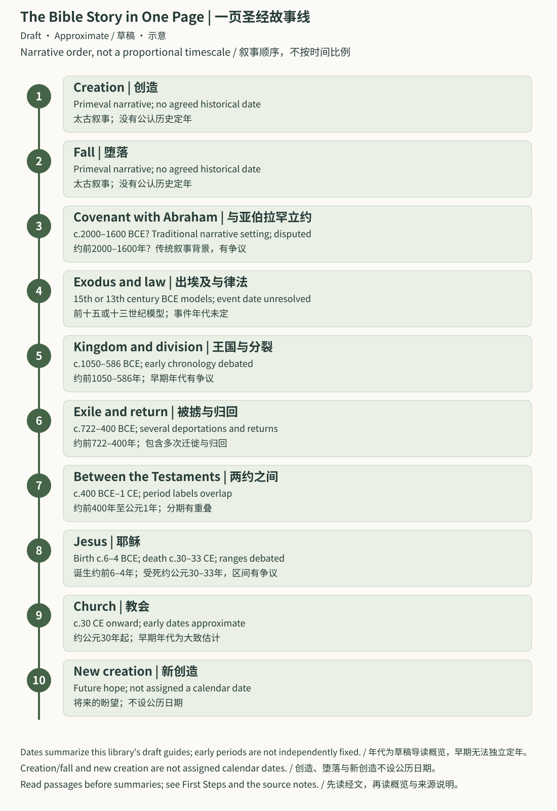

The order is narrative, not a proportional timescale. Early date ranges are debated; creation, fall, and new creation are not assigned calendar dates. / 图按叙事顺序排列，不按时间比例；早期年代区间有争议，创造、堕落与新创造不设公历日期。 [Open full SVG | 打开完整图](../assets/maps/bible-storyline.svg)

## Route Guide | 路线导航

| Route | 跳转 |
| --- | --- |
| [Ten story stops](#ten-stops) | [十站故事线](#ten-stops) |
| [Before you begin](#before-you-begin) | [开始前](#before-you-begin) |
| [30-minute first reading](#thirty-minute-route) | [30 分钟第一次阅读](#thirty-minute-route) |
| [Four-week first steps](#four-week-route) | [前四周](#four-week-route) |
| [Glossary: 51 words](../Glossary/README.md) | [51词词汇表](../Glossary/README.md) |
| [Small glossary](#glossary) | [术语小表](#glossary) |
| [What to read next](#next-steps) | [下一步读什么](#next-steps) |

## Ten Story Stops | 十站故事线

Read this section as a picture guide. The 30-minute and four-week routes below select passages from the same story. Art is a later interpretation, not a historical photograph. / 本节是一份图像导读；后面的30分钟和四周路线从同一故事选取经文。画作是后来的诠释，不是历史照片。

### Creation | 创造

Begin with Genesis 1–2. [Creation](../Glossary/README.md#creation) means that the world is God’s gift, with a purpose and a place for human responsibility. These opening chapters belong to the [Old Testament](../Glossary/README.md#old-testament). 
先读创世记一至二章。[创造](../Glossary/README.md#creation)表达世界是神的礼物，具有目的，人也承担责任。这些开篇故事属于[旧约](../Glossary/README.md#old-testament)。

**Read | 阅读：** Genesis 1–2 / 创世记1–2章。

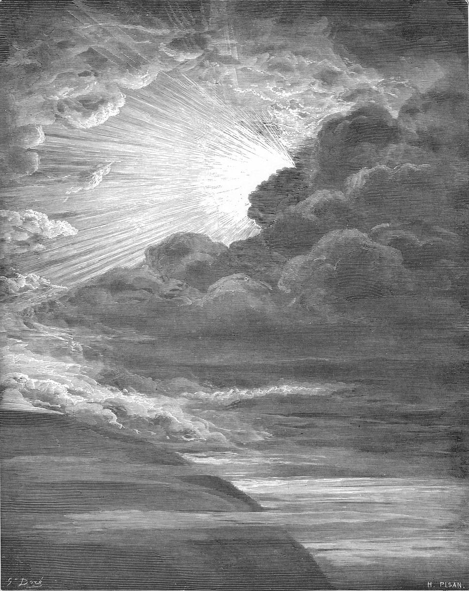

*Gustave Doré — The Creation of Light / 创造之光, 1866. Public-domain art; not historical evidence. / 公有领域画作，不作为历史证据。* [Source and rights | 来源与权利](../CREDITS.md#artworks)

### Fall | 堕落

Genesis 3–4 tells of distrust, harm, and broken relationships. [Fall](../Glossary/README.md#fall) is a short name for this turn; [sin](../Glossary/README.md#sin) names the wrong and its spreading effects. The story does not end with failure. 
创世记三至四章叙述不信任、伤害和关系破裂。“[堕落](../Glossary/README.md#fall)”概括这个转折，“[罪](../Glossary/README.md#sin)”说明过错及其扩散。故事并没有停在失败。

**Read | 阅读：** Genesis 3–4 / 创世记3–4章。

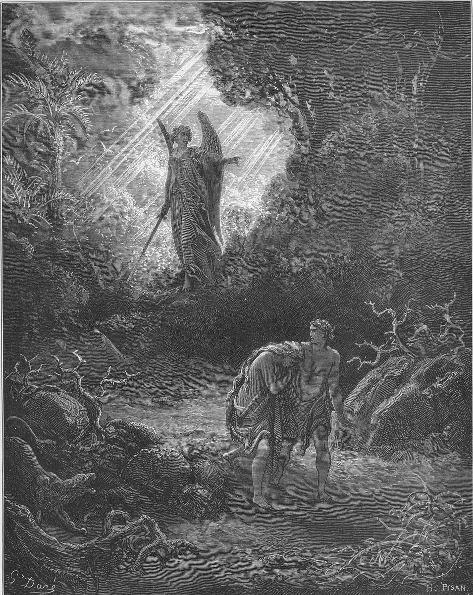

*Gustave Doré — Adam and Eve Are Driven out of Eden / 亚当和夏娃离开伊甸园, 1866. Public-domain art; not historical evidence. / 公有领域画作，不作为历史证据。* [Source and rights | 来源与权利](../CREDITS.md#artworks)

### Covenant with Abraham | 与亚伯拉罕立约

God makes a [covenant](../Glossary/README.md#covenant) with Abraham: a [promise](../Glossary/README.md#promise) with a calling and responsibility. [Blessing](../Glossary/README.md#blessing) is meant to reach other families too. [Faith](../Glossary/README.md#faith) means trusting God and responding, not knowing every answer. 
神与亚伯拉罕立[约](../Glossary/README.md#covenant)：有[应许](../Glossary/README.md#promise)，也有呼召和责任。[祝福](../Glossary/README.md#blessing)还要传向别的家庭。[信心](../Glossary/README.md#faith)是信任神并回应，不必先知道所有答案。

**Read | 阅读：** Genesis 12:1–9; 15:1–6 / 创世记12:1–9；15:1–6。

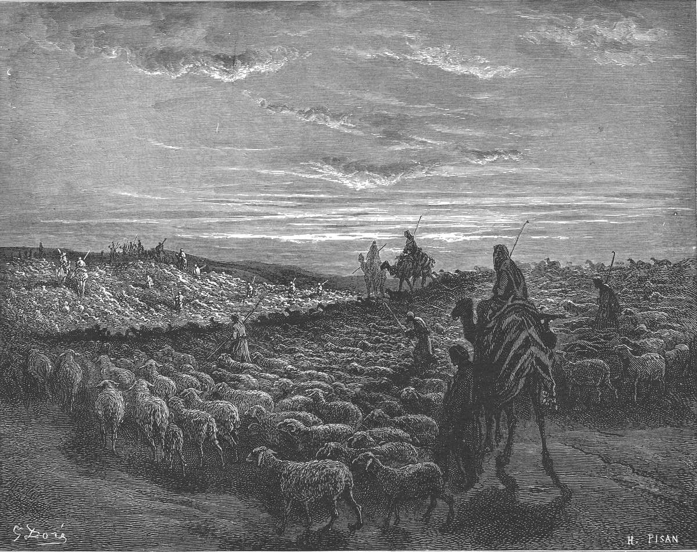

*Gustave Doré — Abraham Goes to the Land of Canaan / 亚伯拉罕前往迦南, 1866. Public-domain art; not historical evidence. / 公有领域画作，不作为历史证据。* [Source and rights | 来源与权利](../CREDITS.md#artworks)

### Exodus and law | 出埃及与律法

[Exodus](../Glossary/README.md#exodus) tells of [Israel](../Glossary/README.md#israel) leaving slavery in Egypt. [Passover](../Glossary/README.md#passover) remembers this rescue, also described with the words [salvation](../Glossary/README.md#salvation) and [redemption](../Glossary/README.md#redemption). [Law](../Glossary/README.md#law) guides the rescued community; [priests](../Glossary/README.md#priest), [sacrifices](../Glossary/README.md#sacrifice), and the [tabernacle](../Glossary/README.md#tabernacle) belong to its worship. 
[出埃及](../Glossary/README.md#exodus)叙述[以色列](../Glossary/README.md#israel)离开埃及的奴役。[逾越节](../Glossary/README.md#passover)记念拯救，“[救恩](../Glossary/README.md#salvation)”和“[救赎](../Glossary/README.md#redemption)”也用来表达拯救。[律法](../Glossary/README.md#law)引导获救的群体；[祭司](../Glossary/README.md#priest)、[献祭](../Glossary/README.md#sacrifice)和[会幕](../Glossary/README.md#tabernacle)属于其敬拜生活。

**Read | 阅读：** Exodus 12–14; 19–20 / 出埃及记12–14；19–20章。

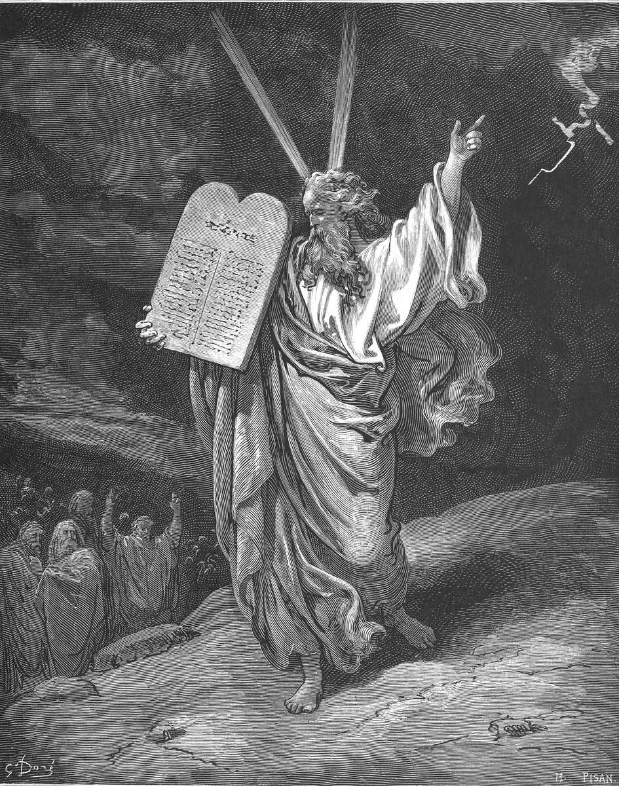

*Gustave Doré — Moses Comes Down from Mount Sinai / 摩西从西乃山下来, 1866. Public-domain art; not historical evidence. / 公有领域画作，不作为历史证据。* [Source and rights | 来源与权利](../CREDITS.md#artworks)

### Kingdom and Division | 王国与分裂

Human kings can fail. The [kingdom of God](../Glossary/README.md#kingdom) means God’s rule. The [temple](../Glossary/README.md#temple) becomes a center of worship. [Prophets](../Glossary/README.md#prophet) call people back to faithfulness; a [psalm](../Glossary/README.md#psalm) can voice praise or grief, and [wisdom](../Glossary/README.md#wisdom) writing explores how to live. After the division, Israel often means the northern kingdom and [Judah](../Glossary/README.md#judah) the southern kingdom. 
人间君王仍会失败。[国度（神的国）](../Glossary/README.md#kingdom)指神掌权。[圣殿](../Glossary/README.md#temple)成为敬拜中心。[先知](../Glossary/README.md#prophet)呼吁人回到忠信；[诗篇](../Glossary/README.md#psalm)可以表达赞美或悲伤，[智慧](../Glossary/README.md#wisdom)文学则探索怎样生活。王国分裂后，以色列常指北国，[犹大](../Glossary/README.md#judah)常指南国。

**Read | 阅读：** 1 Kings 8; 12 / 列王纪上8；12章。

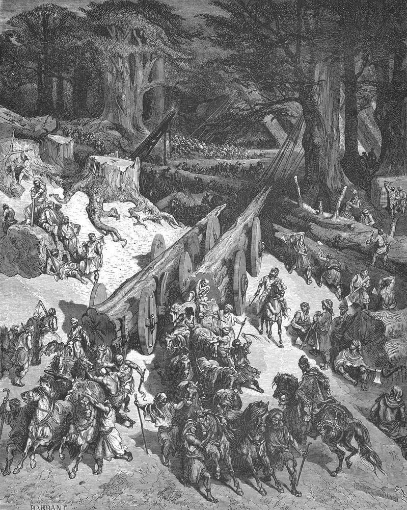

*Gustave Doré — Cedars Are Cut Down for the Jerusalem Temple / 为耶路撒冷圣殿砍伐香柏木, 1866. Public-domain art; not historical evidence. / 公有领域画作，不作为历史证据。* [Source and rights | 来源与权利](../CREDITS.md#artworks)

### Exile and return | 被掳与归回

[Exile](../Glossary/README.md#exile) means people are forced away from home. [Return](../Glossary/README.md#return) describes some of them coming back and rebuilding worship and community. Neither word means that every person had the same experience. 
[被掳](../Glossary/README.md#exile)指人被迫离开故土。[归回](../Glossary/README.md#return)指部分人回来，重建敬拜和群体。这两个词不表示每个人的经历都相同。

**Read | 阅读：** 2 Kings 24–25; Ezra 1–3 / 列王纪下24–25；以斯拉记1–3章。

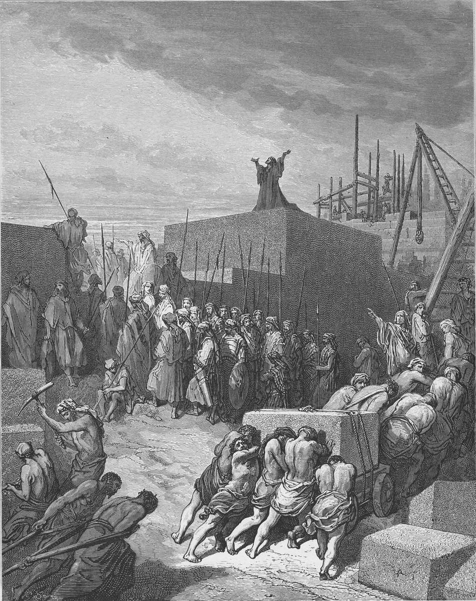

*Gustave Doré — The Rebuilding of the Temple Is Begun / 开始重建圣殿, 1866. Public-domain art; not historical evidence. / 公有领域画作，不作为历史证据。* [Source and rights | 来源与权利](../CREDITS.md#artworks)

### Between the Testaments | 两约之间

The world changes between the return stories and the Gospels. The picture recalls the Maccabean crisis, described in 1 Maccabees; Christian traditions differ over that book’s place in the [canon](../Glossary/README.md#canon). Here it supplies historical reading context, not a new requirement for the reading route. 
从归回故事走向[福音书](../Glossary/README.md#gospels)，时代背景发生变化。画作回顾马加比危机，相关叙述见马加比一书；不同基督教传统对它是否属于[正典](../Glossary/README.md#canon)的认定不同。这里把它用作历史阅读背景，不增加本路线的必读书目。

**Read | 阅读：** Background / 背景：1 Maccabees 2:42–70 / 马加比一书2:42–70。

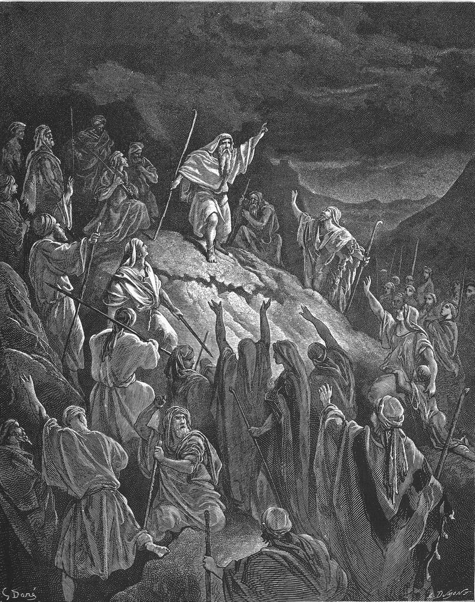

*Gustave Doré — Mattathias Appeals to the Jewish Refugees / 玛他提亚向犹太避难者讲话, 1866. Public-domain art; not historical evidence. / 公有领域画作，不作为历史证据。* [Source and rights | 来源与权利](../CREDITS.md#artworks)

### Jesus | 耶稣

The [New Testament](../Glossary/README.md#new-testament) presents Jesus as [Messiah](../Glossary/README.md#messiah), also called [Christ](../Glossary/README.md#christ). [Gospel](../Glossary/README.md#gospel) means the good news about him; [grace](../Glossary/README.md#grace), [repentance](../Glossary/README.md#repentance), and [forgiveness](../Glossary/README.md#forgiveness) describe God’s gift and people’s response. A [disciple](../Glossary/README.md#disciple) learns to follow Jesus. A [parable](../Glossary/README.md#parable) helps people see. [Resurrection](../Glossary/README.md#resurrection) means being raised from death. 
[新约](../Glossary/README.md#new-testament)称耶稣为[弥赛亚](../Glossary/README.md#messiah)，也称[基督](../Glossary/README.md#christ)。福音是关于祂的好消息；[恩典](../Glossary/README.md#grace)、[悔改](../Glossary/README.md#repentance)和[赦免](../Glossary/README.md#forgiveness)，说明神的赐予与人的回应。[门徒](../Glossary/README.md#disciple)学习跟随耶稣。[比喻](../Glossary/README.md#parable)帮助人理解。[复活](../Glossary/README.md#resurrection)指从死亡中被兴起。

**Read | 阅读：** Mark 1:14–20; 15:33–39; 16:1–8 / 马可福音1:14–20；15:33–39；16:1–8。

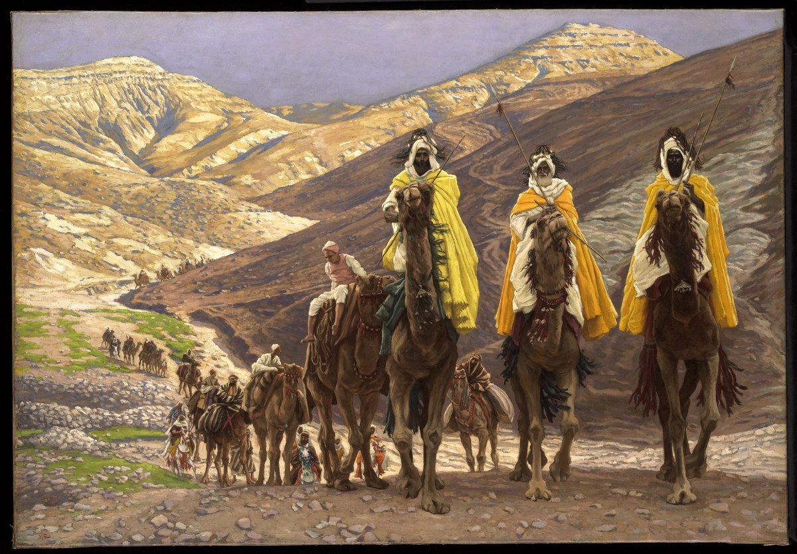

*James Tissot — Journey of the Magi / 博士的旅程, c. 1894. Public-domain art; not historical evidence. / 公有领域画作，不作为历史证据。* [Source and rights | 来源与权利](../CREDITS.md#artworks)

### Church | 教会

At [Pentecost](../Glossary/README.md#pentecost) in Acts 2, the [Holy Spirit](../Glossary/README.md#holy-spirit) equips Jesus’ followers to bear witness. [Apostles](../Glossary/README.md#apostle) are sent with a task, and [church](../Glossary/README.md#church) names the community rather than mainly a building. The good news also reaches [Gentiles](../Glossary/README.md#gentile), people outside the Jewish people. 
使徒行传第二章的[五旬节](../Glossary/README.md#pentecost)，[圣灵](../Glossary/README.md#holy-spirit)帮助耶稣的跟随者作见证。[使徒](../Glossary/README.md#apostle)受差遣承担使命；[教会](../Glossary/README.md#church)主要指群体，而非建筑。好消息也传向[外邦人](../Glossary/README.md#gentile)，就是非犹太人。

**Read | 阅读：** Acts 2; 17:1–9 / 使徒行传2章；17:1–9。

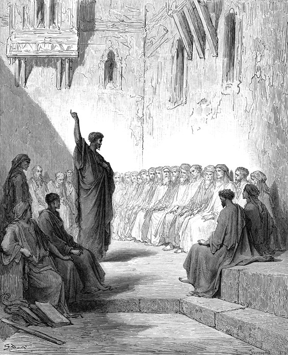

*Gustave Doré — Paul Preaching to the Thessalonians / 保罗向帖撒罗尼迦人传讲, 1866. Public-domain art; not historical evidence. / 公有领域画作，不作为历史证据。* [Source and rights | 来源与权利](../CREDITS.md#artworks)

### New creation | 新创造

[New creation](../Glossary/README.md#new-creation) is the final hope of God renewing the world and living with his people. Revelation uses a vision of a renewed city to express that hope. The passage does not give a calendar date. 
[新创造](../Glossary/README.md#new-creation)表达最终的盼望：神更新世界，与子民同住。启示录用更新城邑的异象表达这份盼望。经文并没有提供公历日期。

**Read | 阅读：** Revelation 21:1–5 / 启示录21:1–5。

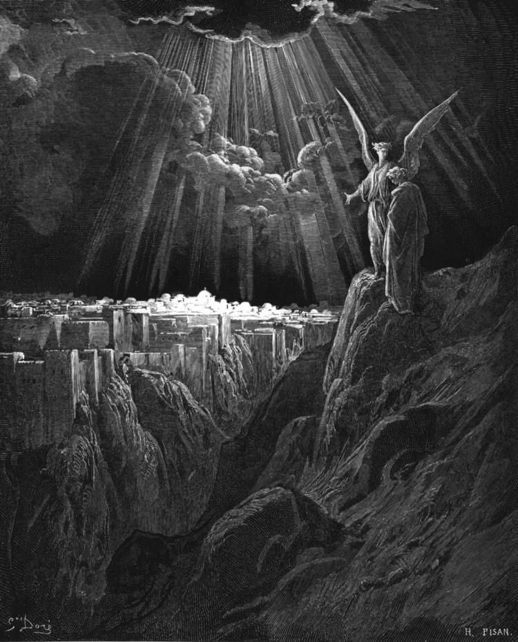

*Gustave Doré — The New Jerusalem / 新耶路撒冷, 1866 series; file-page copy date 1890. Public-domain art; not historical evidence. / 1866年系列；文件页的复制本日期为1890年。公有领域画作，不作为历史证据。* [Source and rights | 来源与权利](../CREDITS.md#artworks)

## Before You Begin | 开始前

Use a Bible you can legally access and understand. If you are learning English, try the Chinese text first, then one English paragraph. Reading in one language is also enough. If you want to try the International Standard Version, use the [ISV Access and ESL Guide](../Bible_Translations/ISV_International_Standard_Version_Access_and_ESL_Guide.md) to reach an authorized copy. 
请使用可以合法取得、自己也读得懂的圣经。学习英语时，可以先读中文，再读一段对应英文。只读一种语言也可以。若想尝试 International Standard Version，可通过 [ISV 获取与 ESL 指南](../Bible_Translations/ISV_International_Standard_Version_Access_and_ESL_Guide.md)进入正版授权渠道。

Read the passage before reading a study note. For each reading session, answer only the one core question provided. Mark unfamiliar words and continue; you can investigate them later. 
每次先读经文，再读辅助说明。每个阅读时段只回答所列的一个核心问题。遇到不懂的词，先作记号并继续读，以后再查也可以。

This page does not ask you to sign in, submit answers, identify your church, or share personal experiences. Keep any notes privately unless you freely choose to discuss them with someone you trust. 
本页不会要求你登录、提交答案、说明所属教会或分享个人经历。笔记可以只保存在自己手中；只有在你自愿并信任对方时，才需要与别人讨论。

## 30-Minute First Reading | 30 分钟第一次阅读

This route samples the Bible's beginning, crisis, center, and ending. The times are suggestions, not deadlines. Read slowly enough to notice what the passage actually says. 
这条路线用几段短经文看圣经的开端、危机、中心与结局。所列时间只是建议，不是限时任务；请放慢速度，留意经文本身说了什么。

### Stop One Creation and Human Calling | 第一站 创造与人的受托

**Read for about 6 minutes | 阅读约 6 分钟：** Genesis 1:1–5, 26–31 | 创世记 1:1–5、26–31。

**One core question | 一个核心问题：** What does this passage say about who God is and what human beings are for? | 这段经文怎样说明神是谁，以及人受造是为了什么？

### Stop Two Distrust and Fracture | 第二站 不信与破裂

**Read for about 6 minutes | 阅读约 6 分钟：** Genesis 3:1–15 | 创世记 3:1–15。

**One core question | 一个核心问题：** Which relationships begin to break when human beings distrust God? | 当人不信任神时，哪些关系开始破裂？

### Stop Three Jesus and the Turning Point | 第三站 耶稣与故事转折

**Read for about 11 minutes | 阅读约 11 分钟：** Mark 1:14–20; 15:33–39; 16:1–8 | 马可福音 1:14–20；15:33–39；16:1–8。

**One core question | 一个核心问题：** What does Mark present Jesus saying and doing that changes the direction of the story? | 马可怎样描写耶稣的宣告与行动，使故事方向发生改变？

### Stop Four New Creation | 第四站 新创造

**Read for about 7 minutes | 阅读约 7 分钟：** Revelation 21:1–5 | 启示录 21:1–5。

**One core question | 一个核心问题：** What is healed or restored at the end of the Bible's story? | 在圣经故事的结尾，哪些破裂得到医治或恢复？

God creates a good world, but human distrust brings sin and death. God keeps his promise through a people and through Jesus. Jesus announces God’s kingdom, dies, and rises. The story looks toward God renewing creation and living with humanity. 
神创造美好世界，人的不信却带来罪与死亡。神通过一个群体，并通过耶稣，继续成就应许。耶稣宣告神的国，受死并复活。故事最后指向神更新世界、与人同住。

## Four-Week First Steps | 前四周

Use two short sessions each week. Each session has one question. The handoff sentence shows how that week leads to the next one; it is a summary to remember, not another assignment. 
每周安排两个短时段，每次只回答一个问题。“接力句”说明这一周怎样通向下一周；它只是帮助记忆的总结，不是额外作业。

### Week One A Good World Becomes Broken | 第一周 美好世界走向破裂

**Session 1 | 第一次：** Read Genesis 1–2 | 阅读创世记 1–2 章。

**One core question | 一个核心问题：** What does God call good, and what responsibility does he give human beings? | 神称什么为美好，又把什么责任交给人？

**Session 2 | 第二次：** Read Genesis 3–4 | 阅读创世记 3–4 章。

**One core question | 一个核心问题：** How does sin spread from a choice into relationships and violence? | 罪怎样从一次选择扩散到人与人的关系和暴力？

**Handoff | 接力句：** Judgment does not end God's purpose; the story now looks for a promise and a family through whom blessing can move outward. | 审判没有终止神的计划；故事开始等候一个应许，以及一个能把祝福带向万族的家庭。

### Week Two Promise Through a Family | 第二周 应许经过一个家庭

**Session 1 | 第一次：** Read Genesis 12:1–9 and 15:1–6 | 阅读创世记 12:1–9、15:1–6。

**One core question | 一个核心问题：** How is God's promise to Abraham meant to reach beyond Abraham himself? | 神给亚伯拉罕的应许，怎样超越亚伯拉罕个人而指向更多人？

**Session 2 | 第二次：** Read Genesis 37:1–11; 45:1–15; 50:15–21 | 阅读创世记 37:1–11；45:1–15；50:15–21。

**One core question | 一个核心问题：** How does God preserve life without calling human evil good? | 神怎样保全生命，同时没有把人的恶说成善？

**Handoff | 接力句：** Abraham's family survives in Egypt, but later becomes enslaved and needs rescue. | 亚伯拉罕的家族在埃及得以存留，后来却沦为奴隶，需要拯救。

### Week Three Rescue and Covenant | 第三周 拯救与立约

**Session 1 | 第一次：** Read Exodus 1:8–2:10 and 3:1–15 | 阅读出埃及记 1:8–2:10、3:1–15。

**One core question | 一个核心问题：** What does God see, hear, remember, and decide to do for an oppressed people? | 面对受压迫的百姓，神看见、听见、记念并决定做什么？

**Session 2 | 第二次：** Read Exodus 12:1–32 and 14:10–31 | 阅读出埃及记 12:1–32、14:10–31。

**One core question | 一个核心问题：** What does Israel learn about rescue before receiving the law at Sinai? | 在西奈领受律法以前，以色列先从拯救认识了什么？

**Handoff | 接力句：** The rescued people repeatedly fail, so the story still needs a faithful representative, a deeper rescue, and renewed hearts. | 蒙拯救的百姓仍不断失败，因此故事还需要一位忠信的代表、更深的拯救和被更新的心。

### Week Four Jesus and New Creation | 第四周 耶稣与新创造

**Session 1 | 第一次：** Read Luke 4:14–21 and Mark 1:14–20 | 阅读路加福音 4:14–21、马可福音 1:14–20。

**One core question | 一个核心问题：** What does Jesus say God's kingdom brings, and how does he call people to respond? | 耶稣说神的国带来什么，又呼召人怎样回应？

**Session 2 | 第二次：** Read Mark 15:33–39; 16:1–8; Revelation 21:1–5 | 阅读马可福音 15:33–39；16:1–8；启示录 21:1–5。

**One core question | 一个核心问题：** How do Jesus' death and resurrection point toward the renewal promised at the Bible's end? | 耶稣的受死与复活，怎样指向圣经结尾所应许的更新？

**Handoff | 接力句：** The New Testament goes on to describe a people formed around the risen Jesus. The Holy Spirit helps them live toward new creation. | 新约接着描写围绕复活耶稣形成的群体。圣灵帮助他们朝向新创造而活。

## Small Glossary | 术语小表

| Term | Plain-English meaning | 中文简释 |
| --- | --- | --- |
| Bible reference / 经文编号 | `Genesis 1:1–5` means the book of Genesis, chapter 1, verses 1 through 5. | “创世记 1:1–5”指创世记第 1 章第 1 至 5 节。 |
| Creation / 创造 | God makes and orders the world; creation also means the world God made. | 神创造并安排世界；“受造界”也指神所造的一切。 |
| Sin / 罪 | Distrust of God expressed in disordered desire, wrongdoing, guilt, and broken relationships. | 人不信神，并在错乱欲望、恶行、罪责与破裂关系中表现出来。 |
| Covenant / 圣约 | A binding relationship established by God, with promises and responsibilities. | 神所设立、带有应许与责任的约定关系。 |
| Kingdom of God / 神国 | God's saving rule becoming visible; it is more than a place or political state. | 神施行拯救的统治显明出来，不只是地点或政治国家。 |
| Messiah or Christ / 弥赛亚或基督 | Titles meaning “anointed one,” used for Jesus as God's promised king and rescuer. | 都有“受膏者”之意，指耶稣是神所应许的君王与拯救者。 |
| Gospel / 福音 | The good news about what God has done through Jesus' life, death, resurrection, and reign. | 神借耶稣的生平、受死、复活与掌权所成就的好消息。 |
| Redemption or salvation / 救赎或救恩 | God's rescue from sin and its power, bringing people into restored life with him and others. | 神救人脱离罪及其权势，使人与神、与人进入被恢复的生命。 |
| New creation / 新创造 | God's final renewal of creation, where evil and death no longer rule and God dwells with his people. | 神最终更新受造界；罪恶与死亡不再掌权，神与祂的子民同住。 |

## What to Read Next | 下一步读什么

- **Continue through the whole storyline | 继续读完整故事线：** Use the [52-Week Bible Storyline Plan](./52周圣经故事线_查经与史料阅读计划.md) when you are ready for all 66 books, historical settings, and carefully limited use of external evidence.
  **进入完整故事线：** 准备好研读全部 66 卷、历史背景与有边界的外部旁证时，使用[《52 周圣经故事线》完整版](./52周圣经故事线_查经与史料阅读计划.md)。
- **Read Jesus closely in John | 用约翰福音细读耶稣：** Read the Gospel itself, then use the [Twelve-Week John Route](../Book_Studies/求真寻道_约翰福音研经问答_使用指南.md#reading-route) to follow its signs, teaching, cross, and resurrection without reproducing the copyrighted workbook.
  **用约翰福音细读耶稣：** 先直接阅读约翰福音，再使用[约翰福音 12 周路线](../Book_Studies/求真寻道_约翰福音研经问答_使用指南.md#reading-route)，追踪记号、教导、十字架与复活；该路线不会复制受版权保护的教材正文。
- **Choose a Christian book guide | 选择基督教书籍导读：** Visit the [Christian Book Studies Library](../Book_Studies/README.md#library-index) for recommendations by question, reading boundaries, and authorized-edition reminders.
  **选择基督教书籍导读：** 前往[基督教书籍研读 Library](../Book_Studies/README.md#library-index)，按问题查看推荐理由、阅读边界与正版提示。

[Back to Project Covenant | 返回项目首页](../README.md) · [Back to the Bible Timeline Research Hub | 返回圣经时间线研究中心](./README.md)
