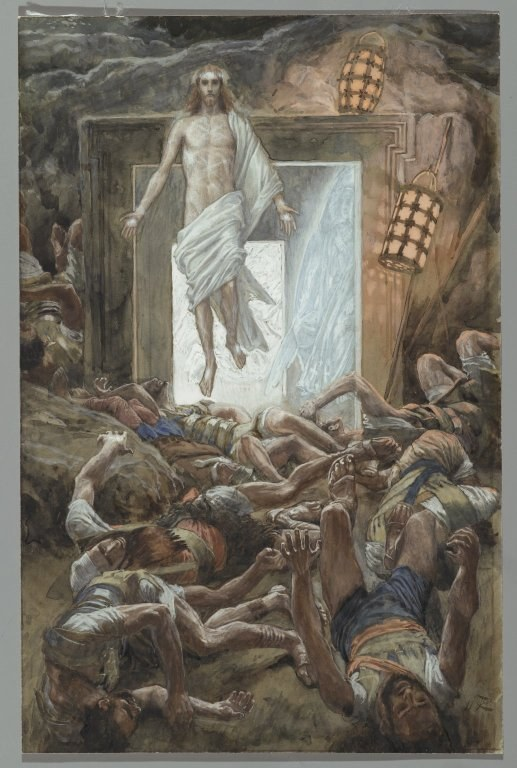

> Status: Draft (AI draft; not human reviewed) | 状态：Draft（AI 草稿，未人工审阅）
# First Steps in the Bible Story | 圣经故事线第一步

> **Language status | 语言状态:** Fully bilingual, paragraph by paragraph.
>
> **语言状态 | Language status：** 全文按段落提供中英双语。

This page is a low-pressure starting point for readers who are new to the Bible, unsure where its many books connect, or reading biblical English as a second language. You do not need to understand every name or doctrine before you begin.

本页为圣经初读者、还看不出各卷怎样相连的读者，以及把英语作为第二语言读经的人，提供一个低门槛入口。开始之前，不需要先弄懂所有人名或教义。

## Route Guide | 路线导航

| Route | 跳转 |
| --- | --- |
| [Before you begin](#before-you-begin) | [开始前](#before-you-begin) |
| [30-minute first reading](#thirty-minute-route) | [30 分钟第一次阅读](#thirty-minute-route) |
| [Four-week first steps](#four-week-route) | [前四周](#four-week-route) |
| [Small glossary](#glossary) | [术语小表](#glossary) |
| [What to read next](#next-steps) | [下一步读什么](#next-steps) |

## Before You Begin | 开始前

Use a Bible you can legally access and understand. Reading the Chinese text first and then one English paragraph is a useful ESL pattern, but reading in one language is enough for this route. If you want to try the International Standard Version, use the [ISV Access and ESL Guide](../Bible_Translations/ISV_International_Standard_Version_Access_and_ESL_Guide.md) to reach an authorized copy.

请使用自己可以合法取得并且读得懂的圣经。对 ESL 读者，先读中文、再读同一段英文，是一种实用方法；但完成本路线并不要求同时读两种语言。若想尝试 International Standard Version，可通过 [ISV 获取与 ESL 指南](../Bible_Translations/ISV_International_Standard_Version_Access_and_ESL_Guide.md)进入正版授权渠道。

Read the passage before reading a study note. For each reading session, answer only the one core question provided. Mark unfamiliar words and continue; you can investigate them later.

每次先读经文，再读辅助说明。每个阅读时段只回答所列的一个核心问题。遇到不懂的词，先作记号并继续读，以后再查也可以。

This page does not ask you to sign in, submit answers, identify your church, or share personal experiences. Keep any notes privately unless you freely choose to discuss them with someone you trust.

本页不会要求你登录、提交答案、说明所属教会或分享个人经历。笔记可以只保存在自己手中；只有在你自愿并信任对方时，才需要与别人讨论。

## 30-Minute First Reading | 30 分钟第一次阅读

This route samples the Bible's beginning, crisis, center, and ending. The times are suggestions, not deadlines. Read slowly enough to notice what the passage actually says.

这条路线用几段短经文看圣经的开端、危机、中心与结局。所列时间只是建议，不是限时任务；请放慢速度，留意经文本身说了什么。

### Stop One Creation and Human Calling | 第一站 创造与人的受托

**Read for about 6 minutes | 阅读约 6 分钟：** Genesis 1:1–5, 26–31 | 创世记 1:1–5、26–31。

**One core question | 一个核心问题：** What does this passage say about who God is and what human beings are for? | 这段经文怎样说明神是谁，以及人受造是为了什么？

### Stop Two Distrust and Fracture | 第二站 不信与破裂

**Read for about 6 minutes | 阅读约 6 分钟：** Genesis 3:1–15 | 创世记 3:1–15。

**One core question | 一个核心问题：** Which relationships begin to break when human beings distrust God? | 当人不信任神时，哪些关系开始破裂？

### Stop Three Jesus and the Turning Point | 第三站 耶稣与故事转折

**Read for about 11 minutes | 阅读约 11 分钟：** Mark 1:14–20; 15:33–39; 16:1–8 | 马可福音 1:14–20；15:33–39；16:1–8。

**One core question | 一个核心问题：** What does Mark present Jesus saying and doing that changes the direction of the story? | 马可怎样描写耶稣的宣告与行动，使故事方向发生改变？

### Stop Four New Creation | 第四站 新创造

**Read for about 7 minutes | 阅读约 7 分钟：** Revelation 21:1–5 | 启示录 21:1–5。

**One core question | 一个核心问题：** What is healed or restored at the end of the Bible's story? | 在圣经故事的结尾，哪些破裂得到医治或恢复？

The simplest storyline is: God creates a good world; human distrust brings sin and death; God carries forward a promise; Jesus announces God's kingdom, dies, and rises; the story ends with God renewing creation and dwelling with humanity.

最简故事线是：神创造美好世界；人的不信带来罪与死亡；神继续推动应许；耶稣宣告神国、受死并复活；故事以神更新受造界、与人同住结束。

## Four-Week First Steps | 前四周

Use two short sessions each week. Each session has one question. The handoff sentence shows how that week leads to the next one; it is a summary to remember, not another assignment.

每周安排两个短时段，每次只回答一个问题。“接力句”说明这一周怎样通向下一周；它只是帮助记忆的总结，不是额外作业。

### Week One A Good World Becomes Broken | 第一周 美好世界走向破裂

*Gustave Doré, 1866 — The Creation of Light / 创造之光. Public domain; artistic interpretation, not historical evidence. / 公有领域画作，属于艺术诠释，不是历史证据。* [Source and rights | 来源与权利](../CREDITS.md#artworks)

**Session 1 | 第一次：** Read Genesis 1–2 | 阅读创世记 1–2 章。

**One core question | 一个核心问题：** What does God call good, and what responsibility does he give human beings? | 神称什么为美好，又把什么责任交给人？

**Session 2 | 第二次：** Read Genesis 3–4 | 阅读创世记 3–4 章。

**One core question | 一个核心问题：** How does sin spread from a choice into relationships and violence? | 罪怎样从一次选择扩散到人与人的关系和暴力？

**Handoff | 接力句：** Judgment does not end God's purpose; the story now looks for a promise and a family through whom blessing can move outward. | 审判没有终止神的计划；故事开始等候一个应许，以及一个能把祝福带向万族的家庭。

### Week Two Promise Through a Family | 第二周 应许经过一个家庭

**Session 1 | 第一次：** Read Genesis 12:1–9 and 15:1–6 | 阅读创世记 12:1–9、15:1–6。

**One core question | 一个核心问题：** How is God's promise to Abraham meant to reach beyond Abraham himself? | 神给亚伯拉罕的应许，怎样超越亚伯拉罕个人而指向更多人？

**Session 2 | 第二次：** Read Genesis 37:1–11; 45:1–15; 50:15–21 | 阅读创世记 37:1–11；45:1–15；50:15–21。

**One core question | 一个核心问题：** How does God preserve life without calling human evil good? | 神怎样保全生命，同时没有把人的恶说成善？

**Handoff | 接力句：** Abraham's family survives in Egypt, but later becomes enslaved and needs rescue. | 亚伯拉罕的家族在埃及得以存留，后来却沦为奴隶，需要拯救。

### Week Three Rescue and Covenant | 第三周 拯救与立约

*Gustave Doré, 1866 — Moses Comes Down from Mount Sinai / 摩西从西乃山下来. Public domain; artistic interpretation, not historical evidence. / 公有领域画作，属于艺术诠释，不是历史证据。* [Source and rights | 来源与权利](../CREDITS.md#artworks)

**Session 1 | 第一次：** Read Exodus 1:8–2:10 and 3:1–15 | 阅读出埃及记 1:8–2:10、3:1–15。

**One core question | 一个核心问题：** What does God see, hear, remember, and decide to do for an oppressed people? | 面对受压迫的百姓，神看见、听见、记念并决定做什么？

**Session 2 | 第二次：** Read Exodus 12:1–32 and 14:10–31 | 阅读出埃及记 12:1–32、14:10–31。

**One core question | 一个核心问题：** What does Israel learn about rescue before receiving the law at Sinai? | 在西奈领受律法以前，以色列先从拯救认识了什么？

**Handoff | 接力句：** The rescued people repeatedly fail, so the story still needs a faithful representative, a deeper rescue, and renewed hearts. | 蒙拯救的百姓仍不断失败，因此故事还需要一位忠信的代表、更深的拯救和被更新的心。

### Week Four Jesus and New Creation | 第四周 耶稣与新创造

*James Tissot, 1886–1894 — The Resurrection / 复活. Public domain; artistic interpretation, not historical evidence. / 公有领域画作，属于艺术诠释，不是历史证据。* [Source and rights | 来源与权利](../CREDITS.md#artworks)

**Session 1 | 第一次：** Read Luke 4:14–21 and Mark 1:14–20 | 阅读路加福音 4:14–21、马可福音 1:14–20。

**One core question | 一个核心问题：** What does Jesus say God's kingdom brings, and how does he call people to respond? | 耶稣说神的国带来什么，又呼召人怎样回应？

**Session 2 | 第二次：** Read Mark 15:33–39; 16:1–8; Revelation 21:1–5 | 阅读马可福音 15:33–39；16:1–8；启示录 21:1–5。

**One core question | 一个核心问题：** How do Jesus' death and resurrection point toward the renewal promised at the Bible's end? | 耶稣的受死与复活，怎样指向圣经结尾所应许的更新？

**Handoff | 接力句：** The rest of the New Testament explains how the risen Jesus forms a Spirit-filled people who live toward God's completed new creation. | 新约其余部分继续说明，复活的耶稣怎样借圣灵建立一群子民，使他们朝向神最终完成的新创造而活。

## Small Glossary | 术语小表

| Term | Plain-English meaning | 中文简释 |
| --- | --- | --- |
| Bible reference / 经文编号 | `Genesis 1:1–5` means the book of Genesis, chapter 1, verses 1 through 5. | “创世记 1:1–5”指创世记第 1 章第 1 至 5 节。 |
| Creation / 创造 | God makes and orders the world; creation also means the world God made. | 神创造并安排世界；“受造界”也指神所造的一切。 |
| Sin / 罪 | Distrust of God expressed in disordered desire, wrongdoing, guilt, and broken relationships. | 人不信神，并在错乱欲望、恶行、罪责与破裂关系中表现出来。 |
| Covenant / 圣约 | A binding relationship established by God, with promises and responsibilities. | 神所设立、带有应许与责任的约定关系。 |
| Kingdom of God / 神国 | God's saving rule becoming visible; it is more than a place or political state. | 神施行拯救的统治显明出来，不只是地点或政治国家。 |
| Messiah or Christ / 弥赛亚或基督 | Titles meaning “anointed one,” used for Jesus as God's promised king and rescuer. | 都有“受膏者”之意，指耶稣是神所应许的君王与拯救者。 |
| Gospel / 福音 | The good news about what God has done through Jesus' life, death, resurrection, and reign. | 神借耶稣的生平、受死、复活与掌权所成就的好消息。 |
| Redemption or salvation / 救赎或救恩 | God's rescue from sin and its power, bringing people into restored life with him and others. | 神救人脱离罪及其权势，使人与神、与人进入被恢复的生命。 |
| New creation / 新创造 | God's final renewal of creation, where evil and death no longer rule and God dwells with his people. | 神最终更新受造界；罪恶与死亡不再掌权，神与祂的子民同住。 |

## What to Read Next | 下一步读什么

- **Continue through the whole storyline | 继续读完整故事线：** Use the [52-Week Bible Storyline Plan](./52周圣经故事线_查经与史料阅读计划.md) when you are ready for all 66 books, historical settings, and carefully limited use of external evidence.
  **进入完整故事线：** 准备好研读全部 66 卷、历史背景与有边界的外部旁证时，使用[《52 周圣经故事线》完整版](./52周圣经故事线_查经与史料阅读计划.md)。
- **Read Jesus closely in John | 用约翰福音细读耶稣：** Read the Gospel itself, then use the [Twelve-Week John Route](../Book_Studies/求真寻道_约翰福音研经问答_使用指南.md#reading-route) to follow its signs, teaching, cross, and resurrection without reproducing the copyrighted workbook.
  **用约翰福音细读耶稣：** 先直接阅读约翰福音，再使用[约翰福音 12 周路线](../Book_Studies/求真寻道_约翰福音研经问答_使用指南.md#reading-route)，追踪记号、教导、十字架与复活；该路线不会复制受版权保护的教材正文。
- **Choose a Christian book guide | 选择基督教书籍导读：** Visit the [Christian Book Studies Library](../Book_Studies/README.md#library-index) for recommendations by question, reading boundaries, and authorized-edition reminders.
  **选择基督教书籍导读：** 前往[基督教书籍研读 Library](../Book_Studies/README.md#library-index)，按问题查看推荐理由、阅读边界与正版提示。

[Back to Project Covenant | 返回项目首页](../README.md) · [Back to the Bible Timeline Research Hub | 返回圣经时间线研究中心](./README.md)
