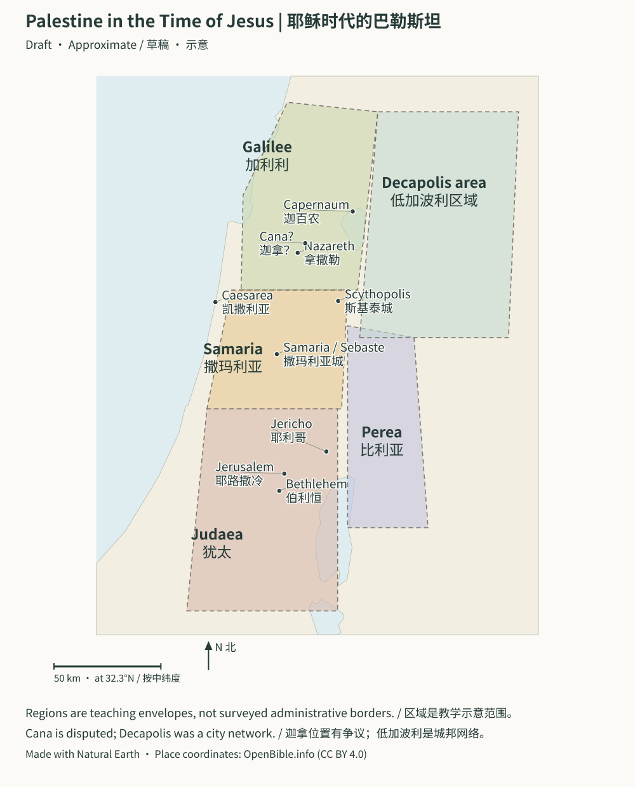
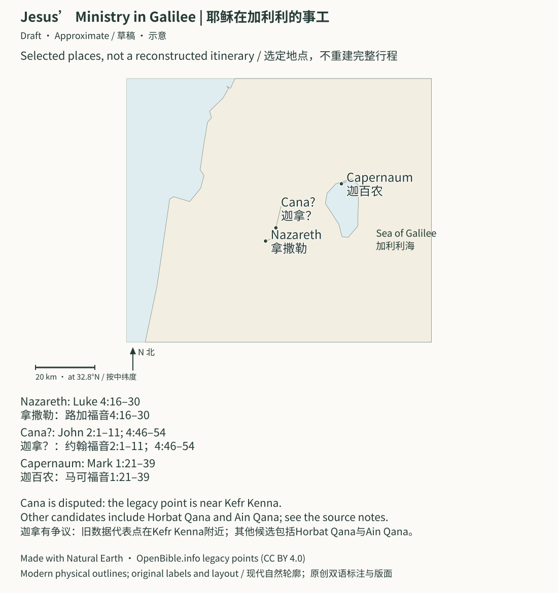

# New Testament Timeline | 新约时间线

> Status: Draft (AI draft; not human reviewed) | 状态：Draft（AI 草稿，未人工审阅）

> **In Three Sentences | 三句话读懂本篇**
>
> The [New Testament](../Glossary/README.md#new-testament) centers on Jesus and the early communities that follow him. The Gospels, Acts, letters, and Revelation serve different purposes. Use the timeline and maps to locate a passage, then read it in context. 
> 新约以耶稣和早期跟随祂的群体为中心。[福音书](../Glossary/README.md#gospels)、使徒行传、书信和启示录各有不同用途。先用时间线和地图定位，再回到上下文阅读。

新约时间线双语版。
Bilingual New Testament timeline.

四福音开始前的希腊化、马加比、哈斯摩尼、希律家族和罗马行政背景，见[《两约之间至四福音：第二圣殿、希腊化与罗马世界》](./两约之间至四福音_第二圣殿与罗马背景.md)。

四福音[复活](../Glossary/README.md#resurrection)叙事关系、妇女见证语境、空墓研究模型、林前 15 的早期传统、马可福音结尾[抄本](../Glossary/README.md#manuscript)、墓葬遗存和罗马材料的证据边界，见[《复活与早期见证：文本史、墓葬背景与历史研究边界》](./复活与早期见证_文本史与历史研究边界.md)。

《使徒行传》三次宣教旅程、保罗书信写作阶段、迦流年代锚点及各城市史料，见[《使徒行传与保罗书信：旅程、年代与城市史料对照》](./使徒行传与保罗书信_旅程年代与城市史料对照.md)。

希伯来书、普通书信、主后 70 年后景、拔摩、亚细亚七城和启示录象征，见[《希伯来书至启示录：晚期新约、普通书信与七教会背景》](./希伯来书至启示录_晚期新约与七教会背景.md)。

若按一年计划阅读，新约部分集中在[《52 周圣经故事线》](./52周圣经故事线_查经与史料阅读计划.md)第 35–52 周。

## Section Jump Table | 章节跳转表

| Section / 章节 | Link / 跳转 |
| --- | --- |
| [Gospel](../Glossary/README.md#gospels) map / 福音书地图 | [Open / 打开](#gospel-map) |
| Jesus’ ministry in Galilee / 耶稣在加利利的事工 | [Open / 打开](#galilee-ministry) |
| Big picture / 总览 | [Jump](#big-picture) |
| Main flow / 主线流程 | [Jump](#main-flow) |
| Timeline / 时间线 | [Jump](#timeline) |
| New Testament book groups / [新约](../Glossary/README.md#new-testament)书卷分组 | [Jump](#new-testament-book-groups) |
| Rough letter placement / 书信大致位置 | [Jump](#rough-letter-placement) |
| What the New Testament is doing / 新约到底在做什么 | [Jump](#what-the-new-testament-is-doing) |
| Relationship to the [Old Testament](../Glossary/README.md#old-testament) / 与旧约的关系 | [Jump](#relationship-to-the-old-testament) |
| Simple reading logic / 简单阅读逻辑 | [Jump](#simple-reading-logic) |

## Palestine in the Time of Jesus | 耶稣时代的巴勒斯坦

**Approximate / 示意:** Region envelopes are not surveyed borders; the Decapolis was a city network, and Cana has competing identifications. Modern physical outlines do not establish ancient shorelines. On a phone, scroll inside the map or [open the full SVG](../assets/maps/palestine-jesus.svg). / 区域范围不是测绘边界；低加波利是城邦网络，迦拿有不同候选位置；现代自然轮廓不能确定古代岸线。手机可在图内横向滚动或[打开完整 SVG](../assets/maps/palestine-jesus.svg)。

[Map notes and disputed locations | 地图说明与争议地点](../Maps/README.md#gospel-geography) · [Data credits | 数据署名](../CREDITS.md#map-data)

### Jesus’ Ministry in Galilee | 耶稣在加利利的事工

Read Luke 4:16–30, John 2:1–11 and 4:46–54, and Mark 1:21–39 alongside the three locations. This is a place overview, not a combined itinerary. Cana has competing identifications; the point follows the pilot’s legacy dataset. Modern physical outlines do not establish ancient shorelines. 
配合三个地点阅读路加福音4:16–30、约翰福音2:1–11和4:46–54、马可福音1:21–39。这是地点概览，不是拼接行程。迦拿有不同候选位置，图中沿用第一批旧数据代表点；现代自然轮廓不能确定古代岸线。

[Notes and disputed locations | 说明与争议地点](../Maps/README.md#map-galilee-ministry) · [Open full SVG | 打开完整SVG](../assets/maps/galilee-ministry.svg) · [Credits | 署名](../CREDITS.md#ministry-map-data)

## Big Picture | 总览

The New Testament begins with Jesus and then shows what happens because Jesus came, died, rose, ascended, and poured out the [Holy Spirit](../Glossary/README.md#holy-spirit). 
新约从耶稣开始，然后展开一个问题：因为耶稣来了、死了、复活了、升天了、并赐下[圣灵](../Glossary/README.md#holy-spirit)，接下来世界发生了什么？

## Main Flow | 主线流程

1. Arrival of the [Messiah](../Glossary/README.md#messiah)
   [弥赛亚](../Glossary/README.md#messiah)来到
2. Jesus' public ministry
   耶稣公开事工
3. Cross and [Resurrection](../Glossary/README.md#resurrection)
   十字架与复活
4. Ascension and [Pentecost](../Glossary/README.md#pentecost)
   升天与[五旬节](../Glossary/README.md#pentecost)
5. Early [Church](../Glossary/README.md#church)
   初代[教会](../Glossary/README.md#church)
6. Mission to the Nations
   向万国宣教
7. Apostolic Teaching
   使徒教导
8. Final Hope
   最终盼望

## Timeline | 时间线

### 1. Arrival of the Messiah

- Main books: Matthew 1-2, Luke 1-2, parts of John 1
  主要书卷：马太福音 1-2、路加福音 1-2、约翰福音 1 的部分内容
- Historical setting: late Herodian rule; the Quirinius census connection in Luke 2 remains chronologically debated
  历史背景：大希律统治晚期；路加福音 2 章与居里扭人口登记的年代衔接仍有争议
- Main people: Jesus, Mary, Joseph, John the Baptist
  主要人物：耶稣、马利亚、约瑟、施洗约翰
- Key themes: [incarnation](../Glossary/README.md#incarnation), fulfillment, promise, kingdom near
  关键词：[道成肉身](../Glossary/README.md#incarnation)、应验、[应许](../Glossary/README.md#promise)、[天国](../Glossary/README.md#kingdom)临近

#### Why it matters | 为什么重要

The Messiah does not appear as an isolated new idea. He arrives as the fulfillment of the Old Testament story. 
弥赛亚不是突然冒出来的新概念，祂是旧约整条故事线的成全。

### 2. Jesus' Public Ministry

- Main books: Matthew, Mark, Luke, John
  主要书卷：马太福音、马可福音、路加福音、约翰福音
- Main people: Jesus, [disciples](../Glossary/README.md#disciple), Pharisees, crowds
  主要人物：耶稣、[门徒](../Glossary/README.md#disciple)、法利赛人、群众
- Key themes: kingdom, teaching, miracles, discipleship, authority
  关键词：天国、教导、神迹、门徒训练、权柄

#### Why it matters | 为什么重要

Jesus reveals who God is, what the kingdom is, and what true humanity looks like. 
耶稣显明神是谁、天国是什么样，以及真正的人应该是什么样。

### 3. Cross and Resurrection

- Main books: all four Gospels
  主要书卷：四福音
- Main people: Jesus, disciples, Roman and Jewish authorities
  主要人物：耶稣、门徒、罗马与犹太领袖
- Key themes: [atonement](../Glossary/README.md#atonement), [sacrifice](../Glossary/README.md#sacrifice), victory, [forgiveness](../Glossary/README.md#forgiveness), new life
  关键词：[赎罪](../Glossary/README.md#atonement)、[献祭](../Glossary/README.md#sacrifice)、得胜、[赦免](../Glossary/README.md#forgiveness)、新生命

#### Why it matters | 为什么重要

The cross is the center of [redemption](../Glossary/README.md#redemption), and the resurrection is God's vindication of the Son and the beginning of [new creation](../Glossary/README.md#new-creation) life. 
十字架是[救赎](../Glossary/README.md#redemption)中心，复活则是父神对圣子的印证，也是[新创造](../Glossary/README.md#new-creation)生命的开端。

### 4. Ascension and Pentecost

- Main books: Luke 24, Acts 1-2
  主要书卷：路加福音 24、使徒行传 1-2
- Main people: Jesus, [apostles](../Glossary/README.md#apostle), early disciples
  主要人物：耶稣、使徒、早期门徒
- Key themes: exaltation, Spirit, witness, church begins
  关键词：高升、圣灵、见证、教会开始

#### Why it matters | 为什么重要

Jesus is not absent after ascension. He reigns and continues his work through the Spirit. 
耶稣升天后并不是不在了，祂是在掌权，并借着圣灵继续工作。

### 5. Early Church

- Main books: Acts 2-7
  主要书卷：使徒行传 2-7
- Main people: Peter, John, Stephen, Jerusalem church
  主要人物：彼得、约翰、司提反、耶路撒冷教会
- Key themes: fellowship, teaching, prayer, persecution, witness
  关键词：团契、教导、祷告、逼迫、见证

#### Why it matters | 为什么重要

The church is shown not as a side project but as the Spirit-formed people of the risen [Christ](../Glossary/README.md#christ). 
这里显明，教会不是附带项目，而是复活[基督](../Glossary/README.md#christ)借圣灵所塑造的群体。

### 6. Mission to the Nations

- Main books: Acts 8-28
  主要书卷：使徒行传 8-28
- Main people: Philip, Peter, Paul, Barnabas, many churches
  主要人物：腓利、彼得、保罗、巴拿巴、许多地方教会
- Key themes: gospel expansion, [Gentiles](../Glossary/README.md#gentile) included, suffering, mission
  关键词：福音扩展、[外邦人](../Glossary/README.md#gentile)被接纳、受苦、宣教

#### Why it matters | 为什么重要

The promises to bless the nations begin to be visibly fulfilled in history. 
“万国得福”的应许开始在历史中明显展开。

### 7. Apostolic Teaching

- Main books: Romans to Jude
  主要书卷：罗马书到犹大书
- Main people: Paul, Peter, John, James, Jude, churches and leaders
  主要人物：保罗、彼得、约翰、雅各、犹大，以及众教会与领袖
- Key themes: gospel doctrine, holiness, unity, perseverance, hope
  关键词：福音真理、圣洁、合一、忍耐、盼望

#### Why it matters | 为什么重要

The letters explain what Jesus' work means for the church's belief, worship, ethics, mission, and endurance. 
书信解释了耶稣的工作对教会的信仰、敬拜、伦理、使命和忍耐到底意味着什么。

### 8. Final Hope

- Main books: Revelation
  主要书卷：启示录
- Main people: John, the churches, the victorious Christ
  主要人物：约翰、众教会、得胜的基督
- Key themes: judgment, victory, worship, perseverance, new [creation](../Glossary/README.md#creation)
  关键词：审判、得胜、敬拜、忍耐、新创造

#### Why it matters | 为什么重要

The New Testament ends by showing where all gospel history is going: Christ wins, evil ends, and God dwells with his people forever. 
新约最后显明整段福音历史究竟走向哪里：基督得胜，邪恶终结，神与祂子民永远同住。

The seven cities were real urban communities existing at the same time, and together they represent the whole church. Read Revelation both in the first-century setting of Roman Asia and emperor worship and as apocalyptic writing that reuses Old Testament imagery and looks toward the final new creation; it is not a codebook for modern news. 
七城是同时存在的真实城市群体，也共同代表整全教会。启示录既要放在一世纪罗马亚细亚和帝国崇拜背景中读，也要按启示文学对旧约图像的重用和最终新创造来读；它不是现代新闻密码表。

## New Testament Book Groups | 新约书卷分组

### Gospels | 福音书

- Matthew, Mark, Luke, John
- 马太福音、马可福音、路加福音、约翰福音

### History | 历史书

- Acts
- 使徒行传

### Paul's Letters | 保罗书信

- Romans to Philemon
- 罗马书到腓利门书

### General Letters | 普通书信

- Hebrews to Jude
- 希伯来书到犹大书

### Apocalypse | 启示文学

- Revelation
- 启示录

## Rough Letter Placement | 书信大致位置

- Early church growth period: James, Galatians, 1-2 Thessalonians.
  教会早期成长阶段：雅各书、加拉太书、帖撒罗尼迦前后书。
- Missionary and church-formation period: Corinthians, Romans, Prison Epistles.
  宣教与建堂阶段：哥林多前后书、罗马书、监狱书信等。
- Pastoral leadership and later church life: 1-2 Timothy, Titus, 1-2 Peter, 1-3 John, Jude.
  牧养领袖与后期教会生活阶段：提摩太前后书、提多书、彼得前后书、约翰一二三书、犹大书。
- Hebrews and Revelation stand with strong theological and pastoral force, though their exact contexts are discussed in different ways.
  希伯来书与启示录也有强烈神学和牧养作用，只是具体背景常有不同讨论。
- This is a teaching sequence, not a claim that every letter has a settled date. Galatians has early and late models; the Prison Epistles have Ephesus, Caesarea, and Rome proposals; the Pastoral Epistles also have competing authorship and date models.
  这是方便教学的相对次序，不表示每封信都有公认日期：加拉太书有早晚两种主要方案；监狱书信有以弗所、凯撒利亚和罗马方案；教牧书信的作者与年代也存在不同模型。

## What The New Testament Is Doing | 新约到底在做什么

The New Testament is doing at least five things: 
新约至少在做五件事：

1. Showing Jesus as fulfillment of the Old Testament.
   显明耶稣是旧约的成全者。
2. Interpreting the meaning of the cross and resurrection.
   解释十字架与复活的意义。
3. Forming the church through apostolic teaching.
   借使徒教导塑造教会。
4. Sending the gospel to the nations.
   把福音推向万国。
5. Fixing hope on Christ's return and new creation.
   把盼望固定在基督再来和新创造上。

## Relationship To The Old Testament | 与旧约的关系

The New Testament does not replace the Old Testament as if the first part no longer matters. It completes what the Old Testament prepared. 
新约不是把旧约“替换掉”，好像前面部分不重要了；新约是在完成旧约所预备的一切。

## Simple Reading Logic | 简单阅读逻辑

If you are new, a clear order is: 
如果你刚开始读新约，一个清晰路线可以是：

1. Luke or Mark
   路加福音或马可福音
2. John
   约翰福音
3. Acts
   使徒行传
4. Romans
   罗马书
5. Ephesians, Philippians, Colossians
   以弗所书、腓立比书、歌罗西书
6. 1 Peter, James
   彼得前书、雅各书
7. Revelation
   启示录
