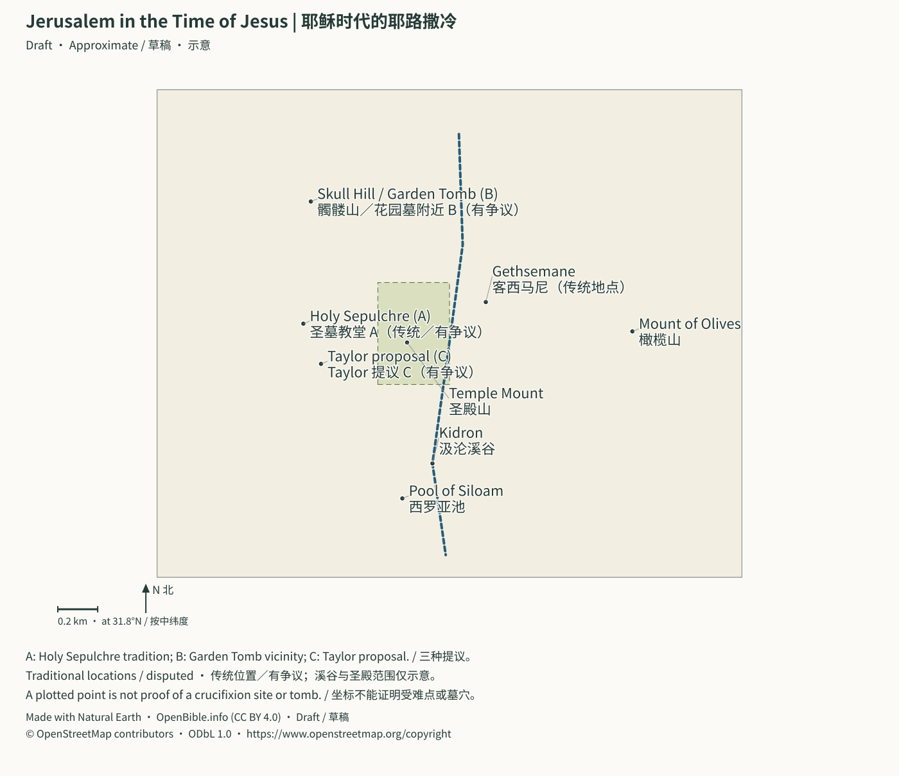

# From the Intertestamental Period to the Gospels: Second Temple and Roman World | 两约之间至四福音：第二圣殿、希腊化与罗马世界

> Status: Draft (AI draft; not human reviewed) | 状态：Draft（AI 草稿，未人工审阅）

<a id="map-jerusalem-jesus"></a>
## Jerusalem in the Time of Jesus | 耶稣时代的耶路撒冷



The Temple Mount outline and Kidron course are teaching sketches. A marks the Holy Sepulchre tradition; B the Skull Hill/Garden Tomb vicinity; C the Taylor proposal recorded by OpenBible. These proposals do not have equal evidential support, and a point does not identify a particular tomb.<br>
圣殿山范围与汲沦溪谷走向是教学示意。A为圣墓教堂传统地点，B为髑髅山／花园墓附近，C为OpenBible收录的Taylor提议。各提议的证据支持并不相等，坐标也不能识别某一座墓穴。

**Sources | 来源：** [Holy Sepulchre custodians / 圣墓教堂管理方](https://www.custodia.org/en/sanctuaries/basilica-of-the-holy-sepulchre/) · [Garden Tomb association / 花园墓管理方](https://gardentomb.com/about/) · [Credits | 署名](../CREDITS.md#batch2-map-data)

[Open full SVG | 打开完整SVG](../assets/maps/jerusalem-jesus.svg)

> Scope: late Persia through the Gospels’ Herodian–Roman world, with 70 CE destruction as historical backdrop.<br>
> 范围：从波斯帝国末期到四福音所处的希律—罗马时代，并以主后 70 年圣殿被毁作为历史后景。
> Purpose: explain how Temple, synagogues, Pharisees, Sadducees, Samaritans, tax collectors, Herods, Roman governors emerge after Ezra, Nehemiah, Malachi.<br>
> 目的：解释旧约归回叙事结束后，福音书中的圣殿、会堂、法利赛人、撒都该人、撒玛利亚人、税吏、希律家族和罗马总督是怎样出现的。
> Method: distinguish biblical narrative, contemporary/near-contemporary texts, archaeology, reconstruction, theology. Compatible background does not prove every detail.<br>
> 方法：区分经文叙事、同期或近同期史料、考古材料、历史重建和神学解读；“背景吻合”不自动等于“证明某一段经文全部细节”。

---

<a id="t1-25a-23"></a>
## 1. Between the Testaments Was Not Silent | 一、先给结论：两约之间并不“沉默”

From Ezra/Nehemiah/Malachi to Gospels, rule, language, and Jewish society change greatly:<br>
从《以斯拉记》《尼希米记》《玛拉基书》的世界进入四福音，政治版图、通行语言和犹太社会内部都发生了巨大变化：

1. **Successive rulers:** Persia→Macedon/successors→Ptolemies→Seleucids→Hasmoneans→Rome→Herods alongside governors.
   **政治主权连续易手**：波斯 → 马其顿及继业者 → 托勒密 → 塞琉古 → 哈斯摩尼 → 罗马 → 希律家族与罗马总督并行。
2. **Greek as common language:** connects Septuagint, New Testament, diaspora.
   **希腊语成为跨地区共同语**：这解释了七十士译本、希腊文新约和散居犹太社群之间的联系。
3. **Temple central, not sole public space:** Jerusalem sacrifice/festival/pilgrimage; local law reading, teaching, gathering, hospitality in synagogues.
   **圣殿仍是中心，却不再是唯一公共空间**：献祭、节期和朝圣以耶路撒冷为中心；会堂则承担诵读律法、教导、地方聚会及接待旅客等功能。
4. **Diverse Jewish responses:** Pharisees, Sadducees, Essenes/Qumran-related groups, priests, revolutionaries, ordinary people seek fidelity under foreign rule.
   **犹太教内部出现多种回应方式**：法利赛人、撒都该人、爱色尼派或昆兰相关群体、祭司集团、革命运动及普通百姓，都在回答“外族统治下怎样忠于上帝”。
5. **Maccabean crisis sharpens themes:** purification, martyrdom, resurrection, law, desecration, kingdom, final rescue.
   **马加比危机强化了几个新约关键词**：圣殿洁净、殉道、复活盼望、律法忠诚、亵渎圣所、上帝国度和末世拯救。
6. **Local kings and governors:** Caesar, Syria/Judah governors, tetrarchs, high priests, tax collectors coexist.
   **罗马通过地方王与总督治理**：所以福音书中会同时出现该撒、叙利亚总督、犹太总督、希律分封王、大祭司和地方税吏。
7. **Material world recoverable:** Pilate, Caiaphas, warning/synagogue inscriptions, baths, stone vessels, pools, boat, Herodian buildings.
   **考古可以重建福音书的物质世界**：彼拉多铭文、该亚法骨棺、圣殿警告碑、会堂铭文、礼仪浴池、石器、池子、渔船和希律建筑，都能提供真实背景。
8. **John in Herodian context:** Josephus Antiquities 18.116–119 recounts baptism, influence, Antipas’ execution, Machaerus confinement. Site attests palace/fortress, not identified prison, banquet, beheading place.
   **约瑟夫斯与马凯鲁斯把施洗约翰放进希律政治**：《犹太古史》18.116–119 记约翰的施洗、群众影响、安提帕处决和马凯鲁斯囚禁地点；遗址则确认这里是年代相合的希律宫堡，但没有找到可点名的牢房、宴席或斩首处。
9. **Miracles/theology not settled archaeologically:** people, places, institutions can be attested, not Jesus’ identity/resurrection theology measured in objects.
   **考古不能裁决经文中的神迹与神学宣告**：它能确认人、地、制度和生活环境，却不能用器物测量“耶稣是谁”或复活的神学意义。

One connecting sentence:<br>
一句话串联：

> Returnees preserve Temple/law under empires; Hellenization and Antiochus IV’s coercion prompt Maccabean revolt; Hasmoneans combine priesthood, kingship, independence then invite Rome through conflict; Herod builds Roman-approved kingship. Gospels unfold amid Temple, distorted kingship, Roman pressure, messianic hope.<br>
> 被掳归回后的犹太群体在列国统治下守住圣殿与律法；希腊化和安条克四世的强制政策引爆马加比反抗；哈斯摩尼王朝把祭司、王权与民族独立结合，又因内斗把罗马引入；希律以宏伟建筑巩固受罗马认可的王权；四福音就在这种“圣殿仍在、王权失真、罗马压境、弥赛亚盼望升高”的世界里展开。

---

<a id="t1-25a-43"></a>
## 2. Using the Dates | 二、怎样使用本专题的年代

- **BCE:** smaller numbers later;167 after 200.
  **主前 / BCE**：年代数字越小，时间越晚；主前 167 年晚于主前 200 年。
- **CE:** no year 0;1 BCE directly precedes 1 CE.
  **主后 / CE**：不设“第 0 年”；主前 1 年之后直接进入主后 1 年。
- Dates are common historical coordinates, not every event’s exact day.
  表中的年份是历史研究常用坐标，不表示所有事件都能精确到某一天。
- Intertestamental is a Christian organizational term, not absence of revelation traditions, literature, events.
  “两约之间”是基督教编排中的实用称呼，不表示这几百年没有启示传统、文学活动或历史事件。
- Maccabean books’ canonical standing varies:
  《马加比一书》《马加比二书》等在不同正典传统中的地位不同：
  - Protestants usually historical/Apocrypha, outside 39 Old Testament books;
    新教通常列为次经或重要历史文献，不列入 39 卷旧约；
  - Catholics/some Orthodox include some as canon;
    天主教和部分东正教传统将其中若干卷列入正典；
  - Historical use here does not predetermine canon traditions.
    本专题在历史层面使用它们，不以此预先裁定正典传统。

---

<a id="t1-25a-56"></a>
## 3. Timeline: Late Persia to 70 CE | 三、总时间线：从波斯末期到主后 70 年

| Date / 年代 | Political/social event / 政治与社会事件 | Storyline significance / 圣经故事线意义 |
| --- | --- | --- |
| Fifth–fourth centuries BCE | Persian Yehud; Temple, law, community | Return not restored independent monarchy |
| 主前 5–4 世纪 | 波斯统治下的 Yehud 省；第二圣殿、律法与地方群体持续发展 | 归回不是完全恢复大卫王国；百姓仍处列国政权之下 |
| 334–323 BCE | Alexander conquers; Persia collapses | Greek, cities, administrative networks expand |
| 主前 334–323 | 亚历山大东征；波斯帝国瓦解 | 希腊语、城市文化和跨地区行政网络加速扩张 |
| 323 BCE | Alexander dies; successor contests | Judea between northern/southern kingdoms |
| 主前 323 | 亚历山大去世，帝国由继业者争夺 | 犹太地成为南北两个希腊化王国争夺的走廊 |
| About 301–200 BCE | Mainly Ptolemaic Judea | Alexandrian Jews/Greek Scripture grow |
| 约主前 301–200 | 托勒密王朝主要控制犹太地 | 埃及亚历山大港的犹太社群与希腊文圣经传统发展 |
| Mid-third century BCE | Greek Pentateuch; others later | Hebrew Bible enters Greek world |
| 约主前 3 世纪中叶 | 摩西五经的希腊文翻译形成；其余书卷随后陆续译出 | 七十士译本使希伯来圣经进入希腊语世界 |
| About 200 BCE | Antiochus III after Panion | Control shifts Egypt→Syria |
| 主前 200 左右 | 塞琉古王安条克三世在帕尼翁战役后控制犹太地 | 政权由埃及方向转到叙利亚方向 |
| 187–175 BCE | Seleucus IV; finance/sanctuaries | Heliodoros background for 2 Maccabees 3 |
| 主前 187–175 | 塞琉古四世时期；王室财政与地方圣所关系紧张 | 赫利奥多罗斯碑为《马加比二书》3 章的政治背景提供外证 |
| 175–164 BCE | Antiochus IV | Throne, finance, Hellenizing factions, priesthood |
| 主前 175–164 | 安条克四世统治 | 王位、财政、希腊化派系和大祭司职位纠缠 |
| 169/168–167 BCE | Unrest, plunder, coercive decrees | Daniel/Maccabean desecration, persecution, fidelity |
| 主前 169/168–167 | 耶路撒冷动乱；圣殿遭掠；宗教禁令与强制同化危机 | 《但以理书》与马加比传统中的“亵渎、逼迫、忠心”背景 |
| 167 BCE | Modiin, Mattathias/sons rebel | Maccabean movement |
| 主前 167 | 模丁起义；马他提亚及其子展开反抗 | 马加比运动开始 |
| 164 BCE | Judas recovers/rededicates Temple | Hanukkah; John 10:22 |
| 主前 164 | 犹大·马加比收复并重新奉献圣殿 | 修殿节 / 光明节的历史根源；参约 10:22 |
| 160 BCE | Judas dies | Longer military/political struggle |
| 主前 160 | 犹大阵亡 | 运动由宗教反抗继续转向长期政治与军事斗争 |
| 152 BCE | Jonathan high priest | Office drawn into dynastic politics |
| 主前 152 | 约拿单取得大祭司职位 | 大祭司职位更加卷入王朝政治 |
| 142/141 BCE | Simon autonomy/Hasmonean rule | Brief local sovereignty |
| 主前 142/141 | 西门取得高度自治，哈斯摩尼统治确立 | 犹太地短暂恢复本土政权 |
| 134–104 BCE | John Hyrcanus expands | Idumea/Samaria incorporated |
| 主前 134–104 | 约翰·许尔堪统治并扩张 | 以土买、撒玛利亚等地区被卷入哈斯摩尼国家工程 |
| 103–76 BCE | Alexander Jannaeus | King/priest/faction conflict |
| 主前 103–76 | 亚历山大·詹尼统治 | 王权、大祭司权和内部派别冲突加剧 |
| 76–67 BCE | Salome Alexandra | Last relative stability; Pharisaic influence often thought stronger |
| 主前 76–67 | 莎乐美·亚历山德拉统治 | 王朝最后较稳定阶段；法利赛影响常被认为上升 |
| 67–63 BCE | Hyrcanus II/Aristobulus II rivalry | Civil war invites Rome |
| 主前 67–63 | 许尔堪二世与亚里斯多布二世争位 | 内战为罗马干预打开大门 |
| 63 BCE | Pompey enters Jerusalem | Roman sphere; independence ends |
| 主前 63 | 庞培进入耶路撒冷 | 犹太地进入罗马势力范围；民族独立终结 |
| 40 BCE | Senate names Herod king | Roman grant, not Davidic genealogy |
| 主前 40 | 罗马元老院宣布希律为“犹太人的王” | 王权合法性来自罗马授予，而非大卫家谱 |
| 37 BCE | Herod captures city | Effective reign begins |
| 主前 37 | 希律攻取耶路撒冷，开始实际统治 | “大希律”时代正式开始 |
| 20/19 BCE | Temple project begins | Gospels’ expanding complex; John 2:20 |
| 主前 20/19 | 希律启动圣殿建筑工程 | 四福音中的圣殿是扩建中的宏大建筑群；参约 2:20 |
| 4 BCE | Herod dies; Archelaus, Antipas, Philip | Matthew 2/Luke 1 era to Luke 3 tetrarchs |
| 主前 4 | 希律去世；领地分给亚基老、安提帕和腓力 | 太 2、路 1 的希律时代结束；路 3 的分封王格局形成 |
| 6 CE | Archelaus deposed; direct Judea/Samaria/Idumea; Quirinius census | Administration/taxation; Luke 2 chronological difficulty |
| 主后 6 | 亚基老被废；犹太、撒玛利亚、以土买改由罗马长官治理；居里扭人口登记 | 罗马直接行政与税制加深；路 2 的年代问题由此产生 |
| 14–37 CE | Tiberius | Luke 3:1/Pilate setting |
| 主后 14–37 | 提庇留在位 | 路 3:1 和彼拉多铭文所处的帝国背景 |
| About 18–36/37 CE | Caiaphas | Passion priestly setting |
| 约主后 18–36/37 | 该亚法任大祭司 | 四福音受难叙事的祭司政治背景 |
| 26–36 CE | Pontius Pilate | Trial/crucifixion administration |
| 主后 26–36 | 本丢·彼拉多任犹太长官 | 耶稣受审与被钉十字架的罗马行政背景 |
| About 28/29 CE | John’s ministry, Tiberius year 15 | Luke 3 coordinates |
| 主后 28/29 左右 | 按提庇留第十五年推算，施洗约翰开始事奉 | 路 3 为耶稣公开事奉提供政治坐标 |
| Late 20s–early 30s CE | Antipas imprisons/kills John; Josephus names Machaerus | Shared historical core with Matthew 14/Mark 6/Luke 3/7/9, different motives/details; sequence alone not precise year |
| 主后 20 年代末至 30 年代前半 | 约翰被安提帕囚禁并处死；约瑟夫斯点名马凯鲁斯，精确年份不能由其叙事次序单独锁定 | 太 14、可 6、路 3／7／9 与《犹太古史》共同保存部分历史核心，也保留不同处决动机与叙事细节 |
| About 30 or 33 CE | Common crucifixion candidates | Year/Passover date disputed |
| 约主后 30 或 33 | 常见的受难年份候选 | 精确年份与逾越节日期仍有争议 |
| 36 CE | Pilate recalled; Caiaphas soon after | Clearer administrative upper limit |
| 主后 36 | 彼拉多被撤；稍后该亚法也被撤 | 福音书受难事件的行政时间上限更清楚 |
| 40–41 CE | Caligula’s planned image in Temple; death prevents | Temple, imperial cult, loyalty crisis |
| 主后 40–41 | 卡利古拉拟在圣殿设皇帝像，引发严重危机；计划因其去世未实行 | 显示圣殿、帝国崇拜和犹太忠诚之间的爆炸性张力 |
| 41–44 CE | Agrippa I rules | Acts 12 background |
| 主后 41–44 | 亚基帕一世统治犹太地 | 徒 12 的希律王背景 |
| 44 CE | Agrippa I dies; direct rule resumes | Acts governors/Agrippa II coexist |
| 主后 44 | 亚基帕一世去世，罗马再度直接治理 | 使徒行传中总督与希律亚基帕二世并存的制度背景 |
| 66–70 CE | First Jewish–Roman war | Temple-judgment backdrop |
| 主后 66–70 | 第一次犹太—罗马战争 | 福音传统和初代教会所面对的圣殿审判后景 |
| 70 CE | Titus captures; Temple destroyed | Sacrificial institution ends; Josephus/arch external witnesses |
| 主后 70 | 提多攻陷耶路撒冷，第二圣殿被毁 | 结束了以献祭圣殿为中心的制度；约瑟夫斯与提多凯旋门提供外部见证 |

---

<a id="t1-25b-161"></a>
## 4. After Persian Return: Why Keep Waiting? | 四、第一幕：波斯归回之后，为什么仍在等待？

<a id="t1-25b-163"></a>
### 1. Temple Rebuilt, Monarchy Unrestored | 1. 圣殿重建了，王国却没有恢复

Return achieves:<br>
归回时期完成了几件大事：

- Second Temple about 516/515 BCE;
  第二圣殿在主前 516/515 年左右完成；
- Nehemiah’s walls;
  耶路撒冷城墙在尼希米时代重建；
- Reorganized law, priests, festivals, identity;
  律法、祭司、节期和群体身份重新组织；
- Persian Yehud administration.
  Yehud 成为波斯帝国内的地方行政单位。

No independent Davidic throne. Return combines:<br>
但大卫王朝没有重新坐上独立王位。所谓“归回”因此同时包含：

- **Real restoration:** land, Temple, worship, community;
  **真实恢复**：土地、圣殿、敬拜和群体生活重新建立；
- **Unfinished waiting:** imperial rule, incomplete prophetic renewal.
  **未竟等待**：仍受列国统治，先知所描绘的完全更新尚未实现。

Hope extends beyond individual salvation:<br>
这解释了为什么第二圣殿时期的盼望不只关心个人得救，也关心：

- God’s effective kingship;
  上帝何时真正作王；
- Davidic son;
  大卫之子何时出现；
- Purified Temple/priesthood;
  圣殿和祭司何时完全洁净；
- Twelve tribes restored;
  以色列十二支派何时复兴；
- Oppression judged;
  列国压迫何时受审判；
- Dead righteous vindicated.
  死去的义人如何得到伸冤。

<a id="t1-25b-186"></a>
### 2. Elephantine Festival Letter: Exodus Memory Abroad | 2. 象岛节期书信：出埃及记忆怎样进入散居生活

P. 13464/TAD A4.1(anchor 187),419–418 BCE, Hananiah to Yedaniah/garrison, concerns Nisan 14–21, seven unleavened days, rest at ends, restrictions on eating/storing leaven, in royal/Arsames administrative network.<br>
主前 419–418 年的 Pap. Berlin P. 13464／TAD A4.1（锚点 187）由哈拿尼亚写给象岛的耶大尼亚及犹太驻军同伴。残文涉及尼散月第十四至二十一日、七日无酵、两端停工、禁食或收藏发酵物，并把指令放进波斯王命与埃及总督亚沙姆的行政网络。

Three storyline connections:<br>
它在故事线上连接三件事：

1. Exodus 12, Leviticus 23, Deuteronomy 16 festival memory reaches southern-Egypt diaspora;
   出 12、利 23、申 16 的节期记忆没有只停在土地和圣殿，也进入埃及南境散居群体；
2. Jerusalem, Yehud, Babylon, Elephantine form multiple centers, not universal return;
   波斯时期的犹太生活是耶路撒冷、Yehud、巴比伦、象岛等多中心网络，不是所有人都已归回；
3. Gospel Passover language has long reception, not identical procedures across dates, places, calendars.
   到福音书时代，逾越节语言已有漫长接收史，但不同年代、地区和日历程序不能直接压成同一套细则。

Traditional Passover letter title is disputed. Berlin’s so-called designation notes uncertain letters, days, purpose: Unleavened Bread, calendar adjustment, military religious leave. Strongest: local dates, leaven/rest practices comparable with festivals, not Exodus events, universal Pentateuch, Last Supper date.<br>
“逾越节书信”是传统题名，不是无争议结论。柏林现行数据库称它为“所谓的逾越节书信”，并提示近期研究争论它是否实际规定逾越节；关键残字、日数和目的也有无酵节、日历调整或驻军宗教休假等解释。最强结论是波斯时期象岛犹太驻军确有可与逾越／无酵节比较的日期、除酵和停工实践，不是出埃及事件、完整五经普遍实行或福音书最后晚餐日期的证明。

- **Source:** [Berlin Elephantine: P. 13464 object, transcription, translation, debates](https://elephantine.smb.museum/objects/object.php?o=100463).
  **来源**：[柏林 Elephantine 项目：Pap. Berlin P. 13464 器物、转录、译文和研究争议](https://elephantine.smb.museum/objects/object.php?o=100463)。

<a id="t1-25b-200"></a>
### 3. Daniel as Bridge | 3. 《但以理书》为什么是重要桥梁

Babylonian/Persian court setting extends through visions to later imperial conflicts. Main formation models:<br>
《但以理书》的叙事设置始于巴比伦与波斯宫廷，但书中异象延伸到后来的帝国冲突。关于其成书过程，研究大致有两种主要理解：

- Traditional attention to exilic Daniel’s visions/preservation;
  传统解释重视但以理本人在被掳时期所得异象及后来的保存；
- Many modern scholars link final form to second-century Antiochus IV crisis.
  许多现代学者认为该书最终形态与安条克四世逼迫、主前 2 世纪危机密切相关。

The eight witnesses 1Q71–72,4Q112–116, and 6Q7(anchor 181) preserve portions of Daniel 1–11. 1Q71 and 4Q112/113 preserve Hebrew–Aramaic and reverse transitions;4Q174 separately names Daniel and cites 12:10. A 2025 radiocarbon study gives 4Q114 parchment a 2σ calibrated 230–160 BCE range. Its late end overlaps the crisis; it dates the skin, not composition, author, or vision. It constrains overly late manuscript models without independently deciding either formation model.<br>
1Q71–72、4Q112–116、6Q7（锚点 181）使讨论多了一层可直接观察的文本史：八份残卷现存可辨文字覆盖 1–11 章，1Q71 与 4Q112／113 还分别保存希伯来文—亚兰文、亚兰文—希伯来文的语言接缝；4Q174 则另引 12:10，并称“先知但以理的书”。2025 年放射性碳研究把 4Q114 羊皮的 2σ 校准范围置于主前 230–160 年。这个范围不是一个精确年份，晚端与安条克危机重合；它测的是羊皮载体，不直接测作品构思、作者生平或异象发出的年代。因此它能约束过晚的抄本方案，却不能独自裁决上述两种成书模型。

Under either model, storyline role:<br>
无论采用哪一种成书模型，它在故事线上的功能都很清楚：

> Beastly kingdoms rise; Son of Man/holy ones receive God’s kingdom.<br>
> 地上的兽国轮流兴起，人子和至高者的圣民最终从上帝得国。

Helps read Son of Man, kingdom, desolating abomination, judgment, but not mechanical modern-event chart.<br>
这条线直接帮助读者理解福音书中的“人子”“上帝的国”“那行毁坏可憎的”和末世审判语言，但不能把每个象征都机械等同为现代事件表。

---

<a id="t1-25b-217"></a>
## 5. Jewish Communities and Hellenization | 五、第二幕：希腊化不是简单的“犹太文化对希腊文化”

<a id="t1-25b-219"></a>
### 1. Alexander’s Lasting Changes | 1. 亚历山大征服带来的长期改变

Empire fragments quickly, cultural influence lasts centuries:<br>
亚历山大的帝国很快分裂，但希腊化影响延续数世纪：

- Greek common language;
  希腊语成为东地中海和近东的共同语；
- City government, gymnasia, theaters, coins, education;
  城市治理、体育馆、剧场、钱币和教育方式传播；
- Elites joining wider networks;
  地方精英可借希腊文化进入更广的政治和经济网络；
- Selective adoption/debate on law’s boundaries.
  犹太群体既吸收某些形式，也不断讨论忠于律法的界线。

No simple pure-Jewish/pure-Greek camps:<br>
不能把当时人简单分成“纯犹太派”和“纯希腊派”：

- Greek-language defense of Israel’s faith;
  犹太作者可以用希腊语捍卫以色列信仰；
- Opponents of coercive paganization may know Greek culture;
  反对强制异教化的人也可能熟悉希腊文化；
- Theology, class, city power, high-priest appointments, finance intersect.
  冲突常同时涉及神学、阶层、城市权力、大祭司任命和帝国财政。

<a id="t1-25b-234"></a>
### 2. Why Ptolemies/Seleucids Contest Judea | 2. 托勒密与塞琉古为什么不断争夺犹太地

Between Egypt/Syria, coast, hills, Jordan routes, Judea is imperial buffer as well as sacred land.<br>
犹太地位于埃及和叙利亚之间，是海岸道路、山地通道和约旦河谷交汇之处。它不仅是宗教圣地，也是帝国缓冲区。

- Ptolemaic Egypt;
  托勒密王朝以埃及为中心；
- Seleucid Syria/east;
  塞琉古王朝的核心在叙利亚和更东地区；
- Mostly Ptolemaic in the third century BCE;
  主前 3 世纪大部分时间，犹太地主要处于托勒密控制下；
- Antiochus III gains control about 200 BCE.
  主前 200 年左右，安条克三世取得控制权。

Roman Syria–Judea administrative relation continues this geography.<br>
福音书时代“叙利亚总督—犹太长官”的行政组合，正是这种地缘位置在罗马时代的延续。

---

<a id="t1-25b-247"></a>
## 6. Septuagint: Old Testament in the Gospels’ Language | 六、七十士译本：旧约怎样进入福音书的语言世界

<a id="t1-25b-249"></a>
### 1. What Is LXX? | 1. 什么是“七十士译本”

Ancient Greek translations of the Hebrew Bible:<br>
“七十士译本”（LXX）通常指希伯来圣经的古希腊文译本传统：

- Pentateuch around the mid-third century BCE, Egypt;
  摩西五经大约在主前 3 世纪中叶于埃及翻译；
- Other books at varying times, places, styles;
  其他书卷在不同时间、地点和翻译风格中陆续形成；
- Not one modern-style Bible finished one day by one team.
  它不是某一天由一个统一团队完成的整本现代式译本。

The legend of seventy-two translators in the Letter of Aristeas and other traditions witnesses later authority claims, not unqualified day-by-day production record.<br>
传说中的“七十二位译者”见于《亚里斯提亚书信》等传统。它说明后世怎样理解译本权威，但不能不加区分地当作翻译过程的逐日记录。

<a id="t1-25b-259"></a>
### 2. New Testament Importance | 2. 为什么它对新约重要

- Many authors use Greek Scripture directly/indirectly;
  许多新约作者直接或间接使用希腊文旧约；
- Hebrew/Greek wording can differ;
  同一段旧约在希伯来文本和古希腊译本中的措辞有时不同；
- Diaspora/Greek readers access Israel’s books;
  散居犹太人和希腊语读者可以在自己的通行语言中接触以色列经典；
- Christ, Lord, gospel, righteousness acquire biblical meanings within translation tradition.
  “基督”“主”“福音”“公义”等词的圣经语义，也在这种翻译传统中发展。

<a id="t1-25b-266"></a>
### 3. Rylands Greek Papyrus 458 | 3. 外部实物：Rylands Greek Papyrus 458

- **Material:** Egyptian Greek Deuteronomy papyrus-roll fragments.
  **材料**：申命记古希腊文纸草残片，来自埃及，卷轴形制。
- **Date:** usually second century BCE.
  **年代**：通常定于主前 2 世纪。
- **Supports:** Greek Pentateuch copied/used before Christianity.
  **能支持**：基督教形成以前，希腊文摩西五经已经被实际抄写和使用。
- **Does not establish:** complete LXX/simultaneous whole Old Testament translation.
  **不能支持**：它不是完整七十士译本，也不能证明所有旧约书卷同时完成翻译。
- **Grade: A.**
  **等级**：A。
- **Source:** [University of Manchester Rylands P 458](https://www.digitalcollections.manchester.ac.uk/view/MS-GREEK-P-00458).
  **来源**：[曼彻斯特大学 Rylands Greek P 458 藏品页](https://www.digitalcollections.manchester.ac.uk/view/MS-GREEK-P-00458)。

---

<a id="t1-25c-347"></a>
## 7. Antiochus IV, Temple Crisis, Maccabean Revolt | 七、第三幕：安条克四世、圣殿危机与马加比反抗

<a id="t1-25c-349"></a>
### 1. A Crisis with Prior Causes | 1. 危机并非突然从天而降

Around Antiochus’ reign, Jerusalem competition involves:<br>
安条克四世统治前后，耶路撒冷内部已有激烈竞争：

- High priesthood/political loyalty;
  大祭司职位与政治效忠挂钩；
- Hellenizing elites seeking city power;
  亲希腊化精英争夺城市治理权；
- Royal finance/local support;
  塞琉古王室需要财政与地方支持；
- Egyptian wars/succession legitimacy.
  埃及战争和王位合法性压力加重。

Persecution around 167 BCE combines religious, imperial, fiscal, factional crises.<br>
因此，主前 167 年前后的迫害既是宗教危机，也是帝国、财政和地方派系冲突的总爆发。

<a id="t1-25c-360"></a>
### 2. Heliodoros Stele’s Evidence | 2. 赫利奥多罗斯碑能确认什么

Israel Museum Greek correspondence between Seleucus IV/Heliodoros appoints an official over regional sanctuaries including Judea.<br>
以色列博物馆所藏赫利奥多罗斯碑记录塞琉古四世与官员赫利奥多罗斯之间的希腊文公文，涉及任命管理包括犹太地在内区域圣所事务的官员。

- **Supports:**
  **能支持**：
  - A real senior official;
    赫利奥多罗斯是真实的塞琉古高官；
  - Royal intervention in sanctuary administration;
    王室确实介入地方圣所行政；
  - Concrete institutional setting for 2 Maccabees 3.
    《马加比二书》3 章的政治与制度背景不是凭空构造。
- **Does not establish:**
  **不能支持**：
  - Temple miracle;
    碑文不记载《马加比二书》中的圣殿神迹；
  - Every narrative word independently confirmed.
    不能因此说整段叙事已被外部铭文逐字证实。
- **Grade: A** for person/office/policy; particular story **B**.
  **等级**：A（人物、官职与政策背景）；对具体叙事为 B。
- **Source:** [Israel Museum Heliodoros Stele](https://www.imj.org.il/en/exhibitions/heliodorus-stele).
  **来源**：[以色列博物馆：Heliodorus Stele](https://www.imj.org.il/en/exhibitions/heliodorus-stele)。

<a id="t1-25c-374"></a>
### 3. 167–164 BCE Reconstruction | 3. 主前 167–164 年发生了什么

Using 1–2 Maccabees, Josephus, research:<br>
按《马加比一书》《马加比二书》、约瑟夫斯和相关研究重建：

1. Antiochus intervenes/plunders;
   安条克四世干预耶路撒冷并掠夺圣殿；
2. Circumcision, Sabbath, law scrolls, sacrifices suppressed;
   禁止或压制割礼、安息日、律法卷与传统献祭；
3. Foreign cult imposed;
   圣殿被改造用于外来祭祀；
4. Mattathias’ Modiin family rebels;
   模丁的祭司马他提亚及其家族发动反抗；
5. Judas leads guerrilla/conventional war;
   犹大·马加比率领游击和正规战；
6. 164 recovery, purification, rededication.
   主前 164 年收复圣殿，洁净并重新奉献。

<a id="t1-25c-385"></a>
### 4. Dedication in John | 4. 修殿节怎样进入约翰福音

John 10:22’s festival commemorates 164 BCE rededication, not a Mosaic institution.<br>
约翰福音 10:22 提到“修殿节”。它不是摩西五经设立的节期，而是纪念主前 164 年圣殿重新奉献。

John 10’s tension:<br>
这使约 10 的语境更有张力：

- Temple restored from desecration;
  节期纪念圣殿从亵渎中恢复；
- Question whether Jesus is Christ;
  众人追问耶稣是否是基督；
- Work, Father, sheep;
  耶稣谈自己的工作、与父的关系及羊群；
- Implicit question of true consecration/divine sending.
  “谁是真正分别为圣、由父差来的”成为隐含主题。

Literary-theological comparison, not festival proving Jesus’ identity.<br>
这属于文学—神学互读，不是说修殿节本身证明约翰福音对耶稣身份的宣告。

<a id="t1-25c-398"></a>
### 5. Antiochus IV Coins | 5. 安条克四世钱币的意义

Portrait, title, Greek gods:<br>
安条克四世的钱币保留其肖像、王号和希腊神祇图像：

- **Supports:** ruler, date, public royal symbolism, currency network;
  **能支持**：统治者身份、年代、希腊化王权的公开象征和帝国货币网络；
- **Does not establish:** complete persecution story from one coin;
  **不能支持**：一枚钱币不能单独重建耶路撒冷迫害全过程；
- **Grade: A** for ruler/images.
  **等级**：A（统治者与王权图像）。
- **Source:** [British Museum silver, about 173–169 BCE](https://www.britishmuseum.org/collection/object/C_RPK-p180A-5-AntIV?selectedImageId=143669001).
  **来源**：[大英博物馆：安条克四世银币，约主前 173–169 年](https://www.britishmuseum.org/collection/object/C_RPK-p180A-5-AntIV?selectedImageId=143669001)。

---

<a id="t1-25c-409"></a>
## 8. Hasmoneans: New Problems after Victory | 八、第四幕：哈斯摩尼王朝——胜利之后的新难题

<a id="t1-25c-411"></a>
### 1. Rebels Become Rulers | 1. 从反抗者到统治者

The Maccabean family’s dynasty develops:<br>
马加比家族后来被称为哈斯摩尼王朝。其发展可分为：

1. **Survival/religious freedom:** Mattathias, Judas;
   **生存与宗教自由**：马他提亚、犹大；
2. **Diplomacy/high priesthood:** Jonathan;
   **外交与大祭司权**：约拿单；
3. **Autonomy/dynasty:** Simon;
   **自治与王朝建立**：西门；
4. **Expansion/coercive integration:** John Hyrcanus, Aristobulus, Alexander Jannaeus;
   **扩张与强制整合**：约翰·许尔堪、亚里斯多布、亚历山大·詹尼；
5. **Civil war/Rome:** Hyrcanus II, Aristobulus II.
   **宫廷内斗与罗马介入**：许尔堪二世、亚里斯多布二世。

<a id="t1-25c-421"></a>
### 2. Remembered and Criticized | 2. 为什么哈斯摩尼统治既被纪念又受批评

Positive:<br>
积极面：

- Temple recovered;
  圣殿从安条克四世政策下恢复；
- Local military autonomy;
  本土政权和军事自主一度重建；
- Expanded institutions/territory.
  犹太制度和领土影响扩大。

Problems:<br>
问题面：

- Priestly family combines religious, military, political power;
  祭司家族兼具政治、军事和宗教权力；
- Not Davidic royal descent, contested kingship;
  其祭司血统并非大卫王族，王权合法性受到质疑；
- Conquest/integration of neighbors;
  扩张伴随对邻近群体的征服与整合；
- Bloody factional conflict;
  王室与不同宗教—政治派别发生流血冲突；
- Rome becomes arbiter.
  内战最终使罗马成为仲裁者。

<a id="t1-25c-437"></a>
### 3. Coins Attest Local Rule | 3. 钱币如何见证本土政权

John Hyrcanus I’s coins use Hebrew titles/local symbols:<br>
约翰·许尔堪一世的钱币使用希伯来文称号和地方符号：

- **Supports:** ruler, priestly-political identity, minting, autonomy;
  **能支持**：哈斯摩尼统治者、祭司—政治身份、地方铸币和自治；
- **Does not establish:** universal approval of policies;
  **不能支持**：钱币是政权自我表达，不能证明其所有政策获得全民认同；
- **Grade: A.**
  **等级**：A。
- **Source:** [British Museum prutah](https://www.britishmuseum.org/collection/object/C_1907-0107-7).
  **来源**：[大英博物馆：约翰·许尔堪一世 prutah](https://www.britishmuseum.org/collection/object/C_1907-0107-7)。

<a id="t1-25c-446"></a>
### 4. Sharpened Samaritan–Jewish Tension | 4. 撒玛利亚问题在这一时期进一步尖锐化

Shared Israelite traditions coexist with sanctuary, text, identity, political differences:<br>
撒玛利亚人与犹太人共享以色列传统的若干根源，却在圣所、经文传统、族群身份和政治历史上形成深刻分歧：

- Gerizim worship center;
  撒玛利亚群体以基利心山为敬拜中心；
- Hyrcanus attacks sanctuary/Samaria;
  哈斯摩尼王约翰·许尔堪时期，基利心山圣所及撒玛利亚城受到攻击；
- Continuing Gospel-era tension.
  到四福音时代，彼此交往仍有明显张力。

Persian–Hellenistic sanctuary/settlement archaeology:<br>
基利心山考古显示波斯—希腊化时期的撒玛利亚圣区和大型聚落：

- **Supports:** John 4’s worship-location question has long institutional/geographical roots;
  **能支持**：约 4 章所反映的“耶路撒冷还是这座山”并非抽象神学争论，而有长期制度和地理背景；
- **Does not establish:** theological legitimacy of one sanctuary;
  **不能支持**：遗址本身不能裁决哪一处圣所具有神学正统性；
- **Grade: A** for place/community; biblical theology background **B**.
  **等级**：A（圣区、聚落和群体背景）；对经文神学为背景性 B。
- **Source:** [Israel Nature/Parks Authority Gerizim](https://en.parks.org.il/reserve-park/mount-gerizim/).
  **来源**：[以色列自然与公园管理局：Mount Gerizim](https://en.parks.org.il/reserve-park/mount-gerizim/)。

---

<a id="t1-25c-463"></a>
## 9. Why Rome Entered Jerusalem in 63 BCE | 九、第五幕：主前 63 年，罗马为什么进了耶路撒冷

<a id="t1-25c-465"></a>
### 1. Not an Invasion of Stable Monarchy | 1. 庞培不是突然入侵一个稳定王国

Rival Hasmoneans seek outside aid; Pompey enters Jerusalem in 63 BCE.<br>
哈斯摩尼王室内战中，争位双方寻求外援。罗马将领庞培介入，主前 63 年进入耶路撒冷。

Results:<br>
结果包括：

- Practical independence ends;
  哈斯摩尼独立实质结束；
- Roman sphere;
  犹太地进入罗马势力体系；
- Redrawn territories;
  部分领土被重新划分；
- Continuing priest/local rulers under Roman recognition;
  大祭司和地方统治者继续存在，但受罗马认可和监督；
- Increasing dependence on Rome.
  地方政治越来越依赖与罗马权力的关系。

A Gospel tension:<br>
这形成福音书中一个持续矛盾：

> Local king/high priest outwardly, ultimate penal power/imperial security Roman.<br>
> 表面上有“犹太人的王”和大祭司，实际最终刑罚权与帝国安全由罗马掌握。

<a id="t1-25c-481"></a>
### 2. Sensitive Tax Collectors | 2. “税吏”为什么成为敏感人物

Rulers need:<br>
罗马及其地方统治者需要征收：

- Land/poll-related taxes;
  土地与人头相关税赋；
- Customs, tolls, market/fishing fees;
  关税、通行费、市场或渔业相关费用；
- Local royal/administrative revenue.
  地方王室和行政体系所需收入。

Contracted/managed through layers, collectors can appear:<br>
税收可通过不同层级承包或管理，因此税吏容易被视为：

- Serving outsiders;
  为外族政权服务；
- Profiting through system;
  可能借制度牟利；
- Ritually/socially marginal contacts;
  与礼仪或社会边缘人群接触；
- Visible economic oppression.
  经济压迫的可见面孔。

Not every collector judicially proved corrupt. Zacchaeus’ conditional if I defrauded preserves individual responsibility, not professional condemnation.<br>
但不能把每位福音书税吏都假定为已被司法证明的贪官。撒该“若讹诈了谁”的表述，正体现个体责任而非职业定罪。

---

<a id="t1-25c-500"></a>
## 10. Herod: Roman-Approved King, Temple Builder | 十、大希律：罗马认可的王与圣殿建造者

<a id="t1-25c-502"></a>
### 1. Position | 1. 希律的政治位置

- Senate recognition in 40 BCE;
  主前 40 年，罗马元老院承认希律为“犹太人的王”；
- Capture/effective rule in 37;
  主前 37 年，他攻取耶路撒冷并开始实际统治；
- Roman support/adaptation during civil wars;
  他依赖罗马支持，也善于在罗马内战的权力转换中自保；
- Family background distinct from Hasmoneans, legitimacy sensitive;
  其家族背景与哈斯摩尼王朝不同，王权合法性长期敏感；
- Marriage, execution, construction, priest appointments, security consolidate power.
  他通过婚姻、处决、建筑、任命大祭司和严密安全体系巩固统治。

<a id="t1-25c-510"></a>
### 2. Matthew 2’s Political Setting | 2. 为什么太 2 的希律形象符合政治背景

Newborn king of Jews challenges Herod’s sensitive title/dynastic security, not mere religious curiosity.<br>
“犹太人的王”是希律最敏感的头衔之一。来自东方的人询问新生的“犹太人之王”，在叙事中触及的不是一般宗教好奇，而是王朝安全。

Compatible psychology, not external proof of Bethlehem infants from reputation alone.<br>
这只说明太 2 的政治心理与已知希律统治方式相合；它不能单靠希律的残酷名声外证伯利恒婴孩事件。

<a id="t1-25c-516"></a>
### 3. Projects | 3. 希律建筑计划

Builds/expands:<br>
希律修建或扩建：

- Temple Mount;
  耶路撒冷圣殿山建筑群；
- Caesarea harbor/city;
  凯撒利亚海港与城市；
- Herodium;
  希律堡 / 赫罗狄翁；
- Masada;
  马萨达宫殿与防御设施；
- Jericho palaces/other forts, cities, public works.
  耶利哥宫殿及其他要塞、城市和公共建筑。

Functions:<br>
这些工程具有多重作用：

- Local support;
  争取地方支持；
- Piety/kingship;
  展示敬虔与王权；
- Roman/Mediterranean economy;
  接入罗马经济和地中海网络；
- Refuge/administration;
  提供军事避难和行政控制；
- Augustan/imperial loyalty.
  向奥古斯都及帝国秩序表达忠诚。

<a id="t1-25c-534"></a>
### 4. What Sites Establish | 4. 建筑遗址能证明什么

<a id="t1-25c-536"></a>
#### Caesarea | 凯撒利亚

- Royal maritime, administrative, imperial-cult integration;
  展现希律把犹太地接入罗马海运、行政和皇帝崇敬世界的能力；
- Later governor residence;
  后来成为罗马总督的重要驻地；
- Pilate inscription findspot.
  彼拉多铭文即发现于此。
- **Source:** [Hebrew University excavation report](https://heb.archaeology.huji.ac.il/sites/default/files/archaeology/files/qedem21.pdf).
  **来源**：[希伯来大学凯撒利亚发掘报告](https://heb.archaeology.huji.ac.il/sites/default/files/archaeology/files/qedem21.pdf)。

<a id="t1-25c-543"></a>
#### Masada | 马萨达

- Palaces, stores, baths, defenses;
  保存希律宫殿、仓库、浴室和防御系统；
- Roman camps/siege works;
  罗马围城营地与攻城工程也保存显著；
- Herodian power/66–73/74 war, not direct Jesus biography evidence.
  主要帮助理解希律王权和主后 66–73/74 年战争，不应直接称作“耶稣生平证据”。
- **Source:** [UNESCO Masada](https://whc.unesco.org/en/list/1040/).
  **来源**：[UNESCO：Masada](https://whc.unesco.org/en/list/1040/)。

<a id="t1-25c-550"></a>
#### Herodium | 赫罗狄翁

- Palace, fort, monumental landscape, royal display;
  展现希律宫殿、要塞、纪念性景观和王权宣传；
- Excavators’ tomb identification disputed by some scholars;
  发掘者把山腰陵墓建筑认定为希律墓，但这一具体认定仍有学术异议；
- State identification and dissent, not undisputed fact.
  因此宜写“发掘团队认定为希律墓，部分研究者质疑”，不写成无争议事实。
- **Sources:**
  **来源**：
  - [Israel Nature/Parks Authority Herodium](https://en.parks.org.il/reserve-park/herodium-park/)
    [以色列自然与公园管理局：Herodium](https://en.parks.org.il/reserve-park/herodium-park/)
  - [Hebrew University mausoleum reassessment](https://cris.huji.ac.il/en/publications/revisiting-the-mausoleum-at-herodium-is-it-herods-tomb/).
    [希伯来大学：对陵墓认定的重新讨论](https://cris.huji.ac.il/en/publications/revisiting-the-mausoleum-at-herodium-is-it-herods-tomb/)。

---

<a id="t1-25d-700"></a>
## 11. After Herod: Divided Rule | 十一、希律死后的政治地图

About 4 BCE death leads Rome to divide territory rather than give all to one son.<br>
大希律约于主前 4 年去世。罗马没有让一位儿子继承完整王国，而是拆分领地。

| Ruler / 人物 | Reign / 统治时期 | Territory / 主要地区 | New Testament / 新约位置 |
| --- | --- | --- | --- |
| Archelaus | 4 BCE–6 CE | Judea, Samaria, Idumea; ethnarch, not king | Matthew 2:22; family moves to Galilee |
| 亚基老 | 主前 4–主后 6 | 犹太、撒玛利亚、以土买；称 ethnarch，不是正式王 | 太 2:22；约瑟一家因他而转往加利利 |
| Antipas | 4 BCE–39 CE | Galilee/Perea; tetrarch | John’s death; Galilean setting |
| 希律·安提帕 | 主前 4–主后 39 | 加利利和比利亚；分封王 | 施洗约翰被杀；耶稣事奉的加利利政治背景 |
| Philip | 4 BCE–34 CE | Northeast Jordan; tetrarch | Luke 3:1; Caesarea Philippi |
| 希律·腓力 | 主前 4–主后 34 | 约旦河东北地区；分封王 | 路 3:1；该撒利亚腓立比地名背景 |
| Agrippa I | 37–44 CE; expanded in 41 | Much of grandfather’s realm | Acts 12 |
| 亚基帕一世 | 主后 37–44；41 年后领土扩大 | 一度重新统合祖父大部分领地 | 徒 12 |
| Agrippa II | Mid/late-first century CE | Northern lands/some Temple influence | Acts 25–26 |
| 亚基帕二世 | 主后 1 世纪中后期 | 北方若干领地，并对部分圣殿事务有影响 | 徒 25–26 |

<a id="t1-25d-712"></a>
### 1. John, Antipas, Two Accounts | 1. 施洗约翰、安提帕与两套叙事

Josephus’ 93/94 CE Antiquities 18.116–119(anchor 176) is later, not contemporary, but the major surviving first-century non-Christian account:<br>
约瑟夫斯《犹太古史》18.116–119（锚点 176）约在主后 93／94 年写成。他不是约翰活动时的同期记录者，却提供现存最重要的第一世纪非基督教段落：

- John called Baptist, urging interpersonal justice/divine piety;
  约翰“被称为施洗者”，以人与人之间的义和对上帝的敬虔劝勉众人；
- Bodily purification follows a life cleansed through righteousness;
  水洗被解释为身体洁净，前提是人的生命已经借义行得洁净；
- Popular influence raises Antipas’ revolt fears;
  群众聚集和约翰的影响使安提帕担心可能发生变乱；
- Imprisonment at Machaerus/execution;
  约翰被锁送马凯鲁斯并处死；
- Some Jews read later Aretas IV defeat as divine vengeance.
  部分犹太人后来把安提帕败于拿巴提王亚哩达四世解释为上帝替约翰伸冤。

Gospels share Baptist, crowds, Antipas, imprisonment/execution with different emphasis:<br>
福音书与它相交于“施洗者—群众—安提帕监禁与处死”，却另有自己的叙事重点：

| Question / 问题 | Josephus / 约瑟夫斯 | Synoptics / 对观福音 |
| --- | --- | --- |
| Message | Justice, piety, purification | Repentance, judgment, preparing later one |
| 约翰的主要信息 | 义、敬虔与身体洁净 | 悔改、审判、预备主路及指向后来者 |
| Motive | Popular political risk | Marriage rebuke, banquet oath, beheading |
| 安提帕为何行动 | 担心群众影响演成政治变乱 | 约翰谴责安提帕与希罗底的婚姻；宴席誓言把冲突推至斩首 |
| Place/manner | Names Machaerus; execution | No site named; Matthew 14/Mark 6 beheading |
| 死亡地点／方式 | 点名马凯鲁斯；只说处死 | 不点名马凯鲁斯；太 14／可 6 说斩首 |
| Jesus relation | None | Preparation, baptism, prison inquiry |
| 与耶稣的关系 | 完全不提 | 约翰预备道路、为耶稣施洗，并从狱中询问 |

Motives can coexist, but possibility does not prove every detail. Later Josephus has unknown sources; Gospels have theological/narrative shaping. Mainstream authenticity with minority interpolation/reworking: person/execution **B+**, formation/exact time **C**.<br>
两套记载不必先压成只能二选一的动机：统治者可同时面对公开道德批评与群众政治风险。但“可以并存”不等于已经证明每一项细节；约瑟夫斯写作较晚、资料来源不明，福音书又有神学和叙事编排。多数研究者接受约瑟夫斯段落为真文，仍有少数学者主张插补或改写，因此人物与处决核心可列 B+，段落形成史和精确时间列 C。

<a id="t1-25d-733"></a>
### 2. What Machaerus Establishes | 2. 马凯鲁斯宫堡能把地点确认到哪一步

Modern Mukawir, Jordan, Perea heights east of Dead Sea(anchor 177):<br>
马凯鲁斯（今约旦穆卡维尔；锚点 177）位于死海东岸比利亚高地。发掘确认：

- Hasmonean defenses; Herod’s palace rebuild about 30 BCE;
  哈斯摩尼防御基础，以及大希律约主前 30 年重建的宫堡；
- Towers, halls, colonnaded courtyard, baths, five purification pools;
  塔楼、厅室、柱廊式王家庭院、浴室和五处洁净浴池；
- Cisterns, water collection, lower-city routes, early Roman military layer;
  巨型蓄水池、水收集系统、下城通道和早期罗马军事层；
- 2016–17 northern three halls, fourth tower, bath, cistern, gate.
  2016–2017 年新发掘的北翼三厅、第四塔、洁净浴池、蓄水池和城门。

A popular prisoner confined in frontier palace is geographically/politically plausible. Compatible material context stops short of:<br>
这使“安提帕把具有群众影响力的囚犯送往边境宫堡”在地理、建筑和政治上完全可以理解，也使约瑟夫斯的地点说明获得相合的物质环境。证据到此应当停住：

- Named John cell, instruments, remains, execution inscription;
  没有写有约翰名字的牢房、刑具、遗骸或处决铭文；
- Gospels placing birthday banquet here: site comes from Josephus;
  福音书没有说生日宴发生在马凯鲁斯，地点来自约瑟夫斯；
- Courtyard niche as Antipas’ throne/banquet/dance place is excavator’s interpretation, disputed in size/function;
  庭院旁的半圆壁龛被发掘主持者解释为安提帕王座，并进一步推为宴会和舞蹈场所；其他考古学者认为尺寸和用途仍可质疑；
- **A** palace;**B+** compatible Josephus location;**C/D** throne, dance floor, precise beheading site.
  因此“希律宫堡”是 A 级遗址事实，“约瑟夫斯所说囚禁地点与遗址相合”为 B+，“王座／舞池／精确斩首处”只属 C／D。

Sources: [Perseus/Tufts: Antiquities 18.116–119](https://www.perseus.tufts.edu/hopper/text?doc=Perseus%3Atext%3A1999.01.0146%3Abook%3D18%3Asection%3D116); [Antiquities 18.136–137: Herodias’ daughter Salome](https://www.perseus.tufts.edu/hopper/text?doc=Perseus%3Atext%3A1999.01.0146%3Abook%3D18%3Awhiston+chapter%3D5%3Awhiston+section%3D4); [Robert L.Webb: context/authenticity](https://api.pageplace.de/preview/DT0400.9780567314291_A23695141/preview-9780567314291_A23695141.pdf); [Rivka Nir: interpolation proposal](https://doi.org/10.1163/174551911X618885); [Jordan Department of Antiquities:2016–2017 Machaerus](https://publication.doa.gov.jo/uploads/publications/43/ADAJ_2018_59-435-454.pdf); [Liber Annuus: north-wing excavation](https://doi.org/10.1484/J.LA.4.2019020); [External archaeologists: throne/dance-floor assessments](https://www.livescience.com/dance-floor-john-the-baptist-execution.html)<br>
来源：[Perseus／Tufts：《犹太古史》18.116–119](https://www.perseus.tufts.edu/hopper/text?doc=Perseus%3Atext%3A1999.01.0146%3Abook%3D18%3Asection%3D116)；[《犹太古史》18.136–137：希罗底之女名撒罗米](https://www.perseus.tufts.edu/hopper/text?doc=Perseus%3Atext%3A1999.01.0146%3Abook%3D18%3Awhiston+chapter%3D5%3Awhiston+section%3D4)；[Robert L. Webb：约翰段落的语境与真实性](https://api.pageplace.de/preview/DT0400.9780567314291_A23695141/preview-9780567314291_A23695141.pdf)；[Rivka Nir：插补说](https://doi.org/10.1163/174551911X618885)；[约旦文物局：马凯鲁斯 2016–2017 年发掘报告](https://publication.doa.gov.jo/uploads/publications/43/ADAJ_2018_59-435-454.pdf)；[《Liber Annuus》北翼发掘报告](https://doi.org/10.1484/J.LA.4.2019020)；[外部学者对“王座／舞池”主张的不同判断](https://www.livescience.com/dance-floor-john-the-baptist-execution.html)。

<a id="t1-25d-751"></a>
### 3. Distinguish Names and Titles | 3. 需要特别分清的称呼

- Herod not always one person;
  福音书中的“希律”不总是同一个人；
- Popular king may formally be tetrarch/ethnarch;
  “王”可能是通俗称呼，正式头衔可能是分封王或民族长；
- Great Herod, Antipas, Agrippa I/II span decades;
  大希律、安提帕、亚基帕一世、亚基帕二世跨越数十年；
- First ask which Herod to avoid timeline errors.
  读经时先问“这是哪一位希律”，能避免大量时间线错误。

---

<a id="t1-25d-760"></a>
## 12. After 6 CE: Governor and High Priest | 十二、主后 6 年之后：罗马长官与大祭司并行

<a id="t1-25d-762"></a>
### 1. Administrative Levels | 1. 犹太地的行政层级

After Archelaus’ removal:<br>
亚基老被撤后：

```text
Roman emperor
  └─ Syrian governor (higher rank, legions)
       └─ Judean prefect/governor (smaller garrison, daily rule)
            ├─ Local administration/taxation
            ├─ Public order/major criminal authority
            └─ Cooperation with high priest/local elites

罗马皇帝
  └─ 叙利亚行省总督（较高层级、握有军团）
       └─ 犹太地长官／总督（较小规模驻军与日常治理）
            ├─ 地方行政与税收
            ├─ 公共秩序与重大刑事权力
            └─ 与大祭司及地方精英合作
```

Caesarea inscription gives Pilate **praefectus/prefect**; later writers sometimes use broader/later **procurator**.<br>
彼拉多的拉丁文职衔由凯撒利亚铭文支持为 **praefectus**，即“长官 / prefect”；后世史家有时使用较宽泛或后期的“总督 / procurator”称呼。

<a id="t1-25d-777"></a>
### 2. High Priest’s Religious and Political Power | 2. 大祭司为何有宗教权也有政治权

Controls/influences:<br>
大祭司掌握或影响：

- Temple/priestly order;
  圣殿秩序与祭司体系；
- Festival crowds/security;
  节期人潮中的公共安全；
- Elite/local deliberation;
  贵族网络与地方议事；
- Roman negotiations.
  与罗马长官的交涉。

Appointment/removal by Roman administrators or predecessors creates dependency. Caiaphas’ long tenure may reflect effective cooperation.<br>
罗马长官或其前任可任免大祭司，使职位带有明显政治依赖。该亚法长期任职，可能反映他与罗马行政维持了有效合作。

<a id="t1-25d-788"></a>
### 3. Pilate Inscription | 3. 彼拉多铭文

- **Findspot:** Caesarea;
  **发现地**：凯撒利亚；
- **Text:** Pontius Pilatus/prefect of Judea;
  **内容**：保留 Pontius Pilatus 名字，并把他称为犹太地 prefect；
- **Supports:** real official, title, Tiberian setting, administrative base;
  **能支持**：彼拉多是真实官员，其职衔、皇帝提庇留时代和行政基地有外证；
- **Does not establish:** Jesus, Barabbas, trial;
  **不能支持**：铭文本身不提耶稣、巴拉巴或受审过程；
- **Grade: A.**
  **等级**：A。
- **Source:** [Israel Museum Cradle of Christianity](https://www.imj.org.il/en/exhibitions/cradle-christianity).
  **来源**：[以色列博物馆：Cradle of Christianity](https://www.imj.org.il/en/exhibitions/cradle-christianity)。

<a id="t1-25d-797"></a>
### 4. Pilate Coins | 4. 彼拉多钱币

Jerusalem mint under Pilate bears Tiberian dates/Roman religious symbols.<br>
彼拉多任内在耶路撒冷铸造的钱币带有提庇留年代和罗马宗教图像。

- **Supports:** administration, mint chronology, imperial symbolism in economy;
  **能支持**：彼拉多实际行政、铸币年代及帝国象征进入地方经济；
- **Does not establish:** particular trial;
  **不能支持**：钱币不能重建某次审判；
- **Grade: A.**
  **等级**：A。
- **Source:** [British Museum prutah 30–31 CE](https://www.britishmuseum.org/collection/object/C_1908-0110-522).
  **来源**：[大英博物馆：彼拉多时期 prutah，主后 30–31 年](https://www.britishmuseum.org/collection/object/C_1908-0110-522)。

<a id="t1-25d-806"></a>
### 5. Caiaphas Ossuary | 5. 该亚法骨棺

Ornate Joseph-Caiaphas-related names in Jerusalem priestly elite burial context.<br>
刻有“约瑟·该亚法”相关名字的华美骨棺出自耶路撒冷祭司精英墓葬背景。

- **Supports:** name, family, ossuary practice, elite setting;
  **能支持**：该名字、祭司家族、骨棺葬俗和精英社会世界；
- **Identification:** Israel Museum links 18–36 CE high priest, persuasive historical inference;
  **身份判断**：以色列博物馆将其与主后 18–36 年任大祭司的该亚法联系，这一认定有力但仍含历史推断；
- **Does not establish:** Jesus’ trial;
  **不能支持**：骨棺不记载耶稣审判；
- **Grade: A** object, name, burial;**B+** particular identity.
  **等级**：A（器物、铭名、葬俗）；B+（与福音书该亚法的具体身份等同）。
- **Source:** [Israel Museum Caiaphas ossuary](https://www.imj.org.il/en/exhibitions/ossuary-caiaphas-high-priest-18-36-ce).
  **来源**：[以色列博物馆：Ossuary of Caiaphas](https://www.imj.org.il/en/exhibitions/ossuary-caiaphas-high-priest-18-36-ce)。

---

<a id="t1-25e-893"></a>
## 13. Second Temple: Center of the Gospel World | 十三、第二圣殿：福音书世界的中心

<a id="t1-25e-895"></a>
### 1. Herod’s Temple Remains the Second Temple | 1. “希律的圣殿”仍是第二圣殿

Herod expands/restores the return-era complex rather than building a third Temple. John 2:20’s forty-six years fits a long construction period.<br>
希律不是另建第三座圣殿，而是大规模扩建和更新归回时期的第二圣殿建筑群。工程延续多年，约 2:20 所说“这殿是四十六年才造成的”可放在长期建设背景下理解。

<a id="t1-25e-899"></a>
### 2. Multiple Functions | 2. 圣殿同时是什么

- Sacrifice/atonement;
  献祭和赎罪制度中心；
- Passover, Pentecost, Tabernacles pilgrimage;
  逾越节、五旬节、住棚节朝圣目的地；
- Priests/Levites;
  祭司与利未人服事中心；
- Offerings, vows, relief;
  奉献、誓愿与赈济空间；
- Teaching, debate, encounters;
  教导、辩论与公共相遇场所；
- National identity;
  民族身份象征；
- A sensitive place for Roman administration.
  罗马必须谨慎管理的政治热点。

Temple cleansing therefore concerns more than general moral protest:<br>
所以“洁净圣殿”不是一般道德抗议，而会触及：

- Worship management;
  敬拜是否被正确管理；
- Authority;
  谁拥有圣殿权威；
- Prophetic judgment tradition;
  先知对圣殿审判的传统；
- Economic/priestly/political order;
  经济、祭司与政治秩序；
- Jesus’ relation to Temple.
  耶稣自身与圣殿的关系。

<a id="t1-25e-917"></a>
### 3. Temple Warning Inscription | 3. 圣殿警告碑

Greek notice at restricted inner-court boundary bars foreigners with death warning.<br>
希腊文警告碑原置于内院限制区域，禁止外邦人越过界线，并以死亡警告。

- **Supports:**
  **能支持**：
  - Ethnic/ritual boundaries;
    圣殿空间存在族群与礼仪界线；
  - Greek public notice;
    希腊语用于公共告示；
  - Josephus/Acts 21 accusation context.
    约瑟夫斯所述界线和徒 21 对保罗的指控有具体制度背景。
- **Does not establish:**
  **不能支持**：
  - Paul named;
    碑文不提保罗；
  - All dividing-wall theology reduced to a stone.
    不能把“隔断的墙”所有神学含义简化为一块石碑。
- **Grade: A.**
  **等级**：A。
- **Object distinction:** BM C.328 is twentieth-century fiberglass copy. Museum records original found in 1871, now Istanbul Archaeological Museums 2196T. Grade rests on ancient inscription, not replica’s date.
  **馆藏辨析**：大英博物馆 C.328 是 20 世纪玻璃纤维复制品，不是原碑；其藏品页记载 1871 年发现的原件现藏伊斯坦布尔考古博物馆，编号 2196T。证据等级来自古代原碑及其铭文，不来自复制品的年代。
- **Source:** [British Museum copy/original explanation](https://www.britishmuseum.org/collection/object/W_C-328).
  **来源**：[大英博物馆：圣殿警告碑复制品及原件说明](https://www.britishmuseum.org/collection/object/W_C-328)。

<a id="t1-25e-932"></a>
### 4. Pilgrim Streets, Pools, Ritual Baths | 4. 朝圣道路、池子与礼仪浴池

Jerusalem remains include:<br>
耶路撒冷考古所见的：

- Steps toward Temple;
  通往圣殿区的阶梯街道；
- Large pools;
  大型水池；
- Many nearby ritual baths;
  圣殿附近大量礼仪浴池；
- Limestone vessels;
  石灰岩器皿；
- Commerce, lodging, tombs;
  商业、住宿和墓葬设施；

Together show pilgrimage’s citywide water, roads, purity, accommodation, exchange, animal supply.<br>
共同说明节期朝圣不是抽象宗教行为，而是牵动整座城市的水、路、洁净、住宿、兑换和牲畜供应系统。

Judean/Galilean stone vessels often reflect purity practice, but a household’s objects cannot identify its sect.<br>
石器在犹太地和加利利广泛出现，常与当时对礼仪洁净的理解有关；但不能由某户发现石器就判断其属于哪一个派别。

- **Sources:**
  **来源**：
  - [Hebrew University: first-century bath near Temple Mount](https://en.huji.ac.il/news/hebrew-university-uncovers-ritual-bath-used-jerusalem%E2%80%99s-elites-eve-destruction)
    [希伯来大学：圣殿山附近第一世纪礼仪浴池](https://en.huji.ac.il/news/hebrew-university-uncovers-ritual-bath-used-jerusalem%E2%80%99s-elites-eve-destruction)
  - [Hebrew University: Galilean stone vessels](https://zeevweiss.huji.ac.il/stone-vessels-galilee-2012-2013).
    [希伯来大学：加利利石器研究](https://zeevweiss.huji.ac.il/stone-vessels-galilee-2012-2013)。

---

<a id="t1-25e-952"></a>
## 14. Synagogues alongside Temple | 十四、会堂：圣殿的竞争者，还是地方补充？

<a id="t1-25e-954"></a>
### 1. Second Temple Functions | 1. 第二圣殿时期会堂的主要功能

Inscriptions/buildings show:<br>
现有铭文和建筑显示，会堂或相关聚会场所可用于：

- Law reading;
  诵读律法；
- Teaching commandments;
  教导诫命；
- Public gathering;
  地方公共聚会；
- Visitors’ accommodation;
  接待外地访客；
- Organization/charity.
  群体组织与慈善。

Do not project later mature rabbinic liturgy backward or assume Temple replaced. Many users still sacrifice/pilgrimage.<br>
不宜把主后数世纪成熟的拉比会堂礼仪原样投射到耶稣时代，也不应假定会堂已经取代圣殿。许多会堂使用者仍会朝圣和献祭。

<a id="t1-25e-966"></a>
### 2. Theodotus Inscription | 2. Theodotus 铭文

Jerusalem Greek inscription names priest/synagogue leader building for law reading, commandment teaching, guestrooms, water for visitors.<br>
耶路撒冷发现的希腊文铭文提到一位名叫 Theodotus 的祭司兼会堂负责人，建造会堂用于诵读律法和教导诫命，并设客房与供水接待外来者。

- **Supports:**
  **能支持**：
  - Pre-70 CE Jerusalem Greek-speaking synagogue tradition;
    主后 70 年前的耶路撒冷已有希腊语犹太会堂传统；
  - Explicit reading, teaching, hospitality;
    诵读、教导和接待朝圣者是明确功能；
  - Intelligible Acts 6 urban setting.
    徒 6 中希腊语犹太社群的城市背景具有可理解性。
- **Debate:**
  **争议**：
  - Exact date/building history;
    铭文的精确年代和建筑历史仍有讨论；
  - One example not universal system.
    不能把这一所会堂的安排当作所有会堂的统一制度。
- **Grade: B+** overall; object/functions **A**; precise date/generalization **B/C**.
  **等级**：B+；铭文本身及其功能陈述为 A，精确年代与普遍化为 B/C。
- **Source:** [University of Michigan Theodotus Inscription](https://image-database.nes.lsa.umich.edu/items/show/196).
  **来源**：[密歇根大学图像资料库：Theodotus Inscription](https://image-database.nes.lsa.umich.edu/items/show/196)。

<a id="t1-25e-980"></a>
### 3. Magdala Synagogue | 3. 马格达拉会堂

Prosperous early Roman town with pre-70 CE synagogue/famous carved stone.<br>
马格达拉发掘显示该城在早期罗马时期繁盛，并发现主后 70 年前的会堂建筑和著名雕刻石。

- **Supports:**
  **能支持**：
  - Actual Jesus-era Galilean synagogues;
    加利利在耶稣时代已有实际会堂建筑；
  - Temple images/local gathering/Jewish life linked;
    圣殿图像、地方聚会和加利利犹太生活彼此相连；
  - Mark 1/Luke 4 plausible regional institutional setting.
    可 1、路 4 等会堂场景处于可信的地区制度背景。
- **Does not establish:**
  **不能支持**：
  - Jesus entered this exact excavated building;
    没有铭文证明耶稣亲自进入这座已发掘建筑；
  - Mary’s personal house: origin tradition/toponym likely, not excavated identity.
    “抹大拉的马利亚来自此处”是传统且地名关系很可能，但遗址不能证明其个人住所。
- **Grade: A** town/synagogue; particular Gospel events **B**.
  **等级**：A（早期罗马城镇和会堂）；对具体福音事件为 B。
- **Source:** [IAA ‘Atiqot:2010–2012 preliminary excavation](https://publications.iaa.org.il/atiqot/vol90/iss1/7/).
  **来源**：[以色列文物局《‘Atiqot》：Magdala 2010–2012 发掘初报](https://publications.iaa.org.il/atiqot/vol90/iss1/7/)。

---

<a id="t1-25f-1068"></a>
## 15. Diverse Paths within Shared Jewish Tradition | 十五、不是一个“犹太教”，而是共同传统中的多种道路

Scripture, Temple memory, circumcision, Sabbath, festivals unite communities, but law, priesthood, resurrection, fate, foreign rule, end-time answers differ.<br>
第二圣殿时期犹太群体共享圣经、圣殿记忆、割礼、安息日和节期等核心标志，但对律法解释、祭司权、复活、命运、外族统治和末世的回答不同。

<a id="t1-25f-1072"></a>
### 1. Pharisees | 1. 法利赛人

Broad traits:<br>
大致特征：

- Law in daily life;
  重视律法在日常生活中的具体实行；
- Ancestral/oral interpretation;
  接受祖先传统或口传解释；
- Resurrection, angels, judgment;
  相信复活、天使和上帝最终审判；
- Influence beyond priests among teachers/people.
  不只限于祭司阶层，在民间和教师网络中有影响。

Reading cautions:<br>
读福音书的提醒：

- Jesus’ disputes often internal Jewish debate, not Christianity versus Judaism;
  耶稣与法利赛人的争论常是犹太传统内部争论，不宜改写成“基督教反对犹太教”；
- Luke 13:31’s warning shows varied characters;
  路 13:31 等经文还出现法利赛人警告耶稣，说明人物并非单色；
- Paul also calls himself Pharisee.
  新约也记得保罗自称法利赛人。

<a id="t1-25f-1087"></a>
### 2. Sadducees | 2. 撒都该人

Broad traits:<br>
大致特征：

- Priestly elite/Temple power;
  与祭司贵族和圣殿权力关系密切；
- Reject Pharisaic ancestral authority;
  不接受法利赛式祖传解释权威；
- NT/Josephus describe rejecting bodily resurrection and some angel/spirit doctrines;
  按新约和约瑟夫斯的描述，不接受身体复活及某些天使或灵的教义；
- Institutional base diminished after 70 CE.
  主后 70 年圣殿被毁后，其制度基础大幅消失。

Cautions:<br>
读福音书的提醒：

- Not every priest Sadducee;
  不是所有祭司都是撒都该人；
- High-priest family, party, council overlap without identity.
  “大祭司家族—撒都该派—公会”存在重叠，但不能完全画等号。

<a id="t1-25f-1101"></a>
### 3. Essenes and Qumran-Related Communities | 3. 爱色尼派与昆兰相关群体

Josephus, Philo, Pliny describe Essenes; Yahad writings show:<br>
古代作者约瑟夫斯、斐洛和老普林尼描述过爱色尼派；死海古卷中的“共同体 / Yahad”文献则呈现：

- Strict purity;
  严格洁净规则；
- Discipline/property arrangements;
  群体纪律与财物安排；
- Criticism of Jerusalem priesthood;
  对耶路撒冷祭司制度的批评；
- War, two spirits, covenant renewal, exegesis;
  末世战争、两灵、圣约更新和经文释义；
- Solar/different festival calendars.
  太阳历或不同节期计算传统。

**Evidence boundary:**<br>
**证据边界**：

- Site, scrolls, Essenes association influential/explanatory;
  把昆兰遗址、洞穴古卷和爱色尼派联系，是最有影响力且仍很有解释力的模型；
- Exact identity, all locally copied, exclusive residence debated;
  但三者是否完全等同、古卷是否全由当地群体抄写、群体是否只居于昆兰，仍有争论；
- Likely Essene links, not all Essenes archaeologically equated with Qumran.
  因此宜写“昆兰相关群体很可能与爱色尼运动有关”，不写“考古已经证明昆兰人就是全部爱色尼派”。

- **Sources:**
  **来源**：
  - [Israel Antiquities Authority: historical timeline](https://www.deadseascrolls.org.il/learn-about-the-scrolls/historical-timeline)
    [以色列文物局：死海古卷历史时间线](https://www.deadseascrolls.org.il/learn-about-the-scrolls/historical-timeline)
  - [Cambridge: viable Qumran–Essene hypothesis, not undisputed identity](https://www.cambridge.org/core/journals/new-testament-studies/article/mark-the-jerusalem-temple-and-jewish-sectarianism-why-geographical-proximity-matters-in-determining-the-provenance-of-mark/2873FFE77F01B996EEFFC4B6FE9968C3).
    [Cambridge：昆兰—爱色尼联系仍属最可行假说，但不是无争议等式](https://www.cambridge.org/core/journals/new-testament-studies/article/mark-the-jerusalem-temple-and-jewish-sectarianism-why-geographical-proximity-matters-in-determining-the-provenance-of-mark/2873FFE77F01B996EEFFC4B6FE9968C3)。

<a id="t1-25f-1121"></a>
### 4. Zealots and Wider Resistance | 4. “奋锐党”与更广的反抗传统

Distinguish:<br>
需要区分：

- Broad zeal/opposition to foreign rule;
  对上帝热心、反对外族统治的广义“奋锐”态度；
- Judas the Galilean’s post-6 CE anti-tax movement;
  主后 6 年人口登记后与加利利人犹大相关的抗税运动；
- More definite 66 CE factions;
  主后 66 年战争中较明确的革命派别；
- Simon the Zealot’s title.
  “西门奋锐党”这个门徒称号。

Do not project every wartime organization backward. Anti-Roman/divine-rule thought existed, but formal group boundaries uncertain.<br>
不能把主后 66 年战争中的每个组织名称，完整倒推到耶稣事奉初期。耶稣时代已有反罗马与神权统治思想，但正式派别边界并不总是清楚。

<a id="t1-25f-1132"></a>
### 5. Scribes | 5. 文士

Scriptural, legal, administrative expertise, not one sect:<br>
“文士”更接近一种经文、法律与行政专长，不等于单一宗派：

- Could favor Pharisaic tradition;
  文士可以与法利赛传统相近；
- Could serve priests, administration, others;
  也可服务祭司、行政或其他群体；
- Gospels’ paired scribes/Pharisees are not synonyms.
  福音书有时把“文士和法利赛人”并列，正说明二者并非同义词。

<a id="t1-25f-1140"></a>
### 6. Ordinary People beyond Labels | 6. 普通百姓不应被派别标签淹没

Most were not factional leaders. Life centered on:<br>
多数人不是史书中的派别领袖。他们的生活围绕：

- Families/villages;
  家庭与村庄；
- Farming, fishing, craft, markets;
  农耕、渔业、手工业和市场；
- Sabbath, festivals, gathering;
  安息日、节期与地方聚会；
- Tax, debt, disease, land;
  税赋、债务、疾病和土地；
- Prophets, healers, teachers, messianic hope.
  对先知、医治者、教师与弥赛亚盼望的回应。

Livelihood/honor context prevents reducing Gospel conflicts to abstract doctrine.<br>
四福音的许多冲突只有放回普通人的生计与荣辱世界，才不会被读成抽象教义辩论。

---

<a id="t1-25f-1154"></a>
## 16. Dead Sea Scrolls: Text and Thought | 十六、死海古卷：文本史与思想世界的双重窗口

<a id="t1-25f-1156"></a>
### 1. Contents | 1. 古卷包括什么

- Biblical manuscripts/fragments; no generally confirmed Esther;
  希伯来圣经各书抄本或残片；通常认为《以斯帖记》尚无确证抄本；
- Apocrypha, pseudepigrapha, related literature;
  次经、伪经或相关犹太文学；
- Rules, hymns, War/Temple scrolls;
  共同体规则、感恩诗、战争卷和圣殿卷；
- Commentary, such as Habakkuk;
  释经作品，如哈巴谷书注释；
- Administrative/other documents.
  行政或其他文书。

<a id="t1-25f-1164"></a>
### 2. Old Testament Text History | 2. 它们对旧约文本史的意义

They show:<br>
古卷显示：

- Widespread copying before first century CE;
  主后 1 世纪以前，旧约书卷已经广泛抄写；
- Some near later Masoretic;
  有些文本非常接近后来马所拉传统；
- Some reflect Hebrew forms underlying the Septuagint or resemble Samaritan Pentateuch types;
  有些与七十士译本背后的希伯来文本或撒玛利亚五经类型相近；
- Distinctive variants.
  还有若干独特异文。

Neither unchanged-every-word nor total-chaos conclusion:<br>
正确结论不是“古卷证明每个字从未变化”，也不是“古卷证明文本完全混乱”，而是：

> Continuity and multiple Second Temple forms coexist; text criticism uses them toward earlier readings.<br>
> 经文传抄具有显著连续性，同时第二圣殿时期确有多种文本形态；文本批判借这些证据更接近早期读法。

<a id="t1-25f-1177"></a>
### 3. New Testament Context | 3. 它们对新约背景的意义

Illuminate:<br>
古卷帮助理解：

- Wilderness way preparation;
  “旷野预备道路”的群体想象；
- Purification, covenant, judgment;
  洁净礼、圣约群体和末世审判；
- Light/darkness sons language;
  “光明之子 / 黑暗之子”语言环境；
- Royal, priestly, prophetic messianic expectations;
  弥赛亚可能具有王者、祭司或先知等不同期待；
- Contemporary prophetic application.
  解经如何把先知话语应用到当代。

Shared words do not prove John/Jesus joined Qumran; wider Jewish tradition can explain overlap.<br>
但相似词汇不证明施洗约翰或耶稣曾加入昆兰团体。相同语言可以来自更广的第二圣殿犹太传统。

<a id="t1-25f-1189"></a>
### 4. 1QpHab: Ancient Exegesis at Work | 4. 1QpHab 是观察“古代释经如何工作”的案例

Anchor 162 quotes Habakkuk 1–2, then applies Chaldeans, wicked, righteous, end-time to Teacher/community:<br>
1QpHab《哈巴谷书注释》（锚点 162）逐段引用哈巴谷 1–2 章，再用“其解释是”把迦勒底人、恶人、义人和末期应用到公义教师及其群体。它显示：

- Prophetic mysteries beyond original setting;
  第二圣殿时期的读者会相信先知话语含有超越原时代、关乎自己处境的奥秘；
- Habakkuk 2:4 before Paul in law, fidelity, identity, salvation debate;
  哈 2:4“义人因信实得生”在保罗以前已经进入群体身份、律法实践、忠信与拯救的讨论；
- Same verse in different Qumran, Paul, Hebrews arguments.
  相同经句可以被昆兰、保罗和《希伯来书》放进不同的论证结构。

Comparative context, not direct Jesus/Paul genealogy. Teacher/community differs from Romans 1’s gospel righteousness, Galatians 3’s Gentile justification, Hebrews 10’s endurance. Compare wording and narrative function together.<br>
这为理解新约引用先知书提供比较背景，却不建立“耶稣／保罗来自昆兰”的直接传承链。1QpHab 的解释对象是公义教师及群体；罗 1、加 3 和来 10 则分别服务于福音的义、外邦人称义和受苦中的忍耐。比较应同时看共同经句与不同叙事功能。

<a id="t1-25f-1199"></a>
### 5. 4Q175: Expectations on One Reading Card | 5. 4Q175：旧约期待怎样被放进同一张读经卡

Pre-Christian Hebrew short parchment(anchor 185) combines:<br>
4Q175／4QTestimonia（锚点 185）是一张前基督教希伯来文羊皮短卷。它没有按现代书卷顺序整卷抄写，而是连续安排：

1. Deuteronomy 5:28–29/18:18–19: Moses-like prophet;
   申 5:28–29、18:18–19：上帝兴起一位像摩西的先知；
2. Numbers 24:15–17: star/scepter;
   民 24:15–17：雅各之星与权杖；
3. Deuteronomy 33:8–11: Levi/priestly blessing;
   申 33:8–11：利未与祭司祝福；
4. Joshua 6:26 curse plus disaster interpretation resembling 4Q379.
   书 6:26 的咒诅及一段与 4Q379《约书亚诗篇／伪经约书亚》相近的灾难解释。

A concrete future-oriented combination of dispersed Numbers/Deuteronomy/Joshua prophet, king/star, priest, judgment passages. Acts 3:22–23/7:37 later reads Deuteronomy 18 through risen Jesus/apostolic witness.<br>
这张短卷对“把圣经串起来”特别有帮助：它让读者实际看见，第二圣殿时期有人怎样把《民数记》《申命记》《约书亚记》分散的先知、王权／星、祭司和审判经句放在一起，作为关乎未来的解释单元。《使徒行传》3:22–23、7:37 后来同样重读申 18 的“像摩西的先知”，却把它放进复活耶稣与使徒见证的论证。

Boundaries:<br>
边界同样重要：

- Not Christian, no Jesus named;
  4Q175 不是基督教文献，没有提耶稣；
- Testimonia/messianic anthology modern names;
  `Testimonia`、“弥赛亚汇编”是现代名称；
- One/multiple figures possible, not universal Jewish three-office doctrine;
  各段可以涉及一位或多位末世人物，不能先把它画成全犹太教统一的“先知—祭司—君王三职教义”；
- Shared text/interpretive world not automatic literary dependence.
  新约与本卷使用同一段经文，只能证明共有经文资源和可比较的解释世界，不能自动证明文学依赖。

<a id="t1-25f-1217"></a>
### 6. 11Q13: Jubilee, Release, Good News | 6. 11Q13：禧年、释放与好消息怎样成为末世语言

Cave 11 Hasmonean fragmentary Hebrew exegesis(anchor 186), column 2 combines:<br>
11Q13／11QMelchizedek（锚点 186）出自第 11 洞，是哈斯摩尼时期的残碎希伯来文释经作品。保存较多的第二栏把多组经文接在一起：

- Leviticus 25:13 Jubilee return;
  利 25:13 的禧年归回；
- Deuteronomy 15:2 remission;
  申 15:2 的债务豁免；
- Isaiah 61:1–2 release/favor;
  赛 61:1–2 的释放和“恩年”；
- Isaiah 52:7 good news;
  赛 52:7 的报好信息；
- Psalm 82 heavenly council/judgment;
  诗 82 的天上议会与审判；
- Daniel 9 anointed figure/periods.
  但 9 的受膏者和时期语言。

Tenth-Jubilee framework exalts Melchizedek against Belial for release, atonement, judgment. Before Jesus, these themes form an interpretive network. Luke 4:16–21 and Hebrews 7(compare Genesis 14/Psalm 110) inhabit comparable, not identical worlds.<br>
作者把这些经文放入“第十个禧年”的末世框架，以麦基洗德作为对抗彼列、执行释放、赎罪和审判的高举代理。这说明在耶稣以前，“禧年—豁免—好消息—赎罪—末世”已经可以形成一组解释网络。路 4:16–21 宣告“主的恩年”，《希伯来书》7 章则从创 14 与诗 110 论证麦基洗德；两个新约论证因此处于可比较却不相同的犹太释经世界。

Differences:<br>
必须保留的差异是：

- No direct Genesis 14/Psalm 110 quotation or extant direct priest title;
  11Q13 没有直接引用创 14 或诗 110，作品现存文字也没有直接称麦基洗德为“祭司”；
- Luke centers Jesus’ Nazareth reading, not Qumran end-time exegesis;
  路 4 以耶稣在拿撒勒宣读以赛亚为叙事中心，11Q13 则是昆兰相关群体的末世释经；
- Christ’s once-for-all offering, eternal priest, heavenly sanctuary argument not supplied by hidden 11Q13 draft;
  《希伯来书》以基督一次献上、永远祭司与进入天上圣所展开论证，11Q13 不能替它提供隐藏原稿；
- Shared texts/themes do not show authors read this scroll.
  共同经文和主题能够说明解释背景，不能证明路加或《希伯来书》作者读过这张卷轴。

<a id="t1-25f-1237"></a>
### 7. Evidence Grades | 7. 证据等级

- Dates, text existence, actual language: A;
  古卷年代、文本存在和实际用语：A；
- Direct New Testament dependence: usually C without stronger textual evidence;
  某一新约作者直接依赖某一昆兰文献：通常为 C，除非有更强文本证据；
- Qumran=all Essenes: C;
  昆兰共同体与全部爱色尼派完全等同：C；
- Christian scrolls/direct Jesus references: D, unsupported.
  古卷为基督教文献或直接讲耶稣：D，不符合现有证据。

---

<a id="t1-25g-1361"></a>
## 17. Geography Shapes the Gospel World | 十七、福音书中的地理不是舞台布景

<a id="t1-25g-1363"></a>
### 1. Galilee | 1. 加利利

Features:<br>
特点：

- Antipas, not Pilate’s direct rule;
  主要受希律·安提帕治理，而非彼拉多直接治理；
- Agriculture, fishing, villages, markets;
  农业、渔业、村庄和区域市场相连；
- Nearby Greek cities, not universally Hellenized villagers;
  临近希腊化城市，却不能因此说所有村民都完全希腊化；
- Growing synagogue, purity-vessel, Jewish-life evidence.
  会堂、洁净器物和犹太生活的考古材料日益丰富。

Galilean ministry occurs under local tetrarch and ultimate Roman sovereignty.<br>
耶稣从加利利开展事奉，意味着他主要在一个有本土分封王、又受罗马最终主权控制的区域活动。

<a id="t1-25g-1374"></a>
### 2. Galilee Boat | 2. 加利利湖古船

Near Gennesaret, radiocarbon/other dating about 100 BCE–100 CE.<br>
革尼撒勒附近发现的木船经碳十四等方法定于约主前 100 至主后 100 年。

- **Supports:** era’s boat size, building, repairs;
  **能支持**：福音时代湖上可用船只的规模、造船与修补技术；
- **Does not establish:** unnamed object as Jesus/Peter’s boat;
  **不能支持**：它没有名字，不能称为“耶稣或彼得的船”；
- **Grade: A** object/date/transport; events **B**.
  **等级**：A（年代、器物与航运背景）；对具体福音事件为 B。
- **Source:** [Yigal Allon Centre Ancient Boat](https://en.yigal-allon-centre.org.il/the-ancient-boat/).
  **来源**：[Yigal Allon Centre：The Ancient Boat](https://en.yigal-allon-centre.org.il/the-ancient-boat/)。

<a id="t1-25g-1383"></a>
### 3. Samaria | 3. 撒玛利亚

Between Galilee/Judea, not mere transit:<br>
撒玛利亚位于加利利与犹太之间，却不是单纯过境区：

- Distinct Pentateuch/Gerizim memory;
  撒玛利亚人拥有自己的五经传统和基利心山圣所记忆；
- Shared ancestry claims, rival sanctuaries, political trauma;
  犹太与撒玛利亚关系包含共同祖先主张、竞争圣所和政治创伤；
- John 4, Luke 9, Good Samaritan challenge real boundaries.
  约 4、路 9 和“好撒玛利亚人”比喻都在挑战真实存在的群体边界。

<a id="t1-25g-1391"></a>
### 4. Judea/Jerusalem | 4. 犹太与耶路撒冷

During direct rule:<br>
在罗马直接治理时期：

- Pilate usually more likely Caesarea;
  彼拉多平常驻地更可能在凯撒利亚；
- Governor/reinforcements at festivals;
  大节期时总督与增援部队可进入耶路撒冷；
- Crowds give kingship/liberation claims security implications;
  圣殿人潮使任何王权或解放宣告都具有安全含义；
- Crucifixion publicly deters revolt, slaves, serious offenders.
  十字架刑罚彰显罗马对叛乱、奴隶和严重罪犯的公开威慑。

---

<a id="t1-25g-1402"></a>
## 18. Four Gospels within Shared Coordinates | 十八、四福音怎样嵌进共同历史坐标

<a id="t1-25g-1404"></a>
### 1. Matthew | 1. 马太福音

Historical connections:<br>
主要历史连接：

- Late Herod/king of Jews;
  大希律晚年与“犹太人的王”称号；
- Archelaus/Galilee distinction;
  亚基老和加利利的行政区别；
- Temple tax, Pharisees, Sadducees;
  圣殿税、法利赛人与撒都该人；
- Pilate;
  罗马总督彼拉多；
- Old Testament echoes.
  旧约应许在耶稣生平中的反复回响。

Reading:<br>
阅读提醒：

- More than prediction checklist;
  马太不只是把旧约“预测清单”逐项打勾；
- Exodus, wilderness, Moses, David, exile/return patterns;
  他也用出埃及、旷野、摩西、大卫和被掳—归回的模式讲述耶稣；
- Context illuminates structure, not replacing text.
  历史背景帮助看见叙事结构，但不能替代文本本身。

<a id="t1-25g-1420"></a>
### 2. Mark | 2. 马可福音

Connections:<br>
主要历史连接：

- Villages, synagogues, lake;
  加利利村镇、会堂和湖上交通；
- Antipas/John;
  希律·安提帕与施洗约翰；
- Temple conflict;
  耶路撒冷圣殿冲突；
- Pilate, soldiers, cross;
  彼拉多、罗马军人和十字架；
- Son of God/gospel in Jewish/Roman language.
  “上帝的儿子”与“福音”在犹太圣经和罗马帝国用语中的双重回声。

Reading:<br>
阅读提醒：

- Immediately is narrative pace, not every event one uninterrupted day;
  “立刻”是叙事节奏，不表示每件事在无间隔的一天内发生；
- Messiah/suffering challenges purely political triumph.
  马可把弥赛亚身份与受苦之路连在一起，修正纯政治胜利式期待。

<a id="t1-25g-1435"></a>
### 3. Luke | 3. 路加福音

Connections:<br>
主要历史连接：

- Herods, priests, Augustus, Quirinius, Tiberius, Pilate, tetrarchs;
  希律、大祭司、奥古斯都、居里扭、提庇留、彼拉多和分封王的密集定位；
- Temple/Jerusalem;
  圣殿—耶路撒冷结构；
- Wealth, collectors, Samaritans, women, margins;
  贫富、税吏、撒玛利亚人、妇女和边缘群体；
- Israel-to-nations trajectory continues in Acts.
  福音从以色列故事进入万民的方向，并延续到《使徒行传》。

Reading:<br>
阅读提醒：

- Historical orientation;
  路加有强烈历史定位意图；
- Not all chronology solved, especially census;
  这不表示每个年代问题都已解决，特别是路 2 的人口登记；
- Theological arrangement and history coexist.
  应允许作者的神学编排与历史叙事同时存在。

<a id="t1-25g-1450"></a>
### 4. John | 4. 约翰福音

Connections:<br>
主要历史连接：

- Repeated festivals/Jerusalem;
  多次节期与上耶路撒冷；
- Dedication, Tabernacles, Passover;
  修殿节、住棚节和逾越节；
- Temple, purity, priests, council;
  圣殿、洁净、祭司和公会；
- Bethesda/Siloam;
  毕士大池、西罗亚池等耶路撒冷地理；
- Roman governor/Caesar-only kingship irony.
  罗马总督与“除了该撒，我们没有王”的政治讽刺。

Reading:<br>
阅读提醒：

- More Passovers suggest longer ministry;
  约翰比对观福音记载更多逾越节，常被用于推算较长事奉期；
- Passion-day sequence differs from Mark’s tradition;
  其受难日期与马可传统在逾越节日序上存在解释难题；
- Reliable geography does not settle all dates/theology.
  地理细节的可信不自动解决全部年代与神学问题。

---

<a id="t1-25g-1468"></a>
## 19. Gospel Dates: Firmer and Disputed Points | 十九、四福音年代问题：哪些较稳，哪些仍有争议

<a id="t1-25g-1470"></a>
### 1. Birth and Herod’s Death | 1. 耶稣出生与大希律去世

Majority reconstruction 4 BCE death, with Matthew 2/Luke 1 implying:<br>
主流历史重建通常把大希律去世定在主前 4 年，因此若太 2 与路 1 把耶稣出生置于希律仍在位时：

- Birth commonly 6–4 BCE;
  耶稣出生通常估在主前 6–4 年左右；
- Later calendar can be offset;
  “公元纪年”由后世制定，计算有偏差并不奇怪；
- Minority 1 BCE death, not majority.
  少数研究者主张希律死于主前 1 年，但并非当前多数意见。

<a id="t1-25g-1478"></a>
### 2. Quirinius Census | 2. 路 2 的居里扭人口登记

Relatively firm:<br>
外部史料较稳地确认：

- Archelaus deposed in 6 CE;
  亚基老主后 6 年被撤；
- Quirinius/Syrian rule, Judean registration;
  居里扭治理叙利亚并在犹太地进行人口登记；
- Judas’ resistance.
  该登记引发加利利人犹大相关的反抗。

Difficulty:<br>
难题在于：

- Luke 1 Herod;
  路 1 把故事放在大希律时代；
- Luke 2 Quirinius;
  路 2 又把登记与居里扭联系；
- About decade between coordinates.
  两个常用历史坐标相差约十年。

Explanations:<br>
主要解释包括：

- Unproved earlier appointment/task;
  居里扭更早曾有未被充分证明的职务或任务；
- Luke 2:2 before Quirinius translation;
  路 2:2 可译为“在居里扭以前的登记”；
- Earlier process completed in 6 CE;
  登记过程早已开始，到主后 6 年才完成；
- Luke connecting/conflating traditions.
  路加把两个时间传统关联或混合。

No universal solution:<br>
目前没有一种解释获得普遍接受。正确写法是：

> Unresolved chronological tension; 6 CE census well attested, earlier/special-translation models disputed, not fully solved by archaeology.<br>
> 路 2 的居里扭登记存在尚未解决的年代张力；主后 6 年登记有坚实外部证据，但更早登记或特殊翻译方案仍属争论，不能声称考古已经彻底解决。

- **Reference:** [Cambridge: The Nativity Census](https://www.cambridge.org/core/journals/greece-and-rome/article/abs/nativity-census-what-does-luke-actually-say/09F87E230993C1D68CE2027E41007795).
  **参考**：[Cambridge：The Nativity Census—What Does Luke Actually Say?](https://www.cambridge.org/core/journals/greece-and-rome/article/abs/nativity-census-what-does-luke-actually-say/09F87E230993C1D68CE2027E41007795)。

<a id="t1-25g-1505"></a>
### 3. Tiberius’ Fifteenth Year | 3. 提庇留第十五年

Luke 3:1 dates John.<br>
路 3:1 把施洗约翰出现放在提庇留第十五年。

- From 14 CE accession, about 28/29;
  若从提庇留主后 14 年正式即位计算，约为主后 28/29 年；
- Coregency/local reckoning can be earlier;
  若采用共治或地方纪年方式，可出现略早计算；
- Common starting point, not all alternatives impossible.
  主后 28/29 是较常用的起点，但不应把所有替代算法称作不可能。

<a id="t1-25g-1513"></a>
### 4. Ministry Length | 4. 耶稣事奉有多久

- Synoptics focus Galilee/final Jerusalem;
  对观福音叙事集中于加利利并以一次最后上耶路撒冷为高潮；
- John’s Passovers often suggest two–three years;
  约翰福音提到多个逾越节，常被读为约两至三年事奉；
- Narrative selection possible, multiple harmonizations.
  两者可能是不同叙事选择，但具体合参仍有多种方案。

<a id="t1-25g-1519"></a>
### 5. 30 or 33 CE Crucifixion? | 5. 受难是主后 30 年还是 33 年

Firmer range:<br>
较稳的范围：

- Tiberius;
  提庇留在位；
- Pilate 26–36 CE;
  彼拉多任内，即主后 26–36 年；
- Near Passover;
  接近逾越节；
- Usually Friday/burial before Sabbath.
  通常认为是星期五受刑，并在安息日前安葬。

Common candidates:<br>
常用候选：

- 30 CE;
  主后 30 年；
- 33 CE.
  主后 33 年。

Some scholars doubt exact calendar recoverability; 29–34 CE near Passover safer broad wording. 30/33 influential reconstructions, not inscription dates.<br>
但有研究主张，凭现有叙事无法恢复精确日历日期；较稳妥的历史表述是主后 29–34 年逾越节前后。30 和 33 是有影响力的重建，不是铭文直接给出的日期。

- **Reference:** [Cambridge NTS: Dating the Death of Jesus](https://www.cambridge.org/core/journals/new-testament-studies/article/dating-the-death-of-jesus-memory-and-the-religious-imagination/0458FC0CA55BEF810BCC411AC2765860).
  **参考**：[Cambridge New Testament Studies：Dating the Death of Jesus](https://www.cambridge.org/core/journals/new-testament-studies/article/dating-the-death-of-jesus-memory-and-the-religious-imagination/0458FC0CA55BEF810BCC411AC2765860)。

<a id="t1-25g-1537"></a>
### 6. Synoptics/John Passover Sequence | 6. 对观福音与约翰的逾越节日序

- Mark’s tradition presents Passover supper/Passion within festival sequence;
  马可传统把最后晚餐呈现为逾越节筵席，受难发生在节期日序内；
- John emphasizes preparation/lamb symbolism;
  约翰强调受难发生在预备日，与宰逾越节羊的象征紧密相连；
- Calendars, day boundaries, usage, theological-memory traditions proposed;
  解释包括不同历法、不同日界计算、节期用语弹性或各自的神学—记忆传统；
- Neither erase difference nor dismiss historical worth.
  不应假装这一差异不存在，也不必仓促断言其中一方毫无历史价值。

<a id="t1-25g-1544"></a>
### 7. Early Papyri Answer the Text Clock | 7. 四福音早期纸草回答的是“文本时钟”

Separate events, composition, copies. What Gospel wording was physically copied by a broad date? Not occurrence, author, first completion year.<br>
把故事年代、成书年代和现存副本年代拆开以后，早期纸草可以回答一个很具体的问题：**到某个宽断代时，哪些福音文字已经被实际抄在 codex 上？** 它们不能直接回答“事件是否发生”“谁是作者”或“作品最初在哪一年完成”。

| Gospel / 福音书 | Papyri / 代表直接纸草 | Catalogue date/contents / 现行目录断代与内容 | Strongest support / 最强支持 | Limit / 停止线 |
| --- | --- | --- | --- | --- |
| Matthew | P104/P45 | P104 second century CE,21:34–37/faint 43/45; P45 third century CE | Second-century Greek Matthew 21 codex | No author, first date, parable/conflict event proof |
| 马太福音 | P104；P45 | P104 常断二世纪，存太 21:34–37 及 43／45 淡痕；P45 三世纪另存本卷片段 | 二世纪已有太 21 希腊文 codex 见证 | 不证明马太作者、初写年、园户比喻或圣殿冲突事件 |
| Mark | P137/P45 | P137 late-second/early-third centuries CE,1:7–9/16–18; P45 third century CE | Formal witness before fourth-century codices | Not first-century Mark or baptism/call proof |
| 马可福音 | P137；P45 | P137 正式断二世纪末至三世纪初，存可 1:7–9、16–18；P45 三世纪 | 正式纸草见证早于四世纪大抄本 | P137 不是传闻中的“一世纪马可”，也不证明受洗／蒙召事件 |
| Luke | P4/P75/P45 | Third century CE; parts Luke 1–6,3–24/John 1–12, P45 fragments | Broad early copying, Luke–John in P75 | No author, relationship, universal order, events |
| 路加福音 | P4；P75；P45 | 三世纪；P4 存路 1–6，P75 存路 3–24 并接约 1–12，P45 另有残文 | 跨全卷范围的早期抄传；P75 实际见路加—约翰同册 | 同册不证明作者、两卷关系、普遍福音次序或卷内事件 |
| John | P52/P66/P75/P45 | P52 catalogue second century CE, comparisons into third; P66 late-second/early-third broad text; others third century CE | Multiple witnesses, tiny to extensive | No fixed 125 CE, apostolic author, route, trial, resurrection |
| 约翰福音 | P52；P66；P75；P45 | P52 目录列二世纪但可比书手跨入三世纪；P66 二世纪末／三世纪初保存大范围正文；P75、P45 三世纪 | 多件独立纸草形成由极小残片到大范围正文的文本链 | P52 不可钉在主后 125 年；纸草不证明使徒作者、传播路线、审讯或复活 |

P45 directly combines Gospel/Acts fragments in third-century codex, not every early community’s order/final canon. See [evidence index 188–192](./史料与考古旁证索引.md) for A–D grading.<br>
P45 还在同一现存 codex 中保存四福音和《使徒行传》残文。这是三世纪多卷书形态的直接事实，却不能据此反推所有早期群体已有完全相同的卷序或最终正典边界。详细 A–D 分级见[史料索引锚点 188–192](./史料与考古旁证索引.md)。

- **Sources:** [CSNTM: P104](https://manuscripts.csntm.org/manuscript/View/GA_P104); [Egypt Exploration Society: P137 formal date](https://www.ees.ac.uk/resource/p-oxy-lxxxiii-5345.html); [CSNTM: P4](https://manuscripts.csntm.org/manuscript/Group/GA_P4); [CSNTM: P52](https://manuscripts.csntm.org/manuscript/View/GA_P52); [Nongbri: paleographic precision for P52](https://www.cambridge.org/core/services/aop-cambridge-core/content/view/1D4E56BF0E9D4DDDA313D0C2754E2F28/S0028688520000089a.pdf/palaeography_precision_and_publicity_further_thoughts_on_pryliii457_p52.pdf); [CSNTM: P66](https://manuscripts.csntm.org/manuscript/View/GA_P66_Bodmer); [CSNTM: P75](https://manuscripts.csntm.org/manuscript/View/GA_P75?OSIS=John.3.16); [CSNTM: P45](https://manuscripts.csntm.org/Manuscript/Group/GA_P45)
  **来源**：[CSNTM：P104](https://manuscripts.csntm.org/manuscript/View/GA_P104)；[Egypt Exploration Society：P137 正式断代](https://www.ees.ac.uk/resource/p-oxy-lxxxiii-5345.html)；[CSNTM：P4](https://manuscripts.csntm.org/manuscript/Group/GA_P4)；[CSNTM：P52](https://manuscripts.csntm.org/manuscript/View/GA_P52)；[Nongbri：P52 古文字断代的精度边界](https://www.cambridge.org/core/services/aop-cambridge-core/content/view/1D4E56BF0E9D4DDDA313D0C2754E2F28/S0028688520000089a.pdf/palaeography_precision_and_publicity_further_thoughts_on_pryliii457_p52.pdf)；[CSNTM：P66](https://manuscripts.csntm.org/manuscript/View/GA_P66_Bodmer)；[CSNTM：P75](https://manuscripts.csntm.org/manuscript/View/GA_P75?OSIS=John.3.16)；[CSNTM：P45](https://manuscripts.csntm.org/Manuscript/Group/GA_P45)。

---

<a id="t1-25h-1685"></a>
## 20. Key Archaeological Anchors | 二十、福音书世界的关键考古锚点

| Anchor / 锚点 | Approximate date / 大致年代 | Supports / 能支持 | Does not establish / 不能支持 | Grade / 等级 |
| --- | --- | --- | --- | --- |
| Rylands P 458 | Second century BCE | Pre-Christian Greek Deuteronomy | Whole LXX autograph | A |
| Rylands Greek P 458 | 主前 2 世纪 | 希腊文申命记在基督教前已流通 | 不是全部 LXX 原稿 | A |
| Elephantine P. 13464/TAD A4.1 | 419–418 BCE | Nisan, unleavened, rest, leaven practice | Disputed restoration/purpose; no Exodus/Supper date | A/B/C |
| 象岛 Pap. Berlin P. 13464／TAD A4.1 | 主前 419–418 年 | 散居犹太驻军的尼散月、无酵、停工和除酵实践 | “逾越节”复原与命令目的有争议；不证明出埃及或最后晚餐日期 | A/B/C |
| Heliodoros | Early-second century BCE | Official/sanctuary administration/Maccabean setting | Miracle | A/B |
| 赫利奥多罗斯碑 | 主前 2 世纪前半 | 塞琉古官员、圣所行政和《马加比二书》背景 | 不证明书中神迹 | A/B |
| Antiochus IV coins | 175–164 BCE | Ruler/date/images | All persecution | A |
| 安条克四世钱币 | 主前 175–164 | 统治者、年代与王权图像 | 不重建逼迫全过程 | A |
| Dead Sea Scrolls | Centuries BCE–first century CE | Scripture, thought, community | Autographs/direct Jesus | A |
| 死海古卷 | 主前数世纪至主后 1 世纪 | 圣经文本、犹太思想和群体文献 | 不是旧约原稿，也不直接讲耶稣 | A |
| 4Q175 | Often first century BCE | Combined prophet, king, priest, judgment texts | Uniform doctrine/direct NT use | A/B/C |
| 4Q175／4QTestimonia | 主前 1 世纪常见断年 | 把申命记、民数记和约书亚传统组合为先知／王权／祭司／审判释经 | 不代表统一弥赛亚教义，也不证明新约直接使用 | A/B/C |
| 11Q13 | Hasmonean | Jubilee, remission, good news, atonement, judgment | No Jesus/direct Genesis 14/Psalm 110/dependence | A/B/C |
| 11Q13／11QMelchizedek | 哈斯摩尼时期 | 把禧年、豁免、好消息、赎罪与末世审判组合解释 | 不提耶稣，不直接引用创 14／诗 110，也不证明路加或希伯来书依赖 | A/B/C |
| Hasmonean coins | Second–first centuries BCE | Local rule, priestly title, mint | Universal support | A |
| 哈斯摩尼钱币 | 主前 2–1 世纪 | 本土统治、祭司称号与铸币 | 不证明王朝获一致支持 | A |
| Gerizim | Persian–Hellenistic | Samaritan sanctuary/community | Theological legitimacy | A/B |
| 基利心山圣区 | 波斯—希腊化时期 | 撒玛利亚圣所与群体背景 | 不裁定圣所神学正统性 | A/B |
| Herodian buildings | First century BCE | Kingship, cities, defense, Rome | Jesus events | A/B |
| 希律建筑群 | 主前 1 世纪 | 王权、城市化、防御与罗马联系 | 不是耶稣事迹的直接证物 | A/B |
| Original warning stone | First century BCE–first century CE | Temple boundaries/Greek | Acts 21; C.328 modern copy | A |
| 圣殿警告碑原件 | 主前 1 世纪至主后 1 世纪 | 圣殿界线、希腊语告示 | 不直接记载徒 21；BM C.328 是现代复制品 | A |
| Theodotus | Late-first century BCE–first century CE | Reading, teaching, hospitality | All synagogues | A/B |
| Theodotus 铭文 | 约主前 1 世纪末至主后 1 世纪 | 会堂的诵读、教导、接待功能 | 不能代表所有会堂 | A/B |
| Magdala | First century CE | Synagogue/Temple imagery | Jesus entered this structure | A/B |
| 马格达拉会堂 | 主后 1 世纪 | 加利利早期会堂和圣殿图像 | 不能证明耶稣曾进入该建筑 | A/B |
| Baths/stone vessels | First century BCE–first century CE | Urban/household purity | Particular sect | A/B |
| 礼仪浴池和石器 | 主前 1 世纪至主后 1 世纪 | 洁净实践进入城市和家庭生活 | 不能由器物判断具体宗派 | A/B |
| Galilee boat | 100 BCE–100 CE | Boats/fishing | Jesus’ boat | A/B |
| 加利利湖古船 | 主前 100–主后 100 | 湖上船只和渔业物质背景 | 不是“耶稣的船” | A/B |
| Pilate stone | 26–36 CE | Official/title/administration | Trial | A |
| 彼拉多铭文 | 主后 26–36 | 官员、职衔、犹太行政 | 不提耶稣受审 | A |
| Pilate coins | About 29–31 CE | Administration/mint/symbols | Passion | A |
| 彼拉多钱币 | 主后 29–31 左右 | 行政年代、铸币与帝国象征 | 不提受难 | A |
| Caiaphas ossuary | First century CE | Name, elite, burial | Trial; identity inferred | A/B+ |
| 该亚法骨棺 | 主后 1 世纪 | 姓名、祭司精英与葬俗 | 不记载审判；身份等同含推断 | A/B+ |
| Yehohanan | First century CE | Crucifixion/Jewish burial example | Jesus/universal method | A/B |
| 约哈难被钉者遗骸 | 主后 1 世纪 | 罗马钉十字架和犹太安葬实例 | 不是耶稣，也不能固定所有钉法 | A/B |
| P104/P137 | Second–early-third century CE | Matthew 21/Mark 1 text | First-century Mark/authors/events | A/B/C |
| P104／P137 | 二世纪至三世纪初 | 《马太福音》21 章与《马可福音》1 章的直接纸草文本 | P137 不是“一世纪马可”；两片都不证明作者或事件 | A/B/C |
| P4/P52/P66/P75/P45 | Second–third centuries CE | Luke/John/Gospel–Acts codex | Fixed125 CE/authors/initial years/events | A/B/C |
| P4／P52／P66／P75／P45 | 二世纪至三世纪 | 《路加》《约翰》及四福音—《使徒行传》多卷 codex 的早期文本实物 | P52 不可固定为主后 125 年；同册与早期抄传不证明作者、初写年或事件 | A/B/C |
| Titus arch | After 81 CE | 70 victory/Temple spoils | Neutral war report | A |
| 提多凯旋门 | 主后 81 年后 | 罗马庆祝主后 70 年胜利及圣殿器物战利品 | 是胜利纪念物，不是中立战报 | A |

---

<a id="t1-25h-1714"></a>
## 21. Yehohanan: Crucifixion and Burial Boundaries | 二十一、十字架与埋葬：约哈难遗骸的证据边界

A Jerusalem man’s right heel retains transverse nail, rare direct Roman-period evidence. A 1985 reassessment rejects one long nail through both heels. Right heel secure, not full feet, arms, apparatus reconstruction.<br>
耶路撒冷墓中一具名为约哈难的男子遗骸，右脚跟骨仍被铁钉横向穿过，是罗马时期钉十字架罕见而明确的实物证据。1985 年重新检验指出，早期“一枚长钉同时贯穿两脚跟”的复原不成立；材料能确认右跟骨受钉，却不能完整复原双脚、双臂和刑具形制。

<a id="t1-25h-1718"></a>
### Supports | 能支持

- Actual Judean crucifixion;
  罗马在犹太地实际使用钉十字架；
- Some feet fixed by nails;
  至少有受刑者使用铁钉固定脚部；
- At least one victim later Jewish tomb/ossuary burial;
  至少有一名被钉者后来得到犹太式墓葬和骨棺收殓；
- Material penalty/burial context.
  福音书所处的刑罚与葬俗背景具有实物见证。

<a id="t1-25h-1725"></a>
### Does Not Establish | 不能支持

- Jesus’ remains;
  这不是耶稣的遗骸；
- One method universal;
  一名受刑者的固定方式不代表所有十字架刑都完全相同；
- Every Jesus nail detail;
  不能仅凭此重建耶稣手脚钉法的每一细节；
- Nailed versus tied arms; old reconstruction not excavation photograph;
  现存骨骼不能证明双臂究竟被钉还是被绑，旧复原图也不应当作出土现场照片；
- Empty tomb/resurrection proved or disproved.
  不能证明或否定空墓与复活。

<a id="t1-25h-1733"></a>
### Grade and Sources | 等级与来源

- **Grade: A** practice/individual burial; Jesus details **B**.
  **等级**：A（存在钉十字架及该个案的埋葬）；对耶稣受难细节为 B。
- **Sources:**
  **来源**：
  - [Google Arts/Israel Museum Yehohanan ossuary](https://artsandculture.google.com/asset/ossuary-of-yehohanan-son-of-hagkol-with-heel-bone-and-nail-unknown/8gEPRIAlblWlqw)
    [Google Arts & Culture / 以色列博物馆：Ossuary of Yehohanan](https://artsandculture.google.com/asset/ossuary-of-yehohanan-son-of-hagkol-with-heel-bone-and-nail-unknown/8gEPRIAlblWlqw)
  - [Israel Exploration Journal 35,1985: A Reappraisal](https://www.jstor.org/stable/27925968)
    [Israel Exploration Journal 35（1985）：The Crucified Man from Giv'at ha-Mivtar: A Reappraisal](https://www.jstor.org/stable/27925968)

---

<a id="t1-25h-1742"></a>
## 22. 70 CE as Gospel Backdrop | 二十二、主后 70 年：为什么必须作为福音书的后景

<a id="t1-25h-1744"></a>
### 1. Temple Destroyed | 1. 圣殿被毁

War begins in 66; Titus captures/burns Jerusalem Temple in 70 CE.<br>
主后 66 年犹太反罗马战争爆发；主后 70 年，提多军队攻陷耶路撒冷并焚毁圣殿。

Consequences:<br>
这件事：

- Sacrificial system ends;
  终止第二圣殿献祭体系；
- Institutions reshaped;
  重塑犹太群体制度；
- Temple judgment, end-time, Messiah reinterpreted;
  加深对圣殿审判、末世和弥赛亚的重新解释；
- Coordinate for Gospel composition setting.
  成为解读福音书成书环境的重要坐标。

<a id="t1-25h-1755"></a>
### 2. Arch of Titus | 2. 提多凯旋门

Relief shows Temple spoils: menorah, showbread table, trumpets.<br>
罗马的提多凯旋门内壁描绘士兵抬走耶路撒冷圣殿战利品，包括七枝灯台、陈设饼桌和号筒。

- **Supports:** Roman victory display;
  **能支持**：罗马以攻陷耶路撒冷和取得圣殿器物为帝国胜利；
- **Does not establish:** neutral account of violence;
  **不能支持**：凯旋门是王朝宣传纪念物，不是对战争暴力的中立报道；
- **Grade: A.**
  **等级**：A。
- **Source:** [Colosseum Archaeological Park Arch of Titus](https://colosseo.it/en/marvels/arch-of-titus/).
  **来源**：[罗马斗兽场考古公园：Arch of Titus](https://colosseo.it/en/marvels/arch-of-titus/)。

<a id="t1-25h-1764"></a>
### 3. Gospel Dating | 3. 它与四福音日期有什么关系

Jesus predicts destruction; researchers differ on tradition/composition:<br>
福音书中耶稣预告圣殿被毁。研究者对这些传统的形成和福音书成书日期有不同判断：

- Wording reflects 70 war experience;
  有人认为相关措辞反映主后 70 年战争经验；
- Prediction/tradition may predate event/in Jesus’ ministry;
  有人强调预言可以早于事件，且传统可能在耶稣事奉时期形成；
- Genre, relationships, church context, external witness needed, not one verse.
  具体福音书日期需要结合文体、相互关系、教会处境和外部见证，不应只靠一节经文决定。

Historical backdrop does not predetermine all Gospel dates.<br>
本专题把主后 70 年列为“历史后景”，不是用它预先裁定所有福音书成书日期。

---

<a id="t1-25i-1837"></a>
## 23. Passage Notes | 二十三、逐段读经注释

<a id="t1-25i-1839"></a>
### 1. Daniel 7: Son of Man Receives Kingdom | 1. 但以理书 7 章：人子得国

- Sea beasts represent violent empires;
  海中诸兽代表暴力帝国；
- Human-like figure contrasts beastly power;
  “像人子的”与兽性政权形成对比；
- Holy ones share kingdom;
  至高者的圣民共享国度；
- Jesus’ use joins suffering, representation, authority, final vindication.
  福音书中耶稣使用“人子”时，同时连到受苦、代表性、权柄和末世伸冤。

**Avoid:** reducing the vision to a simple title; imperial judgment/community kingdom frame matters.<br>
**避免误读**：不要把但 7 只缩成“人子等于一个简单称号”；它首先是一整幅帝国审判与圣民得国的异象。

<a id="t1-25i-1848"></a>
### 2. Daniel 11–12: Persecution, Faithfulness, Resurrection | 2. 但以理书 11–12 章：逼迫、忠心与复活

- Chapter11 closely relates to Hellenistic/Antiochus IV crisis;
  11 章与希腊化王国冲突、安条克四世危机高度相关；
- 12 extends righteous sufferers’ hope to resurrection/eternity;
  12 章把受苦义人的盼望推进到复活与永恒结局；
- Maccabean martyrdom develops law-faithfulness unto death.
  马加比殉道传统进一步发展“宁死忠于律法”的见证。

**Storyline:** resurrection hope grows through Old Testament/Second Temple crises, not suddenly invented in Gospels.<br>
**故事线作用**：复活盼望不是四福音突然出现的新概念，而是在旧约与第二圣殿危机中逐渐清晰。

**Manuscript boundary:** formal 4Q114 catalogue 10:5–11:29 versus 2025 paper’s broader 8–11. Preserve experimental wording and actual-fragment precision. 230–160 BCE probability is no 195 BCE true midpoint or author signature.<br>
**抄本边界**：4Q114 的正式残片目录可辨但 10:5–11:29 的若干段落，2025 年测年论文则用较宽的“但 8–11”概括样本内容；本项目分别保留目录精度与论文原表述，不把较宽文学单元写成每章都有现存文字。主前 230–160 年也是概率区间，不应取主前 195 年作“真实中点”，更不能让羊皮日期替作者签名。

<a id="t1-25i-1858"></a>
### 3. Matthew 2:1–22: Herod, Archelaus, Galilee | 3. 马太福音 2:1–22：大希律、亚基老与加利利

- 2:1 Great Herod;
  2:1 的希律是大希律；
- 2:22 son Archelaus in Judea;
  2:22 的亚基老是其子，治理犹太；
- Antipas’ Galilee differs politically;
  加利利由安提帕统治，政治风险不同；
- Egypt-called son connects Jesus/Exodus.
  “从埃及召出我的儿子”把耶稣故事与以色列出埃及模式连接。

**Boundary:** plausible dynastic fears, not external Bethlehem-event account.<br>
**证据边界**：希律已知性格和王朝恐惧使叙事政治逻辑可理解，但没有现存外部文献直接记录伯利恒事件。

<a id="t1-25i-1867"></a>
### 4. Luke 2:1–2: Registration | 4. 路加福音 2:1–2：人口登记

- Historical Augustus/Quirinius;
  奥古斯都和居里扭都是真实人物；
- Well-attested 6 CE census;
  主后 6 年居里扭登记有可靠历史背景；
- Birth-before-Herod link remains difficult.
  与大希律死前出生的衔接仍是公开难题。

**Recommended:** list tension/explanations, not unverified discovery that dissolves it.<br>
**推荐注释写法**：诚实列出张力与主要解释，不用未经证实的“考古发现”消除问题。

<a id="t1-25i-1875"></a>
### 5. Luke 3:1–2: Coordinates | 5. 路加福音 3:1–2：政治坐标表

Names:<br>
这一段同时列出：

- Tiberius;
  提庇留；
- Pilate;
  彼拉多；
- Antipas;
  希律·安提帕；
- Philip;
  腓力；
- Lysanias;
  吕西亚；
- Annas/Caiaphas.
  亚那与该亚法。

John’s call occurs amid layered power. Annas no longer formal high priest but influential family network; not necessarily identical simultaneous official terms.<br>
它把施洗约翰的旷野呼召放进帝国、地方王和祭司权力层层叠加的世界。亚那虽已非正式在任大祭司，却仍有家族影响；“亚那和该亚法”可反映实权网络，不必理解为两人同时持有完全相同的正式任期。

<a id="t1-25i-1888"></a>
### 6. Mark 6/Matthew 14: John’s Death | 6. 马可福音 6／马太福音 14：约翰为何被杀

- Marriage rebuke, banquet, oath, daughter’s request, beheading;
  两卷福音都把冲突放在约翰谴责安提帕与希罗底婚姻之后，并以生日宴、誓言、希罗底之女的请求和斩首推进；
- Josephus (evidence anchor 176) emphasizes crowd fears/names Machaerus, no banquet, dance, beheading, Jesus;
  约瑟夫斯（锚点 176）则强调安提帕害怕约翰的群众影响，并点名马凯鲁斯，不提宴会、舞蹈、斩首或耶稣；
- Compatible motives not proof of one shared archive;
  道德谴责和政治恐惧可以同时存在，却不能因“可协调”就声称两位作者在复述同一份档案；
- Salome from separate Josephus genealogy, not these Gospel passages; identify source when supplying name.
  “撒罗米”这个名字来自约瑟夫斯另处保存的希律家谱，不见于太 14 或可 6 本段；把名字补进故事时应说明来源。

**Storyline:** prophetic truth costs life; Jesus too suffers rather than taking Antipas’ power through crowds. Sources illuminate risk, not decide prophetic identity.<br>
**故事线作用**：约翰像旧约先知一样向王权说真话并付出生命；耶稣随后同样走向受苦，而不是借群众影响夺取安提帕的权力。外部史料使政治风险更具体，却不替福音书决定约翰的先知身份。

<a id="t1-25i-1897"></a>
### 7. John 2:13–22: Forty-Six Years | 7. 约翰福音 2:13–22：圣殿与四十六年

- About 20/19 BCE project;
  希律约于主前 20/19 年启动重建；
- Forty-six years gives about 27/28 CE;
  若从此计算四十六年，大致可进入主后 27/28 年附近；
- Broad Luke 3 compatibility, with calendar/project-phase margins.
  这与路 3 常用年代大致相容，但古代周年计算和工程阶段仍需留余地。

**Theology:** body, presence, resurrection beyond trading reform.<br>
**神学重点**：耶稣不只改革圣殿交易，而以自己的身体重新定义上帝同在与复活。

<a id="t1-25i-1905"></a>
### 8. John 4: Gerizim/Jerusalem | 8. 约翰福音 4 章：基利心山与耶路撒冷

- Real sanctuary rivalry;
  撒玛利亚妇人的问题来自真实圣所竞争；
- Salvation from Jews;
  耶稣承认救恩历史从犹太人而出；
- No mountain monopoly;
  同时宣告敬拜将不再由某一座山垄断；
- Worship in spirit/Spirit and truth remains embodied, communal, historical, reconstituted by the Spirit and Christ’s truth.
  “心灵和诚实 / 圣灵与真理”不等于取消身体、群体或历史，而是由圣灵和基督的真理重构敬拜。

<a id="t1-25i-1912"></a>
### 9. Mark 7: Purity | 9. 马可福音 7 章：洁净争论

- Baths/vessels show daily purity;
  第二圣殿考古显示礼仪洁净真实进入日常器物和浴池；
- Pharisaic extension of holiness;
  法利赛传统把圣洁实践延伸到生活细节；
- Inside/outside, tradition/command, defilement’s roots;
  耶稣的争论针对内外、传统与诫命、污秽根源；
- Do not reduce to superstition or opposition to hygiene.
  不能粗暴读成“犹太人迷信洗手，耶稣反对卫生”。

<a id="t1-25i-1919"></a>
### 10. Mark 12:13–17: Caesar’s Coin | 10. 马可福音 12:13–17：该撒的钱

- Visible rule/economy;
  钱币是统治权与经济秩序的可见符号；
- Image/title tension over idols/sovereignty;
  皇帝肖像和称号对犹太听众有偶像与主权张力；
- Tax trap: rebellion accusation or loss of popular support;
  问题是政治陷阱：拒税可被视为反罗马，赞成又可能失去民众；
- Jesus recognizes civic duties while human beings, made in God’s image, belong wholly to God.
  耶稣的回答既承认现实行政义务，又把人作为上帝形像完全归给上帝。

<a id="t1-25i-1926"></a>
### 11. Mark 15/John 18–19: Pilate | 11. 马可福音 15 与约翰福音 18–19：彼拉多

- Inscription/title;
  铭文确认彼拉多及其职衔；
- Other ancient sources often depict firmness, not weakness;
  古代其他文献常把他描绘为强硬而非软弱；
- Read narrative purposes, not antisemitic responsibility transfer;
  福音书的审判场景需按各自叙事目的阅读，不能把责任讨论转成反犹主义；
- Roman execution, local leaders, crowds, disciples, imperial violence have distinct narrative responsibilities.
  罗马执行十字架，地方领袖、群众、门徒失败和帝国暴力在叙事中各有责任层次。

<a id="t1-25i-1933"></a>
### 12. Acts 21:27–36: Temple Accusation | 12. 使徒行传 21:27–36：外邦人进入圣殿的指控

- Warning stone gives context;
  圣殿警告碑说明越界指控具有真实制度背景；
- They supposed Paul brought Trophimus, not proved charge;
  经文说众人“以为”保罗带特罗非摩进入，不表示指控已证实；
- Roman tribune intervenes as unrest becomes security crisis.
  罗马千夫长介入显示圣殿骚乱会迅速成为治安事件。

---

## 二十四、神学故事线：这四百年推进了什么

### 1. 圣约与列国

以色列虽回归故土，却继续处于列国帝国之下。问题从“能否回乡”深化为：

> 在外族王权不断更替时，上帝的圣约怎样最终实现？

### 2. 圣殿与同在

第二圣殿是真实敬拜中心，却也经历：

- 外邦王掠夺；
- 内部祭司政治；
- 马加比洁净；
- 希律扩建；
- 耶稣审判；
- 罗马毁灭。

四福音由此把焦点推进到：

- 耶稣的身体作为圣殿；
- 赦罪和洁净在他里面实现；
- 圣灵使上帝同在扩展到新的群体。

### 3. 国度与王

第二圣殿时期出现多种“王”：

- 波斯王；
- 希腊化王；
- 哈斯摩尼祭司王；
- 罗马皇帝；
- 罗马授予的希律王。

没有一位完成先知所应许的公义国度。福音书宣告耶稣为王，却让他：

- 不以暴力夺耶路撒冷；
- 骑驴进入；
- 在十字架上被标为“犹太人的王”；
- 借复活彰显国度。

### 4. 律法与内心

外族压力使割礼、安息日、食物和洁净成为身份边界；耶稣并非在无律法世界中说话，而是在激烈的律法忠诚讨论中：

- 指向律法的成全；
- 把爱上帝与爱邻舍置于核心；
- 揭露以传统逃避诫命；
- 把污秽根源指向人心；
- 形成由圣灵更新的圣约群体。

### 5. 受苦、殉道与复活

安条克危机与马加比殉道传统强化了：

- 忠心者可能在今世被杀；
- 上帝必须在死后使公义得胜；
- 复活是公义审判的答案；
- “舍命忠诚”可成为群体榜样。

福音书把这条线集中在耶稣：

- 他不是只劝别人殉道；
- 他自己受死；
- 复活不是抽象来世教义，而是上帝为受辱弥赛亚伸冤并启动新创造。

### 6. 洁净与万民

第二圣殿制度重视圣洁边界；福音书既不嘲弄圣洁，也宣告更大的洁净：

- 麻风者、病人和罪人得恢复；
- 撒玛利亚人与外邦人进入应许视野；
- 圣殿的族群界线在基督里被重新处理；
- 万民不是绕过以色列故事，而是借以色列的弥赛亚进入祝福。

---

## 二十五、常见误传与需要避免的过度结论

| 常见说法 | 更准确的写法 |
| --- | --- |
| “两约之间上帝完全沉默，什么也没发生” | 正典编排可能没有新卷书，但历史、文学、解释传统和群体发展非常活跃 |
| “亚历山大亲自朝拜耶路撒冷圣殿已被历史证明” | 约瑟夫斯保存相关传统，但具体访问叙事缺少同期外证，不宜作为固定锚点 |
| “七十士译本由 70 人在 70 天内一次完成整本旧约” | 摩西五经较早翻译，其余书卷分阶段形成；译者传说反映权威记忆 |
| “安条克四世单纯因为讨厌犹太教而迫害” | 宗教压迫真实存在，同时有战争、财政、大祭司竞争和地方派系背景 |
| “马加比赢了以后就恢复了大卫王国” | 哈斯摩尼是祭司家族政权，不是大卫王朝；其后也出现扩张、内斗和压迫 |
| “法利赛人都是假冒为善的人” | 福音书批评特定行为和争论；法利赛传统内部多元，并深刻影响后来的拉比犹太教 |
| “撒都该人就是所有祭司” | 撒都该人与祭司贵族关系密切，但二者不能完全等同 |
| “昆兰人就是爱色尼派，已毫无争议” | 这是影响最大的模型，但遗址、古卷来源和群体范围仍有争论 |
| “奋锐党从主前 2 世纪到主后 70 年一直是同一个政党” | 反抗热情与后期正式组织需区分，名称不能无差别倒推 |
| “希律建的是第三圣殿” | 他扩建的是归回时期第二圣殿 |
| “该亚法骨棺证明了耶稣受审” | 它有力连接姓名、祭司家族和时代，骨棺本身不记载审判 |
| “彼拉多铭文证明了福音书全部受难叙事” | 它直接证明人物和职衔，只为受难叙事提供行政锚点 |
| “古船就是耶稣的船” | 它与福音时代和地区相同，却没有所有者铭文 |
| “被钉者遗骸证明耶稣复活” | 它证明罗马刑罚与犹太安葬个案，不涉及耶稣身份或复活 |
| “主后 30 或 33 年已有绝对定论” | 两者是主要候选；更稳妥的范围是彼拉多任内、逾越节附近 |
| “路加人口登记问题已被某块碑彻底解决” | 主后 6 年登记很稳；与希律死前年代的衔接仍未获共识 |
| “考古没找到某一事件，所以事件必定没发生” | 缺证会降低可确认程度，但遗存、发掘范围和文类限制必须一起评估 |
| “考古证明了神迹，所以信仰已无需解释” | 考古处理物质遗存；神迹和启示需要历史、文本、哲学与神学多层讨论 |

---

## 二十六、证据矩阵：不要让一个器物承担全部论证

| 问题 | 经文 / 古代文学 | 铭文 / 钱币 | 建筑 / 器物 | 能达到的稳妥结论 |
| --- | --- | --- | --- | --- |
| 希腊文圣经是否在基督教前存在？ | 《亚里斯提亚书信》等翻译传统 | 抄本题记有限 | P458、死海古卷希腊文本 | 是，至少摩西五经古希腊译本已有实物 |
| 塞琉古是否介入圣所行政？ | 《马加比二书》 | 赫利奥多罗斯碑 | — | 是，王室与圣所财政行政关系可外证 |
| 马加比反抗是否有真实帝国背景？ | 《马加比书》、约瑟夫斯 | 安条克钱币、后续哈斯摩尼钱币 | 毁坏与防御遗址需逐点分析 | 背景与人物可靠，单个战役仍需多源比较 |
| 撒玛利亚圣所争论是否真实？ | 约 4、约瑟夫斯、撒玛利亚传统 | 基利心山铭文 | 圣区与聚落 | 是，圣所竞争有长期物质背景 |
| 希律是否是大规模建造者？ | 约瑟夫斯、福音书背景 | 钱币、建筑题记 | 凯撒利亚、马萨达、赫罗狄翁、圣殿平台 | 是，王权和建筑计划高度可确认 |
| 施洗约翰是否有福音书之外的第一世纪见证？ | 《犹太古史》18.116–119 | 无同期约翰铭文 | 马凯鲁斯希律宫堡 | 有：约瑟夫斯支持施洗、群众影响、安提帕处决和地点；不支持耶稣受洗神迹、宴席或斩首方式 |
| 马凯鲁斯是否已找到约翰牢房或“撒罗米舞池”？ | 约瑟夫斯点名囚禁／处死地点；太 14、可 6 另叙宴席与斩首 | 无点名约翰的铭文 | 宫堡、庭院、壁龛、浴池、蓄水与军事层 | 宫堡与年代确定；牢房、王座、舞池和行刑点不能由现有遗构确认 |
| 彼拉多是否治理犹太？ | 福音书、斐洛、约瑟夫斯、塔西佗 | 彼拉多铭文和钱币 | 凯撒利亚行政环境 | 是，人物、职衔和任期背景很稳 |
| 该亚法是否属真实祭司精英世界？ | 福音书、约瑟夫斯 | 骨棺铭文 | 家族墓葬 | 是；具体骨棺身份有力但仍含推断 |
| 主后 70 年圣殿是否被罗马摧毁？ | 约瑟夫斯等 | 罗马胜利铭文、钱币 | 提多凯旋门、毁坏层 | 是，是第一世纪最稳固的历史事件之一 |
| 耶稣是否复活？ | 四福音、保罗传统、早期见证 | 无直接铭文 | 空墓地点认定与器物不能直接检验 | 需历史与神学论证，考古不能单独证明或否定 |

---

## 二十七、把这一阶段接回整本圣经

### 承上

- 《创世记》：万国借亚伯拉罕后裔得福；
- 《出埃及记》：上帝胜过帝国，形成圣约百姓；
- 《撒母耳记》与《诗篇》：大卫之约和受膏君王；
- 《列王纪》与先知书：王国失败、圣殿审判、被掳；
- 《以斯拉记》《尼希米记》：真实归回，却仍未完成全面复兴；
- 《但以理书》：兽国之后，人子与圣民得国。

### 本阶段贡献

- 把“列国统治”从巴比伦、波斯继续推进到希腊和罗马；
- 让律法、圣殿、复活、弥赛亚和上帝国度问题变得尖锐；
- 形成希腊文圣经和散居网络，为福音跨语言传播预备道路；
- 暴露本土王朝也无法带来最终公义；
- 让十字架同时成为罗马刑罚、犹太弥赛亚危机和上帝救赎行动的交叉点。

### 启下

- 四福音：真正的王、圣殿、人子和上帝国度在耶稣里重新定义；
- 使徒行传：福音沿罗马道路、城市与散居会堂网络传开；
- 保罗书信：犹太人与外邦人在弥赛亚里组成新群体；
- 希伯来书：圣殿、祭司和献祭在基督里达到终极解释；
- 启示录：罗马式兽国终受审判，新耶路撒冷中上帝亲自同住。

---

## 二十八、推荐学习顺序

### 第一轮：只抓故事线

1. 拉 1–6；尼 8–10；
2. 但 2、7、11–12；
3. 马加比一书 1–4（按所属正典传统阅读或作为历史文献参照）；
4. 太 2；路 1–3；
5. 可 1、7、11–15；
6. 约 2、4、7–10、18–20；
7. 徒 1–6、21–28。

### 第二轮：抓主题

- 圣殿：该 2 → 亚 6 → 玛 3 → 但 9 → 约 2 → 可 11–13 → 来 8–10；
- 国度：但 2、7 → 马可福音 → 徒 1、28 → 启 11、19–22；
- 复活：但 12 → 马加比殉道传统 → 可 12 → 约 5、11、20 → 林前 15；
- 万民：创 12 → 赛 49、56 → 约 4 → 太 28 → 徒 1、10、15 → 启 7。

### 第三轮：逐项核查证据

对每一材料重复问：

1. 它从哪里出土或收藏？
2. 年代靠什么判定？
3. 铭文实际写了什么？
4. 它与经文共享人物、地点、制度，还是只共享一般背景？
5. 是否存在替代释读？
6. 它不能证明什么？

---

## 二十九、本专题采用的主要外部来源

> 查阅日期：2026-07-27。优先列博物馆、文物主管机构、大学发掘报告和同行评议研究；古代文学仍需结合可靠译本逐段阅读。

### 文本、希腊化与马加比时期

- [曼彻斯特大学：Rylands Greek Papyrus 458](https://www.digitalcollections.manchester.ac.uk/view/MS-GREEK-P-00458)
- [以色列博物馆：Heliodorus Stele](https://www.imj.org.il/en/exhibitions/heliodorus-stele)
- [大英博物馆：Antiochus IV coin](https://www.britishmuseum.org/collection/object/C_RPK-p180A-5-AntIV?selectedImageId=143669001)
- [大英博物馆：John Hyrcanus I coin](https://www.britishmuseum.org/collection/object/C_1907-0107-7)
- [以色列文物局：Leon Levy Dead Sea Scrolls Digital Library](https://www.deadseascrolls.org.il/home?locale=en_US)
- [以色列文物局：Dead Sea Scrolls Historical Timeline](https://www.deadseascrolls.org.il/learn-about-the-scrolls/historical-timeline)
- [以色列文物局：Khirbet Qumran 发掘材料](https://www.antiquities.org.il/images/shop/jsp/JSP6_Qumran_bw.pdf)
- [以色列博物馆：1QpHab《哈巴谷书注释》高清卷轴与说明](https://dss.collections.imj.org.il/habakkuk)
- [Qumran-Digital：1QpHab 逐栏转录](https://lexicon.qumran-digital.org/transcriptions/1QpHab/2023-05-17/index.html)
- [Timothy H. Lim：1QpHab 与保罗重读哈 2:4b](https://doi.org/10.1177/00145246221075893)
- [以色列文物局：4Q175／4QTestimonia 数字档案](https://www.deadseascrolls.org.il/explore-the-archive/manuscript/4Q175-1?locale=en_US)
- [USC West Semitic Research Project：4Q175 经文组合与断年](https://dornsife.usc.edu/wsrp/testimonia/)
- [以色列文物局：11Q13／11QMelchizedek 数字档案](https://www.deadseascrolls.org.il/explore-the-archive/manuscript/11Q13-1?locale=en_US)
- [明尼苏达大学：11Q13 对利 25 与申 15 的组合式法律释经](https://experts.umn.edu/en/publications/this-is-the-manner-of-the-remission-implicit-legal-exegesis-in-11/)
- [Gard Granerød：11Q13 与创 14／诗 110／来 7 的比较边界](https://www.bsw.org/biblica/vol-90-2009/melchizedek-in-hebrews-7/15/article-p198.html)
- [Logan Williams：11Q13 的禧年、赛 61 与赦罪解释](https://doi.org/10.1177/0142064X231191176)
- [以色列自然与公园管理局：Mount Gerizim](https://en.parks.org.il/reserve-park/mount-gerizim/)

### 希律、罗马与圣殿世界

- [希伯来大学：Herodium 发掘报告](https://heb.archaeology.huji.ac.il/sites/default/files/archaeology/files/qedem13.pdf)
- [希伯来大学：Herodium 陵墓认定争议](https://cris.huji.ac.il/en/publications/revisiting-the-mausoleum-at-herodium-is-it-herods-tomb/)
- [希伯来大学：Caesarea 发掘报告](https://heb.archaeology.huji.ac.il/sites/default/files/archaeology/files/qedem21.pdf)
- [UNESCO：Masada](https://whc.unesco.org/en/list/1040/)
- [以色列博物馆：Cradle of Christianity](https://www.imj.org.il/en/exhibitions/cradle-christianity)
- [以色列博物馆：Ossuary of Caiaphas](https://www.imj.org.il/en/exhibitions/ossuary-caiaphas-high-priest-18-36-ce)
- [大英博物馆：Pontius Pilate coin](https://www.britishmuseum.org/collection/object/C_1908-0110-522)
- [大英博物馆：Temple Warning Inscription cast](https://www.britishmuseum.org/collection/object/W_C-328)
- [密歇根大学：Theodotus Inscription](https://image-database.nes.lsa.umich.edu/items/show/196)
- [以色列文物局：Magdala 发掘报告](https://publications.iaa.org.il/atiqot/vol90/iss1/7/)
- [Yigal Allon Centre：Ancient Galilee Boat](https://en.yigal-allon-centre.org.il/the-ancient-boat/)
- [Google Arts & Culture / 以色列博物馆：Yehohanan](https://artsandculture.google.com/asset/ossuary-of-yehohanan-son-of-hagkol-with-heel-bone-and-nail-unknown/8gEPRIAlblWlqw)
- [Israel Exploration Journal：Zias 与 Sekeles 对约哈难遗骸的 1985 年复核](https://www.jstor.org/stable/27925968)
- [罗马斗兽场考古公园：Arch of Titus](https://colosseo.it/en/marvels/arch-of-titus/)

### 年代与解释争议

- [Cambridge：The Nativity Census—What Does Luke Actually Say?](https://www.cambridge.org/core/journals/greece-and-rome/article/abs/nativity-census-what-does-luke-actually-say/09F87E230993C1D68CE2027E41007795)
- [Cambridge：Dating the Death of Jesus](https://www.cambridge.org/core/journals/new-testament-studies/article/dating-the-death-of-jesus-memory-and-the-religious-imagination/0458FC0CA55BEF810BCC411AC2765860)
- [Cambridge：Qumran—Essene hypothesis 的解释力与边界](https://www.cambridge.org/core/journals/new-testament-studies/article/mark-the-jerusalem-temple-and-jewish-sectarianism-why-geographical-proximity-matters-in-determining-the-provenance-of-mark/2873FFE77F01B996EEFFC4B6FE9968C3)

---

## 三十、一页式复习

```text
波斯归回
  └─ 圣殿恢复，但大卫王国未恢复
       ↓
亚历山大与希腊化
  ├─ 希腊语共同世界
  ├─ 七十士译本
  └─ 地方精英与律法界线之争
       ↓
塞琉古与安条克四世
  ├─ 大祭司政治
  ├─ 圣殿亵渎和宗教迫害
  └─ 马加比反抗、主前 164 年修殿
       ↓
哈斯摩尼王朝
  ├─ 本土自治与扩张
  ├─ 祭司兼王
  └─ 内战邀请罗马介入
       ↓
主前 63 年罗马接管
  └─ 地方精英、大祭司与帝国合作治理
       ↓
大希律
  ├─ 罗马授予王权
  ├─ 扩建第二圣殿
  └─ 凯撒利亚、马萨达、赫罗狄翁
       ↓
希律诸子与罗马长官
  ├─ 安提帕治理加利利
  ├─ 彼拉多治理犹太
  └─ 该亚法掌祭司权力网络
       ↓
四福音
  ├─ 上帝的国挑战兽国
  ├─ 真正的王走向十字架
  ├─ 真正的圣殿在耶稣身体里
  └─ 复活启动新创造与万民使命
       ↓
主后 70 年圣殿被毁
  └─ 犹太教与耶稣运动进入新的历史阶段
```
