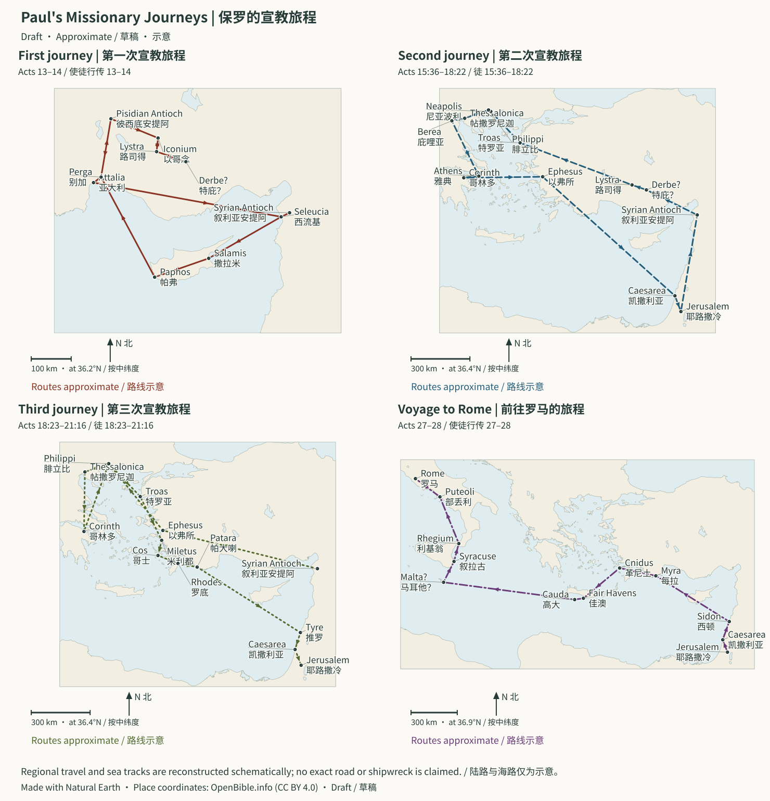

# Acts and Paul: Journeys, Chronology, and Urban Evidence | 使徒行传与保罗书信：旅程、年代与城市史料对照

> Status: Draft (AI draft; not human reviewed) | 状态：Draft（AI 草稿，未人工审阅）

> Scope: ascension, Pentecost, Jerusalem, Antioch, missions, Paul’s Roman confinement; locate thirteen named Pauline letters in possible writing stages.<br>
> 范围：从耶稣升天、五旬节和耶路撒冷教会开始，经安提阿与保罗宣教旅程，直到保罗在罗马被软禁；同时把十三卷具名保罗书信放回可能的写作阶段。
> Purpose: connect city problems, coworkers, letters, and expanding gospel rather than isolated travel/theology.<br>
> 目的：不再把《使徒行传》当成独立旅行故事、把书信当成散乱神学文章，而是看见“某座城发生问题—同工往返—书信回应—福音继续扩展”的连续历史。
> Method: distinguish internal narrative, Roman administration, inscriptions, coins, roads, cities; present alternatives when dates/authorship unsettled.<br>
> 方法：把经文内部资料、罗马行政史、铭文、钱币、道路与城市考古分层使用；精确年代和作者问题若无共识，就并列主要方案。

---

<a id="journey-map"></a>
## Paul's Missionary Journeys | 保罗的宣教旅程



**Approximate / 示意:** Solid, dashed, dotted, and dash-dot lines connect selected places in Acts 13–14, 15:36–18:22, 18:23–21:16, and 27–28 respectively. Regional travel in Galatia/Phrygia, Derbe's identification, the Maltese landing site, and the exact storm track remain uncertain. This is not an ancient road survey or an identified shipwreck position. / 实线、虚线、点线、点划线分别连接上述四段使徒行传中的选定地点。加拉太与弗吕家的区域路线、特庇认定、马耳他登陆点及风暴航迹仍不确定；本图不是古道测绘或已确认沉船位置。

On a phone, scroll inside the map or [open the full SVG](../assets/maps/paul-journeys.svg). See [map notes](../Maps/README.md#paul-geography) and [data credits](../CREDITS.md#map-data). / 手机可在图内横向滚动或[打开完整 SVG](../assets/maps/paul-journeys.svg)，另见[地图说明](../Maps/README.md#paul-geography)与[数据署名](../CREDITS.md#map-data)。

<a id="t1-26a-20"></a>
## 1. Main Conclusions | 一、先给结论

1. **Geography also structures the theology:** Jerusalem→Judea/Samaria→Antioch→Asia Minor→Macedonia/Achaia→Rome; Acts 1:8.
   **《使徒行传》的地理结构就是神学结构**：耶路撒冷 → 犹太和撒玛利亚 → 安提阿 → 小亚细亚 → 马其顿和亚该亚 → 罗马，对应徒 1:8。
2. **Letters are remote pastoral care:** actual division, pressure, ethics, worship, teaching, money, leadership, not systematic-theology chapters.
   **保罗书信不是系统神学教材的章节**：它们是写给真实群体的“远程牧养”，回应分裂、逼迫、伦理、敬拜、假教导、金钱和领袖等具体问题。
3. **Canonical order is broadly not chronological:** church letters then individuals, roughly length-based.
   **书信在新约中的排列大致不是写作顺序**：传统编排先列写给教会的信、再列写给个人的信，并大致按篇幅排列。
4. **Gallio anchors chronology:** Delphi supports common51–52 CE Achaian proconsul reconstruction, not exact start/end months.
   **迦流是最重要的外部年代锚点**：德尔斐铭文把迦流任亚该亚省 proconsul 的常见重建压缩在主后 51–52 年附近，从而帮助推算保罗第二次旅程和前后书信；它不能给出任职起止的精确月份。
5. **Around50 CE convergence:** Claudius, Roman Jews, Aquila/Priscilla, Corinth, 1 Thessalonians, Gallio.
   **主后 50 年左右是关键交叉点**：革老丢处理罗马犹太群体、亚居拉和百基拉来到哥林多、保罗在哥林多停留、帖撒罗尼迦前书写成、迦流上任，几条线在此相交。
6. **Cities explain letters:**
   **城市考古最能说明“为什么这封信这样写”**：
   - Philippi Roman colony;
     腓立比是罗马殖民城；
   - Thessalonian politarchs;
     帖撒罗尼迦使用“政治官 / politarch”职称；
   - Athenian altars, images, philosophy;
     雅典充满祭坛、神像与哲学公共空间；
   - Corinth colony, capital, transport hub;
     哥林多是罗马殖民城、省会与交通枢纽；
   - Ephesian Artemis, theater, guilds, honor.
     以弗所的亚底米崇拜、剧场、同业和城市荣誉紧密相连。
7. **Context, not particular conversion/sermon proof:** no Lydia house or exact Pauline bema step identified.
   **考古通常确认背景，不直接确认某次讲道或悔改**：腓立比的建筑不能证明吕底亚住在哪间屋；哥林多的讲坛也不能证明保罗准确站在现存平台的哪一级。
8. **Degrees of confidence:**
   **保罗年代要用“确定度”而非单一答案**：
   - 1 Thessalonians, Corinthian letters, Romans more readily located;
     帖撒罗尼迦前书、哥林多前后书、罗马书相对容易放入旅程；
   - Early/late Galatians;
     加拉太书的早晚次序仍有两大模型；
   - Ephesus, Caesarea, Rome imprisonment models;
     腓立比书、腓利门书的监禁地点可能是以弗所、凯撒利亚或罗马；
   - Ephesians, Colossians, 2 Thessalonians, Pastorals authorship/dates debated.
     以弗所书、歌罗西书、帖撒罗尼迦后书和教牧书信的作者与年代在学界有实质争论。
9. **Cross-read Acts/self-account:** visits, Galatians 2, post-call movements, not forced harmonization.
   **《使徒行传》与保罗自述应交叉阅读，而非强行抹平**：耶路撒冷访问次数、加拉太书 2 章对应哪次会议、保罗受召后的移动，都需要比较两种叙事目的。
10. **Not heroic travel alone:** risen Christ/Spirit forms Jew, Samaritan, Gentile covenant people, Abrahamic blessing to nations.
    **整条线的中心不是“保罗的英雄旅行”**：是复活的基督借圣灵带领一个跨越犹太人、撒玛利亚人和外邦人的新约群体，把亚伯拉罕之福带向万国。

One connecting statement:<br>
一句话串联：

> From persecuted Jerusalem disciples through Antioch’s cross-cultural mission, coworkers build communities along cities, sea, synagogues, homes. Letters address new problems; Paul enters capital in chains while God’s word remains unhindered.<br>
> 福音从耶路撒冷受逼迫的犹太门徒群体出发，在安提阿成为跨族群差传运动；保罗和同工沿罗马城市、海路、会堂和家庭网络建立群体；书信处理这些群体因福音而产生的新问题；最后保罗虽带锁链进入帝国首都，上帝的道却“不受禁止”。

---

<a id="t1-26a-48"></a>
## 2. Read Three Timelines Together | 二、使用说明：三条时间线必须一起看

<a id="t1-26a-50"></a>
### 1. Acts Narrative | 1. 《使徒行传》的叙事时间线

Tells:<br>
它告诉我们：

- Where;
  人到了哪里；
- Companions;
  与谁同行；
- City events;
  城市发生什么；
- Official responses;
  罗马官员怎样回应；
- New mission regions.
  宣教如何转向新地区。

<a id="t1-26a-60"></a>
### 2. Letters’ Internal Timeline | 2. 保罗书信的内部时间线

Tells:<br>
它告诉我们：

- Remembered experience;
  保罗怎样回忆自己的经历；
- Present coworkers;
  哪些同工当时与他同在；
- Plans;
  他计划下一步去哪里；
- Earlier letters/visits;
  某教会之前收过哪些信或访问；
- Collection/mission networks.
  捐款和差传网络进行到哪一步。

<a id="t1-26a-70"></a>
### 3. External History | 3. 外部历史时间线

Provides:<br>
它提供：

- Emperor, king, governor terms;
  皇帝、地方王和总督任期；
- City status, offices, roads;
  城市身份、官职名称和道路；
- Coins/inscriptions;
  钱币和铭文年代；
- War, famine, expulsion, administrative changes.
  战争、饥荒、驱逐令和行政变化。

Find intersections without swallowing one timeline into another.<br>
正确做法不是用其中一条吞掉另外两条，而是寻找交叉点。

---

<a id="t1-26a-83"></a>
## 3. Confidence Grades | 三、确定度分级

| Grade / 等级 | Definition / 定义 | Example / 例子 |
| --- | --- | --- |
| A: high | Internal/external convergence, small model differences | Gallio 51–52/Paul in Corinth |
| A：高确定 | 经文内部与外部锚点相互支持，主要方案差距小 | 迦流任期约主后 51–52；保罗在此阶段身处哥林多 |
| B: probable | Itinerary/coworkers fit, no direct date | 1 Thessalonians 50–51 Corinth |
| B：较可能 | 经文行程和同工信息吻合，但缺少直接外部日期 | 帖前约主后 50–51 年写于哥林多 |
| C: alternatives | Multiple substantial models | Galatians timing/Philippians imprisonment |
| C：多方案 | 重要材料可支持两个或更多模型 | 加拉太书早期或晚期；腓立比书监禁地点 |
| D: outside core | Late legend, tourism, unprovenanced objects, circularity | Paul’s exact prison/standing stone |
| D：不宜作为核心 | 依赖后世传说、旅游认定、来源不明器物或循环论证 | “这就是保罗监牢”“这块石头就是保罗站立点” |

About 50–52 expresses evidence’s precision, not evasion.<br>
年代写成“约主后 50–52”不是含糊，而是对证据精度的诚实表达。

---

<a id="t1-26a-96"></a>
## 4. Timeline | 四、总时间线

> The table uses a common middle chronology. Outside fixed anchors, many dates can move by 1–2 years. A Passion date of 33 CE can shift early events later.<br>
> 下表采用较常见的“中间年代方案”。除迦流等固定点外，许多年份可前后移动一至两年；受难若采用主后 33 年，早期事件也可能相应后移。

| Date / 年代 | Acts / 《使徒行传》主线 | Paul/letters / 保罗与书信 | External context / 外部坐标 |
| --- | --- | --- | --- |
| About 30/33 CE | Ascension, Pentecost, Jerusalem | — | Tiberius/Pilate |
| 约主后 30/33 | 升天、五旬节、耶路撒冷群体形成 | — | 提庇留在位；彼拉多仍任犹太长官 |
| Early 30sCE | Healings, shared life, Ananias/Sapphira, Seven, Stephen | Saul persecutes | Temple/priest/Roman administration |
| 主后 30 年代前期 | 医治、讲道、共享、亚拿尼亚与撒非喇、七人、司提反 | 扫罗逼迫教会 | 圣殿仍在，祭司与罗马行政并行 |
| About 32–36 CE | Damascus call/Ananias | Galatians 1:15–24 self-account | Aretas ethnarch, 2 Corinthians 11:32; mechanism debated |
| 约主后 32–36 | 扫罗在大马士革路上蒙召；亚拿尼亚接纳他 | 加 1:15–24 提供保罗自己的受召与行程概述 | 亚哩达王相关民族长与大马士革问题见林后 11:32，精确政治机制有争议 |
| Late 30s CE | Philip/Samaria/coast; Cornelius | Syria/Cilicia | Caesarea administration/port |
| 30 年代后期 | 腓利在撒玛利亚及沿海；彼得与哥尼流 | 保罗往叙利亚、基利家一带 | 凯撒利亚是罗马行政和港口中心 |
| About 40–44 CE | Antioch, Christian name, famine aid | Barnabas brings Paul | Claudius 41–54 |
| 约主后 40–44 | 安提阿教会形成；“基督徒”称呼出现；饥荒援助 | 巴拿巴找保罗到安提阿服事 | 革老丢主后 41–54 在位 |
| 44 CE | Agrippa I kills James, imprisons Peter, dies | — | Coins/Josephus kingship setting |
| 主后 44 | 希律·亚基帕一世杀雅各、囚彼得，后在凯撒利亚去世 | — | 亚基帕一世钱币和约瑟夫斯提供外部王权背景 |
| About 46–48 CE | Cyprus, Pamphylia, Pisidian Antioch, Iconium, Lystra, Derbe, return | Early South-Galatian model | Province/Paphos/cult setting |
| 约主后 46–48 | 第一次旅程：居比路 → 旁非利亚 → 彼西底安提阿 → 以哥念 → 路司得 → 特庇 → 回安提阿 | 若采用“南加拉太早期说”，加拉太书可能接近此时写成 | 居比路为罗马行省；帕福斯是行政与阿佛洛狄忒崇拜中心 |
| About 48/49 CE | Jerusalem meeting | Galatians 2 or earlier relief visit | Jew/Gentile questions under Claudius |
| 约主后 48/49 | 耶路撒冷会议 | 加 2 可能对应此会，也可能对应较早赈灾访问 | 革老丢时代犹太—外邦问题日益显著 |
| About 49–52 CE | Syria/Cilicia, Lystra, Troas, Philippi, Thessalonica, Berea, Athens, Corinth | 1 Thessalonians 50–51; 2 Thessalonians if early; Galatians possible later | Claudius 49/Gallio 51–52 |
| 约主后 49–52 | 第二次旅程：叙利亚／基利家 → 路司得 → 特罗亚 → 腓立比 → 帖撒罗尼迦 → 庇哩亚 → 雅典 → 哥林多 | 帖前约 50–51；帖后若为早期保罗书信则不久后；加拉太书也可能在此后 | 革老丢约 49 年处理罗马犹太群体；迦流约 51–52 任亚该亚 proconsul |
| About 52 CE | Ephesus, Caesarea, Antioch return | — | Gallio synchronization |
| 约主后 52 | 保罗离开哥林多，经以弗所、凯撒利亚回安提阿 | — | 迦流铭文构成最重要同步点 |
| About 52/53–57 CE | Galatia/Phrygia, Ephesus, Macedonia, Corinth, Jerusalem | 1 Corinthians 54/55; 2 Corinthians 55/56; Romans 56/57; late Galatians 54–56 | Nero 54/Ephesus |
| 约主后 52/53–57 | 第三次旅程：加拉太／弗吕家 → 以弗所长期服事 → 马其顿 → 哥林多 → 返回耶路撒冷 | 林前约 54/55；林后约 55/56；罗约 56/57；加拉太书晚期说约 54–56 | 尼禄主后 54 即位；以弗所为亚细亚省重要城市 |
| About 57 CE | Temple arrest | Romans completed; collection delivery | High priest Ananias’ term near end |
| 约主后 57 | 在耶路撒冷圣殿被捕 | 罗马书已写成，保罗准备前往耶路撒冷送捐项 | 亚拿尼亚任大祭司时期接近结束 |
| About 57–59 CE | Caesarea/Felix | Caesarean captivity-letter model | Felix coins |
| 约主后 57–59 | 在凯撒利亚被监禁；腓力斯审讯 | 若采凯撒利亚监禁说，腓立比书／腓利门书／歌罗西书等可能在此 | 腓力斯钱币确认其犹太行政背景 |
| About 59/60 CE | Festus/appeal/Agrippa II | — | Accession uncertain; coins58/59 |
| 约主后 59/60 | 非斯都到任；保罗向该撒上诉；亚基帕二世听审 | — | 非斯都任期的精确起年仍有讨论；钱币提供主后 58/59 附近材料 |
| 59–60 or 60–61 CE | Storm, Malta, Rome | — | Winter seas/Alexandrian grain ships |
| 约主后 59–60 或 60–61 | 海难、马耳他、抵达罗马 | — | 地中海冬季航行和亚历山大粮船背景与叙事相符 |
| About 60–62 CE | Two years/Roman confinement/end | Traditional Philippians, Philemon, Colossians, Ephesians | Early Nero, before 64 fire |
| 约主后 60–62 | 保罗在罗马软禁两年；《使徒行传》结束 | 传统罗马监禁说把腓、门、西、弗放在此期 | 尼禄早期统治；主后 64 年罗马大火尚在《使徒行传》结尾之后 |
| After62 CE | Not narrated | Release/travel/Pastorals tradition versus later Pauline-tradition model | Early church tradition, no contemporary Roman archive |
| 主后 62 以后 | 《使徒行传》未叙述 | 传统说：保罗获释、再旅行，写提前、多、提后；另一学术模型视教牧书信为较晚的保罗传统 | 保罗结局主要依赖早期教会传统，缺少同期罗马档案 |

---

<a id="acts-geographical-framework"></a>
## 5. The Geographical Framework of Acts | 整卷《使徒行传》的地理骨架

```text
Acts 1–7: Jerusalem
徒 1–7     耶路撒冷
              ├─ The Spirit descends
              ├─ 圣灵降临
              ├─ Witness in the temple
              ├─ 圣殿见证
              └─ Stephen’s martyrdom
              └─ 司提反殉道
                   ↓
Acts 8–12: Judea, Samaria, and the coast
徒 8–12    犹太、撒玛利亚与沿海
              ├─ Philip and Samaria
              ├─ 腓利与撒玛利亚
              ├─ The Ethiopian official
              ├─ 埃提阿伯官员
              ├─ Saul’s call
              ├─ 扫罗蒙召
              ├─ Cornelius
              ├─ 哥尼流
              └─ The Antioch church
              └─ 安提阿教会
                   ↓
Acts 13–15: First journey and Jerusalem council
徒 13–15   第一次旅程与耶路撒冷会议
              ├─ Cyprus
              ├─ 居比路
              ├─ Pamphylia
              ├─ 旁非利亚
              ├─ Cities of southern Galatia
              ├─ 南加拉太城市
              └─ Must Gentiles be circumcised?
              └─ 外邦人是否必须受割礼？
                   ↓
Acts 15:36–18:22: Second journey
徒 15:36–18:22  第二次旅程
              ├─ The Macedonian call
              ├─ 马其顿呼声
              ├─ Philippi
              ├─ 腓立比
              ├─ Thessalonica and Berea
              ├─ 帖撒罗尼迦、庇哩亚
              ├─ Athens
              ├─ 雅典
              └─ Corinth and Gallio
              └─ 哥林多与迦流
                   ↓
Acts 18:23–21:17: Third journey
徒 18:23–21:17  第三次旅程
              ├─ Extended ministry in Ephesus
              ├─ 以弗所长期服事
              ├─ Macedonia and Achaia
              ├─ 马其顿与亚该亚
              ├─ The collection network
              ├─ 捐项网络
              └─ Return to Jerusalem
              └─ 返回耶路撒冷
                   ↓
Acts 21–28: Arrest, hearings, and Rome
徒 21–28    被捕、审讯与罗马
              ├─ Jerusalem
              ├─ 耶路撒冷
              ├─ Caesarea: Felix, Festus, and Agrippa II
              ├─ 凯撒利亚：腓力斯、非斯都、亚基帕二世
              ├─ Mediterranean voyage and Malta
              ├─ 地中海航行与马耳他
              └─ Rome: preaching boldly while in chains
              └─ 罗马：带锁链却放胆传道
```

---


<a id="t1-26bc-270"></a>
## 6. Jerusalem Is the Starting Point | 六、第一阶段：耶路撒冷不是终点，而是起点

<a id="t1-26bc-272"></a>
### 1. Acts 1:8 Outlines the Book | 1. 徒 1:8 是全卷目录

“Jerusalem, all Judea and Samaria, and the ends of the earth” is a purposeful sequence:<br>
“耶路撒冷、犹太全地和撒玛利亚，直到地极”不是随意地名排列：

- Jerusalem: the city of promise, temple, Passion, and resurrection;
  耶路撒冷：应许、圣殿、受难与复活之城；
- Judea: Israel’s homeland;
  犹太：以色列故土；
- Samaria: a neighboring community sharing traditions yet separated by deep boundaries;
  撒玛利亚：有共同传统又存在深刻边界的邻近群体；
- The ends of the earth: the Gentile world and the imperial center.
  地极：外邦世界和帝国中心。

The gospel unfolds from Israel’s Messiah and the promise of the Spirit toward all peoples, rather than abandoning Israel.<br>
福音不是抛弃以色列后转向外邦，而是从以色列的弥赛亚和圣灵应许中向万民展开。

<a id="t1-26bc-283"></a>
### 2. Pentecost, Diaspora Jews, and Languages in Acts 2 | 2. 徒 2：五旬节、散居犹太人与语言

Pentecost was a pilgrimage festival. The list of places in Acts 2 shows:<br>
五旬节原是朝圣节期。徒 2 的多地名单说明：

- Diaspora Jews and converts gathering in Jerusalem;
  耶路撒冷在节期聚集散居犹太人和归信者；
- Aramaic, Greek, and local languages coexisting;
  亚兰语、希腊语及地方语言共同存在；
- The gospel’s cross-language direction from the outset;
  福音从第一天起就具跨语言方向；
- Returning pilgrims potentially carrying the message through their networks.
  回乡的朝圣者可成为信息传播网络。

This helps explain later missions beginning in synagogues: diaspora networks already linked Jerusalem with imperial cities.<br>
这也解释为何后文许多城市先从会堂开始：散居犹太网络早已连接耶路撒冷与帝国城市。

<a id="t1-26bc-294"></a>
### 3. “Hellenists” in Acts 6–7 | 3. 徒 6–7：“希利尼人”不是“异教希腊人”

The Hellenists of Acts 6 generally means mainly Greek-speaking Jewish believers, culturally and linguistically distinct from mainly Hebrew/Aramaic-speaking believers.<br>
徒 6 的 Hellenists 通常指主要说希腊语的犹太信徒，与主要说希伯来语／亚兰语的群体形成语言文化差异。

The dispute over provision for widows shows:<br>
寡妇供应冲突表明：

- Resource distribution was among the church’s earliest crises;
  教会的第一批危机之一是资源分配；
- Being filled with the Spirit and administrative justice belong together;
  圣灵充满与行政公义不能分开；
- The Seven’s Greek names indicate the empowerment of cross-cultural leaders;
  七人的希腊名字显示跨文化领袖被赋权；
- Stephen rereads Israel’s history, stressing that God is not confined to one place.
  司提反的讲论重读以色列历史，强调上帝不受某一地点限制。

<a id="t1-26bc-305"></a>
### 4. Samaria and the Ethiopian Official in Acts 8 | 4. 徒 8：撒玛利亚与埃提阿伯官员

These two episodes extend the boundaries in succession:<br>
这两段把边界连续向外推：

- Samaritans had a history of sanctuary and communal conflict with Jews;
  撒玛利亚人：历史上与犹太人有圣所和族群冲突；
- The Ethiopian eunuch is a Gentile official whose bodily status also raises questions about legal boundaries of membership;
  埃提阿伯太监：既是外邦高官，又因身体身份面临律法群体界线问题；
- Isaiah 53 and 56 provide a background of hope concerning the suffering servant, foreigners, and eunuchs.
  以赛亚书 53 章与 56 章的受苦仆人、外邦人和太监盼望形成背景。

---

<a id="t1-26bc-315"></a>
## 7. Saul/Paul: Two Names, Not a New Christian Name | 七、扫罗／保罗：不是换了一个基督教名字

<a id="t1-26bc-317"></a>
### 1. Two Names | 1. 两个名字

- “Saul / Shaul” is a Jewish name;
  “扫罗 / Shaul”是犹太名字；
- “Paul / Paulos” belongs to the Roman-Greek environment;
  “保罗 / Paulos”是罗马—希腊语环境中的名字；
- Acts 13:9 says Saul was also called Paul, rather than describing a mysterious renaming ceremony;
  徒 13:9 写“扫罗又名保罗”，不是描述一次神秘改名仪式；
- Having two names was natural in a cross-cultural world.
  在跨文化世界拥有两个名字十分自然。

<a id="t1-26bc-324"></a>
### 2. Why Do Acts 9, 22, and 26 Differ? | 2. 徒 9、22、26 三次叙述为何有差异

The three accounts share this core:<br>
三段共同核心：

- Paul was persecuting Jesus’ disciples;
  保罗正逼迫耶稣门徒；
- A heavenly appearance redirected him;
  天上显现使他转向；
- Jesus treated persecution of the disciples as persecution of himself;
  耶稣把对门徒的逼迫视为对自己的逼迫；
- Paul received a mission to testify to Gentiles.
  保罗领受向外邦人作见证的使命。

Differences include:<br>
差异包括：

- How the companions “heard the sound” or did not understand/hear the speaker;
  同行者“听见声音”与“没有听明／听见说话者”的表达；
- Seeing light without seeing the speaker;
  看见光却不见说话者；
- Details of the commission unfolding in different hearing contexts.
  使命细节在不同审讯语境中展开。

Read these first as ancient repeated narratives and speeches. Neither splice them into a second-by-second recording nor overlook their shared core because perspectives differ.<br>
应先按古代重复叙事与演说目的阅读，不要把三个版本拼成逐秒录像，也不要因为视角差异就忽略共同核心。

<a id="t1-26bc-341"></a>
### 3. Paul’s Own Testimony | 3. 保罗自己的见证

Important passages:<br>
重要经文：

- Galatians 1:13–24;
  加 1:13–24；
- 1 Corinthians 9:1; 15:8–10;
  林前 9:1；15:8–10；
- Philippians 3:4–11;
  腓 3:4–11；
- 2 Corinthians 4:6.
  林后 4:6。

Paul emphasizes:<br>
保罗强调：

- He formerly persecuted God’s church;
  他曾逼迫上帝的教会；
- God called him by grace and revealed his Son;
  上帝以恩典呼召并启示祂的儿子；
- He did not derive the gospel’s fundamental authority from the Jerusalem apostles;
  他没有从耶路撒冷使徒获得福音的根本权威；
- He later shared fellowship with the apostles and received recognition of his mission.
  同时他后来与使徒相交并获得使命认可。

Acts emphasizes acceptance by the church and public mission; the letters emphasize direct calling and the gospel’s independence. Their different emphases need not silence one another.<br>
《使徒行传》强调教会接纳与公共使命；书信强调直接呼召与福音独立性。两者重点不同，不必互相消音。

---

<a id="t1-26bc-361"></a>
## 8. Antioch: A Missionary Hub | 八、安提阿：第一座差传枢纽

<a id="t1-26bc-363"></a>
### 1. Why Antioch? | 1. 为什么是安提阿

Syrian Antioch:<br>
叙利亚安提阿：

- Was a major city of Roman Syria;
  是罗马叙利亚行省重镇；
- Linked Mediterranean ports, the Syrian interior, and roads into Asia Minor;
  连接地中海港口、叙利亚内陆和小亚细亚道路；
- Had a multiethnic and multilingual population;
  有多族群、多语言人口；
- Had a Jewish diaspora community;
  有犹太散居社群；
- Was well placed as a base for missions across regions.
  适合成为跨地区差传基地。

<a id="t1-26bc-373"></a>
### 2. “Christians” in Acts 11:26 | 2. 徒 11:26 的“基督徒”

“Christian” may initially have been an outsiders’ social label for a Christ-associated group. It suggests:<br>
“基督徒”可能起初是外界给“基督派”群体的社会标签。它表明：

- The community remained deeply rooted in Jewish Scripture;
  这群人仍深深扎根犹太圣经；
- City observers could identify it by its association with Christ;
  但在城市观察者眼中，他们已经因“基督”形成可辨识群体；
- The name’s appearance does not mean a later institutional religion, wholly separated from Judaism, already existed.
  名称出现不等于此时已形成与犹太教完全分离的后世制度宗教。

<a id="t1-26bc-381"></a>
### 3. The Leaders Listed in Acts 13 | 3. 徒 13 的领袖名单

Barnabas, Simeon, Lucius, Manaen, and Saul had diverse backgrounds. Antioch’s mission grew from diverse leaders worshiping, fasting, and sending together, rather than one group exporting its culture.<br>
巴拿巴、西面、路求、马念和扫罗的背景多样。安提阿差传不是单一族群向别人输出文化，而是多元领袖在敬拜与禁食中共同差派。

---

## 九、第一次旅程：居比路与南加拉太城市

### 1. 路线

```text
安提阿
  → 西流基港
  → 居比路：撒拉米、帕福斯
  → 旁非利亚：别加
  → 彼西底安提阿
  → 以哥念
  → 路司得
  → 特庇
  → 原路坚固群体
  → 安提阿
```

### 2. 帕福斯与“方伯”

徒 13 称士求·保罗为 proconsul。居比路在罗马行政中属于由元老院管理、由 proconsul 治理的行省，这个职称与制度背景相符。

帕福斯考古展示：

- 罗马行政城市；
- 宫殿、剧场、住宅和墓葬；
- 阿佛洛狄忒崇拜的长期中心。

**证据边界**：

- 尚没有一块被普遍接受的铭文能毫无疑问地等同徒 13 的士求·保罗；
- 同名铭文或家族线索只能作为候选，不应升为 A 级人物证明；
- 帕福斯遗址能确认城市和宗教环境，不能证明行法术的以吕马事件。

- **来源**：
  - [UNESCO：Paphos](https://whc.unesco.org/en/list/79/)
  - [居比路大学：Paphos Harbour 与罗马方伯驻地](https://www.ucy.ac.cy/marecyprium/case-studies/paphos-harbour/)。

### 3. 彼西底安提阿的信息

保罗从以色列历史讲到大卫之子和复活，说明外邦宣教并非跳过旧约：

- 出埃及、士师、扫罗、大卫；
- 诗篇和以赛亚；
- 赦罪与称义；
- “作外邦人的光”。

安提阿信息为保罗书信的基本模式提供叙事窗口：以色列应许借复活的弥赛亚临到万民。

### 4. 路司得的宙斯与希耳米

当地人把巴拿巴、保罗认作宙斯和希耳米，反映希腊—安纳托利亚宗教世界。保罗的回应不是接受“基督教版神人”，而是：

- 从偶像转向创造天地的永生上帝；
- 上帝过去容让列国各行其道；
- 雨水、丰年和饮食仍是普遍恩典见证。

这与在会堂中从以色列历史讲起不同，显示福音表达会因听众知识背景调整，但核心创造主—复活主不变。

---

## 十、耶路撒冷会议：外邦人必须先成为犹太人吗？

### 1. 争议核心

问题不是“外邦人能不能相信”，而是：

- 是否必须受割礼；
- 是否必须承担完整犹太身份标志；
- 摩西律法怎样适用于外邦信徒；
- 犹太人与外邦人能否同桌、同属一个群体。

### 2. 徒 15 的决定

彼得、巴拿巴、保罗和雅各共同见证：

- 上帝已赐圣灵给外邦人；
- 得救是借主耶稣的恩；
- 不应把列祖和当代人都不能完全负担的轭放在外邦人身上；
- 外邦信徒应避开偶像污秽、淫乱、勒死牲畜和血。

这些禁戒的来源与功能有多种解释：

- 利未记 17–18 对寄居者的要求；
- 远离异教宴席；
- 促进犹太—外邦同桌；
- 基本道德和敬拜界线。

### 3. 加拉太书 2 章对应哪一次访问

两大模型：

#### 模型 A：对应徒 11 的赈灾访问

- 加拉太书写在徒 15 会议前；
- 加 2 是较私下的会面；
- 保罗未提徒 15 决议，因为它尚未发生；
- 支持较早的“南加拉太”日期。

#### 模型 B：对应徒 15 的会议

- 两段都处理外邦人、割礼、彼得、雅各和巴拿巴；
- 加 2 从保罗个人与使徒认可角度叙述，徒 15 从公共会议角度叙述；
- 保罗不引用决议可能因加拉太书论证基于福音与圣灵，不依赖耶路撒冷行政命令。

现有材料不能排除其中之一。应标为 C，而非用一张时间表假装已定论。

---

## 十一、第二次旅程：福音进入马其顿与亚该亚

### 1. 保罗与巴拿巴分开

徒 15:36–41 对马可的分歧显示：

- 成熟领袖也会产生严重判断差异；
- 经文没有简单宣布某一方完全属灵、另一方完全错误；
- 分开后出现两支团队；
- 西 4:10、门 24、提后 4:11 显示马可后来与保罗恢复合作。

这是一条重要牧养线：冲突可能造成真实损伤，却不必成为永久定罪。

### 2. 提摩太受割礼与提多不受割礼

- 提多是希腊人；加 2 坚持不因强迫而受割礼，因为福音自由正受挑战；
- 提摩太母亲是犹太人、父亲是希腊人；徒 16 的割礼是为地方宣教可接近性；
- 二者差别不是原则反复，而是“救恩必要条件”和“自愿宣教适应”不同。

### 3. 马其顿呼声

徒 16 的异象把路线带到爱琴海西岸。保罗团队从特罗亚渡海，经撒摩特喇到尼亚波利，再沿罗马道路进入腓立比。

---

## 十二、腓立比：罗马殖民城与天上国民

### 1. 城市身份

腓立比：

- 位于连接东西的 Via Egnatia；
- 在腓立比战役后安置罗马军人；
- 成为罗马殖民城；
- 城市法律、公共建筑、拉丁文化和公民荣誉带有“小罗马”特征。

UNESCO 对遗址的总结明确称其被塑造成类似“小罗马”的 Colonia Augusta。

- **来源**：[UNESCO：Archaeological Site of Philippi](https://whc.unesco.org/en/list/1517/)。

### 2. 徒 16 的城市细节

- 保罗和西拉遭地方 magistrates 处理；
- 执法人员使用杖打；
- 保罗后来提出罗马公民未经审判被打的问题；
- 监牢、公共广场和城外祷告处符合殖民城社会框架。

不能直接把今日旅游点“吕底亚洗礼处”或“保罗监狱”当作经考古确认的具体现场；它们主要是纪念性传统定位。

### 3. 腓立比书的政治语言

腓 1:27 的 politeuesthe 可带“以公民身份生活”的意味；3:20 说“我们的国籍 / 公民权在天上”。

在罗马殖民城中，这不是叫信徒逃离公共生活，而是重新定义最高效忠：

- 地上罗马公民身份可能有真实特权；
- 天上国民的主是耶稣基督；
- “救主”和“主”的语言挑战皇帝宣传；
- 群体政治以十字架式谦卑而非争竞荣耀为形状。

### 4. 吕底亚和狱卒显示家庭网络

两人“和她／他一家”受洗，显示福音常通过 household 网络扩展。但古代一家包括哪些人、是否有幼儿，不能从这两节确定；不同洗礼传统不应把沉默处变成考古事实。

---

## 十三、帖撒罗尼迦：政治官与“另有一个王”

### 1. 城市位置

帖撒罗尼迦：

- 是马其顿省重要城市；
- 位于 Via Egnatia；
- 有良好港口；
- 具有自由城的地方治理传统；
- 城市与罗马帝国政治密切。

### 2. “政治官 / politarch”铭文

大英博物馆藏帖撒罗尼迦城门石列出六位 politarchs、城市司库和 gymnasiarch。

该物件为主后 2 世纪的大理石城门建筑块，馆藏号 BM 1877,0511.1，铭文出版号 IG X 126。它晚于保罗访问，但不是孤立的现代术语猜测。

- **能支持**：
  - politarch 是马其顿、尤其帖撒罗尼迦真实使用的地方官职；
  - 徒 17:6、8 的地方称谓不是随意杜撰。
- **不能支持**：
  - 该石通常定于主后 2 世纪，晚于保罗访问；
  - 它没有列出徒 17 当时官员，也不证明耶孙事件；
  - 应说“职称在当地得到铭文证实”，不说“这块石就是审讯保罗的官员名单”。
- **等级**：A（地方职称）；对徒 17 具体事件为 B。
- **来源**：[大英博物馆：Thessalonica politarch inscription，BM 1877,0511.1](https://www.britishmuseum.org/collection/object/G_1877-0511-1)。

### 3. “违背该撒命令，说另有一个王耶稣”

指控把福音转为政治犯罪：

- “基督”可被听成受膏王；
- “主”与“救主”也用于皇帝；
- 末世降临与国度语言可能被视为挑战罗马秩序；
- 耶孙被要求担保，显示地方当局优先维持治安。

帖撒罗尼迦前书继续使用：

- 上帝的国；
- 耶稣从天降临；
- 躲避将来忿怒；
- 平安稳妥之时审判忽然来到。

这不是鼓动武装政变，而是把终极主权从该撒转向被钉又复活的耶稣。

### 4. 帖撒罗尼迦前书的时间

较常见重建：

- 保罗离开帖撒罗尼迦；
- 在雅典独自等候，并差提摩太回去；
- 提摩太在哥林多带回消息；
- 保罗、西拉、提摩太共同具名写信；
- 时间约主后 50–51 年。

这是现存最早新约书卷的有力候选。

---

## 十四、雅典：未知之神、亚略巴古与复活

### 1. 城市环境

雅典在罗马时代已非帝国政治中心，却仍是：

- 哲学教育中心；
- 神庙、祭坛、雕像密集之城；
- 古典文化权威象征；
- 多种学派和外来思想交流场所。

### 2. “未识之神”有文学背景，但没有找到保罗那块祭坛

主后 2 世纪作者保萨尼亚斯记载雅典法勒隆一带有“称为未知者的神”的祭坛，其他古代作者也提到未知神灵祭坛。

- **能支持**：把祭坛献给身份未明神灵的宗教实践在希腊世界、包括雅典有文学见证；
- **不能支持**：没有一块可确认就是徒 17:23 那座祭坛的出土石块；
- **语法提醒**：保萨尼亚斯材料多用复数“未知诸神”，徒 17 引用单数铭文；两者说明环境相近，不是逐字同碑。
- **来源**：[Scaife / Perseus：Pausanias, Description of Greece 1.1.4](https://scaife.perseus.org/reader/urn%3Acts%3AgreekLit%3Atlg0525.tlg001.perseus-eng2%3A1.1.4/?right=perseus-grc2)。

### 3. “亚略巴古”可能指山，也可能指议事机构

Areopagus 既是雅典卫城西北的岩丘，也指以此得名的议事机关。罗马时期该机构重新获得较广公共和教育监督权。

徒 17 的“带到亚略巴古”可能是：

- 到岩丘附近公开讨论；
- 到该议会或其成员面前接受询问；
- 两种含义在古代并非绝对分离。

- **来源**：[雅典卫城博物馆：Areopagus Council](https://www.theacropolismuseum.gr/en/node/1007)。

### 4. 保罗怎样与哲学听众对话

他没有先引用摩西：

- 从创造主不住人手所造殿宇开始；
- 反对神需要人供养；
- 宣告万族同源和上帝掌管时代疆界；
- 引用希腊诗人可理解的语言；
- 最终以复活与审判提出不可被希腊哲学吸收的挑战。

“凡事很敬畏鬼神”可含正面或批判双关；保罗既找到接触点，也揭露偶像无知。

---

## 十五、哥林多：迦流铭文锁定整条保罗时间线

### 1. 为什么哥林多重要

罗马哥林多：

- 主前 44 年由凯撒重建为殖民城；
- 是亚该亚省行政中心；
- 控制科林斯地峡的东西交通；
- 有港口、市场、工匠、 freedpersons、精英赞助人和多种神庙；
- 社会荣誉竞争、宴席、法庭和公共赞助深刻影响哥林多书信。

### 2. 亚居拉和百基拉与革老丢命令

徒 18:2 说亚居拉和百基拉最近从意大利来，因为革老丢命令犹太人离开罗马。

罗马作者苏埃托尼乌斯写革老丢因“Chrestus 煽动的持续骚乱”驱逐犹太人。常见重建约主后 49 年。

需要保留：

- “Chrestus”可能是对 Christus 的拼写／听写，也可能是同名人物；
- 命令的范围可能针对涉乱者，并非真的把罗马每一位犹太人永久清空；
- 卡西乌斯·狄奥还记载主后 41 年限制聚会的另一事件；
- 徒 18 与苏埃托尼乌斯可相互照明，但不能把所有细节合成一份行政公报。

- **来源**：
  - [Perseus：Suetonius, Claudius 25.4 拉丁文](https://www.perseus.tufts.edu/hopper/text?doc=Perseus%3Atext%3A1999.02.0061%3Alife%3Dcl.%3Achapter%3D25)
  - [Cambridge：驱逐事件、日期和范围的讨论](https://www.cambridge.org/core/books/cambridge-companion-to-the-age-of-nero/burning-rome-burning-christians/174BE1274DF70D5C6088BDAFC163F837)。

### 3. 迦流铭文

德尔斐发现的革老丢诏令由九块希腊文石灰岩残片组成，常用出版编号 SIG II 801d。残文称 Lucius Junius Gallio 为皇帝的朋友和亚该亚 proconsul。皇帝头衔组合把革老丢致德尔斐的诏令置于主后 52 年附近。

由此通常推算：

- 迦流任期约主后 51–52；
- 保罗在哥林多十八个月覆盖这一时期；
- 保罗约主后 50 年抵达，52 年左右离开；
- 帖前写作、第二次旅程和耶路撒冷会议可由此向前后推算。

**能支持**：

- 迦流是真实官员；
- 正式职衔为亚该亚 proconsul；
- 任期是保罗时间线最牢靠的外部同步点。

**不能支持**：

- 铭文不提保罗；
- 不能证明徒 18 审讯逐句话语；
- 诏令日期不等于迦流就任或离任日，任职起止月仍有讨论。

**等级**：A（人物、职衔、年代）；对审讯叙事为 B+。

- **来源**：
  - [K. C. Hanson：铭文资料、希腊文与英译](https://www.kchanson.com/ANCDOCS/greek/gallio.html)
  - [法文同行评议文献档案：迦流德尔斐铭文](https://www.persee.fr/doc/reg_0035-2039_1967_num_80_379_3963)
  - [德尔斐考古博物馆官方页面](https://archaeologicalmuseums.culture.gov.gr/en/museum/5df34af3deca5e2d79e8c17a/archaeological-museum-of-delphi)。

### 4. 哥林多 bema

古哥林多广场保存一座罗马时期公开讲台／裁判平台建筑，希腊文 bema 可指审判座。

- **能支持**：徒 18 把案件带到公共裁判座符合省会广场和罗马司法空间；
- **不能支持**：建筑经过阶段性改建，无法证明保罗站在今天游客所指的某一块石头；
- **等级**：A（公共司法建筑）；对具体站位为 D。
- **来源**：[美国古典研究学院哥林多发掘报告：Bema / rostra](https://www.ascsa.edu.gr/uploads/media/hesperia/146969.pdf)。

### 5. 迦流拒绝审理的意义

迦流把争议视为：

- 言语、名目和犹太人自己的律法问题；
- 不构成他愿意处理的罗马犯罪。

这不是给基督教颁发帝国合法宗教证书，却在叙事中暂时把内部宗教争议挡在罗马刑法之外，为宣教留下空间。

---

## 十六、哥林多前后书：一段持续而痛苦的牧养关系

### 1. 不只两封信

按书信内部线索，关系至少包括：

1. 保罗初次建立群体；
2. 一封现已失传的信（林前 5:9）；
3. 哥林多人来信和家里人报告；
4. 《哥林多前书》；
5. 可能一次痛苦访问；
6. 一封严厉／流泪的信；
7. 提多带回较好消息；
8. 《哥林多后书》；
9. 保罗再次到哥林多。

这提醒：正典保存的是上帝给教会的书信，不是保罗所有邮件的完整档案。

### 2. 林前约写于以弗所

内部线索：

- 林前 16:8 说要在以弗所住到五旬节；
- 亚居拉、百基拉和他们家中的教会问安；
- 提摩太可能前往哥林多；
- 以弗所“野兽”与激烈反对背景。

常见年代约主后 54/55，确定度 A−／B+。

### 3. 林后约写于马其顿

内部线索：

- 保罗在马其顿遇见提多；
- 为犹太信徒的捐项动员；
- 准备第三次到哥林多。

常见年代约主后 55/56。书卷是否由数封信片段组合，学界仍有讨论；不影响其大体位于以弗所之后、最后哥林多访问之前。

### 4. 主要问题怎样联系城市生活

| 书信问题 | 城市背景 | 福音回应 |
| --- | --- | --- |
| 结党与领袖崇拜 | 荣誉竞争、修辞教师与赞助关系 | 十字架使人的夸口归零 |
| 诉讼 | 罗马殖民城公共法庭与身份竞争 | 圣徒应以新创造智慧处理内部争端 |
| 庙宴与祭偶像之物 | 神庙、宴会、行业和亲属网络交织 | 爱限制知识；不能同领主桌与鬼桌 |
| 主餐贫富羞辱 | 私宅餐厅空间与阶层差异 | 分辨身体，等候彼此 |
| 属灵恩赐竞争 | 城市公开表演与身份荣耀 | 恩赐为共同益处，爱是更大的道路 |
| 否认复活 | 希腊罗马灵魂观、社会嘲讽及内部解释 | 基督身体复活是新创造初熟果 |
| 使徒权威 | 赞助、收费演说和荣耀标准 | 真使徒权柄呈十字架的软弱与服事 |

---

## 十七、“以拉都铭文”：为什么必须降级

哥林多剧场附近路面铭文大意为：

> Erastus 为感谢／取得 aedile 职位，自费铺设此路面。

该铭文的标准出版编号为 *Corinth* VIII.3, no. 232（亦写 IKorinthKent 232）。铭文字槽与铺路阶段的精确年代仍被重新讨论，不能先假定它就是罗 16 的人物，再反过来用该身份为铭文定年。

罗 16:23 提到“城内管银库的 / 城市管理者”以拉都；徒 19:22 与提后 4:20 也提同名者。

### 支持身份等同的理由

- 名字相同；
- 都与哥林多或保罗网络有关；
- 两个职位都可能属于城市行政；
- 富有官员能自费铺路，与公共赞助制度相符。

### 反对或保留的理由

- Erastus 并非独一名字；
- 拉丁 aedile 与希腊 oikonomos 的职位是否相同有争论；
- 路面和铭文的精确年代受到挑战，有人主张较晚；
- 铭文发现语境和年代论证可能与身份假设形成循环；
- 徒、罗、提后中的同名者也未必全是同一人。

### 稳妥结论

- 铭文真实证明哥林多有一位富有的城市官员 Erastus；
- 它为罗 16 所描述的城市精英世界提供有力背景；
- “就是保罗同工”应标 C，不应写成已证实人物。

- **来源**：
  - [美国古典研究学院：*Corinth* VIII.3 拉丁铭文，第 232 号](https://www.ascsa.edu.gr/uploads/media/oa_ebooks/oa_corinth/Corinth_VIII_3.pdf)
  - [PHI：Corinth 8.3, no. 232 文本](https://epigraphy.packhum.org/text/209961)
  - [Cambridge New Testament Studies：身份与职位讨论](https://www.cambridge.org/core/journals/new-testament-studies/article/erastus-of-corinth-romans-1623-responding-to-recent-proposals-on-his-rank-status-and-faith/B5585E1CDE28E82C95A0CA9D2413E52A)。

---

## 十八、第三次旅程与以弗所：福音进入城市经济

### 1. 以弗所的重要性

以弗所：

- 是罗马亚细亚省最重要城市之一；
- 有港口和通往内陆的道路；
- 拥有大型剧场、行政建筑、住宅和商业空间；
- 亚底米圣所具有跨地区名望；
- 城市荣誉、节庆、祭祀、同业和旅游经济互相连接。

UNESCO 与奥地利考古研究说明，长期发掘已揭示罗马帝国时期宏伟城市，并保存约七千石刻和大量涂写。

- **来源**：
  - [UNESCO：Ephesus](https://whc.unesco.org/en/list/1018/)
  - [奥地利科学院考古研究院：Ephesus inscriptions](https://www.oeaw.ac.at/en/oeai/research/classical-studies/epigraphy/the-inscriptions-of-asia-minor)。

### 2. 亚底米圣所不是一座孤立宗教建筑

圣所涉及：

- 城市身份和国际名声；
- 游行和节庆；
- 工匠制作神龛；
- 奉献、财务和档案；
- 地方官员与荣誉称号；
- 外地朝圣者和商业。

奥地利考古报告还记录主后 1–2 世纪的亚底米圣所公文封泥，说明圣所拥有行政档案运作。

- **来源**：[OeAI Annual Report：亚底米圣所公文封泥](https://epub.oeaw.ac.at/0xc1aa5576_0x003e7b8c.pdf)。

### 3. 徒 19 的冲突为什么可信

底米丢并非只是“迷信坏人”：

- 保罗宣告人手所作不是神；
- 若大量人改变敬拜，银匠订单会下降；
- 经济损失被转化为城市荣誉危机；
- 群众喊“以弗所人的亚底米是大的”；
- 剧场成为大规模公共集会场所。

城市 clerk / grammateus 的安抚逻辑：

- 以弗所的圣所荣誉公认，无需骚乱证明；
- 若有财务或法律控告，可到法院；
- 有 proconsuls 和正式集会；
- 无理由聚众可能使城市被罗马追责。

### 4. “亚细亚首领 / Asiarchs”

Asiarch 是与亚细亚省城市联盟、节庆和帝国崇拜相关的精英称号／职务。徒 19 说其中有人是保罗朋友，说明：

- 早期宣教并非只在最底层；
- 保罗也可能与地方精英建立关系；
- 他们劝他不要进剧场，是现实安全判断；
- 不能因此说这些人都已成为受洗基督徒。

### 5. 以弗所服事与书信网络

在以弗所期间，保罗可能：

- 写《哥林多前书》；
- 与哥林多持续来往；
- 遭遇严重反对；
- 差派提摩太、以拉都等同工；
- 推进耶路撒冷捐项；
- 影响歌罗西、老底嘉、希拉波立等并非由他亲自建立的邻近群体。

徒 19:10 所说“亚细亚的居民都听见”可通过以弗所的区域网络理解，不必想象保罗本人逐村走遍整省。

---

## 十九、耶路撒冷捐项：金钱也是福音故事线

保罗书信和《使徒行传》都出现为耶路撒冷贫穷圣徒募款：

- 加 2:10；
- 林前 16:1–4；
- 林后 8–9；
- 罗 15:25–32；
- 徒 20–24 的代表团和返回耶路撒冷背景。

### 1. 实际功能

- 救济贫困；
- 多地教会共同承担；
- 由代表与书信保障财务透明；
- 表达外邦群体对耶路撒冷的感恩。

### 2. 神学功能

- 外邦人分享以色列属灵福分，也以物质供给回应；
- 捐项把“一个身体”变成可见经济行动；
- 马其顿人的慷慨在贫困中显出恩典；
- 基督“本来富足，却为你们成为贫穷”成为奉献模式。

### 3. 为什么返回耶路撒冷如此重要

保罗知道危险，却仍送达捐项，因为它象征：

> 他的外邦宣教不是另建一间与耶路撒冷断裂的教会，而是在弥赛亚里实现犹太人与外邦人的合一。

---

## 二十、罗马书：在去耶路撒冷与计划去西班牙之间

### 1. 写作地点

较常见重建为哥林多或附近坚革哩，约主后 56/57：

- 非比是坚革哩教会的执事／服事者和赞助人，可能携信；
- 该犹接待保罗和全教会；
- 城市官员以拉都问安；
- 保罗正准备送捐项到耶路撒冷；
- 下一步计划经罗马去西班牙。

确定度 A−／B+。

### 2. 为什么写给未由他建立的罗马教会

- 介绍自己的福音；
- 处理犹太人与外邦人关系；
- 为西班牙差传寻求伙伴；
- 在革老丢措施后，罗马犹太信徒回归可能造成群体领导与身份张力；
- 说明上帝对以色列的信实与万民得救并不矛盾。

### 3. 罗马书 9–11 不可从全书切掉

若只读“个人因信称义”而跳过以色列问题，就会误解写信处境。

逻辑是：

- 福音是上帝拯救的大能，先是犹太人，后是希腊人；
- 亚伯拉罕是受割礼者与未受割礼者之父；
- 亚当—基督处理全人类；
- 圣灵形成新生命；
- 上帝的话没有落空；
- 外邦枝子不可向原枝子夸口；
- 上帝的怜悯最终使人的夸口停止。

### 4. 罗马书 16 章是一张差传网络图

人物包括：

- 非比；
- 百基拉和亚居拉；
- 安多尼古和犹尼亚；
- 马利亚、土非拿、土富撒、彼息；
- 鲁孚及其母；
- 多个家庭与群体。

这反驳“保罗单人改变世界”的想象。福音沿女性、夫妻、奴隶名字、犹太亲属、外邦同工、房屋群体和旅行信使组成的网络前进。

### 5. 1QpHab 让加 3／罗 1 的“义人因信得生”多出一层解释前史

保罗在加 3:11 与罗 1:17 引用哈巴谷 2:4。主前一世纪后半的 1QpHab（锚点 162）表明，这节经文在保罗以前已经被另一个犹太群体用于解释自身处境：

| 文本 | “义人／得生”放进什么故事 | 不能合并之处 |
| --- | --- | --- |
| 哈 2:4 | 巴比伦暴力将临时，义人以忠信等候异象实现 | 先知原语境不是一套抽象救恩公式 |
| 1QpHab 8:1–3 | 遵行律法者因忠信／信靠公义教师而从审判中蒙救 | 不是保罗的基督论，也不是可证的保罗底本 |
| 加 3:11 | 外邦人在基督里凭信承受亚伯拉罕之福 | 论证同时涉及律法咒诅、十字架与圣灵 |
| 罗 1:17 | 福音显明上帝的义，开启全书犹太人—外邦人论证 | 不能从半节经文孤立推出全卷称义论 |

1QpHab 最有价值的作用不是替保罗“证明”一种翻译，而是显示哈 2:4 的关键词在第二圣殿犹太世界已有解释张力。昆兰、加拉太书和罗马书共享经句，却用不同人物、群体和末世图景回答“谁是义人、何为忠信、怎样得生”。因此应比较，不应画未经证明的单向借用箭头。

---

## 二十一、被捕与审讯：福音怎样进入罗马司法层级

### 1. 徒 21：圣殿指控

来自亚细亚的犹太人以为保罗带外邦人特罗非摩进入内院。圣殿警告碑已在上一专题说明该界线具有真实制度背景。

要点：

- 指控源于“他们以为”，经文没有说越界事实成立；
- 群众暴力迅速触发罗马驻军介入；
- 千夫长先误认保罗为埃及叛乱者，显示当时治安压力；
- 保罗的多重身份——犹太人、基利家人、罗马公民——在审讯中交错。

### 2. 罗马公民权

公民权使保罗可以：

- 要求不在未经定罪时受鞭打；
- 质问腓立比官员的非法处理；
- 受到更正式拘押程序；
- 向该撒上诉。

但公民权不是绝对安全：

- 他仍被打、囚、押送；
- 地方实践可能粗暴；
- 帝国法律既提供保护，也最终把他送到帝国权力中心受审。

### 3. 腓力斯

大英博物馆保存以革老丢为 ruler、安东尼·腓力斯为 governor 的犹太铜合金 prutah；所列 BM 1908,0110.569 铸于耶路撒冷，目录年代为主后 54–55 年。

- **能支持**：腓力斯是真实犹太行政官员，任内有地方铸币；
- **不能支持**：钱币不提保罗、土西拉或审讯；
- **等级**：A。
- **来源**：[大英博物馆：Antonius Felix coin，BM 1908,0110.569](https://www.britishmuseum.org/collection/object/C_1908-0110-569)。

### 4. 非斯都

大英博物馆藏品把尼禄第五年、主后 58–59 年的一类 prutah 归于 Porcius Festus：

- **能支持**：非斯都是真实官员，并与尼禄时期犹太铸币相连；
- **不能支持**：他的准确就任年份仍需与约瑟夫斯、钱币纪年和保罗行程共同讨论；
- **提醒**：研究常用主后 59 或 60 年，不宜因单一目录日期声称所有争论结束；
- **等级**：A（人物与钱币行政）；精确就任月为 C。
- **来源**：[大英博物馆：Festus coin，BM 1908,0110.577](https://www.britishmuseum.org/collection/object/C_1908-0110-577)。

### 5. 亚基帕二世与百妮基

亚基帕二世：

- 是亚基帕一世之子；
- 由罗马逐步授予北方领地和部分宗教事务影响；
- 熟悉犹太习俗和争论；
- 因此非斯都请他帮助形成送呈皇帝的案情说明。

保罗的演说不是把他当最终法官，而是借审讯向王、总督、军官和城市名流作见证。

---

## 二十二、海难与马耳他：哪些可重建，哪些不可

### 1. 航海叙事的现实细节

徒 27 包括：

- 不同港口和船只转换；
- 亚历山大船运；
- 逆风、禁食节期后的季节风险；
- 抛货、测深、锚、救生艇；
- 冬季停航；
- 船员、士兵、囚犯和旅客的不同角色。

这些细节使该章成为研究古代地中海航行的重要叙事，但文体真实性不等于已找到那艘船。

### 2. “米利大”通常认作马耳他

传统和主流地理认定为 Malta，原因包括：

- 航线；
- 亚得里亚海古代宽泛用法；
- 从岛上再往叙拉古、利基翁和部丢利的路线；
- 后续地方传统。

仍有少数替代地点方案，但未取代马耳他主流认定。

### 3. 不采用“已找到保罗船锚”说

若器物：

- 缺乏可靠原始出土语境；
- 由潜水者或收藏者转述；
- 年代范围宽；
- 无船名、人物名或可独立关联信息；

就不能称作保罗海难的直接证物。沉船位置的旅游传统也需与考古证明区分。

---

## 二十三、《使徒行传》为什么停在罗马软禁

徒 28 没有告诉我们：

- 保罗是否在这次审讯获释；
- 是否去了西班牙；
- 是否再访以弗所、马其顿、克里特；
- 何时、怎样殉道。

结尾强调：

- 保罗召集罗马犹太领袖；
- 从摩西律法和先知说明上帝国与耶稣；
- 有人相信，有人不信；
- 福音继续向外邦人；
- 保罗“两年”接待来访者；
- 放胆传讲，**没有人禁止**。

叙事主角不是保罗的司法结局，而是上帝的道。人被锁住，福音没有被锁住。

### P29 与 P45：叙事结尾以前已有文本实物，不等于结尾给作品定年

《使徒行传》的文本时钟不必从七世纪 P74 开始：

- **P45** 是三世纪希腊文纸草 codex，约存 30 叶，现存四福音与《使徒行传》残文；《使徒行传》可辨范围跨徒 4–17。
- **P29／P.Oxy. XIII 1597** 同属三世纪，是一片很小的《使徒行传》纸草，保存徒 26:7–8、20。
- **P74** 虽晚至七世纪，却保存范围更广，并把《使徒行传》与七封普通书信合册、留下卷尾题名；它仍有独立价值，但不应再称“最早《使徒行传》纸草”。

三件材料回答的都是后来的抄传史。P45 的四福音—《使徒行传》同册直接显示一种多卷 codex 形态；它不证明路加作者、路加—使徒行传的精确写作间隔、全地区卷序或最终正典边界。P29 太小，也不足以单独建立稳定文本类型。更重要的是，三世纪纸草不会因保存徒 26 就变成非斯都审讯、保罗申辩或使徒旅程的同期档案；同样，徒 28 的开放结尾也不能自动给整卷盖上主后 62 年写作日期。

- **等级**：A（器物、馆藏、纸草 codex、希腊文与现存经文范围）；B（三世纪《使徒行传》抄传及 P45 的四福音—徒同册）；C（窄断年、P29 文本归类、P45 原册范围／次序）；D（作者、初写年、演说、神迹、旅程或审讯事件证明）。
- **来源**：[CSNTM：P29](https://manuscripts.csntm.org/manuscript/View/GA_P29)；[Bodleian Libraries：P29 数字藏品](https://digital.bodleian.ox.ac.uk/objects/c44d9cdc-e710-4b7f-a52e-05e2fa8175d2/)；[CSNTM：P45](https://manuscripts.csntm.org/Manuscript/Group/GA_P45)；[Chester Beatty：P45 原始出版](https://chesterbeatty.ie/assets/uploads/2018/11/Biblical-Papyri-Descriptions-and-Texts-of-Twelve-Manuscripts-on-Papyrus-of-The-Greek-Bible-II-text-Opt.pdf)。

---

<a id="pauline-letter-timeline"></a>

## 二十四、保罗书信时间表：先看最可能位置

| 书信 | 常见写作阶段 | 约略年代 | 主要根据 | 确定度 |
| --- | --- | --- | --- | --- |
| 加拉太书 | 早期：第一次旅程后、徒 15 前；或晚期：第二／三次旅程 | 约 48–49 或 54–56 | “加拉太”地域、加 2 对应、割礼危机 | C |
| 帖撒罗尼迦前书 | 第二次旅程，哥林多 | 约 50–51 | 保罗、西拉、提摩太重聚；迦流锚点 | A−／B+ |
| 帖撒罗尼迦后书 | 传统：帖前后不久；另一说：较晚保罗传统 | 约 50–52 或主后 1 世纪后期 | 末世纠正、文体与作者问题 | C |
| 哥林多前书 | 第三次旅程，以弗所 | 约 54/55 | 林前 16:8、同工与行程 | A− |
| 哥林多后书 | 第三次旅程，马其顿 | 约 55/56 | 遇见提多、准备再访和捐项 | A− |
| 罗马书 | 第三次旅程末，哥林多／坚革哩 | 约 56/57 | 非比、该犹、以拉都、捐项、西班牙计划 | A− |
| 腓立比书 | 监禁：以弗所、凯撒利亚或罗马 | 约 54–62 | “御营”、以巴弗提、往返距离、死亡可能 | C |
| 腓利门书 | 与歌罗西书关系密切的监禁期 | 约 54–62 | 阿尼西母、以巴弗、同工名单 | C |
| 歌罗西书 | 传统：保罗监禁期；部分学者：保罗同工／后继者 | 约 54–62 或稍后 | 与腓利门、推基古、阿尼西母；语言与神学 | C |
| 以弗所书 | 传统：保罗监禁期、可能循环信；部分学者：后保罗 | 约 60–62 或 70–90 | 与歌罗西关系、“在以弗所”文本异文、教会图景 | C |
| 提摩太前书 | 传统：徒 28 后获释再旅行；另一说：较晚教会 | 约 62–65 或 80–100 | 马其顿—以弗所行程、教会职分、语言 | C |
| 提多书 | 传统：徒 28 后克里特事奉；另一说：较晚教会 | 约 62–65 或 80–100 | 克里特、尼哥波立计划、语言与制度 | C |
| 提摩太后书 | 传统：罗马第二次监禁、殉道前；另一说：保罗纪念传统 | 约 64–67 或更晚 | 个人遗言、同工分散、作者问题 | C |

---

## 二十五、为什么学界说“七封公认保罗书信”

多数现代批判研究把以下七封视为保罗亲笔或由其直接授权写成：

- 罗马书；
- 哥林多前书；
- 哥林多后书；
- 加拉太书；
- 腓立比书；
- 帖撒罗尼迦前书；
- 腓利门书。

常见理由：

- 语言、论证和人格连续性；
- 具体行程与同工网络；
- 彼此交叉的争议和处境；
- 早期接收历史。

对其余六封具名书信有三种大方向：

1. **传统作者说**：保罗在不同处境、不同书记和晚年阶段写作，风格差异可以解释；
2. **秘书／团队说**：保罗授权同工较自由地起草，书信反映共同差传团队；
3. **后保罗说**：门徒在保罗去世后以其名延展使徒传统。

本项目不把某一学术模型伪装成正典自身明说：

- 正典文本都以保罗名义发信；
- 现代作者研究对其中六封有实质争论；
- 串时间线时应同时给出“传统生平位置”和“批判研究候选日期”；
- 神学阅读与历史作者讨论相关，但不是同一个问题。

- **来源**：
  - [Oxford Learning Link：十三封、争议书信与七封公认书信分类](https://learninglink.oup.com/access/content/ehrman_briefnt5e-student-resources/ehrman_briefnt5e-chapter-11-summary)
  - [Oxford Bibliographies：Pauline Chronology 的方法与争议](https://academic.oup.com/reference/62341/reference-article-abstract/554103486)。

---

## 二十六、逐卷“承上—本卷贡献—启下”

### 1. 加拉太书

- **承上**：第一次旅程和耶路撒冷对外邦人归信的争议。
- **本卷贡献**：人因基督的信实／信靠基督称义，不靠成为犹太人；圣灵形成亚伯拉罕的家庭；自由以爱成全律法。
- **启下**：为罗马书更完整的犹太—外邦福音论奠基。

### 2. 帖撒罗尼迦前书

- **承上**：徒 17 的短期建立、逼迫和提摩太回访。
- **本卷贡献**：在逼迫中活出信、爱、望；死亡信徒不会错失主再来；圣洁等待不是停止工作。
- **启下**：末世盼望进入帖后、林前 15 和后续书信。

### 3. 帖撒罗尼迦后书

- **承上**：对主再来和苦难的误解。
- **本卷贡献**：主的日子不等于可被谣言操纵的日期；上帝最终审判；不工作者不可滥用末世盼望。
- **启下**：与启示文学一起要求忍耐、分辨和忠心，而非日期狂热。

### 4. 哥林多前书

- **承上**：保罗建立的多阶层城市群体出现分裂、伦理和敬拜危机。
- **本卷贡献**：十字架重写智慧与权力；身体属于主；教会是一个身体；爱规范恩赐；身体复活是福音核心。
- **启下**：林后进一步解释十字架式使徒职分。

### 5. 哥林多后书

- **承上**：痛苦访问、严厉书信和群体关系修复。
- **本卷贡献**：新约职事、和好、软弱中的能力、慷慨捐赠和使徒受苦。
- **启下**：捐项与和好主题进入罗马书及返回耶路撒冷。

### 6. 罗马书

- **承上**：加拉太的称义争议、哥林多的教会实践、耶路撒冷捐项和万民宣教。
- **本卷贡献**：上帝的义、亚当与基督、圣灵、以色列、犹太—外邦合一、献身生活和差传异象。
- **启下**：保罗从东地中海已完成一阶段，计划以罗马为伙伴向西班牙。

### 7. 腓立比书

- **承上**：徒 16 建立的殖民城群体与长期奉献伙伴关系。
- **本卷贡献**：受苦中的喜乐、基督虚己、天上国民、同心和奉献伙伴。
- **启下**：把监禁变成福音推进，连接保罗最后阶段。

### 8. 腓利门书

- **承上**：家庭教会、奴隶制度与保罗监禁网络。
- **本卷贡献**：阿尼西母从“无益”成为弟兄；福音不以抽象口号处理关系，而要求接纳、偿还和身份重构。
- **文本与社会背景**：三世纪初 P87 与四世纪 P139 直接保存门 6–8、13–15、18–20、24–25 的互补残文；年代更接近保罗书信的第一至二世纪俄克喜林库斯买卖／解放文书，则说明“欠债、归账、买价、自由”在罗马世界有真实法律经济重量。前者证明后期抄传，后者只作跨地区社会比较；两类材料都没有记录阿尼西母事件。
- **解读边界**：本卷写给腓利门、同工和家中教会，保罗以孩子、弟兄、心上人和伙伴的语言公开施加伦理压力；但经文没有明说阿尼西母逃跑、偷窃或最后获法律释放，也没有留下现代意义的废奴法令。
- **启下**：歌罗西书把新群体关系放入基督宇宙主权。

### 9. 歌罗西书

- **承上**：以弗所区域宣教影响到保罗未亲自访问的城市。
- **本卷贡献**：基督是创造、教会与新创造之首；十字架胜过权势；新身份更新家庭与日常生活。
- **启下**：以弗所书扩大为宇宙和教会合一图景。

### 10. 以弗所书

- **承上**：歌罗西的基督论与保罗犹太—外邦合一使命。
- **本卷贡献**：万有在基督里同归于一；隔断拆毁；教会是身体、圣殿、新人和新家庭；属灵争战以福音军装进行。
- **启下**：为后续普世教会论和合一生活提供总览。

### 11. 提摩太前书

- **承上**：以弗所长期事奉和领袖交接。
- **本卷贡献**：抵挡错误教导、公共祷告、监督与执事品格、寡妇照顾和金钱伦理。
- **启下**：展示使徒运动如何进入跨代牧养。

### 12. 提多书

- **承上**：地中海岛屿宣教和未完成的群体组织。
- **本卷贡献**：设立长老；恩典训练人敬虔；善行成为公共见证。
- **启下**：把福音真理与城市社会信誉连接。

### 13. 提摩太后书

- **承上**：保罗受苦、同工更替和福音托付。
- **本卷贡献**：守住所托、把真道交给忠心能教导别人者、在苦难中传道、盼望公义冠冕。
- **启下**：使徒见证从第一代交给下一代，并进入普通书信和早期教会历史。

---

## 二十七、监狱书信的三种地点模型

| 模型 | 可能书信 | 优点 | 难点 |
| --- | --- | --- | --- |
| 以弗所，约 54–56 | 腓、门、西，可能弗 | 与腓立比、歌罗西距离较近，往返使者较容易；林前 15:32、林后 1 可能暗示严重危机 | 《使徒行传》未明确记保罗在以弗所长期监禁；“御营”解释需说明 |
| 凯撒利亚，约 57–59 | 腓、门、西，可能弗 | 徒 24 明记两年监禁；死亡风险真实 | 与腓立比和歌罗西往返较远；保罗计划与同工路线不总易配合 |
| 罗马，约 60–62 | 腓、门、西、弗的传统位置 | 徒 28 明记监禁；御营和该撒家人最自然；早期传统强 | 信使多次往返距离很长；有些计划看似更适合爱琴海区域 |

稳妥写法：

- 腓立比书、腓利门书的保罗作者身份很稳；
- “从哪里写”却未必能由“被囚”二字决定；
- 歌罗西书、以弗所书还叠加作者问题；
- 不应把“监狱书信”自动翻译成“全部同一时在罗马写”。

---

## 二十八、《使徒行传》与保罗书信怎样互相校正

### 1. 《使徒行传》提供书信没有的内容

- 大范围旅行顺序；
- 城市冲突和官员；
- 保罗被捕、海难和抵达罗马；
- 彼得、司提反、腓利、巴拿巴等更广故事；
- 使徒演说的路加叙事。

### 2. 书信提供《使徒行传》没有的内容

- 保罗具体痛苦、劳作和经济选择；
- 多次鞭打、海难和危险；
- 与哥林多复杂书信往返；
- 加拉太危机；
- 捐项的神学；
- 同工女性与家庭网络；
- 保罗对自身使命与耶路撒冷关系的第一人称说明。

### 3. 需要认真比较的张力

| 问题 | 《使徒行传》 | 保罗书信 | 处理方式 |
| --- | --- | --- | --- |
| 蒙召后行程 | 大马士革、耶路撒冷、该撒利亚、特庇 | 亚拉伯、大马士革、三年后耶路撒冷、叙利亚基利家 | 两者选择细节不同；亚拉伯行程在徒略去 |
| 耶路撒冷访问 | 多次访问 | 加 1–2 特别强调前两次 | 对应关系需建模，不能只按一个清单 |
| 外邦会议 | 徒 15 公共会议与书面决议 | 加 2 私下会谈、握手、记念穷人 | 可能同一事件不同视角，也可能不同访问 |
| 提摩太／提多割礼 | 提摩太受割礼 | 提多没有被迫受割礼 | 宣教适应与救恩条件不同 |
| 保罗形象 | 演说者、神迹、罗马公民、走向罗马 | 软弱受苦、与群体争辩、使徒权威受挑战 | 两种文类共同构成立体人物 |
| 律法 | 保罗仍参与圣殿和犹太实践 | 强烈反对把律法行为强加外邦人 | 犹太人的生活实践与外邦人得救条件需区分 |

---

## 二十九、外部史料与考古锚点总表

| 锚点 | 对应 | 能支持 | 不能支持 | 等级 |
| --- | --- | --- | --- | --- |
| 亚基帕一世钱币 | 徒 12 | 王、年代、革老丢关系和地方铸币 | 不记雅各、彼得或王之死 | A/B |
| 帕福斯遗址 | 徒 13 | 罗马城市、阿佛洛狄忒崇拜和行政背景 | 不证明士求·保罗归信 | A/B |
| 腓立比遗址与 Via Egnatia | 徒 16；腓 | 罗马殖民城、“小罗马”公共空间 | 不确定吕底亚家和保罗牢房 | A/B |
| 帖撒罗尼迦 politarch 石 | 徒 17 | 地方官职真实使用 | 石块较晚，不列徒 17 官员 | A/B |
| 雅典未知诸神文学与亚略巴古 | 徒 17 | 宗教和议事制度背景 | 未找到保罗所见确切祭坛 | B |
| 革老丢驱逐记载 | 徒 18:2 | 罗马确有针对犹太骚乱的行动背景 | Chrestus、范围和日期细节仍讨论 | B+ |
| 迦流铭文 | 徒 18:12 | 人物、职衔和主后 51–52 锚点 | 不提保罗或审讯 | A |
| 哥林多 bema | 徒 18:12–17 | 省会公共司法空间 | 不能确认保罗脚下石块 | A/B |
| 以拉都铺路铭文 | 罗 16:23 | 富有同名城市官员和赞助制度 | 与保罗同工等同有争议 | B/C |
| 以弗所城市、亚底米圣所与铭文 | 徒 19；林前 | 圣所、剧场、行政、经济和城市荣誉 | 不证明底米丢本人或暴动逐句 | A/B |
| 腓力斯钱币 | 徒 24 | 官员和地方铸币 | 不提保罗审讯 | A |
| 非斯都钱币 | 徒 25–26 | 官员与尼禄时期行政 | 就任精确年仍有讨论 | A/C |
| 凯撒利亚遗址 | 徒 10、12、21–27 | 港口、罗马行政与希律建筑 | 未确认保罗牢房 | A/B |
| 古代航海地理 | 徒 27–28 | 航线、季节和船务背景 | 未找到可确认保罗沉船 | B |
| P29／P45《使徒行传》纸草 | 徒 4–17、26；P45 同册四福音 | 三世纪已有两件直接《使徒行传》纸草；P45 显示四福音—徒多卷 codex 形态 | 不证明路加作者、初写年、旅程／演说／神迹或原册完整次序 | A/B/C |
| P46 保罗书信抄本 | 保罗书信集 | 按通行的主后 2 世纪末至 3 世纪初年代，已有大型保罗书信集 | 不是原稿；古文字学不给精确年份，也不决定每封作者 | A |
| P30／P.Oxy. XIII 1598 | 帖前 4–5；帖后 1:1–2 | 三世纪纸草在 207–208 页连续保存《帖前》结尾、第一封标题、《帖后》标题与开头 | 不是原收信；不决定《帖后》作者、两信写作间隔或末世解释 | A/B/C |
| P87／P139《腓利门书》纸草 | 门 6–8、13–15、18–20、24–25 | 三世纪初至四世纪已有本卷互补希腊文 codex 残片；P87 是现存最早见证 | 不含门 16；不决定作者、写信地、阿尼西母身份或法律结局 | A/B/C |
| P.Oxy. I 48–49、94–95 奴隶文书 | 林前 6–7；弗 6；西 3–4；门；提前 6；多 2 | 第一至二世纪罗马埃及确有奴隶估价、转让、付款解放和官员登记 | 不是小亚细亚家庭档案；不证明阿尼西母逃跑、偷窃或获释 | A/B/C |
| 《革利免一书》42–44 | 徒 14、20；提前 3、5；多 1 | 一世纪末／二世纪初罗马—哥林多网络已讨论监督、长老、执事、群体认可和继任 | 未注明使用教牧书信；不能证明后世三层圣职已完整定型 | A/B/C |
| 坡旅甲《致腓立比人书》 | 弗、腓、提前；另涉及彼前与约翰书信 | 二世纪前半多处使用《以弗所书》，明说保罗写信给腓立比群体并劝其研读，对《提前》6 的文学使用也为高概率 | 每处未必注明卷名；后半传本和单复数不能决定《腓立比书》组合，文学使用也不解决作者 | A/B+/C |
| 伊格那丢中卷本 | 徒 20；提前 3、5；多 1 | 二世纪早至中期明确倡导单一监督、长老团与执事的三层职分 | 未注明引用教牧书信；作者的规范主张不等于各城已完全一致 | A/B/C |
| 爱任纽《反异端》六处直接使用 | 提前 1:4、6:20；提后 4:9–11、21；多 3:10–11 | 三封各两处带“使徒／保罗说”公式；写给提摩太的材料被称作复数“书信” | 是二世纪后期接收，不是作者、写作日期或一世纪行程证明 | A/B |
| P32／Rylands Gr. P. 5 | 多 1:11–15；2:3–8 | 二至三世纪／可能三世纪后期已有《提多书》纸草 codex | 不是全卷或原稿；不能决定作者、日期或 P46 原内容 | A/B/C |
| P133／P.Oxy. 5259 | 提前 3:13–4:8 | 三世纪俄克喜林库斯已有《提前》纸草 codex；3:16 见 `ὃς` | 一页不能决定作者或整卷原文，异文仍须综合判断 | A/B |
| 西奈抄本 | 提前、提后、多全卷 | 四世纪完整连抄三卷；目前所知最早完整希腊文《提后》见证 | 不决定一世纪作者、行程或此前各地书目 | A/B |
| Eleutherna MR245／IEph 543 | 提前 3、5；多 1 | 主后四至六世纪克里特与以弗所石刻出现长老、执事及后期礼仪人员 | 年代晚且文字残缺；不能证明提摩太、提多本人或第一世纪按立 | A/B/C |
| 穆拉多利残篇 | 十三封保罗书信、来、普通书信与启示录接收 | 逐名列七教会书信及四封个人信，明确哥林多、帖撒罗尼迦各有第二封，并区分公共诵读、私人阅读和伪托 | 现存为八世纪残缺拉丁本；原作二／四世纪、语言和地域有争议，列名不裁决作者 | A/B/C |

---

## 三十、P46：书信怎样成为书信集

P46 是一部希腊文纸草 codex。通行目录多写主后 2 世纪末至 3 世纪初、约主后 200 年；密歇根大学把其书体描述为 3 世纪。两种写法提醒我们：“约 200 年”是古文字学约数，不是有年号的精确制作日期。

现存 86 叶，其中 56 叶藏都柏林 Chester Beatty Library（CBL BP II），30 叶藏密歇根大学（Inv. 6238）。

它保存保罗书信的大部分：

- 罗马书；
- 希伯来书；
- 哥林多前后书；
- 以弗所书；
- 加拉太书；
- 腓立比书；
- 歌罗西书；
- 帖撒罗尼迦前书部分等。

### 能支持

- 按通行年代，到主后 2 世纪末至 3 世纪初，保罗书信已经作为跨教会文集抄写；
- codex 形式便于把多卷文书合在一起；
- 书卷次序与后来的现代圣经不完全相同；
- 希伯来书在此抄本中靠近保罗书信，反映早期接收传统。

### 不能支持

- 不是保罗亲笔原稿；
- 古文字学不能给出精确制作年；
- 不能单靠收录位置证明希伯来书由保罗写；
- 末叶缺失，不能仅凭现存内容断定教牧书信从未在原 codex 中。

### 来源与等级

- **等级**：A（抄本、文本和文集史）。
- **来源**：
  - [CSNTM：P46 数字抄本与目录](https://manuscripts.csntm.org/Manuscript/Group/GA_P46)
  - [密歇根大学：P46 导论](https://apps.lib.umich.edu/files/collections/papyrus/k12/reading/Paul/index.html)
  - [密歇根大学：P46 古文字学说明](https://apps.lib.umich.edu/files/collections/papyrus/exhibits/reading/Paul/paleography.html)
  - [Chester Beatty Library：Pauline Epistles papyrus 专刊](https://chesterbeatty.ie/assets/uploads/2018/11/Biblical-Papyri-Descriptions-and-Texts-of-Twelve-Manuscripts-on-Payprus-of-the-Greek-Bible-III-text-Opt.pdf)。

### P30：一页之间看见“两封帖撒罗尼迦书”

P46 现存《帖撒罗尼迦前书》部分，却没有现存《帖撒罗尼迦后书》；P30 的范围小得多，物理接续反而更直接。它出自俄克喜林库斯，现藏根特大学图书馆 Inv. 61；CSNTM 宽定在主后 200–299 年，1919 年初版则写三世纪后期或四世纪并倾向前者。

| 观察层 | P46 | P30 |
| --- | --- | --- |
| 现存范围 | 大型保罗书信集，含《帖前》部分 | 帖前 4:12–5:28 多段；帖后 1:1–2 |
| 《帖后》 | 现存叶没有 | 保存开头 |
| 两信关系的实物信息 | 不能由现存叶直接观察两信相邻 | 207–208 页跨越两信交界；保存“第一／第二”标题 |
| 最稳妥结论 | 二／三世纪已有大型保罗书信合集 | 三世纪已有把两封帖撒罗尼迦书成对、相邻抄写的 codex |

原始出版所见的页码和版面使编辑者推测：此前 206 页恰可容纳按常见次序排列的罗马书至帖前，本册很可能是一部更大的保罗书信集。这是有根据的页数重建，却不是仍可翻检的前半册；不能把“很可能”写成完整目录。第五块当时无法定位的碎片，后有研究者建议归给帖后 2:1、9–11，CSNTM 现行目录没有列入确定范围，本项目也不把它算作 A 级现存经文。

P30 能证明的是传抄史：三世纪抄写者把两封信连续称作“第一”“第二”。它不能证明两封信由同一作者、在几个月内先后写成，也不能替“不法者”、主的日子或复活次序选定一种释经方案。抄本次序与作品写作史是两个问题。

- **等级**：器物、馆藏、文字、页码和标题 A；两封信相邻流传及较大保罗文集重建 B；窄断年、前 206 页和第五碎片 C；作者、写作年份和末世时序 D。
- **来源**：
  - [CSNTM：P30 数字抄本、馆藏与现存经文](https://manuscripts.csntm.org/Manuscript/Group/GA_P30)
  - [Grenfell 与 Hunt：*The Oxyrhynchus Papyri* XIII, no. 1598, pp. 12–14](https://archive.org/details/oxyrhynchusppt1300grenuoft)
  - [Wikimedia Commons：1919 年原出版扫描 PDF](https://commons.wikimedia.org/wiki/File%3AThe_Oxyrhynchus_papyri%2C_part_13._Bernard_Pyne_Grenfell%2C_Arthur_Surridge_Hunt._1919_%28IA_oxyrhynchusppt1300grenuoft%29.pdf)。

<a id="p87-p139-philemon-text"></a>

### P87 与 P139：先看见《腓利门书》文字，再讨论故事重建

P87 现藏科隆大学 Inv. 00012，只有约 3.6 × 5 厘米，却保存门 13–15、24–25 的部分文字；馆方据书体写作三世纪初，并称它为现存最早的《腓利门书》圣经 codex 见证。P139 即 P.Oxy. LXXXIII 5347，出自俄克喜林库斯，古文字约为主后 325–399 年，保存门 6–8、18–20。P139 还能见到双栏 codex 的版面重建、标点、重音、校正和神名缩写等抄写特征。

两片合读，保存了保罗论证的四个动作：

1. 门 6–8 从团契、爱与喜乐转到劝勉；
2. 门 13–15 说保罗愿留下阿尼西母，却不愿不经腓利门同意行事；
3. 门 18–20 用亏负、欠债、归账和“连你自己也亏欠我”处理关系；
4. 门 24–25 以同工问安和恩典结束。

这比“某份后期书目列了《腓利门书》”更直接，因为纸草本身接触经文；它仍不是事件外证。两片都不保存门 16“亲爱的兄弟”，也没有交代阿尼西母为何离开、是否属于逃奴、腓利门怎样答复或是否完成法律解放。P87 的原出土地不明，P139 才能确定来自俄克喜林库斯；不能把“现藏科隆”和“埃及出土”混写。

- **等级**：器物、馆藏、希腊文、codex 和现存经文 A；三至四世纪本卷流传 B；窄断年、原页面与缺文重建 C；作者、写信地点、阿尼西母行为及法律结局 D。
- **来源**：
  - [科隆大学纸草收藏：P87／Inv. 00012](https://papyri.uni-koeln.de/stueck/tm61857)
  - [CSNTM：P87 数字抄本目录](https://manuscripts.csntm.org/Manuscript/Group/GA_P87)
  - [4CARE：P139／P.Oxy. LXXXIII 5347](https://4care-skos.mf.no/4care-artefacts/329/)
  - [牛津大学：*The Oxyrhynchus Papyri* LXXXIII 出版说明](https://oxyrhynchus.web.ox.ac.uk/publications)。

### 奴隶买卖与解放纸草：法律背景不是阿尼西母档案

俄克喜林库斯第一卷收录几份与保罗书信大致同时的日常文件。主后 83 年 P.Oxy. I 94 把两名男性奴隶交付出售；主后 129 年 P.Oxy. I 95 为一名约 25 岁女性记录 1,200 银德拉克马售价、前手所有权、身体状况、税款和担保。主后 86 年 P.Oxy. I 48 与主后 100 年 P.Oxy. I 49 则显示，解放可牵涉支付款项、公开公式、银行人员和市场官登记。

这些文件让几组书信语言恢复重量：

- 林前 6:20、7:22–23 的“重价买来”“主所释放的人”不是没有社会联想的比喻；
- 门 18–19 的亏负、欠债和“归在我的账上”置身于人可被估价、债务可被登记的世界；
- 门 1–2 把信同时写给腓利门、亚腓亚、亚基布和家中教会，说明阿尼西母的重新接纳不是只有主人私下知道；
- 弗 6、西 3–4、提前 6 与多 2 在制度仍存在时分别向受奴役者和主人说话，不能脱离权力不对等只抽象成“职场原则”。

比较必须停在边界内：这四份纸草来自罗马埃及，腓利门家可能在小亚细亚；行省、身份和解放程序可以不同。经文从未明说阿尼西母是逃奴或偷窃者，门 18 的条件句也不是认罪书；保罗的弟兄语言对制度施加真实伦理压力，却不是已经盖章的释放文书。最稳妥的读法，是让纸草说明制度怎样运作，让《腓利门书》本身说明福音怎样在这一制度内公开重写人与人的称呼、责任和接纳。

- **等级**：纸草、日期、人物及交易／解放条款 A；罗马埃及社会法律背景 B；跨行省套用具体程序 C；阿尼西母逃跑、偷窃、出售或正式获释 D。
- **来源**：
  - [Papyri.info：P.Oxy. I 48](https://papyri.info/hgv/20710)
  - [Papyri.info：P.Oxy. I 49](https://papyri.info/hgv/20711)
  - [Papyri.info：P.Oxy. I 94](https://papyri.info/ddbdp/p.oxy;1;94)
  - [Papyri.info：P.Oxy. I 95／Chr.Mitt. 267](https://papyri-prod.lib.duke.edu/ddbdp/chr.mitt%3B%3B267)
  - [*Archaeology and the Letters of Paul*：第 4 章《腓利门书》与奴隶制物质世界](https://summerstudy.yale.edu/sites/default/files/d5_nasrallah_reduced_pdf_archaeology_and_the_letters_of_paul_final_proofs.pdf)。

### 《革利免一书》与坡旅甲：制度背景不等于文学使用

纸草以前的两份材料回答不同问题：

| 材料 | 关键内容 | 最稳妥用途 | 不可越过的边界 |
| --- | --- | --- | --- |
| 《革利免一书》42–44 | 使徒设立监督、执事；后来合格者接替；被罢黜者又称长老 | 说明一世纪末／二世纪初罗马—哥林多网络已真实面对职分品格、复数领袖、群体认可和继任争议 | 没有写出教牧书信卷名；共同制度词不能单独证明直接引用，也不能先读成后来固定的三个等级 |
| 坡旅甲《致腓立比人书》4.1 | 把提前 6:10“贪财”与 6:7“没有带什么来，也不能带什么去”倒序连用 | 两句在同一小段密集重现，使现代研究多把对《提前》6 的文学使用评为高概率 | 仍未写卷名，不决定作者；不能由《提前》一段自动推出也使用了《提后》《提多》 |

两者因此构成一个有用对照：

1. 《革利免一书》证明监督／长老、执事和继任问题确实存在，却不必假设它抄了教牧书信；
2. 坡旅甲第 4.1 节的组合远比单个“监督”或“善行”等共有词汇具体，更适合作早期文学接收证据；
3. 即使坡旅甲使用《提前》成立，能推出的只是《提前》早于坡旅甲的写信层，不会自动解决保罗作者、主后 60 年代行程或整套新约正典。

### 伊格那丢与爱任纽：制度发展不等于文本接收，文本接收也不等于作者证明

伊格那丢的中卷本与爱任纽《反异端》把两类证据清楚分开：

| 作者与段落 | 直接可见内容 | 证据类型 | 最重要边界 |
| --- | --- | --- | --- |
| 伊格那丢《致马格尼西亚人书》2；《致特拉勒人书》2–3；《致士每拿人书》8 | 具体监督、长老和执事；单一监督与长老团区分；圣餐、洗礼由监督或其授权者主持 | 二世纪早至中期的制度主张和地方网络 | 没有注明引用《提前》或《提多》；强力劝告也可能说明秩序仍在争取中 |
| 爱任纽《反异端》1.pref.1、2.14.7 | 以“使徒／保罗说”引提前 1:4、6:20 | 《提前》的明确归属与文学使用 | 二世纪后期接收不能单独解决一世纪作者 |
| 爱任纽《反异端》3.3.3、3.14.1 | “给提摩太的书信们”；引提后 4:21、4:10–11 | 《提后》及复数提摩太书信意识 | 不是实体书目或爱任纽所用 codex 的目录 |
| 爱任纽《反异端》1.16.3、3.3.4 | 两次把多 3:10–11 归给保罗 | 《提多书》的明确归属与文学使用 | 不能由爱任纽的判断反推传统克里特行程已经得到同期档案证明 |

Benjamin L. White 以严格引介公式计算为六处，恰好三封各两处。这比坡旅甲对《提前》6 的高概率使用更明确，却更晚。最合适的时间梯级因此是：

1. 《革利免一书》：很早的职分共同语境，没有注明教牧书信；
2. 坡旅甲：对《提前》6 的高概率文学使用，没有写卷名；
3. 伊格那丢：三层职分结构已经被清楚倡导，却仍未注明文学依赖；
4. 爱任纽：三封书信都得到明确引介并归给使徒／保罗。

这条梯级证明制度语言和文本接收逐渐变得可见，不证明三封书信一定同时写成，也不能用二世纪读者的作者判断替代现代作者研究。

### P32 与 P133：从 P46 的“现存缺席”转向正面实物见证

P46 末叶缺失，所以不能用它现存没有教牧书信来证明原 codex 必然没有。P32 与 P133 从相反方向提供更窄却更直接的资料：

| 抄本 | 现存经文 | 当前定年 | 能说明 | 仍不能说明 |
| --- | --- | --- | --- | --- |
| P32／Rylands Gr. P. 5 | 多 1:11–15；2:3–8 | CSNTM：二至三世纪；Gathergood：可能三世纪后期 | 《提多书》已经以希腊文纸草 codex 流传 | 精确制作年、整部 codex 书目、作者与传统行程 |
| P133／P.Oxy. 5259 | 提前 3:13–4:8 | 三世纪 | 俄克喜林库斯已有《提前》文本；3:16 的早期读法为 `ὃς ἐφανερώθη` | 《提后》是否同册、三封书信作者，以及一个读法自动等于原文 |

两项材料纠正两个相反的过度推论：

1. “P46 没有，所以早期没人知道教牧书信”——末叶缺失使这个结论不成立，P32、P133 又给出正面抄传见证；
2. “有三世纪抄本，所以证明保罗在主后 60 年代亲写”——抄本只证明其制作时代以前文本已经形成并流传，作者与写作年代仍须另论。

### 西奈抄本：从两件残片到三封教牧书信全文

四世纪西奈抄本把《希伯来书》放在《帖撒罗尼迦后书》之后，随后连续抄《提摩太前书》《提摩太后书》《提多书》《腓利门书》，再进入《使徒行传》。页面衔接尤其清楚：

- 对开页 295b 从提前 6:9–21 接到提后 1:1–15；
- 对开页 297 从提后 4:21–22 接到多 1:1–2:9；
- 大英图书馆把整个连续单元编为 Add MS 43725, ff. 294r–298r。

现存更早纸草已给《提多书》和《提摩太前书》片段，却没有《提摩太后书》正文；因此西奈抄本是目前所知最早完整希腊文《提摩太后书》见证。这里的“最早完整”描述**幸存抄本状态**，不等于《提后》到四世纪才产生，也不表示四世纪以前各地都没有它。它同样不能决定作者、传统第二次罗马监禁或提后 4 章临终场景。

### 克里特与以弗所的职分碑铭：实物最直接，年代边界也最直接

克里特 Eleutherna 石件 MR245 的 A 涂刻第三行保存 `πρεσβυτέρων διακόνων`。石件不在原位，表面多层字迹互相叠压；出版者把这组早期拜占庭涂刻宽定在主后 365 年地震以后至五世纪末／六世纪初。除“长老们、执事们”等词以外，大段文字无法可靠恢复。

以弗所 IEph 543 则写：

> `οὗτος ὁ τόπος ψαλταναγνωστῶν, διακόνων, πρεσβυτέρων`

即“此处属于诗篇歌者兼读经员、执事、长老”。它提供地方教会人员共享墓地／空间的实物文字，`ψαλταναγνῶσται` 这种兼任歌唱和读经的后期职分又清楚显示：这不是保罗时代的组织快照。

两件碑铭可以确认：

- 克里特和以弗所后来确有在地的长老与执事称谓；
- 以弗所材料还显示职分与读经／歌唱人员形成制度化群体；
- 石刻实物比后世名单更直接地确认当地称谓，却只确认石刻自己的时代。

它们不能确认：

- 提多或提摩太本人；
- 第一世纪某次按立；
- 《提前》《提多》的作者或传统行程；
- 数百年间职责、等级和按立方式从未改变。

所以“发现了长老／执事碑铭”必须紧接一句“但它们是四至六世纪材料”。这不是削弱考古，而是让实物真正承担它能承担的重量。

### 穆拉多利残篇：逐名列出十三封保罗书信，却不是无争议的完整正典

现存八世纪中叶的 I.101 sup. 先把保罗写给七个教会的书信依次列为哥林多、以弗所、腓立比、歌罗西、加拉太、帖撒罗尼迦、罗马，再说明哥林多人与帖撒罗尼迦人各“再收一封”。随后说保罗出于爱写“一封给腓利门、一封给提多、两封给提摩太”。因此这段实际逐名承认后来所称的十三封保罗书信，不只三封教牧书信。

这项恢复使接收梯级更清楚：

1. 坡旅甲在二世纪前半多处使用《以弗所书》，并明说保罗给腓立比群体写信、当地人应仔细研读；这是文学使用和地方记忆；
2. P46 约在主后二世纪末至三世纪初把多封保罗书信合成一册；这是可触摸的文本实物；
3. 穆拉多利残篇逐名列七教会与四封个人信；这是书目判断。

三层可以相互补充，却不能互相冒充。坡旅甲后半主要经古拉丁文保存，他说的信件单复数不能决定现存《腓立比书》是一封还是数封材料的组合；P46 不保存原始邮寄形态；穆拉多利残篇的原作年代与地域又有显著争论。

但它同时：

- 开头、结尾残缺；
- 在保罗书信段未列《希伯来书》；
- 提到《彼得启示录》且承认有人不许公开诵读；
- 允许私人读《赫马牧者》，却不列入先知或使徒；
- 对约翰短书的数目和所指有语法歧义。

所以它最适合说明古代教会已经在区分**使徒来源、公共诵读、私人造就与伪托文本**，不适合被简化为“主后 170 年全教会已有今天完全相同的 27 卷”。传统二世纪末罗马希腊底本、四世纪拉丁翻译、四世纪东方成文及更激进的拟古文本模型仍在争论。

---

## 三十一、逐段经文注释

### 1. 徒 1:6–8：复兴以色列与万民使命

- 门徒问以色列国复兴，不一定是完全错误问题；
- 耶稣纠正的是时间控制权和使命优先；
- 圣灵降临不是取消以色列盼望，而是使见证从耶路撒冷到万民；
- 《使徒行传》结尾仍谈“上帝的国”，首尾呼应。

### 2. 徒 2:42–47；4:32–37：凡物公用

- 是圣灵推动的自愿共享、变卖和按需分配；
- 徒 5:4 表明产业未卖前仍属本人，价银也有处分空间；
- 重点不是强制统一财产制度，而是新群体不容弟兄姊妹缺乏；
- 巴拿巴的慷慨与亚拿尼亚、撒非喇的虚假形成对比。

### 3. 徒 10–11：哥尼流

- 哥尼流敬畏上帝、施舍祷告，却仍需听见耶稣福音；
- 彼得异象不只在讲食物，也直接处理“不可把任何人称为俗而不洁”；
- 圣灵先降临，使耶路撒冷群体必须承认上帝行动；
- 外邦纳入不是保罗个人创新，彼得故事已建立先例。

### 4. 徒 13:48：“预定得永生”

- 这节强调上帝恩典主动性；
- 同段也描述有人拒绝、嫉妒和反驳；
- 不应从单节跳过路加整体的宣讲、悔改、信心和圣灵工作；
- 不同预定传统可讨论语法与神学，但先保留叙事双重见证。

### 5. 徒 15:20、29：四项禁戒

- 不能简单叫作“外邦人只需遵守四条道德”；
- 淫乱显然是伦理；偶像、血和勒死物也与桌上团契和异教宴席有关；
- 摩西在各城会堂被宣读，说明犹太—外邦共同生活背景；
- 决议不是靠行为称义，却要求恩典形成可见圣洁。

### 6. 徒 16:14：“主开导吕底亚的心”

- 上帝主动工作；
- 吕底亚也真实听道、受洗、邀请同工；
- 恩典与人的回应不是互相排斥；
- 她的家庭和房屋成为腓立比群体基地，显示女性与家庭空间的关键作用。

### 7. 徒 17:11：庇哩亚人查考圣经

- “天天考查”不是现代个人随手一本纸质圣经的场景；
- 更可能在会堂群体中使用卷轴、听读和讨论；
- 他们既开放领受，也检验保罗是否按以色列经典解释弥赛亚；
- 健康分辨不是先拒绝，也不是不加核查地接受。

### 8. 徒 17:26：“一本造出万族”

- 上帝是全人类创造主；
- 帝国和民族疆界不是终极神明；
- 人类共同来源反对族群优越；
- 上帝安排时代疆界的目的与寻求祂相连，而非为征服神圣化。

### 9. 徒 18:3：制造帐棚

希腊词可指帐棚制造、皮革或相关手艺。保罗劳作：

- 与百基拉、亚居拉建立伙伴；
- 减少对新群体的经济负担；
- 仍在其他时期接受腓立比等教会支持；
- 因此“带职事奉”和“全职受供养”都不能单独垄断保罗模式。

### 10. 徒 19:19：焚烧法术书

- 以弗所以法术文本闻名的说法有古代背景；
- 公开焚烧表示断绝旧权势，不是经济破坏表演；
- 银价“五万”强调旧生活投资巨大；
- 经文没有授权基督徒焚烧别人的宗教书籍。

### 11. 徒 20:7–12：推基古还是犹推古？

这里人物是 **犹推古 / Eutychus**，不是携信同工 **推基古 / Tychicus**。中文译名相近，时间线整理时很容易混淆。

- 犹推古在特罗亚聚会中坠楼；
- 推基古见徒 20:4，并在弗 6:21、西 4:7、提后 4:12、多 3:12 出现。

### 12. 徒 20:28：“监督全群”

- 长老在 20:17 被召来，20:28 又用 overseer 语言，显示第一世纪职称仍有重叠；
- 牧养、监督和防备错误教导在同一职责中；
- 权柄来自圣灵托付，以舍己守护群体为形状；
- 不能把后世完整宗派架构原样塞回本段。

### 13. 徒 21:20：“信主的犹太人有多少万”

- 耶路撒冷信徒仍为律法热心；
- 第一代耶稣运动不是突然停止犹太身份；
- 对保罗的谣言是教导散居犹太人离弃摩西；
- 雅各安排公开洁净行动，试图展示保罗并非反犹太生活；
- 后续冲突却由来自亚细亚者的圣殿越界指控引爆。

### 14. 徒 25:11：“我要上告于该撒”

- 是罗马公民的法律行动；
- 保罗拒绝因地方政治压力被送回耶路撒冷；
- 上诉既使用帝国制度保护使命，也把他交到帝国最高权力；
- 这不是宣告该撒公义无误，而是上帝可使用不完美制度推进见证。

### 15. 徒 28:31：“没有人禁止”

最后一个副词把全书张力总结：

- 圣殿领袖反对；
- 群众骚乱；
- 监狱、鞭打、风暴和锁链；
- 但上帝国和主耶稣仍公开传讲。

《使徒行传》结尾开放，因为“直到地极”的使命仍由读者群体继续。

---

## 三十二、神学故事线

### 1. 圣灵与新创造

- 创世记中上帝的灵运行；
- 先知应许末后浇灌；
- 耶稣受圣灵膏抹；
- 五旬节圣灵临到男女、老少与仆婢；
- 圣灵跨越撒玛利亚和外邦边界；
- 书信把群体称为圣灵的殿与初熟果子。

### 2. 亚伯拉罕之福临到万国

使徒行传不是临时启用“外邦 B 计划”：

- 徒 3 直接引用亚伯拉罕万族得福；
- 徒 13 引用以赛亚外邦之光；
- 徒 15 引用阿摩司大卫帐幕与列国；
- 加拉太书称福音预先传给亚伯拉罕；
- 罗马书把亚伯拉罕称万人的父。

### 3. 出埃及模式继续

- 受压群体呼求；
- 上帝施行拯救；
- 逾越节弥赛亚受死；
- 洗礼如过海；
- 圣灵同在带领；
- 教会在旷野试炼中学习忠心；
- 最终进入新创造产业。

### 4. 圣殿从建筑扩展到群体

- 徒 2–7 门徒仍在圣殿作见证；
- 司提反强调至高者不住人手所造；
- 外邦人领受圣灵，不需先进入圣殿内院；
- 林前称群体与身体是上帝的殿；
- 弗 2 称犹太—外邦共同被建造成圣灵居所。

这不是说第二圣殿毫无价值，而是上帝同在借弥赛亚与圣灵达到更广成全。

### 5. 十字架式权力挑战帝国与教会

罗马世界看重：

- 公民身份；
- 荣誉等级；
- 胜利凯旋；
- 赞助与回报；
- 皇帝和平。

保罗宣告：

- 被钉者是主；
- 软弱中显能力；
- 领袖是仆人；
- 不同阶层同桌；
- 真正和平来自十字架和好；
- 公民权在天上；
- 最终万膝向耶稣跪拜。

### 6. 复活不是灵魂逃离

从徒 17 雅典嘲笑到林前 15：

- 上帝使耶稣身体复活；
- 复活是末世审判凭据；
- 信徒等候身体改变；
- 受造界也等候脱离败坏；
- 传福音的劳苦因此“不徒然”。

### 7. 教会合一不是没有冲突

《使徒行传》和书信都记：

- 希腊语寡妇被忽略；
- 保罗与巴拿巴分开；
- 彼得在安提阿退缩；
- 保罗与哥林多关系破裂；
- 腓立比两位同工不和；
- 犹太—外邦同桌持续困难。

圣灵的合一不是历史粉饰，而是借真理、悔改、会议、书信、代祷和经济共享不断修复。

---

## 三十三、常见误传与过度结论

| 常见说法 | 更准确的写法 |
| --- | --- |
| “扫罗信主后上帝把他改名保罗” | 他同时拥有犹太名扫罗和罗马名保罗，徒 13 开始在外邦旅程中主要使用后者 |
| “三次宣教旅程是保罗自己给生平分段” | 这是后世方便教学的划分；经文本身呈现连续差传网络 |
| “保罗单枪匹马建立所有教会” | 巴拿巴、西拉、提摩太、提多、百基拉、亚居拉、非比和许多家庭共同参与 |
| “加拉太书一定在所有书信之前” | 早期说很有力，但晚期说也有重要支持；取决于地域与加 2 对应 |
| “所有监狱书信都在罗马同一次写成” | 罗马是传统方案；以弗所、凯撒利亚也有学术支持 |
| “十三封信的作者问题毫无争议” | 正典都具保罗名，现代研究对六封有实质作者争论 |
| “希伯来书是保罗第十四封信” | 希伯来书正文匿名，早期作者归属已多元；P46 的收录位置不等于作者证明 |
| “迦流铭文提到保罗” | 铭文只提迦流；它借官员任期为保罗在哥林多提供同步点 |
| “帖撒罗尼迦城门石列出抓耶孙的官员” | 石块晚于事件，证明当地使用 politarch 职称，不是当年名单 |
| “考古找到了未识之神祭坛” | 古代文学证实未知神祭坛传统，但没有找到可确定为保罗所见的那一座 |
| “今日腓立比的保罗监狱已被证实” | 遗址确认殖民城背景，具体牢房主要是纪念传统 |
| “哥林多 bema 上有保罗脚印” | 公共裁判空间真实，具体站位无法考证 |
| “以拉都铭文证明罗 16 的以拉都” | 同名、城市与职务形成候选，但职位、年代和身份仍有争论 |
| “已找到保罗在马耳他的船锚” | 现有流行说法缺乏足够出土语境和唯一识别证据 |
| “使徒行传每个官职正确，所以每件神迹自动得证” | 地方称谓提高历史背景可信度，神迹仍需按叙事与神学证据讨论 |
| “保罗反对一切犹太律法生活” | 他反对把割礼和律法作为外邦人称义条件；他自身犹太实践与具体原则需逐段分析 |
| “保罗发明基督教，和耶稣无关” | 保罗引用更早复活、主餐和基督诗传统，也与耶路撒冷领袖相交；他确有独特外邦使命与神学阐释 |
| “《使徒行传》结尾说明保罗无罪获释” | 结尾只说软禁两年传道，没有叙述判决 |

---

## 三十四、推荐阅读顺序

### 第一轮：旅程与书信交叉读

1. 徒 1–12；
2. 徒 13–14 → 加拉太书；
3. 徒 15；
4. 徒 16–18 → 帖撒罗尼迦前后书；
5. 徒 18:23–19:41 → 哥林多前书；
6. 徒 20:1–6 → 哥林多后书；
7. 罗马书；
8. 徒 20:7–28:31；
9. 腓立比书、腓利门书、歌罗西书、以弗所书；
10. 提摩太前后书、提多书。

这是一种学习顺序，不是对所有书信日期的最终裁决。

### 第二轮：追同工

- 巴拿巴：徒 4、9、11–15；加 2；林前 9；
- 百基拉、亚居拉：徒 18；罗 16；林前 16；提后 4；
- 提摩太：徒 16–20；帖前；林前后；腓；提前后；
- 提多：加 2；林后 2、7–8、12；提多书；
- 马可：徒 12–15；西 4；门 24；提后 4；彼前 5；
- 路加：“我们”段落；西 4；门 24；提后 4；
- 推基古：徒 20；弗 6；西 4；提后 4；多 3；
- 非比：罗 16。

### 第三轮：追主题

- 圣灵与使命：徒 1–2、8、10、13、16、19；
- 犹太人与外邦人：徒 10–15、21；加；罗 9–11；弗 2；
- 帝国与主权：徒 16–19、24–28；腓 2–3；帖前 4–5；
- 金钱与共享：徒 2、4–5、11、20、24；林前 9、16；林后 8–9；腓 4；
- 复活：徒 2、13、17、23–26；林前 15；罗 6、8；
- 受苦与能力：徒 5、7、9、14、16、20–28；林后；腓；提后。

---

## 三十五、主要外部来源

> 查阅日期：2026-07-28。优先列官方遗址、博物馆、大学发掘报告、古典文本库与同行评议研究。

### 年代、官员与钱币

- [德尔斐考古博物馆](https://archaeologicalmuseums.culture.gov.gr/en/museum/5df34af3deca5e2d79e8c17a/archaeological-museum-of-delphi)
- [Persée：L'inscription de Delphes mentionnant le proconsul Gallion](https://www.persee.fr/doc/reg_0035-2039_1967_num_80_379_3963)
- [大英博物馆：Herod Agrippa I coin](https://www.britishmuseum.org/collection/object/C_1908-0110-395)
- [Perseus：Suetonius, Claudius 25](https://www.perseus.tufts.edu/hopper/text?doc=Perseus%3Atext%3A1999.02.0061%3Alife%3Dcl.%3Achapter%3D25)
- [大英博物馆：Antonius Felix](https://www.britishmuseum.org/collection/term/BIOG86278)
- [大英博物馆：Porcius Festus coin](https://www.britishmuseum.org/collection/object/C_1908-0110-577)
- [大英博物馆：Herod Agrippa II](https://www.britishmuseum.org/collection/term/BIOG92392)

### 城市与遗址

- [UNESCO：Paphos](https://whc.unesco.org/en/list/79/)
- [居比路大学：Paphos Harbour 与罗马方伯驻地](https://www.ucy.ac.cy/marecyprium/case-studies/paphos-harbour/)
- [UNESCO：Philippi](https://whc.unesco.org/en/list/1517/)
- [大英博物馆：Thessalonica politarch inscription](https://www.britishmuseum.org/collection/object/G_1877-0511-1)
- [雅典卫城博物馆：Areopagus Council](https://www.theacropolismuseum.gr/en/node/1007)
- [Scaife / Perseus：Pausanias 1.1.4](https://scaife.perseus.org/reader/urn%3Acts%3AgreekLit%3Atlg0525.tlg001.perseus-eng2%3A1.1.4/?right=perseus-grc2)
- [美国古典研究学院：Corinth bema 发掘报告](https://www.ascsa.edu.gr/uploads/media/hesperia/146969.pdf)
- [美国古典研究学院：*Corinth* VIII.3 拉丁铭文](https://www.ascsa.edu.gr/uploads/media/oa_ebooks/oa_corinth/Corinth_VIII_3.pdf)
- [PHI：Erastus inscription，Corinth 8.3, no. 232](https://epigraphy.packhum.org/text/209961)
- [UNESCO：Ephesus](https://whc.unesco.org/en/list/1018/)
- [奥地利科学院考古研究院：Ephesus inscriptions](https://www.oeaw.ac.at/en/oeai/research/classical-studies/epigraphy/the-inscriptions-of-asia-minor)
- [奥地利科学院考古研究院：Artemision](https://www.oeaw.ac.at/oeai/forschung/historische-archaeologie/historische-archaeologie-im-mittelmeerraum/kult-und-heiligtum)
- [希伯来大学：Caesarea 发掘报告](https://heb.archaeology.huji.ac.il/sites/default/files/archaeology/files/qedem21.pdf)

### 书信年代、作者与抄本

- [以色列博物馆：1QpHab《哈巴谷书注释》](https://dss.collections.imj.org.il/habakkuk)
- [Timothy H. Lim：1QpHab 与保罗重读哈 2:4b](https://doi.org/10.1177/00145246221075893)
- [Oxford Bibliographies：Pauline Chronology](https://academic.oup.com/reference/62341/reference-article-abstract/554103486)
- [Cambridge：保罗书信常见相对年代](https://www.cambridge.org/core/books/abs/paul-the-apostle/appendix-1-extant-writings-attributed-to-saint-paul-in-rough-chronological-order/31C0B63A5A754ED5B4ADB7AFA66BD85C)
- [Cambridge Companion to St Paul：时间表](https://assets.cambridge.org/97805217/81558/frontmatter/9780521781558_frontmatter.pdf)
- [Oxford Learning Link：保罗书信作者分类](https://learninglink.oup.com/access/content/ehrman_briefnt5e-student-resources/ehrman_briefnt5e-chapter-11-summary)
- [CSNTM：P46 数字抄本与目录](https://manuscripts.csntm.org/Manuscript/Group/GA_P46)
- [密歇根大学：P46 导论](https://apps.lib.umich.edu/files/collections/papyrus/k12/reading/Paul/index.html)
- [密歇根大学：P46 古文字学说明](https://apps.lib.umich.edu/files/collections/papyrus/exhibits/reading/Paul/paleography.html)
- [Chester Beatty Library：P46 专刊](https://chesterbeatty.ie/assets/uploads/2018/11/Biblical-Papyri-Descriptions-and-Texts-of-Twelve-Manuscripts-on-Payprus-of-the-Greek-Bible-III-text-Opt.pdf)
- [CSNTM：P30 数字抄本、馆藏与现存经文](https://manuscripts.csntm.org/Manuscript/Group/GA_P30)
- [Grenfell 与 Hunt：P.Oxy. XIII 1598 原始出版](https://archive.org/details/oxyrhynchusppt1300grenuoft)
- [《革利免一书》42–44：监督、执事、长老与继任](https://en.wikisource.org/wiki/1_Clement_(Lightfoot_translation))
- [Cambridge Companion to the Apostolic Fathers：《革利免一书》通常定于一世纪 90 年代](https://assets.cambridge.org/97811084/29535/excerpt/9781108429535_excerpt.pdf)
- [坡旅甲《致腓立比人书》现传文本](https://www.newadvent.org/fathers/0136.htm)
- [Paul Foster：坡旅甲对保罗书信及其他早期基督教文献的使用](https://www.pure.ed.ac.uk/ws/portalfiles/portal/135892256/Foster_Polycarp_s_Teaching.pdf)
- [Downs、Hoklotubbe：坡旅甲对《提前》6 章的高概率文学使用](https://doi.org/10.1017/S0028688516000175)
- [伊格那丢《致马格尼西亚人书》2](https://www.newadvent.org/fathers/0105.htm)
- [伊格那丢《致特拉勒人书》2–3](https://www.newadvent.org/fathers/0106.htm)
- [伊格那丢《致士每拿人书》8](https://www.newadvent.org/fathers/0109.htm)
- [Paul Foster：中卷本与长卷本、三层职分的文本分辨](https://www.peeters-leuven.be/download_OA.php?id=9789042943902&name=Texts+in+Context)
- [St Andrews Encyclopaedia of Theology：伊格那丢与三层职分](https://www.saet.ac.uk/Christianity/OrdainedMinistries)
- [爱任纽《反异端》2.14.7：提前 6:20](https://ccel.org/ccel/irenaeus/against_heresies_ii/anf01.ix.iii.xv.html)
- [爱任纽《反异端》3.3.3–4：提后 4:21 与多 3:10–11](https://www.newadvent.org/fathers/0103303.htm)
- [爱任纽《反异端》3.14.1：提后 4:10–11](https://www.newadvent.org/fathers/0103314.htm)
- [Benjamin L. White：三封教牧书信各两处直接使用](https://doi.org/10.1163/157007210X508121)
- [James R. Payton Jr.：爱任纽的作者归属与权威判断](https://www.brepolsonline.net/content/books/10.1484/M.IPM-EB.5.113500)
- [CSNTM：P32 数字图像与馆藏说明](https://manuscripts.csntm.org/Manuscript/Group/GA_P32)
- [Emily Gathergood：P32 定年和多文本 codex 重建](https://doi.org/10.1017/S0028688513000179)
- [Oxford Papyrology：P133／P.Oxy. 5259](https://portal.sds.ox.ac.uk/articles/online_resource/P_Oxy_LXXXI_5259_1_Timothy_3_13-4_8/21185737)
- [J. Shao：P.Oxy. 5259 原始刊布](https://pastoralepistles.com/wp-content/uploads/2020/08/Shao-5259.-I-Timothy-313%E2%80%9348.pdf)
- [Codex Sinaiticus：定年、完整新约和书卷次序](https://www.codexsinaiticus.org/en/codex/content.aspx)
- [大英图书馆：Add MS 43725, ff. 294r–298r《提前》至《腓利门》](https://searcharchives.bl.uk/catalog/041-002169734)
- [Codex Sinaiticus：提后卷尾接《提多书》卷首](https://codexsinaiticus.org/en/manuscript.aspx?book=49&lid=en&side=r&zoomSlider=0)
- [Baldwin Bowsky：Eleutherna MR245 职分涂刻与宽定年](https://doi.org/10.12681/eul.32834)
- [Sabine Hübner：IEph 543 晚期以弗所职分碑铭（Franz Steiner Verlag 书目入口）](https://www.steiner-verlag.de/Der-Klerus-in-der-Gesellschaft-des-spaetantiken-Kleinasiens/9783515087278)
- [Ambrosiana I.101 sup. 手稿资料](https://elmss.nuigalway.ie/catalogue/690)
- [穆拉多利残篇英译与拉丁文本](https://www.bible-researcher.com/muratorian.html)
- [Christophe Guignard：原语与拉丁翻译年代](https://doi.org/10.1093/jts/flv093)
- [Clare K. Rothschild：批判文本、翻译与功能重审](https://doi.org/10.1628/978-3-16-161175-9)

---

## 三十六、一页式复习

```text
耶稣复活、升天
  ↓
五旬节：圣灵与耶路撒冷群体
  ↓
司提反殉道、逼迫扩散
  ↓
撒玛利亚、埃提阿伯、哥尼流
  ↓
扫罗蒙召
  ↓
安提阿成为跨族群差传中心
  ↓
第一次旅程
  ├─ 居比路
  └─ 南加拉太城市
  ↓
耶路撒冷会议
  └─ 外邦人不靠割礼得救，同属一个群体
  ↓
第二次旅程
  ├─ 腓立比：罗马殖民城
  ├─ 帖撒罗尼迦：politarchs 与“另有一个王”
  ├─ 雅典：未知之神与复活
  └─ 哥林多：主后 51–52 迦流锚点
       └─ 帖前（帖后？）
  ↓
第三次旅程
  ├─ 以弗所：亚底米、城市经济与剧场
  │    └─ 林前
  ├─ 马其顿
  │    └─ 林后
  └─ 哥林多／坚革哩
       └─ 罗马书
  ↓
耶路撒冷捐项与被捕
  ↓
凯撒利亚：腓力斯、非斯都、亚基帕二世
  ↓
海难、马耳他
  ↓
罗马软禁
  ├─ 腓、门、西、弗？（监禁地点有多方案）
  └─ 放胆传上帝国，“没有人禁止”
  ↓
徒 28 以后
  └─ 传统生平与教牧书信／后保罗作者模型分开讨论
```
