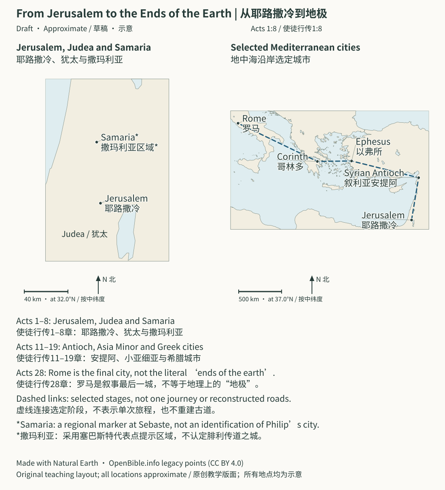

<a id="top"></a>
# Acts and Paul: Journeys, Chronology, and Urban Evidence | 使徒行传与保罗书信：旅程、年代与城市史料对照

> Status: Draft (AI draft; not human reviewed) | 状态：Draft（AI 草稿，未人工审阅）

<a id="in-three-sentences"></a>
> **In Three Sentences | 三句话读懂本篇**
>
> Read Acts and Paul’s letters together as the [gospel](../Glossary/README.md#gospel) moves through cities and communities. Inscriptions and other sources help locate parts of this story in time. Disputed dates, authorship questions, and proposed identifications remain clearly separated from firmer evidence.<br>
> 随着[福音](../Glossary/README.md#gospel)经过城市与群体，把[使徒](../Glossary/README.md#apostle)行传和保罗书信一起读。铭文等来源帮助确定部分历史坐标。有争议的年代、作者问题和身份推定，仍与较稳固的证据分开。

> Scope: follow Jesus’ ascension, [Pentecost](../Glossary/README.md#pentecost), and the Jerusalem [church](../Glossary/README.md#church) through Antioch and Paul’s missions to his Roman confinement. Place the thirteen letters bearing Paul’s name in their possible writing stages.<br>
> 范围：从耶稣升天、[五旬节](../Glossary/README.md#pentecost)和耶路撒冷[教会](../Glossary/README.md#church)开始，经安提阿与保罗宣教旅程，直到保罗在罗马被软禁；同时把十三卷具名保罗书信放回可能的写作阶段。
> Purpose: follow a connected history of city problems, coworkers’ journeys, letters responding, and the gospel spreading. Read Acts and the letters together instead of treating them as isolated travel and theology.<br>
> 目的：不再把《使徒行传》当成独立旅行故事、把书信当成散乱神学文章，而是看见“某座城发生问题—同工往返—书信回应—福音继续扩展”的连续历史。
> Method: use the biblical narrative, Roman administrative history, inscriptions, coins, roads, and urban archaeology as distinct evidence layers. Present major alternatives where dates or authorship lack consensus.<br>
> 方法：把经文内部资料、罗马行政史、铭文、钱币、道路与城市考古分层使用；精确年代和作者问题若无共识，就并列主要方案。

---

> **Section Navigation | 本页导航**

- [Paul's Missionary Journeys | 保罗的宣教旅程](#journey-map)
- [1. Main Conclusions | 一、先给结论](#t1-26a-20)
- [2. Read Three Timelines Together | 二、使用说明：三条时间线必须一起看](#t1-26a-48)
- [3. Confidence Grades | 三、确定度分级](#t1-26a-83)
- [4. Timeline | 四、总时间线](#t1-26a-96)
- [5. The Geographical Framework of Acts | 整卷《使徒行传》的地理骨架](#acts-geographical-framework)
- [6. Jerusalem Is the Starting Point | 六、第一阶段：耶路撒冷不是终点，而是起点](#t1-26bc-270)
- [7. Saul/Paul: Two Names, Not a New Christian Name | 七、扫罗／保罗：不是换了一个基督教名字](#t1-26bc-315)
- [8. Antioch: A Missionary Hub | 八、安提阿：第一座差传枢纽](#t1-26bc-361)
- [9. First Journey: Cyprus and Southern Galatia | 九、第一次旅程：居比路与南加拉太城市](#t1-26de-458)
- [10. Jerusalem Council: Must Gentiles First Become Jews? | 十、耶路撒冷会议：外邦人必须先成为犹太人吗？](#t1-26de-528)
- [11. Second Journey: Macedonia and Achaia | 十一、第二次旅程：福音进入马其顿与亚该亚](#t1-26de-576)
- [12. Philippi: Roman Colony and Heavenly Citizenship | 十二、腓立比：罗马殖民城与天上国民](#t1-26fg-673)
- [13. Thessalonica: Politarchs and “Another King” | 十三、帖撒罗尼迦：政治官与“另有一个王”](#t1-26fg-714)
- [14. Athens: Unknown God, Areopagus, and Resurrection | 十四、雅典：未知之神、亚略巴古与复活](#t1-26fg-774)
- [15. Corinth: Gallio as a Chronological Anchor | 十五、哥林多：迦流铭文锁定整条保罗时间线](#t1-26hi-912)
- [16. The Corinthian Letters: A Difficult, Continuing Pastoral Relationship | 十六、哥林多前后书：一段持续而痛苦的牧养关系](#t1-26hi-991)
- [17. The Erastus Inscription: Why the Identification Needs a Lower Grade | 十七、“以拉都铭文”：为什么必须降级](#t1-26hi-1044)
- [18. Third Journey and Ephesus: The Gospel Meets the Urban Economy | 十八、第三次旅程与以弗所：福音进入城市经济](#t1-26jk-1190)
- [19. The Jerusalem Collection Belongs to the Gospel Story | 十九、耶路撒冷捐项：金钱也是福音故事线](#t1-26jk-1264)
- [20. Romans: Between Jerusalem and a Planned Spanish Mission | 二十、罗马书：在去耶路撒冷与计划去西班牙之间](#t1-26jk-1296)
- [21. Arrest and Hearings: Witness Through Roman Judicial Levels | 二十一、被捕与审讯：福音怎样进入罗马司法层级](#t1-26lm-1470)
- [22. Shipwreck and Malta: Limits of Reconstruction | 二十二、海难与马耳他：哪些可重建，哪些不可](#t1-26lm-1530)
- [23. Why Acts Ends With Roman Confinement | 二十三、《使徒行传》为什么停在罗马软禁](#t1-26lm-1569)
- [24. Pauline Letters: Likely Chronological Locations | 二十四、保罗书信时间表：先看最可能位置](#t1-26no-1690)
- [25. Why Speak of Seven Undisputed Pauline Letters? | 二十五、为什么学界说“七封公认保罗书信”](#t1-26no-1710)
- [26. Connections Before and After Each Letter | 二十六、逐卷“承上—本卷贡献—启下”](#t1-26no-1748)
- [27. Three Imprisonment Locations | 二十七、监狱书信的三种地点模型](#t1-26no-1832)
- [28. Comparing Acts With Paul’s Letters | 二十八、《使徒行传》与保罗书信怎样互相校正](#t1-26no-1849)
- [29. External and Archaeological Anchors | 二十九、外部史料与考古锚点总表](#t1-26pq-2008)
- [30. P46: Letters Become a Collection | 三十、P46：书信怎样成为书信集](#t1-26pq-2043)
- [31. Passage Notes | 三十一、逐段经文注释](#t1-26st-2416)
- [32. Theological Storylines | 三十二、神学故事线](#t1-26st-2532)
- [33. Common Overclaims | 三十三、常见误传与过度结论](#t1-26u-2758)
- [34. Suggested Reading Order | 三十四、推荐阅读顺序](#t1-26u-2783)
- [35. Principal External Sources | 三十五、主要外部来源](#t1-26v-sources-2870)
- [36. One-Page Recap | 一页式复习](#acts-one-page-recap)

<a id="journey-map"></a>
## Paul's Missionary Journeys | 保罗的宣教旅程


**Approximate / 示意:** Solid, dashed, dotted, and dash-dot lines connect selected places in Acts 13–14, 15:36–18:22, 18:23–21:16, and 27–28 respectively. Regional travel in Galatia/Phrygia, Derbe's identification, the Maltese landing site, and the exact storm track remain uncertain. This is not an ancient road survey or an identified shipwreck position. / 实线、虚线、点线、点划线分别连接上述四段使徒行传中的选定地点。加拉太与弗吕家的区域路线、特庇认定、马耳他登陆点及风暴航迹仍不确定；本图不是古道测绘或已确认沉船位置。

On a phone, scroll inside the map or [open the full SVG](../assets/maps/paul-journeys.svg). See [map notes](../Maps/README.md#paul-geography) and [data credits](../CREDITS.md#map-data). / 手机可在图内横向滚动或[打开完整 SVG](../assets/maps/paul-journeys.svg)，另见[地图说明](../Maps/README.md#paul-geography)与[数据署名](../CREDITS.md#map-data)。

<a id="t1-26a-20"></a>
## 1. Main Conclusions | 一、先给结论

1. **Geography also structures the theology:** Jerusalem→Judea/Samaria→Antioch→Asia Minor→Macedonia/Achaia→Rome; Acts 1:8.
   **《使徒行传》的地理结构就是神学结构**：耶路撒冷 → 犹太和撒玛利亚 → 安提阿 → 小亚细亚 → 马其顿和亚该亚 → 罗马，对应徒 1:8。
2. **Letters are remote pastoral care:** actual division, pressure, ethics, worship, teaching, money, leadership, not systematic-theology chapters.
   **保罗书信不是系统神学教材的章节**：它们是写给真实群体的“远程牧养”，回应分裂、逼迫、伦理、敬拜、假教导、金钱和领袖等具体问题。
3. **Canonical order is broadly not chronological:** church letters then individuals, roughly length-based.
   **书信在新约中的排列大致不是写作顺序**：传统编排先列写给教会的信、再列写给个人的信，并大致按篇幅排列。
4. **Gallio anchors chronology:** Delphi supports common51–52 CE Achaian proconsul reconstruction, not exact start/end months.
   **迦流是最重要的外部年代锚点**：德尔斐铭文把迦流任亚该亚省 proconsul 的常见重建压缩在主后 51–52 年附近，从而帮助推算保罗第二次旅程和前后书信；它不能给出任职起止的精确月份。
5. **Around50 CE convergence:** Claudius, Roman Jews, Aquila/Priscilla, Corinth, 1 Thessalonians, Gallio.
   **主后 50 年左右是关键交叉点**：革老丢处理罗马犹太群体、亚居拉和百基拉来到哥林多、保罗在哥林多停留、帖撒罗尼迦前书写成、迦流上任，几条线在此相交。
6. **Cities explain letters:**
   **城市考古最能说明“为什么这封信这样写”**：
   - Philippi Roman colony;
     腓立比是罗马殖民城；
   - Thessalonian politarchs;
     帖撒罗尼迦使用“政治官 / politarch”职称；
   - Athenian altars, images, philosophy;
     雅典充满祭坛、神像与哲学公共空间；
   - Corinth colony, capital, transport hub;
     哥林多是罗马殖民城、省会与交通枢纽；
   - Ephesian Artemis, theater, guilds, honor.
     以弗所的亚底米崇拜、剧场、同业和城市荣誉紧密相连。
7. **Context, not particular conversion/sermon proof:** no Lydia house or exact Pauline bema step identified.
   **考古通常确认背景，不直接确认某次讲道或[悔改](../Glossary/README.md#repentance)**：腓立比的建筑不能证明吕底亚住在哪间屋；哥林多的讲坛也不能证明保罗准确站在现存平台的哪一级。
8. **Degrees of confidence:**
   **保罗年代要用“确定度”而非单一答案**：
   - 1 Thessalonians, Corinthian letters, Romans more readily located;
     帖撒罗尼迦前书、哥林多前后书、罗马书相对容易放入旅程；
   - Early/late Galatians;
     加拉太书的早晚次序仍有两大模型；
   - Ephesus, Caesarea, Rome imprisonment models;
     腓立比书、腓利门书的监禁地点可能是以弗所、凯撒利亚或罗马；
   - Ephesians, Colossians, 2 Thessalonians, Pastorals authorship/dates debated.
     以弗所书、歌罗西书、帖撒罗尼迦后书和教牧书信的作者与年代在学界有实质争论。
9. **Cross-read Acts/self-account:** visits, Galatians 2, post-call movements, not forced harmonization.
   **《使徒行传》与保罗自述应交叉阅读，而非强行抹平**：耶路撒冷访问次数、加拉太书 2 章对应哪次会议、保罗受召后的移动，都需要比较两种叙事目的。
10. **Not heroic travel alone:** risen [Christ](../Glossary/README.md#christ)/Spirit forms Jew, Samaritan, [Gentile](../Glossary/README.md#gentile) [covenant](../Glossary/README.md#covenant) people, Abrahamic [blessing](../Glossary/README.md#blessing) to nations.
    **整条线的中心不是“保罗的英雄旅行”**：是[复活](../Glossary/README.md#resurrection)的[基督](../Glossary/README.md#christ)借[圣灵](../Glossary/README.md#holy-spirit)带领一个跨越犹太人、撒玛利亚人和[外邦人](../Glossary/README.md#gentile)的新约群体，把亚伯拉罕之福带向万国。

One connecting statement:<br>
一句话串联：

> From persecuted Jerusalem [disciples](../Glossary/README.md#disciple) through Antioch’s cross-cultural mission, coworkers build communities along cities, sea, synagogues, homes. Letters address new problems; Paul enters capital in chains while God’s word remains unhindered.<br>
> 福音从耶路撒冷受逼迫的犹太[门徒](../Glossary/README.md#disciple)群体出发，在安提阿成为跨族群差传运动；保罗和同工沿罗马城市、海路、会堂和家庭网络建立群体；书信处理这些群体因福音而产生的新问题；最后保罗虽带锁链进入帝国首都，上帝的道却“不受禁止”。

---

<a id="t1-26a-48"></a>
## 2. Read Three Timelines Together | 二、使用说明：三条时间线必须一起看

<a id="t1-26a-50"></a>
### 1. Acts Narrative | 1. 《使徒行传》的叙事时间线

Tells:<br>
它告诉我们：

- Where;
  人到了哪里；
- Companions;
  与谁同行；
- City events;
  城市发生什么；
- Official responses;
  罗马官员怎样回应；
- New mission regions.
  宣教如何转向新地区。

<a id="t1-26a-60"></a>
### 2. Letters’ Internal Timeline | 2. 保罗书信的内部时间线

Tells:<br>
它告诉我们：

- Remembered experience;
  保罗怎样回忆自己的经历；
- Present coworkers;
  哪些同工当时与他同在；
- Plans;
  他计划下一步去哪里；
- Earlier letters/visits;
  某教会之前收过哪些信或访问；
- Collection/mission networks.
  捐款和差传网络进行到哪一步。

<a id="t1-26a-70"></a>
### 3. External History | 3. 外部历史时间线

Provides:<br>
它提供：

- Emperor, king, governor terms;
  皇帝、地方王和总督任期；
- City status, offices, roads;
  城市身份、官职名称和道路；
- Coins/inscriptions;
  钱币和铭文年代；
- War, famine, expulsion, administrative changes.
  战争、饥荒、驱逐令和行政变化。

Find intersections without swallowing one timeline into another.<br>
正确做法不是用其中一条吞掉另外两条，而是寻找交叉点。

---

<a id="t1-26a-83"></a>
## 3. Confidence Grades | 三、确定度分级

| Grade / 等级 | Definition / 定义 | Example / 例子 |
| --- | --- | --- |
| A: high | Internal/external convergence, small model differences | Gallio 51–52/Paul in Corinth |
| A：高确定 | 经文内部与外部锚点相互支持，主要方案差距小 | 迦流任期约主后 51–52；保罗在此阶段身处哥林多 |
| B: probable | Itinerary/coworkers fit, no direct date | 1 Thessalonians 50–51 Corinth |
| B：较可能 | 经文行程和同工信息吻合，但缺少直接外部日期 | 帖前约主后 50–51 年写于哥林多 |
| C: alternatives | Multiple substantial models | Galatians timing/Philippians imprisonment |
| C：多方案 | 重要材料可支持两个或更多模型 | 加拉太书早期或晚期；腓立比书监禁地点 |
| D: outside core | Late legend, tourism, unprovenanced objects, circularity | Paul’s exact prison/standing stone |
| D：不宜作为核心 | 依赖后世传说、旅游认定、来源不明器物或循环论证 | “这就是保罗监牢”“这块石头就是保罗站立点” |

A range such as about 50–52 CE reflects the evidence’s precision, rather than avoiding a judgment.<br>
年代写成“约主后 50–52”不是含糊，而是对证据精度的诚实表达。

---

<a id="t1-26a-96"></a>
## 4. Timeline | 四、总时间线

> The table uses a common middle chronology. Outside fixed anchors, many dates can move by 1–2 years. A Passion date of 33 CE can shift early events later.<br>
> 下表采用较常见的“中间年代方案”。除迦流等固定点外，许多年份可前后移动一至两年；受难若采用主后 33 年，早期事件也可能相应后移。

| Date / 年代 | Acts / 《使徒行传》主线 | Paul/letters / 保罗与书信 | External context / 外部坐标 |
| --- | --- | --- | --- |
| About 30/33 CE | Ascension, Pentecost, Jerusalem | — | Tiberius/Pilate |
| 约主后 30/33 | 升天、五旬节、耶路撒冷群体形成 | — | 提庇留在位；彼拉多仍任犹太长官 |
| Early 30sCE | Healings, shared life, Ananias/Sapphira, Seven, Stephen | Saul persecutes | [Temple](../Glossary/README.md#temple)/[priest](../Glossary/README.md#priest)/Roman administration |
| 主后 30 年代前期 | 医治、讲道、共享、亚拿尼亚与撒非喇、七人、司提反 | 扫罗逼迫教会 | [圣殿](../Glossary/README.md#temple)仍在，[祭司](../Glossary/README.md#priest)与罗马行政并行 |
| About 32–36 CE | Damascus call/Ananias | Galatians 1:15–24 self-account | Aretas ethnarch, 2 Corinthians 11:32; mechanism debated |
| 约主后 32–36 | 扫罗在大马士革路上蒙召；亚拿尼亚接纳他 | 加 1:15–24 提供保罗自己的受召与行程概述 | 亚哩达王相关民族长与大马士革问题见林后 11:32，精确政治机制有争议 |
| Late 30s CE | Philip/Samaria/coast; Cornelius | Syria/Cilicia | Caesarea administration/port |
| 30 年代后期 | 腓利在撒玛利亚及沿海；彼得与哥尼流 | 保罗往叙利亚、基利家一带 | 凯撒利亚是罗马行政和港口中心 |
| About 40–44 CE | Antioch, Christian name, famine aid | Barnabas brings Paul | Claudius 41–54 |
| 约主后 40–44 | 安提阿教会形成；“基督徒”称呼出现；饥荒援助 | 巴拿巴找保罗到安提阿服事 | 革老丢主后 41–54 在位 |
| 44 CE | Agrippa I kills James, imprisons Peter, dies | — | Coins/Josephus kingship setting |
| 主后 44 | 希律·亚基帕一世杀雅各、囚彼得，后在凯撒利亚去世 | — | 亚基帕一世钱币和约瑟夫斯提供外部王权背景 |
| About 46–48 CE | Cyprus, Pamphylia, Pisidian Antioch, Iconium, Lystra, Derbe, return | Early South-Galatian model | Province/Paphos/cult setting |
| 约主后 46–48 | 第一次旅程：居比路 → 旁非利亚 → 彼西底安提阿 → 以哥念 → 路司得 → 特庇 → 回安提阿 | 若采用“南加拉太早期说”，加拉太书可能接近此时写成 | 居比路为罗马行省；帕福斯是行政与阿佛洛狄忒崇拜中心 |
| About 48/49 CE | Jerusalem meeting | Galatians 2 or earlier relief visit | Jew/Gentile questions under Claudius |
| 约主后 48/49 | 耶路撒冷会议 | 加 2 可能对应此会，也可能对应较早赈灾访问 | 革老丢时代犹太—外邦问题日益显著 |
| About 49–52 CE | Syria/Cilicia, Lystra, Troas, Philippi, Thessalonica, Berea, Athens, Corinth | 1 Thessalonians 50–51; 2 Thessalonians if early; Galatians possible later | Claudius 49/Gallio 51–52 |
| 约主后 49–52 | 第二次旅程：叙利亚／基利家 → 路司得 → 特罗亚 → 腓立比 → 帖撒罗尼迦 → 庇哩亚 → 雅典 → 哥林多 | 帖前约 50–51；帖后若为早期保罗书信则不久后；加拉太书也可能在此后 | 革老丢约 49 年处理罗马犹太群体；迦流约 51–52 任亚该亚 proconsul |
| About 52 CE | Ephesus, Caesarea, Antioch return | — | Gallio synchronization |
| 约主后 52 | 保罗离开哥林多，经以弗所、凯撒利亚回安提阿 | — | 迦流铭文构成最重要同步点 |
| About 52/53–57 CE | Galatia/Phrygia, Ephesus, Macedonia, Corinth, Jerusalem | 1 Corinthians 54/55; 2 Corinthians 55/56; Romans 56/57; late Galatians 54–56 | Nero 54/Ephesus |
| 约主后 52/53–57 | 第三次旅程：加拉太／弗吕家 → 以弗所长期服事 → 马其顿 → 哥林多 → 返回耶路撒冷 | 林前约 54/55；林后约 55/56；罗约 56/57；加拉太书晚期说约 54–56 | 尼禄主后 54 即位；以弗所为亚细亚省重要城市 |
| About 57 CE | Temple arrest | Romans completed; collection delivery | High priest Ananias’ term near end |
| 约主后 57 | 在耶路撒冷圣殿被捕 | 罗马书已写成，保罗准备前往耶路撒冷送捐项 | 亚拿尼亚任大祭司时期接近结束 |
| About 57–59 CE | Caesarea/Felix | Caesarean captivity-letter model | Felix coins |
| 约主后 57–59 | 在凯撒利亚被监禁；腓力斯审讯 | 若采凯撒利亚监禁说，腓立比书／腓利门书／歌罗西书等可能在此 | 腓力斯钱币确认其犹太行政背景 |
| About 59/60 CE | Festus/appeal/Agrippa II | — | Accession uncertain; coins58/59 |
| 约主后 59/60 | 非斯都到任；保罗向该撒上诉；亚基帕二世听审 | — | 非斯都任期的精确起年仍有讨论；钱币提供主后 58/59 附近材料 |
| 59–60 or 60–61 CE | Storm, Malta, Rome | — | Winter seas/Alexandrian grain ships |
| 约主后 59–60 或 60–61 | 海难、马耳他、抵达罗马 | — | 地中海冬季航行和亚历山大粮船背景与叙事相符 |
| About 60–62 CE | Two years/Roman confinement/end | Traditional Philippians, Philemon, Colossians, Ephesians | Early Nero, before 64 fire |
| 约主后 60–62 | 保罗在罗马软禁两年；《使徒行传》结束 | 传统罗马监禁说把腓、门、西、弗放在此期 | 尼禄早期统治；主后 64 年罗马大火尚在《使徒行传》结尾之后 |
| After62 CE | Not narrated | Release/travel/Pastorals tradition versus later Pauline-tradition model | Early church tradition, no contemporary Roman archive |
| 主后 62 以后 | 《使徒行传》未叙述 | 传统说：保罗获释、再旅行，写提前、多、提后；另一学术模型视教牧书信为较晚的保罗传统 | 保罗结局主要依赖早期教会传统，缺少同期罗马档案 |

---

<a id="acts-geographical-framework"></a>
## 5. The Geographical Framework of Acts | 整卷《使徒行传》的地理骨架

<a id="gospel-expansion-map"></a>
### From Jerusalem to the Ends of the Earth | 从耶路撒冷到地极



Read Acts 1:8 as the overview, then follow the chapter ranges in the diagram. The Samaria point represents the region using the legacy Sebaste coordinate; it does not identify Philip’s city in Acts 8:5. Dashed links connect selected narrative stages, not a single journey or reconstructed roads. Acts ends in Rome, but the diagram does not define Rome as the literal “ends of the earth.”<br>
先读使徒行传1:8，再按图中章节范围追踪叙事。撒玛利亚点借用旧数据的塞巴斯特坐标提示区域，不认定使徒行传8:5中腓利传道之城。虚线连接选定叙事阶段，不表示单次旅程或重建古道。使徒行传叙事止于罗马，但图中不把罗马定义为字面的“地极”。

[Map notes | 地图说明](../Maps/README.md#map-gospel-expansion) · [Open full SVG | 打开完整SVG](../assets/maps/acts-gospel-expansion.svg) · [Credits | 署名](../CREDITS.md#ministry-map-data)

```text
Acts 1–7: Jerusalem
徒 1–7     耶路撒冷
              ├─ The Spirit descends
              ├─ 圣灵降临
              ├─ Witness in the temple
              ├─ 圣殿见证
              └─ Stephen’s martyrdom
              └─ 司提反殉道
                   ↓
Acts 8–12: Judea, Samaria, and the coast
徒 8–12    犹太、撒玛利亚与沿海
              ├─ Philip and Samaria
              ├─ 腓利与撒玛利亚
              ├─ The Ethiopian official
              ├─ 埃提阿伯官员
              ├─ Saul’s call
              ├─ 扫罗蒙召
              ├─ Cornelius
              ├─ 哥尼流
              └─ The Antioch church
              └─ 安提阿教会
                   ↓
Acts 13–15: First journey and Jerusalem council
徒 13–15   第一次旅程与耶路撒冷会议
              ├─ Cyprus
              ├─ 居比路
              ├─ Pamphylia
              ├─ 旁非利亚
              ├─ Cities of southern Galatia
              ├─ 南加拉太城市
              └─ Must Gentiles be circumcised?
              └─ 外邦人是否必须受割礼？
                   ↓
Acts 15:36–18:22: Second journey
徒 15:36–18:22  第二次旅程
              ├─ The Macedonian call
              ├─ 马其顿呼声
              ├─ Philippi
              ├─ 腓立比
              ├─ Thessalonica and Berea
              ├─ 帖撒罗尼迦、庇哩亚
              ├─ Athens
              ├─ 雅典
              └─ Corinth and Gallio
              └─ 哥林多与迦流
                   ↓
Acts 18:23–21:17: Third journey
徒 18:23–21:17  第三次旅程
              ├─ Extended ministry in Ephesus
              ├─ 以弗所长期服事
              ├─ Macedonia and Achaia
              ├─ 马其顿与亚该亚
              ├─ The collection network
              ├─ 捐项网络
              └─ Return to Jerusalem
              └─ 返回耶路撒冷
                   ↓
Acts 21–28: Arrest, hearings, and Rome
徒 21–28    被捕、审讯与罗马
              ├─ Jerusalem
              ├─ 耶路撒冷
              ├─ Caesarea: Felix, Festus, and Agrippa II
              ├─ 凯撒利亚：腓力斯、非斯都、亚基帕二世
              ├─ Mediterranean voyage and Malta
              ├─ 地中海航行与马耳他
              └─ Rome: preaching boldly while in chains
              └─ 罗马：带锁链却放胆传道
```

---


<a id="t1-26bc-270"></a>
## 6. Jerusalem Is the Starting Point | 六、第一阶段：耶路撒冷不是终点，而是起点

<a id="t1-26bc-272"></a>
### 1. Acts 1:8 Outlines the Book | 1. 徒 1:8 是全卷目录

“Jerusalem, all Judea and Samaria, and the ends of the earth” is a purposeful sequence:<br>
“耶路撒冷、犹太全地和撒玛利亚，直到地极”不是随意地名排列：

- Jerusalem: the city of promise, temple, Passion, and [resurrection](../Glossary/README.md#resurrection);
  耶路撒冷：[应许](../Glossary/README.md#promise)、圣殿、受难与复活之城；
- Judea: [Israel](../Glossary/README.md#israel)’s homeland;
  犹太：[以色列](../Glossary/README.md#israel)故土；
- Samaria: a neighboring community sharing traditions yet separated by deep boundaries;
  撒玛利亚：有共同传统又存在深刻边界的邻近群体；
- The ends of the earth: the Gentile world and the imperial center.
  地极：外邦世界和帝国中心。

The gospel unfolds from Israel’s [Messiah](../Glossary/README.md#messiah) and the promise of the Spirit toward all peoples, rather than abandoning Israel.<br>
福音不是抛弃以色列后转向外邦，而是从以色列的[弥赛亚](../Glossary/README.md#messiah)和圣灵应许中向万民展开。

<a id="t1-26bc-283"></a>
### 2. Pentecost, Diaspora Jews, and Languages in Acts 2 | 2. 徒 2：五旬节、散居犹太人与语言

Pentecost was a pilgrimage festival. The list of places in Acts 2 shows:<br>
五旬节原是朝圣节期。徒 2 的多地名单说明：

- Diaspora Jews and converts gathering in Jerusalem;
  耶路撒冷在节期聚集散居犹太人和归信者；
- Aramaic, Greek, and local languages coexisting;
  亚兰语、希腊语及地方语言共同存在；
- The gospel’s cross-language direction from the outset;
  福音从第一天起就具跨语言方向；
- Returning pilgrims potentially carrying the message through their networks.
  回乡的朝圣者可成为信息传播网络。

This helps explain later missions beginning in synagogues: diaspora networks already linked Jerusalem with imperial cities.<br>
这也解释为何后文许多城市先从会堂开始：散居犹太网络早已连接耶路撒冷与帝国城市。

<a id="t1-26bc-294"></a>
### 3. “Hellenists” in Acts 6–7 | 3. 徒 6–7：“希利尼人”不是“异教希腊人”

The Hellenists of Acts 6 generally means mainly Greek-speaking Jewish believers, culturally and linguistically distinct from mainly Hebrew/Aramaic-speaking believers.<br>
徒 6 的 Hellenists 通常指主要说希腊语的犹太信徒，与主要说希伯来语／亚兰语的群体形成语言文化差异。

The dispute over provision for widows shows:<br>
寡妇供应冲突表明：

- Resource distribution was among the church’s earliest crises;
  教会的第一批危机之一是资源分配；
- Being filled with the Spirit and administrative justice belong together;
  圣灵充满与行政公义不能分开；
- The Seven’s Greek names indicate the empowerment of cross-cultural leaders;
  七人的希腊名字显示跨文化领袖被赋权；
- Stephen rereads Israel’s history, stressing that God is not confined to one place.
  司提反的讲论重读以色列历史，强调上帝不受某一地点限制。

<a id="t1-26bc-305"></a>
### 4. Samaria and the Ethiopian Official in Acts 8 | 4. 徒 8：撒玛利亚与埃提阿伯官员

These two episodes extend the boundaries in succession:<br>
这两段把边界连续向外推：

- Samaritans had a history of sanctuary and communal conflict with Jews;
  撒玛利亚人：历史上与犹太人有圣所和族群冲突；
- The Ethiopian eunuch is a Gentile official whose bodily status also raises questions about legal boundaries of membership;
  埃提阿伯太监：既是外邦高官，又因身体身份面临律法群体界线问题；
- Isaiah 53 and 56 provide a background of hope concerning the suffering servant, foreigners, and eunuchs.
  以赛亚书 53 章与 56 章的受苦仆人、外邦人和太监盼望形成背景。

---

<a id="t1-26bc-315"></a>
## 7. Saul/Paul: Two Names, Not a New Christian Name | 七、扫罗／保罗：不是换了一个基督教名字

<a id="t1-26bc-317"></a>
### 1. Two Names | 1. 两个名字

- “Saul / Shaul” is a Jewish name;
  “扫罗 / Shaul”是犹太名字；
- “Paul / Paulos” belongs to the Roman-Greek environment;
  “保罗 / Paulos”是罗马—希腊语环境中的名字；
- Acts 13:9 says Saul was also called Paul, rather than describing a mysterious renaming ceremony;
  徒 13:9 写“扫罗又名保罗”，不是描述一次神秘改名仪式；
- Having two names was natural in a cross-cultural world.
  在跨文化世界拥有两个名字十分自然。

<a id="t1-26bc-324"></a>
### 2. Why Do Acts 9, 22, and 26 Differ? | 2. 徒 9、22、26 三次叙述为何有差异

The three accounts share this core:<br>
三段共同核心：

- Paul was persecuting Jesus’ disciples;
  保罗正逼迫耶稣门徒；
- A heavenly appearance redirected him;
  天上显现使他转向；
- Jesus treated persecution of the disciples as persecution of himself;
  耶稣把对门徒的逼迫视为对自己的逼迫；
- Paul received a mission to testify to Gentiles.
  保罗领受向外邦人作见证的使命。

Differences include:<br>
差异包括：

- How the companions “heard the sound” or did not understand/hear the speaker;
  同行者“听见声音”与“没有听明／听见说话者”的表达；
- Seeing light without seeing the speaker;
  看见光却不见说话者；
- Details of the commission unfolding in different hearing contexts.
  使命细节在不同审讯语境中展开。

Read these first as ancient repeated narratives and speeches. Neither splice them into a second-by-second recording nor overlook their shared core because perspectives differ.<br>
应先按古代重复叙事与演说目的阅读，不要把三个版本拼成逐秒录像，也不要因为视角差异就忽略共同核心。

<a id="t1-26bc-341"></a>
### 3. Paul’s Own Testimony | 3. 保罗自己的见证

Important passages:<br>
重要经文：

- Galatians 1:13–24;
  加 1:13–24；
- 1 Corinthians 9:1; 15:8–10;
  林前 9:1；15:8–10；
- Philippians 3:4–11;
  腓 3:4–11；
- 2 Corinthians 4:6.
  林后 4:6。

Paul emphasizes:<br>
保罗强调：

- He formerly persecuted God’s church;
  他曾逼迫上帝的教会；
- God called him by [grace](../Glossary/README.md#grace) and revealed his Son;
  上帝以[恩典](../Glossary/README.md#grace)呼召并启示祂的儿子；
- He did not derive the gospel’s fundamental authority from the Jerusalem [apostles](../Glossary/README.md#apostle);
  他没有从耶路撒冷使徒获得福音的根本权威；
- He later shared fellowship with the apostles and received recognition of his mission.
  同时他后来与使徒相交并获得使命认可。

Acts emphasizes acceptance by the church and public mission; the letters emphasize direct calling and the gospel’s independence. Their different emphases need not silence one another.<br>
《使徒行传》强调教会接纳与公共使命；书信强调直接呼召与福音独立性。两者重点不同，不必互相消音。

---

<a id="t1-26bc-361"></a>
## 8. Antioch: A Missionary Hub | 八、安提阿：第一座差传枢纽

<a id="t1-26bc-363"></a>
### 1. Why Antioch? | 1. 为什么是安提阿

Syrian Antioch:<br>
叙利亚安提阿：

- Was a major city of Roman Syria;
  是罗马叙利亚行省重镇；
- Linked Mediterranean ports, the Syrian interior, and roads into Asia Minor;
  连接地中海港口、叙利亚内陆和小亚细亚道路；
- Had a multiethnic and multilingual population;
  有多族群、多语言人口；
- Had a Jewish diaspora community;
  有犹太散居社群；
- Was well placed as a base for missions across regions.
  适合成为跨地区差传基地。

<a id="t1-26bc-373"></a>
### 2. “Christians” in Acts 11:26 | 2. 徒 11:26 的“基督徒”

“Christian” may initially have been an outsiders’ social label for a Christ-associated group. It suggests:<br>
“基督徒”可能起初是外界给“基督派”群体的社会标签。它表明：

- The community remained deeply rooted in Jewish Scripture;
  这群人仍深深扎根犹太[圣经](../Glossary/README.md#bible)；
- City observers could identify it by its association with Christ;
  但在城市观察者眼中，他们已经因“基督”形成可辨识群体；
- The name’s appearance does not mean a later institutional religion, wholly separated from Judaism, already existed.
  名称出现不等于此时已形成与犹太教完全分离的后世制度宗教。

<a id="t1-26bc-381"></a>
### 3. The Leaders Listed in Acts 13 | 3. 徒 13 的领袖名单

Barnabas, Simeon, Lucius, Manaen, and Saul had diverse backgrounds. Antioch’s mission grew from diverse leaders worshiping, fasting, and sending together, rather than one group exporting its culture.<br>
巴拿巴、西面、路求、马念和扫罗的背景多样。安提阿差传不是单一族群向别人输出文化，而是多元领袖在敬拜与禁食中共同差派。

---

<a id="t1-26de-458"></a>
## 9. First Journey: Cyprus and Southern Galatia | 九、第一次旅程：居比路与南加拉太城市

<a id="t1-26de-460"></a>
### 1. Route | 1. 路线

```text
Antioch
安提阿
  → Seleucia harbor
  → 西流基港
  → Cyprus: Salamis and Paphos
  → 居比路：撒拉米、帕福斯
  → Pamphylia: Perga
  → 旁非利亚：别加
  → Pisidian Antioch
  → 彼西底安提阿
  → Iconium
  → 以哥念
  → Lystra
  → 路司得
  → Derbe
  → 特庇
  → Return along the route to strengthen communities
  → 原路坚固群体
  → Antioch
  → 安提阿
```

<a id="t1-26de-485"></a>
### 2. Paphos and the Proconsul | 2. 帕福斯与“方伯”

Acts 13 calls Sergius Paulus a proconsul. Cyprus was a senatorial province governed by a proconsul, so the title fits the administrative setting.<br>
徒 13 称士求·保罗为 proconsul。居比路在罗马行政中属于由元老院管理、由 proconsul 治理的行省，这个职称与制度背景相符。

Archaeology at Paphos displays:<br>
帕福斯考古展示：

- A Roman administrative city;
  罗马行政城市；
- Palaces, theater, homes, and tombs;
  宫殿、剧场、住宅和墓葬；
- A longstanding center of Aphrodite worship.
  阿佛洛狄忒崇拜的长期中心。

**Evidence limits:**<br>
**证据边界**：

- No generally accepted inscription can be identified beyond doubt with the Sergius Paulus of Acts 13;
  尚没有一块被普遍接受的铭文能毫无疑问地等同徒 13 的士求·保罗；
- Matching names or family connections remain candidates, not Grade A proof of identity;
  同名铭文或家族线索只能作为候选，不应升为 A 级人物证明；
- The ruins establish an urban and religious setting, not the incident involving Elymas.
  帕福斯遗址能确认城市和宗教环境，不能证明行法术的以吕马事件。

- **Sources:**
  **来源**：
  - [UNESCO: Paphos](https://whc.unesco.org/en/list/79/)
    [UNESCO：Paphos](https://whc.unesco.org/en/list/79/)
  - [University of Cyprus: Paphos Harbour and the Roman governor’s residence](https://www.ucy.ac.cy/marecyprium/case-studies/paphos-harbour/).
    [居比路大学：Paphos Harbour 与罗马方伯驻地](https://www.ucy.ac.cy/marecyprium/case-studies/paphos-harbour/)。

<a id="t1-26de-505"></a>
### 3. The Message at Pisidian Antioch | 3. 彼西底安提阿的信息

Paul moves from Israel’s history to David’s son and resurrection. Gentile mission does not bypass the [Old Testament](../Glossary/README.md#old-testament):<br>
保罗从以色列历史讲到大卫之子和复活，说明外邦宣教并非跳过旧约：

- [Exodus](../Glossary/README.md#exodus), judges, Saul, and David;
  [出埃及](../Glossary/README.md#exodus)、士师、扫罗、大卫；
- [Psalms](../Glossary/README.md#psalm) and Isaiah;
  [诗篇](../Glossary/README.md#psalm)和以赛亚；
- [Forgiveness](../Glossary/README.md#forgiveness) and [justification](../Glossary/README.md#justification);
  赦罪与[称义](../Glossary/README.md#justification)；
- Being a light for the Gentiles.
  “作外邦人的光”。

The Antioch speech gives a narrative window into a basic Pauline pattern: Israel’s promises reach the nations through the risen Messiah.<br>
安提阿信息为保罗书信的基本模式提供叙事窗口：以色列应许借复活的弥赛亚临到万民。

<a id="t1-26de-516"></a>
### 4. Zeus and Hermes at Lystra | 4. 路司得的宙斯与希耳米

Identifying Barnabas and Paul as Zeus and Hermes reflects a Greek-Anatolian religious world. Paul instead responds:<br>
当地人把巴拿巴、保罗认作宙斯和希耳米，反映希腊—安纳托利亚宗教世界。保罗的回应不是接受“基督教版神人”，而是：

- Turn from idols to the living God who made heaven and earth;
  从偶像转向[创造](../Glossary/README.md#creation)天地的永生上帝；
- God formerly allowed the nations to follow their own ways;
  上帝过去容让列国各行其道；
- Rain, harvests, and food still witness to general grace.
  雨水、丰年和饮食仍是普遍恩典见证。

Unlike synagogue speeches beginning with Israel’s history, this address adapts to the audience’s knowledge while retaining the Creator and risen Lord as its core.<br>
这与在会堂中从以色列历史讲起不同，显示福音表达会因听众知识背景调整，但核心创造主—复活主不变。

---

<a id="t1-26de-528"></a>
## 10. Jerusalem Council: Must Gentiles First Become Jews? | 十、耶路撒冷会议：外邦人必须先成为犹太人吗？

<a id="t1-26de-530"></a>
### 1. The Central Dispute | 1. 争议核心

The questions went beyond whether Gentiles could believe:<br>
问题不是“外邦人能不能相信”，而是：

- Must they be circumcised?
  是否必须受割礼；
- Must they adopt the full markers of Jewish identity?
  是否必须承担完整犹太身份标志；
- How does Mosaic law apply to Gentile believers?
  [摩西律法](../Glossary/README.md#law)怎样适用于外邦信徒；
- Can Jews and Gentiles share a table and belong to one community?
  犹太人与外邦人能否同桌、同属一个群体。

<a id="t1-26de-539"></a>
### 2. The Decision in Acts 15 | 2. 徒 15 的决定

Peter, Barnabas, Paul, and James jointly testify:<br>
彼得、巴拿巴、保罗和雅各共同见证：

- God has already given the Spirit to Gentiles;
  上帝已赐圣灵给外邦人；
- [Salvation](../Glossary/README.md#salvation) comes through the grace of the Lord Jesus;
  得救是借主耶稣的恩；
- Gentiles should not bear a yoke that neither ancestors nor contemporaries could fully carry;
  不应把列祖和当代人都不能完全负担的轭放在外邦人身上；
- Gentile believers should avoid idolatrous pollution, sexual immorality, strangled animals, and blood.
  外邦信徒应避开偶像污秽、淫乱、勒死牲畜和血。

Several explanations address these restrictions’ origin and function:<br>
这些禁戒的来源与功能有多种解释：

- Leviticus 17–18 and requirements for resident foreigners;
  利未记 17–18 对寄居者的要求；
- Avoiding pagan banquets;
  远离异教宴席；
- Enabling Jewish-Gentile table fellowship;
  促进犹太—外邦同桌；
- Basic moral and worship boundaries.
  基本道德和敬拜界线。

<a id="t1-26de-555"></a>
### 3. Which Visit Does Galatians 2 Describe? | 3. 加拉太书 2 章对应哪一次访问

Two principal models:<br>
两大模型：

<a id="t1-26de-559"></a>
#### Model A: The Famine-Relief Visit of Acts 11 | 模型 A：对应徒 11 的赈灾访问

- Galatians predates the Acts 15 council;
  加拉太书写在徒 15 会议前；
- Galatians 2 describes a relatively private meeting;
  加 2 是较私下的会面；
- Paul does not mention the Acts 15 decision because it has not occurred;
  保罗未提徒 15 决议，因为它尚未发生；
- This supports an early South-Galatian date.
  支持较早的“南加拉太”日期。

<a id="t1-26de-566"></a>
#### Model B: The Council of Acts 15 | 模型 B：对应徒 15 的会议

- Both passages concern Gentiles, circumcision, Peter, James, and Barnabas;
  两段都处理外邦人、割礼、彼得、雅各和巴拿巴；
- Galatians 2 gives Paul’s personal perspective and apostolic recognition; Acts 15 describes a public council;
  加 2 从保罗个人与使徒认可角度叙述，徒 15 从公共会议角度叙述；
- Paul may omit the decree because his argument rests on the gospel and Spirit rather than Jerusalem’s administrative order.
  保罗不引用决议可能因加拉太书论证基于福音与圣灵，不依赖耶路撒冷行政命令。

The available evidence does not exclude either model. Grade C is appropriate; a single timetable should not imply a settled conclusion.<br>
现有材料不能排除其中之一。应标为 C，而非用一张时间表假装已定论。

---

<a id="t1-26de-576"></a>
## 11. Second Journey: Macedonia and Achaia | 十一、第二次旅程：福音进入马其顿与亚该亚

<a id="t1-26de-578"></a>
### 1. Paul and Barnabas Separate | 1. 保罗与巴拿巴分开

Their disagreement over Mark in Acts 15:36–41 shows:<br>
徒 15:36–41 对马可的分歧显示：

- Mature leaders can differ sharply in judgment;
  成熟领袖也会产生严重判断差异；
- The text does not simply declare one wholly spiritual and the other wholly wrong;
  经文没有简单宣布某一方完全属灵、另一方完全错误；
- Two teams emerge after the separation;
  分开后出现两支团队；
- Colossians 4:10, Philemon 24, and 2 Timothy 4:11 indicate later renewed cooperation between Mark and Paul.
  西 4:10、门 24、提后 4:11 显示马可后来与保罗恢复合作。

This has pastoral significance: conflict can cause real harm without requiring permanent condemnation.<br>
这是一条重要牧养线：冲突可能造成真实损伤，却不必成为永久定罪。

<a id="t1-26de-589"></a>
### 2. Timothy Is Circumcised; Titus Is Not | 2. 提摩太受割礼与提多不受割礼

- Titus was Greek. Galatians 2 rejects compelled circumcision because gospel freedom was at stake;
  提多是希腊人；加 2 坚持不因强迫而受割礼，因为福音自由正受挑战；
- Timothy’s mother was Jewish and his father Greek. His circumcision in Acts 16 served local missionary access;
  提摩太母亲是犹太人、父亲是希腊人；徒 16 的割礼是为地方宣教可接近性；
- This distinguishes a supposed requirement for salvation from voluntary missionary adaptation, rather than reversing a principle.
  二者差别不是原则反复，而是“救恩必要条件”和“自愿宣教适应”不同。

<a id="t1-26de-595"></a>
### 3. The Macedonian Call | 3. 马其顿呼声

The vision of Acts 16 directs the journey to the western Aegean. From Troas the team sails via Samothrace to Neapolis, then follows a Roman road into Philippi.<br>
徒 16 的异象把路线带到爱琴海西岸。保罗团队从特罗亚渡海，经撒摩特喇到尼亚波利，再沿罗马道路进入腓立比。

---

<a id="t1-26fg-673"></a>
## 12. Philippi: Roman Colony and Heavenly Citizenship | 十二、腓立比：罗马殖民城与天上国民

<a id="t1-26fg-675"></a>
### 1. The City’s Identity | 1. 城市身份

Philippi:<br>
腓立比：

- Stood on the Via Egnatia, connecting east and west;
  位于连接东西的 Via Egnatia；
- Received Roman military settlers after the battle of Philippi;
  在腓立比战役后安置罗马军人；
- Became a Roman colony;
  成为罗马殖民城；
- Had laws, public buildings, Latin culture, and civic honor reflecting a “little Rome.”
  城市法律、公共建筑、拉丁文化和公民荣誉带有“小罗马”特征。

UNESCO explicitly describes its remaking as the “little Rome” of Colonia Augusta.<br>
UNESCO 对遗址的总结明确称其被塑造成类似“小罗马”的 Colonia Augusta。

- **Source:** [UNESCO: Archaeological Site of Philippi](https://whc.unesco.org/en/list/1517/).
  **来源**：[UNESCO：Archaeological Site of Philippi](https://whc.unesco.org/en/list/1517/)。

<a id="t1-26fg-688"></a>
### 2. Urban Details in Acts 16 | 2. 徒 16 的城市细节

- Local magistrates deal with Paul and Silas;
  保罗和西拉遭地方 magistrates 处理；
- Officials beat them with rods;
  执法人员使用杖打；
- Paul later challenges the beating of Roman citizens without trial;
  保罗后来提出罗马公民未经审判被打的问题；
- Prison, forum, and a place of prayer outside the city fit a colonial social setting.
  监牢、公共广场和城外祷告处符合殖民城社会框架。

Today’s tourist sites called “Lydia’s baptismal place” or “Paul’s prison” are chiefly commemorative traditional locations, not archaeologically established scenes of the events.<br>
不能直接把今日旅游点“吕底亚洗礼处”或“保罗监狱”当作经考古确认的具体现场；它们主要是纪念性传统定位。

<a id="t1-26fg-697"></a>
### 3. The Civic Language of Philippians | 3. 腓立比书的政治语言

Politeuesthe in Philippians 1:27 can suggest living as citizens; 3:20 locates believers’ citizenship in heaven.<br>
腓 1:27 的 politeuesthe 可带“以公民身份生活”的意味；3:20 说“我们的国籍 / 公民权在天上”。

In a Roman colony this redefines highest allegiance rather than calling believers to abandon public life:<br>
在罗马殖民城中，这不是叫信徒逃离公共生活，而是重新定义最高效忠：

- Roman citizenship could convey real privileges;
  地上罗马公民身份可能有真实特权；
- Heaven’s citizens belong to the Lord Jesus Christ;
  天上国民的主是耶稣基督；
- “Savior” and “Lord” challenge imperial claims;
  “救主”和“主”的语言挑战皇帝宣传；
- The community takes the shape of cross-shaped humility rather than rivalry for honor.
  群体政治以十字架式谦卑而非争竞荣耀为形状。

<a id="t1-26fg-708"></a>
### 4. Lydia and the Jailer: Household Networks | 4. 吕底亚和狱卒显示家庭网络

Baptism involving each household shows how the gospel spread through household networks. These verses do not establish who belonged to each ancient household or whether infants were present. Baptismal traditions should not turn silence into archaeological fact.<br>
两人“和她／他一家”受洗，显示福音常通过 household 网络扩展。但古代一家包括哪些人、是否有幼儿，不能从这两节确定；不同洗礼传统不应把沉默处变成考古事实。

---

<a id="t1-26fg-714"></a>
## 13. Thessalonica: Politarchs and “Another King” | 十三、帖撒罗尼迦：政治官与“另有一个王”

<a id="t1-26fg-716"></a>
### 1. Location | 1. 城市位置

Thessalonica:<br>
帖撒罗尼迦：

- Was a major Macedonian city;
  是马其顿省重要城市；
- Stood on the Via Egnatia;
  位于 Via Egnatia；
- Had a good harbor;
  有良好港口；
- Had a tradition of local government as a free city;
  具有自由城的地方治理传统；
- Was closely involved in Roman imperial civic affairs.
  城市与罗马帝国政治密切。

<a id="t1-26fg-726"></a>
### 2. The Politarch Inscription | 2. “政治官 / politarch”铭文

A Thessalonian gateway block in the British Museum lists six politarchs, a city treasurer, and a gymnasiarch.<br>
大英博物馆藏帖撒罗尼迦城门石列出六位 politarchs、城市司库和 gymnasiarch。

This second-century CE marble architectural block is BM 1877,0511.1, published as IG X 126. It postdates Paul, but provides real evidence for the title.<br>
该物件为主后 2 世纪的大理石城门建筑块，馆藏号 BM 1877,0511.1，铭文出版号 IG X 126。它晚于保罗访问，但不是孤立的现代术语猜测。

- **Supports:**
  **能支持**：
  - Politarch was an actual Macedonian office, especially associated with Thessalonica;
    politarch 是马其顿、尤其帖撒罗尼迦真实使用的地方官职；
  - The local designation in Acts 17:6, 8 was not arbitrarily invented.
    徒 17:6、8 的地方称谓不是随意杜撰。
- **Does not support:**
  **不能支持**：
  - The stone is generally dated to the second century CE, later than Paul’s visit;
    该石通常定于主后 2 世纪，晚于保罗访问；
  - It neither names the officials of Acts 17 nor proves the Jason episode;
    它没有列出徒 17 当时官员，也不证明耶孙事件；
  - Say the title is locally attested, not that this is the list of officials who examined Paul.
    应说“职称在当地得到铭文证实”，不说“这块石就是审讯保罗的官员名单”。
- **Grade:** A for the local title; B for the specific Acts 17 event.
  **等级**：A（地方职称）；对徒 17 具体事件为 B。
- **Source:** [British Museum: Thessalonica politarch inscription, BM 1877,0511.1](https://www.britishmuseum.org/collection/object/G_1877-0511-1).
  **来源**：[大英博物馆：Thessalonica politarch inscription，BM 1877,0511.1](https://www.britishmuseum.org/collection/object/G_1877-0511-1)。

<a id="t1-26fg-742"></a>
### 3. The Accusation of Defying Caesar and Naming Jesus as Another King | 3. “违背该撒命令，说另有一个王耶稣”

The accusation casts the gospel as a civic offense:<br>
指控把福音转为政治犯罪：

- “Christ” could be heard as an anointed king;
  “基督”可被听成受膏王；
- “Lord” and “Savior” were also imperial titles;
  “主”与“救主”也用于皇帝；
- Coming judgment and kingdom language could seem to challenge Roman order;
  末世降临与国度语言可能被视为挑战罗马秩序；
- Jason’s required security shows local authorities’ concern for public order.
  耶孙被要求担保，显示地方当局优先维持治安。

1 Thessalonians continues to speak of:<br>
帖撒罗尼迦前书继续使用：

- God’s kingdom;
  上帝的国；
- Jesus coming from heaven;
  耶稣从天降临；
- Deliverance from coming wrath;
  躲避将来忿怒；
- Judgment arriving suddenly amid claims of peace and security.
  平安稳妥之时审判忽然来到。

This transfers ultimate sovereignty from Caesar to the crucified and risen Jesus, rather than urging an armed coup.<br>
这不是鼓动武装政变，而是把终极主权从该撒转向被钉又复活的耶稣。

<a id="t1-26fg-760"></a>
### 4. Dating 1 Thessalonians | 4. 帖撒罗尼迦前书的时间

A common reconstruction:<br>
较常见重建：

- Paul leaves Thessalonica;
  保罗离开帖撒罗尼迦；
- He waits alone in Athens and sends Timothy back;
  在雅典独自等候，并差提摩太回去；
- Timothy brings news to Corinth;
  提摩太在哥林多带回消息；
- Paul, Silas, and Timothy jointly name themselves as senders;
  保罗、西拉、提摩太共同具名写信；
- The date is about 50–51 CE.
  时间约主后 50–51 年。

This makes it a strong candidate for the earliest surviving [New Testament](../Glossary/README.md#new-testament) book.<br>
这是现存最早[新约](../Glossary/README.md#new-testament)书卷的有力候选。

---

<a id="t1-26fg-774"></a>
## 14. Athens: Unknown God, Areopagus, and Resurrection | 十四、雅典：未知之神、亚略巴古与复活

<a id="t1-26fg-776"></a>
### 1. Urban Setting | 1. 城市环境

Roman-era Athens was no longer an imperial governing center, but remained:<br>
雅典在罗马时代已非帝国政治中心，却仍是：

- A center for philosophical education;
  哲学教育中心；
- A city dense with temples, altars, and statues;
  神庙、祭坛、雕像密集之城；
- A symbol of classical cultural authority;
  古典文化权威象征；
- A meeting place for schools of thought and foreign ideas.
  多种学派和外来思想交流场所。

<a id="t1-26fg-785"></a>
### 2. Literary Background for Unknown Gods, but No Identified Pauline Altar | 2. “未识之神”有文学背景，但没有找到保罗那块祭坛

The second-century CE writer Pausanias mentions altars of gods called unknown near Phaleron in Athens. Other ancient writers also mention altars for unknown deities.<br>
主后 2 世纪作者保萨尼亚斯记载雅典法勒隆一带有“称为未知者的神”的祭坛，其他古代作者也提到未知神灵祭坛。

- **Supports:** Literary evidence for honoring unidentified deities in the Greek world, including Athens;
  **能支持**：把祭坛献给身份未明神灵的宗教实践在希腊世界、包括雅典有文学见证；
- **Does not support:** No excavated stone is securely identifiable as the altar of Acts 17:23;
  **不能支持**：没有一块可确认就是徒 17:23 那座祭坛的出土石块；
- **Grammar caution:** Pausanias generally uses plural unknown gods, while Acts cites a singular inscription. The settings resemble each other; they are not the same inscription word for word.
  **语法提醒**：保萨尼亚斯材料多用复数“未知诸神”，徒 17 引用单数铭文；两者说明环境相近，不是逐字同碑。
- **Source:** [Scaife / Perseus: Pausanias, Description of Greece 1.1.4](https://scaife.perseus.org/reader/urn%3Acts%3AgreekLit%3Atlg0525.tlg001.perseus-eng2%3A1.1.4/?right=perseus-grc2).
  **来源**：[Scaife / Perseus：Pausanias, Description of Greece 1.1.4](https://scaife.perseus.org/reader/urn%3Acts%3AgreekLit%3Atlg0525.tlg001.perseus-eng2%3A1.1.4/?right=perseus-grc2)。

<a id="t1-26fg-794"></a>
### 3. Areopagus Can Mean the Hill or the Council | 3. “亚略巴古”可能指山，也可能指议事机构

Areopagus names both a rocky hill northwest of the Acropolis and its namesake council. Under Rome the institution regained broad civic and educational oversight.<br>
Areopagus 既是雅典卫城西北的岩丘，也指以此得名的议事机关。罗马时期该机构重新获得较广公共和教育监督权。

Being brought to the Areopagus in Acts 17 may mean:<br>
徒 17 的“带到亚略巴古”可能是：

- A public discussion near the hill;
  到岩丘附近公开讨论；
- Questioning before the council or its members;
  到该议会或其成员面前接受询问；
- The two ancient meanings need not be wholly separate.
  两种含义在古代并非绝对分离。

- **Source:** [Acropolis Museum: Areopagus Council](https://www.theacropolismuseum.gr/en/node/1007).
  **来源**：[雅典卫城博物馆：Areopagus Council](https://www.theacropolismuseum.gr/en/node/1007)。

<a id="t1-26fg-806"></a>
### 4. Paul’s Conversation with Philosophical Hearers | 4. 保罗怎样与哲学听众对话

He does not begin by citing Moses:<br>
他没有先引用摩西：

- He starts with the Creator who does not live in handmade temples;
  从创造主不住人手所造殿宇开始；
- He rejects the idea that God depends on human provision;
  反对神需要人供养；
- He announces a common human origin and God’s rule over times and boundaries;
  宣告万族同源和上帝掌管时代疆界；
- He uses language recognizable from Greek poets;
  引用希腊诗人可理解的语言；
- He finally confronts his hearers with resurrection and judgment, which cannot simply be absorbed into Greek philosophy.
  最终以复活与审判提出不可被希腊哲学吸收的挑战。

The expression about being very religious can carry positive and critical overtones. Paul finds a point of contact while exposing ignorance concerning idols.<br>
“凡事很敬畏鬼神”可含正面或批判双关；保罗既找到接触点，也揭露偶像无知。

---

<a id="t1-26hi-912"></a>
## 15. Corinth: Gallio as a Chronological Anchor | 十五、哥林多：迦流铭文锁定整条保罗时间线

<a id="t1-26hi-914"></a>
### 1. Why Corinth Matters | 1. 为什么哥林多重要

Roman Corinth:<br>
罗马哥林多：

- Was refounded as a colony by Caesar in 44 BCE;
  主前 44 年由凯撒重建为殖民城；
- Was Achaia’s administrative center;
  是亚该亚省行政中心；
- Controlled east-west movement across the isthmus;
  控制科林斯地峡的东西交通；
- Had ports, markets, craftspeople, freedpersons, elite patrons, and diverse temples;
  有港口、市场、工匠、 freedpersons、精英赞助人和多种神庙；
- Had honor competition, banquets, courts, and patronage that deeply shaped the Corinthian letters’ setting.
  社会荣誉竞争、宴席、法庭和公共赞助深刻影响哥林多书信。

<a id="t1-26hi-924"></a>
### 2. Aquila, Priscilla, and Claudius’ Order | 2. 亚居拉和百基拉与革老丢命令

Acts 18:2 says Aquila and Priscilla recently arrived from Italy because Claudius ordered Jews to leave Rome.<br>
徒 18:2 说亚居拉和百基拉最近从意大利来，因为革老丢命令犹太人离开罗马。

Suetonius reports Claudius expelling Jews amid persistent disturbances associated with Chrestus. A common reconstruction dates this about 49 CE.<br>
罗马作者苏埃托尼乌斯写革老丢因“Chrestus 煽动的持续骚乱”驱逐犹太人。常见重建约主后 49 年。

Keep these qualifications:<br>
需要保留：

- Chrestus may reflect a spelling or hearing of Christus, or may name another person;
  “Chrestus”可能是对 Christus 的拼写／听写，也可能是同名人物；
- The order may have targeted those involved in disturbances, rather than permanently emptying Rome of every Jew;
  命令的范围可能针对涉乱者，并非真的把罗马每一位犹太人永久清空；
- Cassius Dio also records a separate restriction on gatherings in 41 CE;
  卡西乌斯·狄奥还记载主后 41 年限制聚会的另一事件；
- Acts 18 and Suetonius illuminate one another without supplying a single combined administrative bulletin.
  徒 18 与苏埃托尼乌斯可相互照明，但不能把所有细节合成一份行政公报。

- **Sources:**
  **来源**：
  - [Perseus: Suetonius, Claudius 25.4, Latin text](https://www.perseus.tufts.edu/hopper/text?doc=Perseus%3Atext%3A1999.02.0061%3Alife%3Dcl.%3Achapter%3D25)
    [Perseus：Suetonius, Claudius 25.4 拉丁文](https://www.perseus.tufts.edu/hopper/text?doc=Perseus%3Atext%3A1999.02.0061%3Alife%3Dcl.%3Achapter%3D25)
  - [Cambridge: Discussion of the expulsion’s date and scope](https://www.cambridge.org/core/books/cambridge-companion-to-the-age-of-nero/burning-rome-burning-christians/174BE1274DF70D5C6088BDAFC163F837).
    [Cambridge：驱逐事件、日期和范围的讨论](https://www.cambridge.org/core/books/cambridge-companion-to-the-age-of-nero/burning-rome-burning-christians/174BE1274DF70D5C6088BDAFC163F837)。

<a id="t1-26hi-941"></a>
### 3. The Gallio Inscription | 3. 迦流铭文

Nine Greek limestone fragments from Delphi preserve Claudius’ rescript, commonly cited as SIG II 801d. It names Lucius Junius Gallio as the emperor’s friend and proconsul of Achaia. The imperial titles place the rescript near 52 CE.<br>
德尔斐发现的革老丢诏令由九块希腊文石灰岩残片组成，常用出版编号 SIG II 801d。残文称 Lucius Junius Gallio 为皇帝的朋友和亚该亚 proconsul。皇帝头衔组合把革老丢致德尔斐的诏令置于主后 52 年附近。

This commonly supports a reconstruction in which:<br>
由此通常推算：

- Gallio serves about 51–52 CE;
  迦流任期约主后 51–52；
- Paul’s eighteen months in Corinth overlap this period;
  保罗在哥林多十八个月覆盖这一时期；
- Paul arrives around 50 CE and departs around 52 CE;
  保罗约主后 50 年抵达，52 年左右离开；
- 1 Thessalonians, the second journey, and the Jerusalem council can be dated relative to this anchor.
  帖前写作、第二次旅程和耶路撒冷会议可由此向前后推算。

**Supports:**<br>
**能支持**：

- Gallio was a real official;
  迦流是真实官员；
- His formal title was proconsul of Achaia;
  正式职衔为亚该亚 proconsul；
- His term provides the firmest external synchronization for Paul’s chronology.
  任期是保罗时间线最牢靠的外部同步点。

**Does not support:**<br>
**不能支持**：

- The inscription does not mention Paul;
  铭文不提保罗；
- It does not prove each statement in the Acts 18 hearing;
  不能证明徒 18 审讯逐句话语；
- The rescript’s date is not Gallio’s accession or departure date; the exact months remain debated.
  诏令日期不等于迦流就任或离任日，任职起止月仍有讨论。

**Grade:** A for identity, office, and chronology; B+ for the hearing narrative.<br>
**等级**：A（人物、职衔、年代）；对审讯叙事为 B+。

- **Sources:**
  **来源**：
  - [K. C. Hanson: Inscription, Greek text, and English translation](https://www.kchanson.com/ANCDOCS/greek/gallio.html)
    [K. C. Hanson：铭文资料、希腊文与英译](https://www.kchanson.com/ANCDOCS/greek/gallio.html)
  - [Persée: Peer-reviewed study of the Delphi Gallio inscription](https://www.persee.fr/doc/reg_0035-2039_1967_num_80_379_3963)
    [法文同行评议文献档案：迦流德尔斐铭文](https://www.persee.fr/doc/reg_0035-2039_1967_num_80_379_3963)
  - [Official Delphi Archaeological Museum page](https://archaeologicalmuseums.culture.gov.gr/en/museum/5df34af3deca5e2d79e8c17a/archaeological-museum-of-delphi).
    [德尔斐考古博物馆官方页面](https://archaeologicalmuseums.culture.gov.gr/en/museum/5df34af3deca5e2d79e8c17a/archaeological-museum-of-delphi)。

<a id="t1-26hi-971"></a>
### 4. Corinth’s Bema | 4. 哥林多 bema

The forum preserves a Roman public platform or tribunal. The Greek word bema can refer to a judgment seat.<br>
古哥林多广场保存一座罗马时期公开讲台／裁判平台建筑，希腊文 bema 可指审判座。

- **Supports:** Bringing a case to a public tribunal in Acts 18 fits the provincial capital’s forum and judicial space;
  **能支持**：徒 18 把案件带到公共裁判座符合省会广场和罗马司法空间；
- **Does not support:** The structure underwent changes; no particular stone can be identified as Paul’s exact standing place;
  **不能支持**：建筑经过阶段性改建，无法证明保罗站在今天游客所指的某一块石头；
- **Grade:** A for a public judicial structure; D for an exact position.
  **等级**：A（公共司法建筑）；对具体站位为 D。
- **Source:** [American School of Classical Studies excavation report: Bema / rostra](https://www.ascsa.edu.gr/uploads/media/hesperia/146969.pdf).
  **来源**：[美国古典研究学院哥林多发掘报告：Bema / rostra](https://www.ascsa.edu.gr/uploads/media/hesperia/146969.pdf)。

<a id="t1-26hi-980"></a>
### 5. Gallio’s Refusal to Hear the Case | 5. 迦流拒绝审理的意义

Gallio treats the dispute as:<br>
迦流把争议视为：

- Questions of words, names, and Jewish law;
  言语、名目和犹太人自己的律法问题；
- No Roman crime he is willing to prosecute.
  不构成他愿意处理的罗马犯罪。

This does not confer an imperial certificate recognizing Christianity as a lawful religion. Within the narrative it temporarily keeps the dispute outside Roman criminal proceedings and leaves space for mission.<br>
这不是给基督教颁发帝国合法宗教证书，却在叙事中暂时把内部宗教争议挡在罗马刑法之外，为宣教留下空间。

---

<a id="t1-26hi-991"></a>
## 16. The Corinthian Letters: A Difficult, Continuing Pastoral Relationship | 十六、哥林多前后书：一段持续而痛苦的牧养关系

<a id="t1-26hi-993"></a>
### 1. More Than Two Letters | 1. 不只两封信

Internal clues suggest at least these stages:<br>
按书信内部线索，关系至少包括：

1. Paul first establishes the community;
   保罗初次建立群体；
2. A now-lost letter, mentioned in 1 Corinthians 5:9;
   一封现已失传的信（林前 5:9）；
3. A letter from Corinth and reports from a household;
   哥林多人来信和家里人报告；
4. 1 Corinthians;
   《哥林多前书》；
5. A possible painful visit;
   可能一次痛苦访问；
6. A severe or tearful letter;
   一封严厉／流泪的信；
7. Better news brought by Titus;
   提多带回较好消息；
8. 2 Corinthians;
   《哥林多后书》；
9. Paul visits Corinth again.
   保罗再次到哥林多。

The [canon](../Glossary/README.md#canon) preserves letters given to the church, not a complete archive of Paul’s correspondence.<br>
这提醒：[正典](../Glossary/README.md#canon)保存的是上帝给教会的书信，不是保罗所有邮件的完整档案。

<a id="t1-26hi-1009"></a>
### 2. 1 Corinthians Was Probably Written in Ephesus | 2. 林前约写于以弗所

Internal clues:<br>
内部线索：

- 1 Corinthians 16:8 plans to remain in Ephesus until Pentecost;
  林前 16:8 说要在以弗所住到五旬节；
- Aquila, Priscilla, and their house church send greetings;
  亚居拉、百基拉和他们家中的教会问安；
- Timothy may be traveling to Corinth;
  提摩太可能前往哥林多；
- The Ephesian “wild beasts” and intense opposition provide context.
  以弗所“野兽”与激烈反对背景。

A common date is about 54/55 CE, with confidence A−/B+.<br>
常见年代约主后 54/55，确定度 A−／B+。

<a id="t1-26hi-1020"></a>
### 3. 2 Corinthians Was Probably Written in Macedonia | 3. 林后约写于马其顿

Internal clues:<br>
内部线索：

- Paul meets Titus in Macedonia;
  保罗在马其顿遇见提多；
- He organizes the collection for Judean believers;
  为犹太信徒的捐项动员；
- He prepares for a third visit to Corinth.
  准备第三次到哥林多。

A common date is about 55/56 CE. Scholars still debate whether the book combines parts of several letters; its broad location after Ephesus and before the final Corinthian visit remains.<br>
常见年代约主后 55/56。书卷是否由数封信片段组合，学界仍有讨论；不影响其大体位于以弗所之后、最后哥林多访问之前。

<a id="t1-26hi-1030"></a>
### 4. Letter Problems and Urban Life | 4. 主要问题怎样联系城市生活

| Issue / 书信问题 | Urban background / 城市背景 | Gospel response / 福音回应 |
| --- | --- | --- |
| Factions and leader worship | Honor competition, rhetorical teachers, and patronage | The cross removes human boasting |
| 结党与领袖崇拜 | 荣誉竞争、修辞教师与赞助关系 | 十字架使人的夸口归零 |
| Lawsuits | Colonial public courts and status competition | Saints should resolve internal disputes with [new-creation](../Glossary/README.md#new-creation) [wisdom](../Glossary/README.md#wisdom) |
| 诉讼 | 罗马殖民城公共法庭与身份竞争 | 圣徒应以[新创造](../Glossary/README.md#new-creation)[智慧](../Glossary/README.md#wisdom)处理内部争端 |
| Temple meals and idol food | Temples, banquets, trades, and family networks intertwine | Love limits knowledge; the Lord’s table cannot be shared with demons’ table |
| 庙宴与祭偶像之物 | 神庙、宴会、行业和亲属网络交织 | 爱限制知识；不能同领主桌与鬼桌 |
| Humiliation of poorer believers at the Lord’s Supper | Domestic dining space and class distinctions | Discern the body and wait for one another |
| 主餐贫富羞辱 | 私宅餐厅空间与阶层差异 | 分辨身体，等候彼此 |
| Competition over gifts | Public performance and status honor | Gifts serve the common good; love is the greater way |
| 属灵恩赐竞争 | 城市公开表演与身份荣耀 | 恩赐为共同益处，爱是更大的道路 |
| Denial of resurrection | Greco-Roman views of the soul, ridicule, and internal interpretation | Christ’s bodily resurrection is the firstfruits of new [creation](../Glossary/README.md#creation) |
| 否认复活 | 希腊罗马灵魂观、社会嘲讽及内部解释 | 基督身体复活是新创造初熟果 |
| Apostolic authority | Patronage, paid speaking, and standards of glory | True authority takes the cross-shaped form of weakness and service |
| 使徒权威 | 赞助、收费演说和荣耀标准 | 真使徒权柄呈十字架的软弱与服事 |

---

<a id="t1-26hi-1044"></a>
## 17. The Erastus Inscription: Why the Identification Needs a Lower Grade | 十七、“以拉都铭文”：为什么必须降级

A pavement inscription near Corinth’s theater says, in summary:<br>
哥林多剧场附近路面铭文大意为：

> Erastus paid for the pavement in connection with his aedileship.<br>
> Erastus 为感谢／取得 aedile 职位，自费铺设此路面。

Its standard publication is *Corinth* VIII.3, no. 232, also IKorinthKent 232. Dating of the letter cuttings and pavement phase remains debated. Identifying the official with Romans 16 and then using that identity to date the inscription would be circular.<br>
该铭文的标准出版编号为 *Corinth* VIII.3, no. 232（亦写 IKorinthKent 232）。铭文字槽与铺路阶段的精确年代仍被重新讨论，不能先假定它就是罗 16 的人物，再反过来用该身份为铭文定年。

Romans 16:23 names Erastus as the city treasurer or administrator; Acts 19:22 and 2 Timothy 4:20 also mention the name.<br>
罗 16:23 提到“城内管银库的 / 城市管理者”以拉都；徒 19:22 与提后 4:20 也提同名者。

<a id="t1-26hi-1054"></a>
### Arguments for Identifying the Men | 支持身份等同的理由

- The same name;
  名字相同；
- An association with Corinth or Paul’s network;
  都与哥林多或保罗网络有关；
- Both offices potentially belong to civic administration;
  两个职位都可能属于城市行政；
- A wealthy official funding paving fits public patronage.
  富有官员能自费铺路，与公共赞助制度相符。

<a id="t1-26hi-1061"></a>
### Reasons for Caution | 反对或保留的理由

- Erastus was not a unique name;
  Erastus 并非独一名字；
- Equivalence between Latin aedile and Greek oikonomos is debated;
  拉丁 aedile 与希腊 oikonomos 的职位是否相同有争论；
- The pavement and inscription’s precise dating is challenged, with later dates proposed;
  路面和铭文的精确年代受到挑战，有人主张较晚；
- Context and dating arguments can become circular when they assume identity;
  铭文发现语境和年代论证可能与身份假设形成循环；
- The men named in Acts, Romans, and 2 Timothy need not all be one person.
  徒、罗、提后中的同名者也未必全是同一人。

<a id="t1-26hi-1069"></a>
### A Cautious Conclusion | 稳妥结论

- The inscription genuinely attests a wealthy Corinthian official named Erastus;
  铭文真实证明哥林多有一位富有的城市官员 Erastus；
- It offers strong background for the civic elite described in Romans 16;
  它为罗 16 所描述的城市精英世界提供有力背景；
- Identification as Paul’s coworker belongs at Grade C, not as an established fact.
  “就是保罗同工”应标 C，不应写成已证实人物。

- **Sources:**
  **来源**：
  - [American School of Classical Studies: *Corinth* VIII.3, Latin inscription 232](https://www.ascsa.edu.gr/uploads/media/oa_ebooks/oa_corinth/Corinth_VIII_3.pdf)
    [美国古典研究学院：*Corinth* VIII.3 拉丁铭文，第 232 号](https://www.ascsa.edu.gr/uploads/media/oa_ebooks/oa_corinth/Corinth_VIII_3.pdf)
  - [PHI: Corinth 8.3, no. 232](https://epigraphy.packhum.org/text/209961)
    [PHI：Corinth 8.3, no. 232 文本](https://epigraphy.packhum.org/text/209961)
  - [Cambridge, New Testament Studies: Identity and office](https://www.cambridge.org/core/journals/new-testament-studies/article/erastus-of-corinth-romans-1623-responding-to-recent-proposals-on-his-rank-status-and-faith/B5585E1CDE28E82C95A0CA9D2413E52A).
    [Cambridge New Testament Studies：身份与职位讨论](https://www.cambridge.org/core/journals/new-testament-studies/article/erastus-of-corinth-romans-1623-responding-to-recent-proposals-on-his-rank-status-and-faith/B5585E1CDE28E82C95A0CA9D2413E52A)。

---

<a id="t1-26jk-1190"></a>
## 18. Third Journey and Ephesus: The Gospel Meets the Urban Economy | 十八、第三次旅程与以弗所：福音进入城市经济

<a id="t1-26jk-1192"></a>
### 1. Ephesus’ Importance | 1. 以弗所的重要性

Ephesus:<br>
以弗所：

- Was among the leading cities of Roman Asia;
  是罗马亚细亚省最重要城市之一；
- Had a harbor and roads into the interior;
  有港口和通往内陆的道路；
- Had a large theater, administrative buildings, homes, and commercial spaces;
  拥有大型剧场、行政建筑、住宅和商业空间；
- Had a regionally renowned sanctuary of Artemis;
  亚底米圣所具有跨地区名望；
- Connected civic honor, festivals, [sacrifices](../Glossary/README.md#sacrifice), trades, and the visitor economy.
  城市荣誉、节庆、祭祀、同业和旅游经济互相连接。

UNESCO and Austrian archaeological research describe a monumental Roman city revealed by long excavations, with about seven thousand stone inscriptions and much graffiti.<br>
UNESCO 与奥地利考古研究说明，长期发掘已揭示罗马帝国时期宏伟城市，并保存约七千石刻和大量涂写。

- **Sources:**
  **来源**：
  - [UNESCO: Ephesus](https://whc.unesco.org/en/list/1018/)
    [UNESCO：Ephesus](https://whc.unesco.org/en/list/1018/)
  - [Austrian Archaeological Institute: Ephesus inscriptions](https://www.oeaw.ac.at/en/oeai/research/classical-studies/epigraphy/the-inscriptions-of-asia-minor).
    [奥地利科学院考古研究院：Ephesus inscriptions](https://www.oeaw.ac.at/en/oeai/research/classical-studies/epigraphy/the-inscriptions-of-asia-minor)。

<a id="t1-26jk-1208"></a>
### 2. Artemis’ Sanctuary Was More Than a Religious Building | 2. 亚底米圣所不是一座孤立宗教建筑

The sanctuary involved:<br>
圣所涉及：

- Civic identity and international reputation;
  城市身份和国际名声；
- Processions and festivals;
  游行和节庆；
- Craft production of shrines;
  工匠制作神龛；
- Offerings, finance, and archives;
  奉献、财务和档案；
- Local officials and honorific titles;
  地方官员与荣誉称号；
- Pilgrims and commerce.
  外地朝圣者和商业。

An Austrian report also records first–second-century CE document sealings from the sanctuary, indicating administrative archival activity.<br>
奥地利考古报告还记录主后 1–2 世纪的亚底米圣所公文封泥，说明圣所拥有行政档案运作。

- **Source:** [OeAI Annual Report: Document sealings from the Artemision](https://epub.oeaw.ac.at/0xc1aa5576_0x003e7b8c.pdf).
  **来源**：[OeAI Annual Report：亚底米圣所公文封泥](https://epub.oeaw.ac.at/0xc1aa5576_0x003e7b8c.pdf)。

<a id="t1-26jk-1223"></a>
### 3. Why the Acts 19 Conflict Fits Its Setting | 3. 徒 19 的冲突为什么可信

Demetrius is more than a stereotypical superstitious villain:<br>
底米丢并非只是“迷信坏人”：

- Paul proclaims that handmade objects are not gods;
  保罗宣告人手所作不是神；
- Widespread changes in worship could reduce silversmiths’ orders;
  若大量人改变敬拜，银匠订单会下降；
- Economic loss becomes a crisis of civic honor;
  经济损失被转化为城市荣誉危机；
- The crowd acclaims Ephesian Artemis;
  群众喊“以弗所人的亚底米是大的”；
- The theater becomes a mass assembly space.
  剧场成为大规模公共集会场所。

The city clerk, or grammateus, reasons:<br>
城市 clerk / grammateus 的安抚逻辑：

- The sanctuary’s recognized honor needs no riot to establish it;
  以弗所的圣所荣誉公认，无需骚乱证明；
- Financial or legal complaints can go to court;
  若有财务或法律控告，可到法院；
- Proconsuls and lawful assemblies are available;
  有 proconsuls 和正式集会；
- An unjustified gathering may expose the city to Roman accountability.
  无理由聚众可能使城市被罗马追责。

<a id="t1-26jk-1240"></a>
### 4. Asiarchs | 4. “亚细亚首领 / Asiarchs”

Asiarch was an elite title or office connected with provincial civic associations, festivals, and imperial cult. Acts 19 calls some of them Paul’s friends, suggesting:<br>
Asiarch 是与亚细亚省城市联盟、节庆和帝国崇拜相关的精英称号／职务。徒 19 说其中有人是保罗朋友，说明：

- Mission did not reach only the poorest;
  早期宣教并非只在最底层；
- Paul could have relationships with local elites;
  保罗也可能与地方精英建立关系；
- Their warning against entering the theater was a practical safety judgment;
  他们劝他不要进剧场，是现实安全判断；
- This does not establish that all were baptized Christians.
  不能因此说这些人都已成为受洗基督徒。

<a id="t1-26jk-1249"></a>
### 5. Ephesian Ministry and the Letter Network | 5. 以弗所服事与书信网络

While in Ephesus Paul may have:<br>
在以弗所期间，保罗可能：

- Written 1 Corinthians;
  写《哥林多前书》；
- Maintained contact with Corinth;
  与哥林多持续来往；
- Faced serious opposition;
  遭遇严重反对；
- Sent coworkers including Timothy and Erastus;
  差派提摩太、以拉都等同工；
- Advanced the Jerusalem collection;
  推进耶路撒冷捐项；
- Influenced nearby communities such as Colossae, Laodicea, and Hierapolis that he had not personally founded.
  影响歌罗西、老底嘉、希拉波立等并非由他亲自建立的邻近群体。

Acts 19:10 can be understood through Ephesus’ regional networks, without imagining Paul personally visiting every village in the province.<br>
徒 19:10 所说“亚细亚的居民都听见”可通过以弗所的区域网络理解，不必想象保罗本人逐村走遍整省。

---

<a id="t1-26jk-1264"></a>
## 19. The Jerusalem Collection Belongs to the Gospel Story | 十九、耶路撒冷捐项：金钱也是福音故事线

Paul’s letters and Acts both describe collecting for Jerusalem’s poor believers:<br>
保罗书信和《使徒行传》都出现为耶路撒冷贫穷圣徒募款：

- Galatians 2:10;
  加 2:10；
- 1 Corinthians 16:1–4;
  林前 16:1–4；
- 2 Corinthians 8–9;
  林后 8–9；
- Romans 15:25–32;
  罗 15:25–32；
- The delegation and return-to-Jerusalem setting of Acts 20–24.
  徒 20–24 的代表团和返回耶路撒冷背景。

<a id="t1-26jk-1274"></a>
### 1. Practical Functions | 1. 实际功能

- Relieving poverty;
  救济贫困；
- Sharing responsibility across churches;
  多地教会共同承担；
- Using representatives and letters to support financial transparency;
  由代表与书信保障财务透明；
- Expressing Gentile communities’ gratitude to Jerusalem.
  表达外邦群体对耶路撒冷的感恩。

<a id="t1-26jk-1281"></a>
### 2. Theological Functions | 2. 神学功能

- Gentiles share Israel’s spiritual blessings and respond materially;
  外邦人分享以色列属灵福分，也以物质供给回应；
- The collection makes one body visible through economic action;
  捐项把“一个身体”变成可见经济行动；
- Macedonian generosity displays grace amid poverty;
  马其顿人的慷慨在贫困中显出恩典；
- Christ’s becoming poor for others provides the model for giving.
  基督“本来富足，却为你们成为贫穷”成为奉献模式。

<a id="t1-26jk-1288"></a>
### 3. Why Return to Jerusalem Despite Danger? | 3. 为什么返回耶路撒冷如此重要

Paul delivers the collection despite knowing the danger because it represents this:<br>
保罗知道危险，却仍送达捐项，因为它象征：

> His Gentile mission seeks Jewish-Gentile unity in the Messiah, rather than a separate church severed from Jerusalem.<br>
> 他的外邦宣教不是另建一间与耶路撒冷断裂的教会，而是在弥赛亚里实现犹太人与外邦人的合一。

---

<a id="t1-26jk-1296"></a>
## 20. Romans: Between Jerusalem and a Planned Spanish Mission | 二十、罗马书：在去耶路撒冷与计划去西班牙之间

<a id="t1-26jk-1298"></a>
### 1. Place of Writing | 1. 写作地点

A common reconstruction is Corinth or nearby Cenchreae around 56/57 CE:<br>
较常见重建为哥林多或附近坚革哩，约主后 56/57：

- Phoebe serves and supports the Cenchrean church and may carry the letter;
  非比是坚革哩教会的执事／服事者和赞助人，可能携信；
- Gaius hosts Paul and the whole church;
  该犹接待保罗和全教会；
- The city official Erastus sends greetings;
  城市官员以拉都问安；
- Paul is preparing to deliver the Jerusalem collection;
  保罗正准备送捐项到耶路撒冷；
- He next plans to reach Spain through Rome.
  下一步计划经罗马去西班牙。

Confidence: A−/B+.<br>
确定度 A−／B+。

<a id="t1-26jk-1310"></a>
### 2. Why Write to a Church He Did Not Found? | 2. 为什么写给未由他建立的罗马教会

- To introduce his gospel;
  介绍自己的福音；
- To address Jewish-Gentile relations;
  处理犹太人与外邦人关系；
- To seek partners for Spain;
  为西班牙差传寻求伙伴；
- Returning Jewish believers after Claudius’ measures may have created tensions over leadership and identity;
  在革老丢措施后，罗马犹太信徒回归可能造成群体领导与身份张力；
- To explain how God’s faithfulness to Israel relates to salvation for the nations.
  说明上帝对以色列的信实与万民得救并不矛盾。

<a id="t1-26jk-1318"></a>
### 3. Keep Romans 9–11 Within the Whole Letter | 3. 罗马书 9–11 不可从全书切掉

Reading only individual justification by [faith](../Glossary/README.md#faith) while skipping Israel misreads the letter’s setting.<br>
若只读“个人因信称义”而跳过以色列问题，就会误解写信处境。

Its argument includes:<br>
逻辑是：

- The gospel saves Jews first and also Greeks;
  福音是上帝拯救的大能，先是犹太人，后是希腊人；
- Abraham fathers both circumcised and uncircumcised believers;
  亚伯拉罕是受割礼者与未受割礼者之父；
- Adam and Christ concern all humanity;
  亚当—基督处理全人类；
- The Spirit forms new life;
  圣灵形成新生命；
- God’s word has not failed;
  上帝的话没有落空；
- Gentile branches must not boast over original branches;
  外邦枝子不可向原枝子夸口；
- God’s mercy ultimately silences human boasting.
  上帝的怜悯最终使人的夸口停止。

<a id="t1-26jk-1332"></a>
### 4. Romans 16 Maps a Missionary Network | 4. 罗马书 16 章是一张差传网络图

Its people include:<br>
人物包括：

- Phoebe;
  非比；
- Priscilla and Aquila;
  百基拉和亚居拉；
- Andronicus and Junia;
  安多尼古和犹尼亚；
- Mary, Tryphaena, Tryphosa, and Persis;
  马利亚、土非拿、土富撒、彼息；
- Rufus and his mother;
  鲁孚及其母；
- Multiple households and groups.
  多个家庭与群体。

This challenges an image of Paul changing the world alone. Women, couples, slave names, Jewish kin, Gentile coworkers, house communities, and traveling messengers form the network along which the gospel moves.<br>
这反驳“保罗单人改变世界”的想象。福音沿女性、夫妻、奴隶名字、犹太亲属、外邦同工、房屋群体和旅行信使组成的网络前进。

<a id="t1-26jk-1345"></a>
### 5. 1QpHab Adds a Pre-Pauline Interpretive Context for Habakkuk 2:4 | 5. 1QpHab 让加 3／罗 1 的“义人因信得生”多出一层解释前史

Galatians 3:11 and Romans 1:17 cite Habakkuk 2:4. The late-first-century BCE 1QpHab, anchor 162, shows another Jewish community already applying this verse to its circumstances before Paul:<br>
保罗在加 3:11 与罗 1:17 引用哈巴谷 2:4。主前一世纪后半的 1QpHab（锚点 162）表明，这节经文在保罗以前已经被另一个犹太群体用于解释自身处境：

| Text / 文本 | Story framing righteousness and life / “义人／得生”放进什么故事 | Limits of comparison / 不能合并之处 |
| --- | --- | --- |
| Habakkuk 2:4 | The righteous await the vision faithfully as Babylonian violence approaches | The prophetic setting is not an abstract salvation formula |
| 哈 2:4 | 巴比伦暴力将临时，义人以忠信等候异象实现 | [先知](../Glossary/README.md#prophet)原语境不是一套抽象[救恩](../Glossary/README.md#salvation)公式 |
| 1QpHab 8:1–3 | Law-observers receive deliverance from judgment through fidelity/trust concerning the Teacher of Righteousness | Neither Paul’s Christology nor a demonstrable Pauline source |
| 1QpHab 8:1–3 | 遵行律法者因忠信／信靠公义教师而从审判中蒙救 | 不是保罗的基督论，也不是可证的保罗底本 |
| Galatians 3:11 | Gentiles receive Abraham’s blessing through faith in Christ | The argument also concerns law’s curse, cross, and Spirit |
| 加 3:11 | 外邦人在基督里凭信承受亚伯拉罕之福 | 论证同时涉及律法咒诅、十字架与圣灵 |
| Romans 1:17 | The gospel reveals God’s righteousness, opening the Jewish-Gentile argument | Half a verse cannot independently establish the whole letter’s account of justification |
| 罗 1:17 | 福音显明上帝的义，开启全书犹太人—外邦人论证 | 不能从半节经文孤立推出全卷称义论 |

1QpHab does not prove a preferred translation for Paul. It shows existing interpretive tensions around Habakkuk 2:4 in Second Temple Judaism. Qumran, Galatians, and Romans share a verse but use different figures, communities, and end-time pictures to explain righteousness, fidelity, and life. Compare them without drawing an unproven one-way borrowing arrow.<br>
1QpHab 最有价值的作用不是替保罗“证明”一种翻译，而是显示哈 2:4 的关键词在第二圣殿犹太世界已有解释张力。昆兰、加拉太书和罗马书共享经句，却用不同人物、群体和末世图景回答“谁是义人、何为忠信、怎样得生”。因此应比较，不应画未经证明的单向借用箭头。

---

<a id="t1-26lm-1470"></a>
## 21. Arrest and Hearings: Witness Through Roman Judicial Levels | 二十一、被捕与审讯：福音怎样进入罗马司法层级

<a id="t1-26lm-1472"></a>
### 1. The Temple Accusation in Acts 21 | 1. 徒 21：圣殿指控

Jews from Asia assumed Paul had brought the Gentile Trophimus into the inner court. The previous dossier discusses the temple warning inscription as evidence for the institutional boundary.<br>
来自亚细亚的犹太人以为保罗带外邦人特罗非摩进入内院。圣殿警告碑已在上一专题说明该界线具有真实制度背景。

Key points:<br>
要点：

- The charge rests on an assumption; the text does not establish that a breach occurred;
  指控源于“他们以为”，经文没有说越界事实成立；
- Crowd violence rapidly draws Roman military intervention;
  群众暴力迅速触发罗马驻军介入；
- The commander’s initial confusion of Paul with an Egyptian rebel reflects public-order pressures;
  千夫长先误认保罗为埃及叛乱者，显示当时治安压力；
- Paul’s Jewish, Cilician, and Roman civic identities intersect in the hearings.
  保罗的多重身份——犹太人、基利家人、罗马公民——在审讯中交错。

<a id="t1-26lm-1483"></a>
### 2. Roman Citizenship | 2. 罗马公民权

Citizenship allows Paul to:<br>
公民权使保罗可以：

- Object to flogging before conviction;
  要求不在未经定罪时受鞭打；
- Challenge the Philippian officials’ unlawful treatment;
  质问腓立比官员的非法处理；
- Receive more formal custody procedures;
  受到更正式拘押程序；
- Appeal to Caesar.
  向该撒上诉。

Citizenship does not ensure safety:<br>
但公民权不是绝对安全：

- He is still beaten, imprisoned, and transported;
  他仍被打、囚、押送；
- Local practice may be brutal;
  地方实践可能粗暴；
- Imperial law protects him while also sending him to the imperial center for judgment.
  帝国法律既提供保护，也最终把他送到帝国权力中心受审。

<a id="t1-26lm-1498"></a>
### 3. Felix | 3. 腓力斯

The British Museum lists a Judean copper-alloy prutah under ruler Claudius and governor Antonius Felix. BM 1908,0110.569 was minted in Jerusalem and is catalogued to 54–55 CE.<br>
大英博物馆保存以革老丢为 ruler、安东尼·腓力斯为 governor 的犹太铜合金 prutah；所列 BM 1908,0110.569 铸于耶路撒冷，目录年代为主后 54–55 年。

- **Supports:** Felix was a real Judean administrator associated with local coinage;
  **能支持**：腓力斯是真实犹太行政官员，任内有地方铸币；
- **Does not support:** The coin mentions neither Paul nor Drusilla nor the hearing;
  **不能支持**：钱币不提保罗、土西拉或审讯；
- **Grade:** A.
  **等级**：A。
- **Source:** [British Museum: Antonius Felix coin, BM 1908,0110.569](https://www.britishmuseum.org/collection/object/C_1908-0110-569).
  **来源**：[大英博物馆：Antonius Felix coin，BM 1908,0110.569](https://www.britishmuseum.org/collection/object/C_1908-0110-569)。

<a id="t1-26lm-1507"></a>
### 4. Festus | 4. 非斯都

The British Museum attributes a prutah type from Nero’s fifth year, 58–59 CE, to Porcius Festus:<br>
大英博物馆藏品把尼禄第五年、主后 58–59 年的一类 prutah 归于 Porcius Festus：

- **Supports:** Festus was a real official connected with Judean coinage under Nero;
  **能支持**：非斯都是真实官员，并与尼禄时期犹太铸币相连；
- **Does not support:** His exact accession year still requires comparison of Josephus, coin dating, and Paul’s itinerary;
  **不能支持**：他的准确就任年份仍需与约瑟夫斯、钱币纪年和保罗行程共同讨论；
- **Caution:** Research often uses 59 or 60 CE. One catalogue date does not resolve the entire debate;
  **提醒**：研究常用主后 59 或 60 年，不宜因单一目录日期声称所有争论结束；
- **Grade:** A for official and coin administration; C for an exact accession month.
  **等级**：A（人物与钱币行政）；精确就任月为 C。
- **Source:** [British Museum: Festus coin, BM 1908,0110.577](https://www.britishmuseum.org/collection/object/C_1908-0110-577).
  **来源**：[大英博物馆：Festus coin，BM 1908,0110.577](https://www.britishmuseum.org/collection/object/C_1908-0110-577)。

<a id="t1-26lm-1517"></a>
### 5. Agrippa II and Berenice | 5. 亚基帕二世与百妮基

Agrippa II:<br>
亚基帕二世：

- Was Agrippa I’s son;
  是亚基帕一世之子；
- Gradually received northern territories and influence over some religious affairs from Rome;
  由罗马逐步授予北方领地和部分宗教事务影响；
- Knew Jewish customs and disputes;
  熟悉犹太习俗和争论；
- Was therefore asked by Festus to help frame the case report to the emperor.
  因此非斯都请他帮助形成送呈皇帝的案情说明。

Paul addresses him as an opportunity to testify before kings, governors, officers, and civic elites, rather than as the final judge.<br>
保罗的演说不是把他当最终法官，而是借审讯向王、总督、军官和城市名流作见证。

---

<a id="t1-26lm-1530"></a>
## 22. Shipwreck and Malta: Limits of Reconstruction | 二十二、海难与马耳他：哪些可重建，哪些不可

<a id="t1-26lm-1532"></a>
### 1. Realistic Nautical Details | 1. 航海叙事的现实细节

Acts 27 includes:<br>
徒 27 包括：

- Changes of ports and ships;
  不同港口和船只转换；
- Alexandrian shipping;
  亚历山大船运；
- Adverse winds and seasonal risks after the fast;
  逆风、禁食节期后的季节风险；
- Jettisoned cargo, soundings, anchors, and a lifeboat;
  抛货、测深、锚、救生艇；
- Winter suspension of sailing;
  冬季停航；
- Different roles for sailors, soldiers, prisoners, and passengers.
  船员、士兵、囚犯和旅客的不同角色。

These make the chapter important for ancient Mediterranean sailing, but narrative realism does not mean its ship has been found.<br>
这些细节使该章成为研究古代地中海航行的重要叙事，但文体真实性不等于已找到那艘船。

<a id="t1-26lm-1545"></a>
### 2. Melita Is Usually Identified as Malta | 2. “米利大”通常认作马耳他

Traditional and mainstream geography favors Malta because of:<br>
传统和主流地理认定为 Malta，原因包括：

- The route;
  航线；
- The ancient broad use of the name Adriatic;
  亚得里亚海古代宽泛用法；
- The onward route via Syracuse, Rhegium, and Puteoli;
  从岛上再往叙拉古、利基翁和部丢利的路线；
- Later local tradition.
  后续地方传统。

Minority alternatives remain but have not displaced the mainstream identification.<br>
仍有少数替代地点方案，但未取代马耳他主流认定。

<a id="t1-26lm-1556"></a>
### 3. Do Not Claim Paul’s Anchors Have Been Found | 3. 不采用“已找到保罗船锚”说

An object cannot be direct evidence of Paul’s shipwreck if it:<br>
若器物：

- Lacks a reliable original find context;
  缺乏可靠原始出土语境；
- Comes through divers’ or collectors’ reports;
  由潜水者或收藏者转述；
- Has only a broad date range;
  年代范围宽；
- Lacks a ship name, person’s name, or independently identifiable connection.
  无船名、人物名或可独立关联信息；

Tourist traditions about a wreck location also need to be distinguished from archaeological demonstration.<br>
就不能称作保罗海难的直接证物。沉船位置的旅游传统也需与考古证明区分。

---

<a id="t1-26lm-1569"></a>
## 23. Why Acts Ends With Roman Confinement | 二十三、《使徒行传》为什么停在罗马软禁

Acts 28 does not tell us:<br>
徒 28 没有告诉我们：

- Whether Paul was released after this hearing;
  保罗是否在这次审讯获释；
- Whether he went to Spain;
  是否去了西班牙；
- Whether he revisited Ephesus, Macedonia, or Crete;
  是否再访以弗所、马其顿、克里特；
- When or how he was martyred.
  何时、怎样殉道。

The ending emphasizes:<br>
结尾强调：

- Paul summons Rome’s Jewish leaders;
  保罗召集罗马犹太领袖；
- He explains God’s kingdom and Jesus from Moses and the [prophets](../Glossary/README.md#prophet);
  从摩西律法和先知说明上帝国与耶稣；
- Some believe and others do not;
  有人相信，有人不信；
- The gospel continues toward Gentiles;
  福音继续向外邦人；
- For two years Paul welcomes visitors;
  保罗“两年”接待来访者；
- He proclaims boldly and **without hindrance**.
  放胆传讲，**没有人禁止**。

The narrative centers on God’s word, rather than Paul’s legal outcome. Paul is confined; the gospel is not.<br>
叙事主角不是保罗的司法结局，而是上帝的道。人被锁住，福音没有被锁住。

<a id="t1-26lm-1589"></a>
### P29 and P45: Early Physical Witnesses Do Not Date the Work From Its Ending | P29 与 P45：叙事结尾以前已有文本实物，不等于结尾给作品定年

The Acts [manuscript](../Glossary/README.md#manuscript) clock need not begin with seventh-century P74:<br>
《使徒行传》的文本时钟不必从七世纪 P74 开始：

- **P45** is a third-century Greek papyrus codex with about thirty surviving leaves containing portions of the four Gospels and Acts. Its identifiable Acts text spans chapters 4–17.
  **P45** 是三世纪希腊文纸草 codex，约存 30 叶，现存四福音与《使徒行传》残文；《使徒行传》可辨范围跨徒 4–17。
- **P29 / P.Oxy. XIII 1597** is also third century: a small Acts fragment preserving 26:7–8, 20.
  **P29／P.Oxy. XIII 1597** 同属三世纪，是一片很小的《使徒行传》纸草，保存徒 26:7–8、20。
- **P74**, though seventh century, preserves more text, combines Acts with the seven Catholic Epistles, and retains a closing title. Its independent value does not make it the earliest Acts papyrus.
  **P74** 虽晚至七世纪，却保存范围更广，并把《使徒行传》与七封普通书信合册、留下卷尾题名；它仍有独立价值，但不应再称“最早《使徒行传》纸草”。

All three concern later copying. P45 directly shows a four-Gospel–Acts multi-book codex, not Luke’s authorship, an exact Luke–Acts composition interval, universal book order, or final canon boundaries. P29 is too small to establish a stable text type alone. Third-century preservation of Acts 26 does not make it a contemporary archive of Festus’ hearing, Paul’s defense, miracles, or journeys. Nor does Acts 28’s open ending automatically establish composition in 62 CE.<br>
三件材料回答的都是后来的抄传史。P45 的四福音—《使徒行传》同册直接显示一种多卷 codex 形态；它不证明路加作者、路加—使徒行传的精确写作间隔、全地区卷序或最终正典边界。P29 太小，也不足以单独建立稳定文本类型。更重要的是，三世纪纸草不会因保存徒 26 就变成非斯都审讯、保罗申辩或使徒旅程的同期档案；同样，徒 28 的开放结尾也不能自动给整卷盖上主后 62 年写作日期。

- **Grades:** A for objects, holdings, papyrus codex, Greek, and surviving passages; B for third-century Acts copying and P45’s Gospel–Acts combination; C for narrow dates, P29 text classification, and P45’s original scope/order; D for proof of authorship, first composition, speeches, miracles, journeys, or trial events.
  **等级**：A（器物、馆藏、纸草 codex、希腊文与现存经文范围）；B（三世纪《使徒行传》抄传及 P45 的四福音—徒同册）；C（窄断年、P29 文本归类、P45 原册范围／次序）；D（作者、初写年、演说、神迹、旅程或审讯事件证明）。
- **Sources:** [CSNTM: P29](https://manuscripts.csntm.org/manuscript/View/GA_P29); [Bodleian Libraries: P29 digital collection](https://digital.bodleian.ox.ac.uk/objects/c44d9cdc-e710-4b7f-a52e-05e2fa8175d2/); [CSNTM: P45](https://manuscripts.csntm.org/Manuscript/Group/GA_P45); [Chester Beatty: P45 original publication](https://chesterbeatty.ie/assets/uploads/2018/11/Biblical-Papyri-Descriptions-and-Texts-of-Twelve-Manuscripts-on-Papyrus-of-The-Greek-Bible-II-text-Opt.pdf).
  **来源**：[CSNTM：P29](https://manuscripts.csntm.org/manuscript/View/GA_P29)；[Bodleian Libraries：P29 数字藏品](https://digital.bodleian.ox.ac.uk/objects/c44d9cdc-e710-4b7f-a52e-05e2fa8175d2/)；[CSNTM：P45](https://manuscripts.csntm.org/Manuscript/Group/GA_P45)；[Chester Beatty：P45 原始出版](https://chesterbeatty.ie/assets/uploads/2018/11/Biblical-Papyri-Descriptions-and-Texts-of-Twelve-Manuscripts-on-Papyrus-of-The-Greek-Bible-II-text-Opt.pdf)。

---

<a id="pauline-letter-timeline"></a>

<a id="t1-26no-1690"></a>
## 24. Pauline Letters: Likely Chronological Locations | 二十四、保罗书信时间表：先看最可能位置

| Letter / 书信 | Common setting / 常见写作阶段 | Approximate date, CE / 约略年代 | Main grounds / 主要根据 | Confidence / 确定度 |
| --- | --- | --- | --- | --- |
| Galatians | Early: after journey one, before Acts 15; late: journey two or three | 48–49 or 54–56 | Galatia’s geography, Galatians 2 alignment, circumcision crisis | C |
| 加拉太书 | 早期：第一次旅程后、徒 15 前；或晚期：第二／三次旅程 | 约 48–49 或 54–56 | “加拉太”地域、加 2 对应、割礼危机 | C |
| 1 Thessalonians | Journey two, Corinth | 50–51 | Paul, Silas, Timothy reunited; Gallio anchor | A−/B+ |
| 帖撒罗尼迦前书 | 第二次旅程，哥林多 | 约 50–51 | 保罗、西拉、提摩太重聚；迦流锚点 | A−／B+ |
| 2 Thessalonians | Traditional: soon after 1 Thessalonians; alternative: later Pauline tradition | 50–52 or late first century | End-time correction, style, authorship | C |
| 帖撒罗尼迦后书 | 传统：帖前后不久；另一说：较晚保罗传统 | 约 50–52 或主后 1 世纪后期 | 末世纠正、文体与作者问题 | C |
| 1 Corinthians | Journey three, Ephesus | 54/55 | 1 Corinthians 16:8, coworkers, itinerary | A− |
| 哥林多前书 | 第三次旅程，以弗所 | 约 54/55 | 林前 16:8、同工与行程 | A− |
| 2 Corinthians | Journey three, Macedonia | 55/56 | Meeting Titus, another visit, collection | A− |
| 哥林多后书 | 第三次旅程，马其顿 | 约 55/56 | 遇见提多、准备再访和捐项 | A− |
| Romans | End of journey three, Corinth/Cenchreae | 56/57 | Phoebe, Gaius, Erastus, collection, Spanish plans | A− |
| 罗马书 | 第三次旅程末，哥林多／坚革哩 | 约 56/57 | 非比、该犹、以拉都、捐项、西班牙计划 | A− |
| Philippians | Imprisonment in Ephesus, Caesarea, or Rome | 54–62 | Praetorium, Epaphroditus, travel distance, possible death | C |
| 腓立比书 | 监禁：以弗所、凯撒利亚或罗马 | 约 54–62 | “御营”、以巴弗提、往返距离、死亡可能 | C |
| Philemon | Imprisonment closely linked with Colossians | 54–62 | Onesimus, Epaphras, coworker list | C |
| 腓利门书 | 与歌罗西书关系密切的监禁期 | 约 54–62 | 阿尼西母、以巴弗、同工名单 | C |
| Colossians | Traditional: Paul imprisoned; some scholars: coworker/successor | 54–62 or later | Philemon, Tychicus, Onesimus, language, theology | C |
| 歌罗西书 | 传统：保罗监禁期；部分学者：保罗同工／后继者 | 约 54–62 或稍后 | 与腓利门、推基古、阿尼西母；语言与神学 | C |
| Ephesians | Traditional: Paul imprisoned, possibly circular; some scholars: post-Pauline | 60–62 or 70–90 | Colossians relationship, “in Ephesus” variant, church vision | C |
| 以弗所书 | 传统：保罗监禁期、可能循环信；部分学者：后保罗 | 约 60–62 或 70–90 | 与歌罗西关系、“在以弗所”文本异文、教会图景 | C |
| 1 Timothy | Traditional: released and traveling after Acts 28; alternative: later church | 62–65 or 80–100 | Macedonia/Ephesus itinerary, offices, language | C |
| 提摩太前书 | 传统：徒 28 后获释再旅行；另一说：较晚教会 | 约 62–65 或 80–100 | 马其顿—以弗所行程、教会职分、语言 | C |
| Titus | Traditional: Cretan ministry after Acts 28; alternative: later church | 62–65 or 80–100 | Crete, Nicopolis plans, language, institutions | C |
| 提多书 | 传统：徒 28 后克里特事奉；另一说：较晚教会 | 约 62–65 或 80–100 | 克里特、尼哥波立计划、语言与制度 | C |
| 2 Timothy | Traditional: second Roman imprisonment before martyrdom; alternative: commemorative Pauline tradition | 64–67 or later | Farewell, dispersed coworkers, authorship | C |
| 提摩太后书 | 传统：罗马第二次监禁、殉道前；另一说：保罗纪念传统 | 约 64–67 或更晚 | 个人遗言、同工分散、作者问题 | C |

---

<a id="t1-26no-1710"></a>
## 25. Why Speak of Seven Undisputed Pauline Letters? | 二十五、为什么学界说“七封公认保罗书信”

Most modern critical scholarship regards these seven as written by Paul or directly authorized by him:<br>
多数现代批判研究把以下七封视为保罗亲笔或由其直接授权写成：

- Romans;
  罗马书；
- 1 Corinthians;
  哥林多前书；
- 2 Corinthians;
  哥林多后书；
- Galatians;
  加拉太书；
- Philippians;
  腓立比书；
- 1 Thessalonians;
  帖撒罗尼迦前书；
- Philemon.
  腓利门书。

Common reasons include:<br>
常见理由：

- Continuity of language, argument, and personal voice;
  语言、论证和人格连续性；
- Specific travel and coworker networks;
  具体行程与同工网络；
- Interrelated disputes and circumstances;
  彼此交叉的争议和处境；
- Early [reception history](../Glossary/README.md#reception-history).
  早期接收历史。

Three broad approaches address the other six named letters:<br>
对其余六封具名书信有三种大方向：

1. **Traditional authorship:** Different circumstances, secretaries, and later life explain stylistic variation;
   **传统作者说**：保罗在不同处境、不同书记和晚年阶段写作，风格差异可以解释；
2. **Secretary/team model:** Authorized coworkers drafted more freely within a shared mission;
   **秘书／团队说**：保罗授权同工较自由地起草，书信反映共同差传团队；
3. **Post-Pauline model:** Disciples extended Paul’s tradition in his name after his death.
   **后保罗说**：门徒在保罗去世后以其名延展使徒传统。

This library does not present one scholarly model as the canon’s own explicit declaration:<br>
本项目不把某一学术模型伪装成正典自身明说：

- All these canonical texts send under Paul’s name;
  正典文本都以保罗名义发信；
- Modern authorship research substantially disputes six;
  现代作者研究对其中六封有实质争论；
- Timelines should show both traditional biographical settings and critical candidate dates;
  串时间线时应同时给出“传统生平位置”和“批判研究候选日期”；
- Theological reading and historical authorship are related but distinct questions.
  神学阅读与历史作者讨论相关，但不是同一个问题。

- **Sources:**
  **来源**：
  - [Oxford Learning Link: Thirteen letters, disputed letters, and seven undisputed letters](https://learninglink.oup.com/access/content/ehrman_briefnt5e-student-resources/ehrman_briefnt5e-chapter-11-summary)
    [Oxford Learning Link：十三封、争议书信与七封公认书信分类](https://learninglink.oup.com/access/content/ehrman_briefnt5e-student-resources/ehrman_briefnt5e-chapter-11-summary)
  - [Oxford Bibliographies: Pauline Chronology, methods and debates](https://academic.oup.com/reference/62341/reference-article-abstract/554103486).
    [Oxford Bibliographies：Pauline Chronology 的方法与争议](https://academic.oup.com/reference/62341/reference-article-abstract/554103486)。

---

<a id="t1-26no-1748"></a>
## 26. Connections Before and After Each Letter | 二十六、逐卷“承上—本卷贡献—启下”

<a id="t1-26no-1750"></a>
### 1. Galatians | 1. 加拉太书

- **Before:** Journey one and the Jerusalem dispute over Gentile conversion.
  **承上**：第一次旅程和耶路撒冷对外邦人归信的争议。
- **Contribution:** Justification through Christ’s faithfulness/faith in Christ rather than becoming Jewish; the Spirit forms Abraham’s family; freedom fulfills law through love.
  **本卷贡献**：人因基督的信实／信靠基督称义，不靠成为犹太人；圣灵形成亚伯拉罕的家庭；自由以爱成全律法。
- **After:** Prepares for Romans’ fuller Jewish-Gentile account of the gospel.
  **启下**：为罗马书更完整的犹太—外邦福音论奠基。

<a id="t1-26no-1756"></a>
### 2. 1 Thessalonians | 2. 帖撒罗尼迦前书

- **Before:** Brief founding visit, persecution, and Timothy’s return in Acts 17.
  **承上**：徒 17 的短期建立、逼迫和提摩太回访。
- **Contribution:** Faith, love, and hope under pressure; deceased believers will not miss Christ’s return; holy waiting does not mean ceasing work.
  **本卷贡献**：在逼迫中活出信、爱、望；死亡信徒不会错失主再来；圣洁等待不是停止工作。
- **After:** Hope continues into 2 Thessalonians, 1 Corinthians 15, and later letters.
  **启下**：末世盼望进入帖后、林前 15 和后续书信。

<a id="t1-26no-1762"></a>
### 3. 2 Thessalonians | 3. 帖撒罗尼迦后书

- **Before:** Confusion over Christ’s return and suffering.
  **承上**：对主再来和苦难的误解。
- **Contribution:** Rumors cannot control the Lord’s day; God will judge; refusing work must not misuse end-time hope.
  **本卷贡献**：主的日子不等于可被谣言操纵的日期；上帝最终审判；不工作者不可滥用末世盼望。
- **After:** Alongside apocalyptic texts, calls for endurance, discernment, and faithfulness rather than date fixation.
  **启下**：与启示文学一起要求忍耐、分辨和忠心，而非日期狂热。

<a id="t1-26no-1768"></a>
### 4. 1 Corinthians | 4. 哥林多前书

- **Before:** A socially diverse urban church faces division, ethical problems, and worship crises.
  **承上**：保罗建立的多阶层城市群体出现分裂、伦理和敬拜危机。
- **Contribution:** The cross redefines wisdom and power; bodies belong to Christ; the church is one body; love governs gifts; bodily resurrection is central.
  **本卷贡献**：十字架重写智慧与权力；身体属于主；教会是一个身体；爱规范恩赐；身体复活是福音核心。
- **After:** 2 Corinthians develops cross-shaped apostleship.
  **启下**：林后进一步解释十字架式使徒职分。

<a id="t1-26no-1774"></a>
### 5. 2 Corinthians | 5. 哥林多后书

- **Before:** Painful visit, severe letter, and relational repair.
  **承上**：痛苦访问、严厉书信和群体关系修复。
- **Contribution:** New-covenant ministry, reconciliation, strength in weakness, generous giving, and apostolic suffering.
  **本卷贡献**：新约职事、和好、软弱中的能力、慷慨捐赠和使徒受苦。
- **After:** Collection and reconciliation continue into Romans and Jerusalem.
  **启下**：捐项与和好主题进入罗马书及返回耶路撒冷。

<a id="t1-26no-1780"></a>
### 6. Romans | 6. 罗马书

- **Before:** Galatian justification disputes, Corinthian practice, Jerusalem’s collection, and worldwide mission.
  **承上**：加拉太的称义争议、哥林多的教会实践、耶路撒冷捐项和万民宣教。
- **Contribution:** God’s righteousness, Adam and Christ, Spirit, Israel, Jewish-Gentile unity, devoted living, and mission.
  **本卷贡献**：上帝的义、亚当与基督、圣灵、以色列、犹太—外邦合一、献身生活和差传异象。
- **After:** With an eastern Mediterranean stage complete, Paul seeks Roman partnership for Spain.
  **启下**：保罗从东地中海已完成一阶段，计划以罗马为伙伴向西班牙。

<a id="t1-26no-1786"></a>
### 7. Philippians | 7. 腓立比书

- **Before:** The colonial church founded in Acts 16 and its enduring financial partnership.
  **承上**：徒 16 建立的殖民城群体与长期奉献伙伴关系。
- **Contribution:** Joy in suffering, Christ’s self-emptying, heavenly citizenship, unity, and partnership in giving.
  **本卷贡献**：受苦中的喜乐、基督虚己、天上国民、同心和奉献伙伴。
- **After:** Imprisonment advances the gospel in Paul’s later ministry.
  **启下**：把监禁变成福音推进，连接保罗最后阶段。

<a id="t1-26no-1792"></a>
### 8. Philemon | 8. 腓利门书

- **Before:** House churches, slavery, and Paul’s imprisonment network.
  **承上**：家庭教会、奴隶制度与保罗监禁网络。
- **Contribution:** Onesimus moves from “useless” to brother; the gospel requires concrete welcome, repayment, and transformed identity in relationships.
  **本卷贡献**：阿尼西母从“无益”成为弟兄；福音不以抽象口号处理关系，而要求接纳、偿还和身份重构。
- **Text and social setting:** Early-third-century P87 and fourth-century P139 preserve complementary portions of Philemon 6–8, 13–15, 18–20, 24–25. First–second-century Oxyrhynchus sale/manumission documents show the legal-economic weight of debt, charging accounts, purchase price, and freedom. The papyri attest later copying; the documents offer cross-regional social comparison. Neither records Onesimus’ case.
  **文本与社会背景**：三世纪初 P87 与四世纪 P139 直接保存门 6–8、13–15、18–20、24–25 的互补残文；年代更接近保罗书信的第一至二世纪俄克喜林库斯买卖／解放文书，则说明“欠债、归账、买价、自由”在罗马世界有真实法律经济重量。前者证明后期抄传，后者只作跨地区社会比较；两类材料都没有记录阿尼西母事件。
- **Limits:** Addressing Philemon, coworkers, and a house church, Paul publicly presses an ethical appeal through language of child, brother, heart, and partner. The text does not explicitly say Onesimus fled, stole, or received legal emancipation, nor issue a modern abolition decree.
  **解读边界**：本卷写给腓利门、同工和家中教会，保罗以孩子、弟兄、心上人和伙伴的语言公开施加伦理压力；但经文没有明说阿尼西母逃跑、偷窃或最后获法律释放，也没有留下现代意义的废奴法令。
- **After:** Colossians places new relationships under Christ’s cosmic sovereignty.
  **启下**：歌罗西书把新群体关系放入基督宇宙主权。

<a id="t1-26no-1800"></a>
### 9. Colossians | 9. 歌罗西书

- **Before:** Ephesian regional mission reaches cities Paul has not personally visited.
  **承上**：以弗所区域宣教影响到保罗未亲自访问的城市。
- **Contribution:** Christ heads creation, church, and new creation; the cross defeats powers; new identity renews households and daily life.
  **本卷贡献**：基督是创造、教会与新创造之首；十字架胜过权势；新身份更新家庭与日常生活。
- **After:** Ephesians expands the vision of cosmic and church unity.
  **启下**：以弗所书扩大为宇宙和教会合一图景。

<a id="t1-26no-1806"></a>
### 10. Ephesians | 10. 以弗所书

- **Before:** Colossian Christology and Paul’s Jewish-Gentile mission.
  **承上**：歌罗西的基督论与保罗犹太—外邦合一使命。
- **Contribution:** All things unite in Christ; barriers fall; church as body, temple, new humanity, and household; spiritual conflict uses gospel armor.
  **本卷贡献**：万有在基督里同归于一；隔断拆毁；教会是身体、圣殿、新人和新家庭；属灵争战以福音军装进行。
- **After:** An overview for later accounts of the universal church and shared life.
  **启下**：为后续普世教会论和合一生活提供总览。

<a id="t1-26no-1812"></a>
### 11. 1 Timothy | 11. 提摩太前书

- **Before:** Long Ephesian ministry and leadership transition.
  **承上**：以弗所长期事奉和领袖交接。
- **Contribution:** Resisting false teaching, public prayer, overseer/deacon character, widow care, and money ethics.
  **本卷贡献**：抵挡错误教导、公共祷告、监督与执事品格、寡妇照顾和金钱伦理。
- **After:** Apostolic mission develops into intergenerational pastoral care.
  **启下**：展示使徒运动如何进入跨代牧养。

<a id="t1-26no-1818"></a>
### 12. Titus | 12. 提多书

- **Before:** Island mission and unfinished community organization.
  **承上**：地中海岛屿宣教和未完成的群体组织。
- **Contribution:** Appoint elders; grace trains godliness; good works provide public witness.
  **本卷贡献**：设立长老；恩典训练人敬虔；善行成为公共见证。
- **After:** Gospel truth connects with social credibility in cities.
  **启下**：把福音真理与城市社会信誉连接。

<a id="t1-26no-1824"></a>
### 13. 2 Timothy | 13. 提摩太后书

- **Before:** Paul’s suffering, changing coworkers, and entrusted mission.
  **承上**：保罗受苦、同工更替和福音托付。
- **Contribution:** Guard the trust, entrust teaching to faithful teachers, preach through suffering, and hope for the righteous crown.
  **本卷贡献**：守住所托、把真道交给忠心能教导别人者、在苦难中传道、盼望公义冠冕。
- **After:** Apostolic witness passes to a next generation, Catholic Epistles, and early church history.
  **启下**：使徒见证从第一代交给下一代，并进入普通书信和早期教会历史。

---

<a id="t1-26no-1832"></a>
## 27. Three Imprisonment Locations | 二十七、监狱书信的三种地点模型

| Model / 模型 | Possible letters / 可能书信 | Strengths / 优点 | Difficulties / 难点 |
| --- | --- | --- | --- |
| Ephesus, about 54–56 CE | Philippians, Philemon, Colossians, possibly Ephesians | Shorter messenger journeys; 1 Corinthians 15:32 and 2 Corinthians 1 may suggest severe crisis | Acts records no explicit extended imprisonment; praetorium language needs explanation |
| 以弗所，约 54–56 | 腓、门、西，可能弗 | 与腓立比、歌罗西距离较近，往返使者较容易；林前 15:32、林后 1 可能暗示严重危机 | 《使徒行传》未明确记保罗在以弗所长期监禁；“御营”解释需说明 |
| Caesarea, about 57–59 CE | Philippians, Philemon, Colossians, possibly Ephesians | Acts 24 records two years; death was a real risk | Longer travel to Philippi/Colossae; plans and coworker routes do not always fit easily |
| 凯撒利亚，约 57–59 | 腓、门、西，可能弗 | 徒 24 明记两年监禁；死亡风险真实 | 与腓立比和歌罗西往返较远；保罗计划与同工路线不总易配合 |
| Rome, about 60–62 CE | Traditional setting for all four | Acts 28 imprisonment; natural praetorium/Caesar’s household setting; strong early tradition | Repeated messenger trips are lengthy; some plans fit the Aegean better |
| 罗马，约 60–62 | 腓、门、西、弗的传统位置 | 徒 28 明记监禁；御营和该撒家人最自然；早期传统强 | 信使多次往返距离很长；有些计划看似更适合爱琴海区域 |

A cautious formulation:<br>
稳妥写法：

- Pauline authorship of Philippians and Philemon is secure;
  腓立比书、腓利门书的保罗作者身份很稳；
- A reference to imprisonment alone does not identify the place of writing;
  “从哪里写”却未必能由“被囚”二字决定；
- Colossians and Ephesians also involve authorship questions;
  歌罗西书、以弗所书还叠加作者问题；
- Prison letters should not automatically mean all written together in Rome.
  不应把“监狱书信”自动翻译成“全部同一时在罗马写”。

---

<a id="t1-26no-1849"></a>
## 28. Comparing Acts With Paul’s Letters | 二十八、《使徒行传》与保罗书信怎样互相校正

<a id="t1-26no-1851"></a>
### 1. Acts Supplies What the Letters Do Not | 1. 《使徒行传》提供书信没有的内容

- Broad travel sequence;
  大范围旅行顺序；
- Urban conflicts and officials;
  城市冲突和官员；
- Arrest, shipwreck, and arrival in Rome;
  保罗被捕、海难和抵达罗马；
- The wider stories of Peter, Stephen, Philip, and Barnabas;
  彼得、司提反、腓利、巴拿巴等更广故事；
- Luke’s narrative presentation of apostolic speeches.
  使徒演说的路加叙事。

<a id="t1-26no-1859"></a>
### 2. The Letters Supply What Acts Does Not | 2. 书信提供《使徒行传》没有的内容

- Specific suffering, labor, and financial choices;
  保罗具体痛苦、劳作和经济选择；
- Repeated beatings, shipwrecks, and dangers;
  多次鞭打、海难和危险；
- Complex Corinthian correspondence;
  与哥林多复杂书信往返；
- The Galatian crisis;
  加拉太危机；
- Collection theology;
  捐项的神学；
- Women coworkers and household networks;
  同工女性与家庭网络；
- Paul’s first-person account of mission and Jerusalem relations.
  保罗对自身使命与耶路撒冷关系的第一人称说明。

<a id="t1-26no-1869"></a>
### 3. Tensions Requiring Comparison | 3. 需要认真比较的张力

| Question / 问题 | Acts / 《使徒行传》 | Letters / 保罗书信 | Approach / 处理方式 |
| --- | --- | --- | --- |
| Post-call travel | Damascus, Jerusalem, Caesarea, Derbe | Arabia, Damascus, Jerusalem after three years, Syria/Cilicia | Selective detail; Acts omits Arabia |
| 蒙召后行程 | 大马士革、耶路撒冷、该撒利亚、特庇 | 亚拉伯、大马士革、三年后耶路撒冷、叙利亚基利家 | 两者选择细节不同；亚拉伯行程在徒略去 |
| Jerusalem visits | Several visits | Galatians 1–2 emphasizes the first two | Model the correspondence rather than imposing one list |
| 耶路撒冷访问 | 多次访问 | 加 1–2 特别强调前两次 | 对应关系需建模，不能只按一个清单 |
| Gentile meeting | Acts 15 public council and decree | Galatians 2 private meeting, fellowship, remembering the poor | Different views of one event or different visits |
| 外邦会议 | 徒 15 公共会议与书面决议 | 加 2 私下会谈、握手、记念穷人 | 可能同一事件不同视角，也可能不同访问 |
| Timothy/Titus circumcision | Timothy circumcised | Titus not compelled | Distinguish missionary adaptation and salvation conditions |
| 提摩太／提多割礼 | 提摩太受割礼 | 提多没有被迫受割礼 | 宣教适应与救恩条件不同 |
| Paul’s portrayal | Speaker, miracles, Roman citizen, journey to Rome | Weakness, suffering, disputes, challenged authority | Two genres give a fuller portrait |
| 保罗形象 | 演说者、神迹、罗马公民、走向罗马 | 软弱受苦、与群体争辩、使徒权威受挑战 | 两种文类共同构成立体人物 |
| Law | Temple participation and Jewish practices | Opposes imposing law-observance on Gentiles | Distinguish Jewish practice and Gentile salvation conditions |
| 律法 | 保罗仍参与圣殿和犹太实践 | 强烈反对把律法行为强加外邦人 | 犹太人的生活实践与外邦人得救条件需区分 |

---

<a id="t1-26pq-2008"></a>
## 29. External and Archaeological Anchors | 二十九、外部史料与考古锚点总表

| Anchor / 锚点 | Passages / 对应 | Supports / 能支持 | Does not support / 不能支持 | Grade / 等级 |
| --- | --- | --- | --- | --- |
| Agrippa I coins | Acts 12 | Kingship, dates, Claudius connection, local minting | James, Peter, or the king’s death | A/B |
| 亚基帕一世钱币 | 徒 12 | 王、年代、革老丢关系和地方铸币 | 不记雅各、彼得或王之死 | A/B |
| Paphos ruins | Acts 13 | Roman urban, Aphrodite, administrative setting | Sergius Paulus’ conversion | A/B |
| 帕福斯遗址 | 徒 13 | 罗马城市、阿佛洛狄忒崇拜和行政背景 | 不证明士求·保罗归信 | A/B |
| Philippi and Via Egnatia | Acts 16; Philippians | Roman colony and “little Rome” public space | Lydia’s house or Paul’s cell | A/B |
| 腓立比遗址与 Via Egnatia | 徒 16；腓 | 罗马殖民城、“小罗马”公共空间 | 不确定吕底亚家和保罗牢房 | A/B |
| Thessalonian politarch stone | Acts 17 | Actual local office | Later stone does not list Acts 17 officials | A/B |
| 帖撒罗尼迦 politarch 石 | 徒 17 | 地方官职真实使用 | 石块较晚，不列徒 17 官员 | A/B |
| Unknown-god literature and Areopagus | Acts 17 | Religious and council setting | An identified altar seen by Paul | B |
| 雅典未知诸神文学与亚略巴古 | 徒 17 | 宗教和议事制度背景 | 未找到保罗所见确切祭坛 | B |
| Claudius expulsion accounts | Acts 18:2 | Roman action concerning Jewish disturbances | Chrestus, scope, exact dating remain debated | B+ |
| 革老丢驱逐记载 | 徒 18:2 | 罗马确有针对犹太骚乱的行动背景 | Chrestus、范围和日期细节仍讨论 | B+ |
| Gallio inscription | Acts 18:12 | Identity, title, 51–52 CE anchor | Paul or his hearing | A |
| 迦流铭文 | 徒 18:12 | 人物、职衔和主后 51–52 锚点 | 不提保罗或审讯 | A |
| Corinthian bema | Acts 18:12–17 | Public judicial space | Paul’s precise standing stone | A/B |
| 哥林多 bema | 徒 18:12–17 | 省会公共司法空间 | 不能确认保罗脚下石块 | A/B |
| Erastus pavement | Romans 16:23 | Wealthy same-named official and patronage | Identity with Paul’s coworker remains debated | B/C |
| 以拉都铺路铭文 | 罗 16:23 | 富有同名城市官员和赞助制度 | 与保罗同工等同有争议 | B/C |
| Ephesus, Artemision, inscriptions | Acts 19; 1 Corinthians | Sanctuary, theater, administration, economy, honor | Demetrius’ identity or each riot statement | A/B |
| 以弗所城市、亚底米圣所与铭文 | 徒 19；林前 | 圣所、剧场、行政、经济和城市荣誉 | 不证明底米丢本人或暴动逐句 | A/B |
| Felix coins | Acts 24 | Official and minting | Paul’s hearing | A |
| 腓力斯钱币 | 徒 24 | 官员和地方铸币 | 不提保罗审讯 | A |
| Festus coins | Acts 25–26 | Official and Neronian administration | Exact accession year remains debated | A/C |
| 非斯都钱币 | 徒 25–26 | 官员与尼禄时期行政 | 就任精确年仍有讨论 | A/C |
| Caesarea ruins | Acts 10, 12, 21–27 | Harbor, Roman administration, Herodian buildings | Paul’s identified cell | A/B |
| 凯撒利亚遗址 | 徒 10、12、21–27 | 港口、罗马行政与希律建筑 | 未确认保罗牢房 | A/B |
| Ancient nautical geography | Acts 27–28 | Routes, seasons, shipping | An identified Pauline wreck | B |
| 古代航海地理 | 徒 27–28 | 航线、季节和船务背景 | 未找到可确认保罗沉船 | B |
| P29/P45 Acts papyri | Acts 4–17, 26; P45 also four Gospels | Third-century direct Acts papyri and a Gospel–Acts multi-book codex | Luke’s authorship, first composition, journeys, speeches, miracles, complete original order | A/B/C |
| P29／P45《使徒行传》纸草 | 徒 4–17、26；P45 同册四福音 | 三世纪已有两件直接《使徒行传》纸草；P45 显示四福音—徒多卷 codex 形态 | 不证明路加作者、初写年、旅程／演说／神迹或原册完整次序 | A/B/C |
| P46 Pauline collection | Pauline letters | A major collection by the usual late-second/early-third-century CE date | Autographs, exact production year, each letter’s authorship | A |
| P46 保罗书信[抄本](../Glossary/README.md#manuscript) | 保罗书信集 | 按通行的主后 2 世纪末至 3 世纪初年代，已有大型保罗书信集 | 不是原稿；古文字学不给精确年份，也不决定每封作者 | A |
| P30 / P.Oxy. XIII 1598 | 1 Thessalonians 4–5; 2 Thessalonians 1:1–2 | Third-century pages 207–208 link first-letter ending/title and second-letter title/opening | Original correspondence, second letter’s author, composition interval, end-time interpretation | A/B/C |
| P30／P.Oxy. XIII 1598 | 帖前 4–5；帖后 1:1–2 | 三世纪纸草在 207–208 页连续保存《帖前》结尾、第一封标题、《帖后》标题与开头 | 不是原收信；不决定《帖后》作者、两信写作间隔或末世解释 | A/B/C |
| P87/P139 Philemon papyri | Philemon 6–8, 13–15, 18–20, 24–25 | Complementary early-third/fourth-century Greek codex fragments; P87 earliest surviving witness | Verse 16, authorship, writing place, Onesimus’ identity or legal outcome | A/B/C |
| P87／P139《腓利门书》纸草 | 门 6–8、13–15、18–20、24–25 | 三世纪初至四世纪已有本卷互补希腊文 codex 残片；P87 是现存最早见证 | 不含门 16；不决定作者、写信地、阿尼西母身份或法律结局 | A/B/C |
| P.Oxy. I 48–49, 94–95 | 1 Corinthians 6–7; Ephesians 6; Colossians 3–4; Philemon; 1 Timothy 6; Titus 2 | First–second-century Roman Egyptian valuation, transfer, paid manumission, registration | Asian household archives or Onesimus’ flight, theft, release | A/B/C |
| P.Oxy. I 48–49、94–95 奴隶文书 | 林前 6–7；弗 6；西 3–4；门；提前 6；多 2 | 第一至二世纪罗马埃及确有奴隶估价、转让、付款解放和官员登记 | 不是小亚细亚家庭档案；不证明阿尼西母逃跑、偷窃或获释 | A/B/C |
| 1 Clement 42–44 | Acts 14, 20; 1 Timothy 3, 5; Titus 1 | Late-first/early-second-century Roman-Corinthian office, recognition, succession debates | Explicit Pastoral Epistle use or fully fixed later three-tier offices | A/B/C |
| 《革利免一书》42–44 | 徒 14、20；提前 3、5；多 1 | 一世纪末／二世纪初罗马—哥林多网络已讨论监督、长老、执事、群体认可和继任 | 未注明使用教牧书信；不能证明后世三层圣职已完整定型 | A/B/C |
| Polycarp, Philippians | Ephesians, Philippians, 1 Timothy; also 1 Peter and Johannine letters | Early-second-century use of Ephesians, explicit Pauline letter memory, probable 1 Timothy 6 use | Every book title, Philippians’ composite status, authorship | A/B+/C |
| 坡旅甲《致腓立比人书》 | 弗、腓、提前；另涉及彼前与约翰书信 | 二世纪前半多处使用《以弗所书》，明说保罗写信给腓立比群体并劝其研读，对《提前》6 的文学使用也为高概率 | 每处未必注明卷名；后半传本和单复数不能决定《腓立比书》组合，文学使用也不解决作者 | A/B+/C |
| Ignatian middle recension | Acts 20; 1 Timothy 3, 5; Titus 1 | Early/mid-second-century advocacy of one bishop, presbytery, deacons | Explicit Pastoral citation or uniform practice in every city | A/B/C |
| 伊格那丢中卷本 | 徒 20；提前 3、5；多 1 | 二世纪早至中期明确倡导单一监督、长老团与执事的三层职分 | 未注明引用教牧书信；作者的规范主张不等于各城已完全一致 | A/B/C |
| Irenaeus’ six explicit uses | 1 Timothy 1:4, 6:20; 2 Timothy 4:9–11, 21; Titus 3:10–11 | Two uses of each with apostle/Paul formulas; plural Timothy letters | First-century authorship, composition date, itinerary | A/B |
| 爱任纽《反异端》六处直接使用 | 提前 1:4、6:20；提后 4:9–11、21；多 3:10–11 | 三封各两处带“使徒／保罗说”公式；写给提摩太的材料被称作复数“书信” | 是二世纪后期接收，不是作者、写作日期或一世纪行程证明 | A/B |
| P32 / Rylands Gr. P. 5 | Titus 1:11–15; 2:3–8 | Second/third-century, possibly late-third-century, Titus codex | Complete text, autograph, authorship, date, P46’s original contents | A/B/C |
| P32／Rylands Gr. P. 5 | 多 1:11–15；2:3–8 | 二至三世纪／可能三世纪后期已有《提多书》纸草 codex | 不是全卷或原稿；不能决定作者、日期或 P46 原内容 | A/B/C |
| P133 / P.Oxy. 5259 | 1 Timothy 3:13–4:8 | Third-century Oxyrhynchus codex; `ὃς` at 3:16 | Whole-text original reading or authorship from one page | A/B |
| P133／P.Oxy. 5259 | 提前 3:13–4:8 | 三世纪俄克喜林库斯已有《提前》纸草 codex；3:16 见 `ὃς` | 一页不能决定作者或整卷原文，异文仍须综合判断 | A/B |
| Codex Sinaiticus | Complete three Pastorals | Fourth-century consecutive copies; earliest known complete Greek 2 Timothy | First-century author, travel, or earlier universal lists | A/B |
| 西奈抄本 | 提前、提后、多全卷 | 四世纪完整连抄三卷；目前所知最早完整希腊文《提后》见证 | 不决定一世纪作者、行程或此前各地书目 | A/B |
| Eleutherna MR245 / IEph 543 | 1 Timothy 3, 5; Titus 1 | Fourth–sixth-century Cretan/Ephesian elders, deacons, later liturgical personnel | Timothy, Titus, or first-century ordination | A/B/C |
| Eleutherna MR245／IEph 543 | 提前 3、5；多 1 | 主后四至六世纪克里特与以弗所石刻出现长老、执事及后期礼仪人员 | 年代晚且文字残缺；不能证明提摩太、提多本人或第一世纪按立 | A/B/C |
| Muratorian Fragment | Thirteen Pauline letters, Hebrews, Catholic Epistles, Revelation reception | Seven church addressees, four personal letters, second Corinthian/Thessalonian letters; public/private/spurious distinctions | Surviving eighth-century Latin fragment does not settle original second/fourth-century date, language, region, or authorship | A/B/C |
| 穆拉多利残篇 | 十三封保罗书信、来、普通书信与启示录接收 | 逐名列七教会书信及四封个人信，明确哥林多、帖撒罗尼迦各有第二封，并区分公共诵读、私人阅读和伪托 | 现存为八世纪残缺拉丁本；原作二／四世纪、语言和地域有争议，列名不裁决作者 | A/B/C |

---

<a id="t1-26pq-2043"></a>
## 30. P46: Letters Become a Collection | 三十、P46：书信怎样成为书信集

P46 is a Greek papyrus codex. Catalogues usually date it to the late second or early third century CE, about 200; Michigan describes a third-century hand. Both remind us that about 200 is a palaeographic estimate, not an exact dated production year.<br>
P46 是一部希腊文纸草 codex。通行目录多写主后 2 世纪末至 3 世纪初、约主后 200 年；密歇根大学把其书体描述为 3 世纪。两种写法提醒我们：“约 200 年”是古文字学约数，不是有年号的精确制作日期。

Eighty-six leaves survive: fifty-six at Chester Beatty, Dublin, CBL BP II, and thirty at Michigan, Inv. 6238.<br>
现存 86 叶，其中 56 叶藏都柏林 Chester Beatty Library（CBL BP II），30 叶藏密歇根大学（Inv. 6238）。

It preserves much of a Pauline collection:<br>
它保存保罗书信的大部分：

- Romans;
  罗马书；
- Hebrews;
  希伯来书；
- 1–2 Corinthians;
  哥林多前后书；
- Ephesians;
  以弗所书；
- Galatians;
  加拉太书；
- Philippians;
  腓立比书；
- Colossians;
  歌罗西书；
- Parts of 1 Thessalonians, among others.
  帖撒罗尼迦前书部分等。

<a id="t1-26pq-2060"></a>
### Supports | 能支持

- By the usual late-second/early-third-century date, Pauline letters were copied as a cross-church collection;
  按通行年代，到主后 2 世纪末至 3 世纪初，保罗书信已经作为跨教会文集抄写；
- Codex form facilitated combining multiple works;
  codex 形式便于把多卷文书合在一起；
- Its order differs from modern Bibles;
  书卷次序与后来的现代圣经不完全相同；
- Hebrews’ location near Pauline letters reflects early reception.
  希伯来书在此抄本中靠近保罗书信，反映早期接收传统。

<a id="t1-26pq-2067"></a>
### Does Not Support | 不能支持

- Paul’s autograph;
  不是保罗亲笔原稿；
- An exact year from handwriting;
  古文字学不能给出精确制作年；
- Pauline authorship of Hebrews from position alone;
  不能单靠收录位置证明希伯来书由保罗写；
- Certainty that the original codex excluded Pastorals, since final leaves are missing.
  末叶缺失，不能仅凭现存内容断定教牧书信从未在原 codex 中。

<a id="t1-26pq-2074"></a>
### Sources and Grade | 来源与等级

- **Grade:** A for manuscript, text, and collection history.
  **等级**：A（抄本、文本和文集史）。
- **Sources:**
  **来源**：
  - [CSNTM: P46 digital manuscript and catalogue](https://manuscripts.csntm.org/Manuscript/Group/GA_P46)
    [CSNTM：P46 数字抄本与目录](https://manuscripts.csntm.org/Manuscript/Group/GA_P46)
  - [University of Michigan: P46 introduction](https://apps.lib.umich.edu/files/collections/papyrus/k12/reading/Paul/index.html)
    [密歇根大学：P46 导论](https://apps.lib.umich.edu/files/collections/papyrus/k12/reading/Paul/index.html)
  - [University of Michigan: P46 palaeography](https://apps.lib.umich.edu/files/collections/papyrus/exhibits/reading/Paul/paleography.html)
    [密歇根大学：P46 古文字学说明](https://apps.lib.umich.edu/files/collections/papyrus/exhibits/reading/Paul/paleography.html)
  - [Chester Beatty: Pauline Epistles papyrus publication](https://chesterbeatty.ie/assets/uploads/2018/11/Biblical-Papyri-Descriptions-and-Texts-of-Twelve-Manuscripts-on-Payprus-of-the-Greek-Bible-III-text-Opt.pdf).
    [Chester Beatty Library：Pauline Epistles papyrus 专刊](https://chesterbeatty.ie/assets/uploads/2018/11/Biblical-Papyri-Descriptions-and-Texts-of-Twelve-Manuscripts-on-Payprus-of-the-Greek-Bible-III-text-Opt.pdf)。

<a id="t1-26pq-2083"></a>
### P30: Two Thessalonian Letters Across a Page Boundary | P30：一页之间看见“两封帖撒罗尼迦书”

P46 preserves part of 1 Thessalonians but no surviving 2 Thessalonians. Smaller P30 gives a more direct physical sequence. From Oxyrhynchus, now Ghent University Library Inv. 61, it is dated 200–299 CE by CSNTM. The 1919 edition suggested late third or fourth century, preferring the former.<br>
P46 现存《帖撒罗尼迦前书》部分，却没有现存《帖撒罗尼迦后书》；P30 的范围小得多，物理接续反而更直接。它出自俄克喜林库斯，现藏根特大学图书馆 Inv. 61；CSNTM 宽定在主后 200–299 年，1919 年初版则写三世纪后期或四世纪并倾向前者。

| Observation / 观察层 | P46 / P46 | P30 / P30 |
| --- | --- | --- |
| Surviving scope | Large Pauline collection including part of 1 Thessalonians | Sections of 1 Thessalonians 4:12–5:28; 2 Thessalonians 1:1–2 |
| 现存范围 | 大型保罗书信集，含《帖前》部分 | 帖前 4:12–5:28 多段；帖后 1:1–2 |
| 2 Thessalonians | No surviving leaves | Opening preserved |
| 《帖后》 | 现存叶没有 | 保存开头 |
| Physical relationship | Surviving leaves do not directly show adjacency | Pages 207–208 cross the boundary, retaining first/second titles |
| 两信关系的实物信息 | 不能由现存叶直接观察两信相邻 | 207–208 页跨越两信交界；保存“第一／第二”标题 |
| Cautious conclusion | Major Pauline collection by second/third century | Third-century codex copied the two Thessalonian letters adjacently as a pair |
| 最稳妥结论 | 二／三世纪已有大型保罗书信合集 | 三世纪已有把两封帖撒罗尼迦书成对、相邻抄写的 codex |

The first edition’s pagination and layout led editors to reconstruct 206 preceding pages sufficient for Romans through 1 Thessalonians in common order. This is a reasoned larger-collection reconstruction, not an extant front half or complete catalogue. A fifth unplaced fragment was later proposed for 2 Thessalonians 2:1, 9–11; CSNTM does not list that as secure, so this library does not count it as Grade A surviving text.<br>
原始出版所见的页码和版面使编辑者推测：此前 206 页恰可容纳按常见次序排列的罗马书至帖前，本册很可能是一部更大的保罗书信集。这是有根据的页数重建，却不是仍可翻检的前半册；不能把“很可能”写成完整目录。第五块当时无法定位的碎片，后有研究者建议归给帖后 2:1、9–11，CSNTM 现行目录没有列入确定范围，本项目也不把它算作 A 级现存经文。

P30 establishes copying history: a third-century scribe copied letters consecutively as first and second. It does not establish common authorship, composition months apart, or an interpretation of the lawless one, Lord’s day, or resurrection sequence. Manuscript order and composition history are separate questions.<br>
P30 能证明的是传抄史：三世纪抄写者把两封信连续称作“第一”“第二”。它不能证明两封信由同一作者、在几个月内先后写成，也不能替“不法者”、主的日子或复活次序选定一种释经方案。抄本次序与作品写作史是两个问题。

- **Grades:** A for object, holding, writing, pagination, titles; B for paired circulation and a larger collection; C for narrow dates, preceding pages, fifth fragment; D for authorship, composition year, and end-time sequence.
  **等级**：器物、馆藏、文字、页码和标题 A；两封信相邻流传及较大保罗文集重建 B；窄断年、前 206 页和第五碎片 C；作者、写作年份和末世时序 D。
- **Sources:**
  **来源**：
  - [CSNTM: P30 manuscript, holding, and surviving passages](https://manuscripts.csntm.org/Manuscript/Group/GA_P30)
    [CSNTM：P30 数字抄本、馆藏与现存经文](https://manuscripts.csntm.org/Manuscript/Group/GA_P30)
  - [Grenfell and Hunt: *The Oxyrhynchus Papyri* XIII, no. 1598, pp. 12–14](https://archive.org/details/oxyrhynchusppt1300grenuoft)
    [Grenfell 与 Hunt：*The Oxyrhynchus Papyri* XIII, no. 1598, pp. 12–14](https://archive.org/details/oxyrhynchusppt1300grenuoft)
  - [Wikimedia Commons: 1919 original publication scan](https://commons.wikimedia.org/wiki/File%3AThe_Oxyrhynchus_papyri%2C_part_13._Bernard_Pyne_Grenfell%2C_Arthur_Surridge_Hunt._1919_%28IA_oxyrhynchusppt1300grenuoft%29.pdf).
    [Wikimedia Commons：1919 年原出版扫描 PDF](https://commons.wikimedia.org/wiki/File%3AThe_Oxyrhynchus_papyri%2C_part_13._Bernard_Pyne_Grenfell%2C_Arthur_Surridge_Hunt._1919_%28IA_oxyrhynchusppt1300grenuoft%29.pdf)。

<a id="p87-p139-philemon-text"></a>

<a id="t1-26pq-2106"></a>
### P87 and P139: Text Before Story Reconstruction | P87 与 P139：先看见《腓利门书》文字，再讨论故事重建

P87, Cologne Inv. 00012, measures only about 3.6 × 5 cm but preserves parts of Philemon 13–15, 24–25. Its holding institution dates the hand to the early third century and calls it the earliest surviving Philemon biblical codex witness. P139, P.Oxy. LXXXIII 5347, is from Oxyrhynchus, dated palaeographically about 325–399 CE, preserving 6–8, 18–20. It also shows reconstructed double-column layout, punctuation, accents, corrections, and sacred-name abbreviations.<br>
P87 现藏科隆大学 Inv. 00012，只有约 3.6 × 5 厘米，却保存门 13–15、24–25 的部分文字；馆方据书体写作三世纪初，并称它为现存最早的《腓利门书》圣经 codex 见证。P139 即 P.Oxy. LXXXIII 5347，出自俄克喜林库斯，古文字约为主后 325–399 年，保存门 6–8、18–20。P139 还能见到双栏 codex 的版面重建、标点、重音、校正和神名缩写等抄写特征。

Together they preserve four movements in Paul’s appeal:<br>
两片合读，保存了保罗论证的四个动作：

1. Verses 6–8 move from fellowship, love, and joy toward appeal;
   门 6–8 从团契、爱与喜乐转到劝勉；
2. Verses 13–15 say Paul wishes to retain Onesimus but will not act without Philemon’s consent;
   门 13–15 说保罗愿留下阿尼西母，却不愿不经腓利门同意行事；
3. Verses 18–20 address wrong, debt, accounting, and Philemon’s own debt to Paul;
   门 18–20 用亏负、欠债、归账和“连你自己也亏欠我”处理关系；
4. Verses 24–25 close with coworker greetings and grace.
   门 24–25 以同工问安和恩典结束。

These directly touch the text more than a later book list does, yet remain no external record of the event. Neither preserves verse 16’s dear brother, explains Onesimus’ departure, establishes fugitive status, records Philemon’s reply, or documents manumission. P87’s findspot is unknown; P139 is securely from Oxyrhynchus. Current Cologne ownership must not be confused with an Egyptian findspot.<br>
这比“某份后期书目列了《腓利门书》”更直接，因为纸草本身接触经文；它仍不是事件外证。两片都不保存门 16“亲爱的兄弟”，也没有交代阿尼西母为何离开、是否属于逃奴、腓利门怎样答复或是否完成法律解放。P87 的原出土地不明，P139 才能确定来自俄克喜林库斯；不能把“现藏科隆”和“埃及出土”混写。

- **Grades:** A for objects, holdings, Greek, codex, surviving passages; B for third/fourth-century circulation; C for narrow dates and page/lacuna reconstruction; D for author, writing place, Onesimus’ conduct and legal outcome.
  **等级**：器物、馆藏、希腊文、codex 和现存经文 A；三至四世纪本卷流传 B；窄断年、原页面与缺文重建 C；作者、写信地点、阿尼西母行为及法律结局 D。
- **Sources:**
  **来源**：
  - [Cologne papyrus collection: P87 / Inv. 00012](https://papyri.uni-koeln.de/stueck/tm61857)
    [科隆大学纸草收藏：P87／Inv. 00012](https://papyri.uni-koeln.de/stueck/tm61857)
  - [CSNTM: P87 catalogue](https://manuscripts.csntm.org/Manuscript/Group/GA_P87)
    [CSNTM：P87 数字抄本目录](https://manuscripts.csntm.org/Manuscript/Group/GA_P87)
  - [4CARE: P139 / P.Oxy. LXXXIII 5347](https://4care-skos.mf.no/4care-artefacts/329/)
    [4CARE：P139／P.Oxy. LXXXIII 5347](https://4care-skos.mf.no/4care-artefacts/329/)
  - [Oxford: *The Oxyrhynchus Papyri* LXXXIII publication information](https://oxyrhynchus.web.ox.ac.uk/publications).
    [牛津大学：*The Oxyrhynchus Papyri* LXXXIII 出版说明](https://oxyrhynchus.web.ox.ac.uk/publications)。

<a id="t1-26r-2211"></a>
### Slave Sale and Manumission Papyri: Context, Not Onesimus’ File | 奴隶买卖与解放纸草：法律背景不是阿尼西母档案

The first Oxyrhynchus volume includes everyday documents broadly near the Pauline era. P.Oxy. I 94, from 83 CE, transfers two enslaved men for sale. P.Oxy. I 95, from 129 CE, records a woman about twenty-five, a price of 1,200 silver drachmas, prior ownership, bodily condition, taxes, and guarantees. P.Oxy. I 48 from 86 CE and I 49 from 100 CE show payments, public formulas, bankers, and market-official registration in manumission.<br>
俄克喜林库斯第一卷收录几份与保罗书信大致同时的日常文件。主后 83 年 P.Oxy. I 94 把两名男性奴隶交付出售；主后 129 年 P.Oxy. I 95 为一名约 25 岁女性记录 1,200 银德拉克马售价、前手所有权、身体状况、税款和担保。主后 86 年 P.Oxy. I 48 与主后 100 年 P.Oxy. I 49 则显示，解放可牵涉支付款项、公开公式、银行人员和市场官登记。

These give social weight to letter language:<br>
这些文件让几组书信语言恢复重量：

- Being bought at a price and freed by the Lord in 1 Corinthians 6:20; 7:22–23 carried social associations;
  林前 6:20、7:22–23 的“重价买来”“主所释放的人”不是没有社会联想的[比喻](../Glossary/README.md#parable)；
- Wrong, debt, and charging an account in Philemon 18–19 belong to a world where people were valued and debts registered;
  门 18–19 的亏负、欠债和“归在我的账上”置身于人可被估价、债务可被登记的世界；
- Philemon 1–2 also addresses Apphia, Archippus, and the house church, making Onesimus’ welcome a communal matter;
  门 1–2 把信同时写给腓利门、亚腓亚、亚基布和家中教会，说明阿尼西母的重新接纳不是只有主人私下知道；
- Ephesians 6, Colossians 3–4, 1 Timothy 6, and Titus 2 address enslaved people and owners within an unequal institution, not merely abstract workplace principles.
  弗 6、西 3–4、提前 6 与多 2 在制度仍存在时分别向受奴役者和主人说话，不能脱离权力不对等只抽象成“职场原则”。

The comparison has limits. These documents are Roman Egyptian; Philemon’s household may have been in Asia Minor, with different provincial, status, and manumission procedures. Scripture never explicitly calls Onesimus a fugitive or thief; Philemon 18 is conditional, not a confession. Brother-language exerts ethical pressure but is not a signed manumission deed. Let papyri explain the institution and Philemon explain how the gospel publicly reshapes address, responsibility, and welcome within it.<br>
比较必须停在边界内：这四份纸草来自罗马埃及，腓利门家可能在小亚细亚；行省、身份和解放程序可以不同。经文从未明说阿尼西母是逃奴或偷窃者，门 18 的条件句也不是认罪书；保罗的弟兄语言对制度施加真实伦理压力，却不是已经盖章的释放文书。最稳妥的读法，是让纸草说明制度怎样运作，让《腓利门书》本身说明福音怎样在这一制度内公开重写人与人的称呼、责任和接纳。

- **Grades:** A for papyri, dates, persons, sale/manumission terms; B for Egyptian social-legal context; C for transferring procedures across provinces; D for Onesimus’ escape, theft, sale, or formal release.
  **等级**：纸草、日期、人物及交易／解放条款 A；罗马埃及社会法律背景 B；跨行省套用具体程序 C；阿尼西母逃跑、偷窃、出售或正式获释 D。
- **Sources:**
  **来源**：
  - [Papyri.info: P.Oxy. I 48](https://papyri.info/hgv/20710)
    [Papyri.info：P.Oxy. I 48](https://papyri.info/hgv/20710)
  - [Papyri.info: P.Oxy. I 49](https://papyri.info/hgv/20711)
    [Papyri.info：P.Oxy. I 49](https://papyri.info/hgv/20711)
  - [Papyri.info: P.Oxy. I 94](https://papyri.info/ddbdp/p.oxy;1;94)
    [Papyri.info：P.Oxy. I 94](https://papyri.info/ddbdp/p.oxy;1;94)
  - [Papyri.info: P.Oxy. I 95 / Chr.Mitt. 267](https://papyri-prod.lib.duke.edu/ddbdp/chr.mitt%3B%3B267)
    [Papyri.info：P.Oxy. I 95／Chr.Mitt. 267](https://papyri-prod.lib.duke.edu/ddbdp/chr.mitt%3B%3B267)
  - [*Archaeology and the Letters of Paul*, chapter 4: Philemon and slavery’s material world](https://summerstudy.yale.edu/sites/default/files/d5_nasrallah_reduced_pdf_archaeology_and_the_letters_of_paul_final_proofs.pdf).
    [*Archaeology and the Letters of Paul*：第 4 章《腓利门书》与奴隶制物质世界](https://summerstudy.yale.edu/sites/default/files/d5_nasrallah_reduced_pdf_archaeology_and_the_letters_of_paul_final_proofs.pdf)。

<a id="t1-26r-2232"></a>
### 1 Clement and Polycarp: Institutional Context Is Not Literary Use | 《革利免一书》与坡旅甲：制度背景不等于文学使用

Two witnesses preceding these papyri answer different questions:<br>
纸草以前的两份材料回答不同问题：

| Witness / 材料 | Key content / 关键内容 | Cautious use / 最稳妥用途 | Boundary / 不可越过的边界 |
| --- | --- | --- | --- |
| 1 Clement 42–44 | Apostles appoint overseers/deacons; qualified successors follow; deposed leaders also called elders | Late-first/early-second-century Roman-Corinthian debates over character, plural leadership, recognition, succession | No named Pastoral Epistles; shared offices alone prove neither quotation nor fixed later three-tier hierarchy |
| 《革利免一书》42–44 | 使徒设立监督、执事；后来合格者接替；被罢黜者又称长老 | 说明一世纪末／二世纪初罗马—哥林多网络已真实面对职分品格、复数领袖、群体认可和继任争议 | 没有写出教牧书信卷名；共同制度词不能单独证明直接引用，也不能先读成后来固定的三个等级 |
| Polycarp, Philippians 4.1 | Combines 1 Timothy 6:10 and 6:7 in reverse order | Two concentrated phrases support highly probable literary use of 1 Timothy 6 | No book name or settled authorship; use of one passage does not establish use of 2 Timothy/Titus |
| 坡旅甲《致腓立比人书》4.1 | 把提前 6:10“贪财”与 6:7“没有带什么来，也不能带什么去”倒序连用 | 两句在同一小段密集重现，使现代研究多把对《提前》6 的文学使用评为高概率 | 仍未写卷名，不决定作者；不能由《提前》一段自动推出也使用了《提后》《提多》 |

The contrast is useful:<br>
两者因此构成一个有用对照：

1. 1 Clement establishes real offices and succession concerns without requiring dependence on the Pastorals;
   《革利免一书》证明监督／长老、执事和继任问题确实存在，却不必假设它抄了教牧书信；
2. Polycarp’s phrase combination is more specific than shared words such as overseer or good works, and better evidence of literary reception;
   坡旅甲第 4.1 节的组合远比单个“监督”或“善行”等共有词汇具体，更适合作早期文学接收证据；
3. Even established use would put 1 Timothy before Polycarp’s writing layer, not settle Pauline authorship, 60s CE travel, or the complete canon.
   即使坡旅甲使用《提前》成立，能推出的只是《提前》早于坡旅甲的写信层，不会自动解决保罗作者、主后 60 年代行程或整套新约正典。

<a id="t1-26r-2247"></a>
### Ignatius and Irenaeus: Institutions, Reception, and Authorship Are Different Evidence | 伊格那丢与爱任纽：制度发展不等于文本接收，文本接收也不等于作者证明

Ignatius’ middle recension and Irenaeus’ *Against Heresies* separate these evidence types:<br>
伊格那丢的中卷本与爱任纽《反异端》把两类证据清楚分开：

| Author/passage / 作者与段落 | Direct content / 直接可见内容 | Evidence type / 证据类型 | Main limit / 最重要边界 |
| --- | --- | --- | --- |
| Ignatius, Magnesians 2; Trallians 2–3; Smyrnaeans 8 | Bishop, presbytery, deacons; one bishop distinguished; authorized Eucharist/baptism | Early/mid-second-century institutional advocacy and local networks | No explicit 1 Timothy/Titus citation; forceful exhortation may show an order still being established |
| 伊格那丢《致马格尼西亚人书》2；《致特拉勒人书》2–3；《致士每拿人书》8 | 具体监督、长老和执事；单一监督与长老团区分；圣餐、洗礼由监督或其授权者主持 | 二世纪早至中期的制度主张和地方网络 | 没有注明引用《提前》或《提多》；强力劝告也可能说明秩序仍在争取中 |
| Irenaeus 1.pref.1; 2.14.7 | Introduces 1 Timothy 1:4; 6:20 as apostle/Paul | Explicit attribution and use of 1 Timothy | Late-second-century reception does not settle first-century authorship |
| 爱任纽《反异端》1.pref.1、2.14.7 | 以“使徒／保罗说”引提前 1:4、6:20 | 《提前》的明确归属与文学使用 | 二世纪后期接收不能单独解决一世纪作者 |
| Irenaeus 3.3.3; 3.14.1 | Plural letters to Timothy; 2 Timothy 4:21; 4:10–11 | 2 Timothy and awareness of multiple Timothy letters | Not a physical book list or codex contents |
| 爱任纽《反异端》3.3.3、3.14.1 | “给提摩太的书信们”；引提后 4:21、4:10–11 | 《提后》及复数提摩太书信意识 | 不是实体书目或爱任纽所用 codex 的目录 |
| Irenaeus 1.16.3; 3.3.4 | Twice attributes Titus 3:10–11 to Paul | Explicit attribution and use of Titus | No contemporary archival proof of a traditional Cretan itinerary |
| 爱任纽《反异端》1.16.3、3.3.4 | 两次把多 3:10–11 归给保罗 | 《提多书》的明确归属与文学使用 | 不能由爱任纽的判断反推传统克里特行程已经得到同期档案证明 |

Benjamin L. White’s strict introductory-formula count yields six uses, two per letter. This is clearer but later than Polycarp’s probable use of 1 Timothy 6. A useful evidence sequence is:<br>
Benjamin L. White 以严格引介公式计算为六处，恰好三封各两处。这比坡旅甲对《提前》6 的高概率使用更明确，却更晚。最合适的时间梯级因此是：

1. 1 Clement: early shared office context, without naming Pastorals;
   《革利免一书》：很早的职分共同语境，没有注明教牧书信；
2. Polycarp: highly probable 1 Timothy 6 use, without a book title;
   坡旅甲：对《提前》6 的高概率文学使用，没有写卷名；
3. Ignatius: explicit advocacy of three-tier offices, without named literary dependence;
   伊格那丢：三层职分结构已经被清楚倡导，却仍未注明文学依赖；
4. Irenaeus: explicit introduction of all three letters as apostolic/Pauline.
   爱任纽：三封书信都得到明确引介并归给使徒／保罗。

This traces increasingly visible institutions and textual reception. It neither proves simultaneous composition nor replaces modern authorship research with second-century judgments.<br>
这条梯级证明制度语言和文本接收逐渐变得可见，不证明三封书信一定同时写成，也不能用二世纪读者的作者判断替代现代作者研究。

<a id="t1-26r-2267"></a>
### P32 and P133: Positive Manuscript Witnesses Beyond P46’s Surviving Absence | P32 与 P133：从 P46 的“现存缺席”转向正面实物见证

P46’s missing final leaves prevent certainty that its original codex excluded the Pastorals. P32 and P133 offer narrower but direct positive evidence:<br>
P46 末叶缺失，所以不能用它现存没有教牧书信来证明原 codex 必然没有。P32 与 P133 从相反方向提供更窄却更直接的资料：

| Manuscript / 抄本 | Surviving text / 现存经文 | Dating / 当前定年 | Shows / 能说明 | Does not show / 仍不能说明 |
| --- | --- | --- | --- | --- |
| P32 / Rylands Gr. P. 5 | Titus 1:11–15; 2:3–8 | CSNTM: second–third century; Gathergood: possibly late third | Titus circulating as a Greek papyrus codex | Exact year, complete contents, author, traditional itinerary |
| P32／Rylands Gr. P. 5 | 多 1:11–15；2:3–8 | CSNTM：二至三世纪；Gathergood：可能三世纪后期 | 《提多书》已经以希腊文纸草 codex 流传 | 精确制作年、整部 codex 书目、作者与传统行程 |
| P133 / P.Oxy. 5259 | 1 Timothy 3:13–4:8 | Third century | Text at Oxyrhynchus; early `ὃς ἐφανερώθη` at 3:16 | 2 Timothy in the same codex, authorship, or automatic originality of one reading |
| P133／P.Oxy. 5259 | 提前 3:13–4:8 | 三世纪 | 俄克喜林库斯已有《提前》文本；3:16 的早期读法为 `ὃς ἐφανερώθη` | 《提后》是否同册、三封书信作者，以及一个读法自动等于原文 |

These correct opposite overclaims:<br>
两项材料纠正两个相反的过度推论：

1. Absence in surviving P46 does not prove early ignorance of the Pastorals; P32/P133 provide positive copying evidence;
   “P46 没有，所以早期没人知道教牧书信”——末叶缺失使这个结论不成立，P32、P133 又给出正面抄传见证；
2. A third-century copy does not prove Paul personally wrote in the 60s CE. It establishes an earlier formed and circulating text; authorship and composition require separate arguments.
   “有三世纪抄本，所以证明保罗在主后 60 年代亲写”——抄本只证明其制作时代以前文本已经形成并流传，作者与写作年代仍须另论。

<a id="t1-26r-2281"></a>
### Codex Sinaiticus: Complete Texts Beyond Fragments | 西奈抄本：从两件残片到三封教牧书信全文

Fourth-century Sinaiticus places Hebrews after 2 Thessalonians, then copies 1 Timothy, 2 Timothy, Titus, Philemon, and Acts. Page transitions are especially clear:<br>
四世纪西奈抄本把《希伯来书》放在《帖撒罗尼迦后书》之后，随后连续抄《提摩太前书》《提摩太后书》《提多书》《腓利门书》，再进入《使徒行传》。页面衔接尤其清楚：

- Folio 295b moves from 1 Timothy 6:9–21 to 2 Timothy 1:1–15;
  对开页 295b 从提前 6:9–21 接到提后 1:1–15；
- Folio 297 moves from 2 Timothy 4:21–22 to Titus 1:1–2:9;
  对开页 297 从提后 4:21–22 接到多 1:1–2:9；
- The British Library catalogues the continuous unit as Add MS 43725, ff. 294r–298r.
  大英图书馆把整个连续单元编为 Add MS 43725, ff. 294r–298r。

Earlier surviving papyri give Titus and 1 Timothy fragments but no 2 Timothy body text. Sinaiticus is therefore the earliest known complete Greek 2 Timothy witness. **Earliest complete describes survival**, not fourth-century composition or universal earlier absence. It does not settle authorship, a second Roman imprisonment, or the deathbed setting of chapter 4.<br>
现存更早纸草已给《提多书》和《提摩太前书》片段，却没有《提摩太后书》正文；因此西奈抄本是目前所知最早完整希腊文《提摩太后书》见证。这里的“最早完整”描述**幸存抄本状态**，不等于《提后》到四世纪才产生，也不表示四世纪以前各地都没有它。它同样不能决定作者、传统第二次罗马监禁或提后 4 章临终场景。

<a id="t1-26r-2291"></a>
### Office Inscriptions in Crete and Ephesus: Physical Evidence Has Its Own Date | 克里特与以弗所的职分碑铭：实物最直接，年代边界也最直接

Line three of graffito A on Eleutherna MR245 preserves `πρεσβυτέρων διακόνων`. The displaced stone has overlapping inscriptions. Its publisher broadly dates these early Byzantine graffiti from after the 365 CE earthquake to the late fifth/early sixth century. Much beyond elders and deacons cannot be reliably restored.<br>
克里特 Eleutherna 石件 MR245 的 A 涂刻第三行保存 `πρεσβυτέρων διακόνων`。石件不在原位，表面多层字迹互相叠压；出版者把这组早期拜占庭涂刻宽定在主后 365 年地震以后至五世纪末／六世纪初。除“长老们、执事们”等词以外，大段文字无法可靠恢复。

Ephesian IEph 543 reads:<br>
以弗所 IEph 543 则写：

> `οὗτος ὁ τόπος ψαλταναγνωστῶν, διακόνων, πρεσβυτέρων`

That is, this place belongs to psalm-singer/readers, deacons, and elders. It physically attests shared space or burial provision for local personnel. The combined singing/reading office `ψαλταναγνῶσται` marks a later institutional setting, not a snapshot of Paul’s era.<br>
即“此处属于诗篇歌者兼读经员、执事、长老”。它提供地方教会人员共享墓地／空间的实物文字，`ψαλταναγνῶσται` 这种兼任歌唱和读经的后期职分又清楚显示：这不是保罗时代的组织快照。

The two inscriptions establish:<br>
两件碑铭可以确认：

- Later local elder/deacon terminology in Crete and Ephesus;
  克里特和以弗所后来确有在地的长老与执事称谓；
- Institutional groupings involving readers/singers in the Ephesian evidence;
  以弗所材料还显示职分与读经／歌唱人员形成制度化群体；
- Direct local titles, but only for the stones’ own periods.
  石刻实物比后世名单更直接地确认当地称谓，却只确认石刻自己的时代。

They do not establish:<br>
它们不能确认：

- Titus or Timothy personally;
  提多或提摩太本人；
- A first-century ordination;
  第一世纪某次按立；
- Pastoral authorship or traditional itineraries;
  《提前》《提多》的作者或传统行程；
- Unchanged duties, ranks, and ordination over centuries.
  数百年间职责、等级和按立方式从未改变。

Any claim of elder/deacon inscriptions should immediately state their fourth–sixth-century date. This lets archaeology carry the weight it actually supports.<br>
所以“发现了长老／执事碑铭”必须紧接一句“但它们是四至六世纪材料”。这不是削弱考古，而是让实物真正承担它能承担的重量。

<a id="t1-26r-2316"></a>
### Muratorian Fragment: Thirteen Named Pauline Letters, Not an Undisputed Complete Canon | 穆拉多利残篇：逐名列出十三封保罗书信，却不是无争议的完整正典

The surviving mid-eighth-century I.101 sup. lists letters to Corinth, Ephesus, Philippi, Colossae, Galatia, Thessalonica, and Rome, then notes second letters to Corinthians and Thessalonians. It also names one to Philemon, one to Titus, and two to Timothy. Thus it recognizes the later thirteen-letter Pauline group, not only three Pastorals.<br>
现存八世纪中叶的 I.101 sup. 先把保罗写给七个教会的书信依次列为哥林多、以弗所、腓立比、歌罗西、加拉太、帖撒罗尼迦、罗马，再说明哥林多人与帖撒罗尼迦人各“再收一封”。随后说保罗出于爱写“一封给腓利门、一封给提多、两封给提摩太”。因此这段实际逐名承认后来所称的十三封保罗书信，不只三封教牧书信。

This clarifies three levels of reception:<br>
这项恢复使接收梯级更清楚：

1. Early-second-century Polycarp uses Ephesians repeatedly and remembers Paul writing to Philippi, urging study: literary use and local memory;
   坡旅甲在二世纪前半多处使用《以弗所书》，并明说保罗给腓立比群体写信、当地人应仔细研读；这是文学使用和地方记忆；
2. P46, usually late second/early third century CE, combines letters physically in one codex;
   P46 约在主后二世纪末至三世纪初把多封保罗书信合成一册；这是可触摸的文本实物；
3. The Muratorian Fragment names seven church addressees and four personal letters: a bibliographic judgment.
   穆拉多利残篇逐名列七教会与四封个人信；这是书目判断。

These complement but cannot replace one another. Polycarp’s latter half survives mainly in Old Latin; singular/plural letter language cannot decide whether present Philippians is composite. P46 is not an original postal archive. The Fragment’s original date and region remain disputed.<br>
三层可以相互补充，却不能互相冒充。坡旅甲后半主要经古拉丁文保存，他说的信件单复数不能决定现存《腓立比书》是一封还是数封材料的组合；P46 不保存原始邮寄形态；穆拉多利残篇的原作年代与地域又有显著争论。

The Fragment also:<br>
但它同时：

- Lacks its beginning and ending;
  开头、结尾残缺；
- Does not list Hebrews in the Pauline section;
  在保罗书信段未列《希伯来书》；
- Mentions Apocalypse of Peter while acknowledging objections to public reading;
  提到《彼得启示录》且承认有人不许公开诵读；
- Allows private reading of Shepherd of Hermas without placing it among prophets or apostles;
  允许私人读《赫马牧者》，却不列入先知或使徒；
- Has grammatical ambiguity over Johannine short letters’ number and referents.
  对约翰短书的数目和所指有语法歧义。

It best shows distinctions among **apostolic origin, public reading, private edification, and spurious texts**. It does not show a universally identical modern twenty-seven-book canon in 170 CE. Late-second-century Roman Greek, fourth-century Latin translation, fourth-century eastern composition, and more radical antiquarian models remain debated.<br>
所以它最适合说明古代教会已经在区分**使徒来源、公共诵读、私人造就与伪托文本**，不适合被简化为“主后 170 年全教会已有今天完全相同的 27 卷”。传统二世纪末罗马希腊底本、四世纪拉丁翻译、四世纪东方成文及更激进的拟古文本模型仍在争论。

---

<a id="t1-26st-2416"></a>
## 31. Passage Notes | 三十一、逐段经文注释

<a id="t1-26st-2418"></a>
### 1. Acts 1:6–8: Israel’s Restoration and Mission to All Peoples | 1. 徒 1:6–8：复兴以色列与万民使命

- The restoration question need not be entirely mistaken;
  门徒问以色列国复兴，不一定是完全错误问题；
- Jesus corrects control over timing and mission priorities;
  耶稣纠正的是时间控制权和使命优先；
- The Spirit enables witness from Jerusalem to all peoples rather than canceling Israel’s hope;
  圣灵降临不是取消以色列盼望，而是使见证从耶路撒冷到万民；
- Acts’ ending returns to God’s kingdom, linking beginning and end.
  《使徒行传》结尾仍谈“上帝的国”，首尾呼应。

<a id="t1-26st-2425"></a>
### 2. Acts 2:42–47; 4:32–37: Shared Possessions | 2. 徒 2:42–47；4:32–37：凡物公用

- The Spirit prompts voluntary sharing, sales, and distribution by need;
  是圣灵推动的自愿共享、变卖和按需分配；
- Acts 5:4 recognizes ownership before sale and discretion over proceeds;
  徒 5:4 表明产业未卖前仍属本人，价银也有处分空间；
- The point is a community refusing members’ deprivation, not compulsory uniform ownership;
  重点不是强制统一财产制度，而是新群体不容弟兄姊妹缺乏；
- Barnabas’ generosity contrasts with Ananias and Sapphira’s deceit.
  巴拿巴的慷慨与亚拿尼亚、撒非喇的虚假形成对比。

<a id="t1-26st-2432"></a>
### 3. Acts 10–11: Cornelius | 3. 徒 10–11：哥尼流

- Cornelius fears God, gives, and prays, yet still needs Jesus’ gospel;
  哥尼流敬畏上帝、施舍祷告，却仍需听见耶稣福音；
- Peter’s vision concerns people as well as food;
  彼得异象不只在讲食物，也直接处理“不可把任何人称为俗而不洁”；
- The Spirit’s prior descent compels Jerusalem’s believers to recognize God’s action;
  圣灵先降临，使耶路撒冷群体必须承认上帝行动；
- Gentile inclusion already has a Petrine precedent, not merely Paul’s innovation.
  外邦纳入不是保罗个人创新，彼得故事已建立先例。

<a id="t1-26st-2439"></a>
### 4. Acts 13:48: Appointed to Eternal Life | 4. 徒 13:48：“预定得永生”

- The verse emphasizes God’s initiative in grace;
  这节强调上帝恩典主动性；
- The same passage also describes rejection, jealousy, and contradiction;
  同段也描述有人拒绝、嫉妒和反驳；
- Do not bypass Luke’s wider proclamation, [repentance](../Glossary/README.md#repentance), faith, and Spirit from one verse;
  不应从单节跳过路加整体的宣讲、悔改、[信心](../Glossary/README.md#faith)和圣灵工作；
- Predestination traditions can discuss grammar and theology while retaining both narrative strands.
  不同预定传统可讨论语法与神学，但先保留叙事双重见证。

<a id="t1-26st-2446"></a>
### 5. Acts 15:20, 29: Four Restrictions | 5. 徒 15:20、29：四项禁戒

- They are not simply four moral rules sufficient for Gentiles;
  不能简单叫作“外邦人只需遵守四条道德”；
- Sexual immorality is ethical; idols, blood, and strangled meat also concern table fellowship and pagan meals;
  淫乱显然是伦理；偶像、血和勒死物也与桌上团契和异教宴席有关；
- Moses’ synagogue reading across cities supplies the Jewish-Gentile shared-life setting;
  摩西在各城会堂被宣读，说明犹太—外邦共同生活背景；
- The decision rejects justification by works while expecting grace to form visible holiness.
  决议不是靠行为称义，却要求恩典形成可见圣洁。

<a id="t1-26st-2453"></a>
### 6. Acts 16:14: The Lord Opens Lydia’s Heart | 6. 徒 16:14：“主开导吕底亚的心”

- God takes the initiative;
  上帝主动工作；
- Lydia genuinely listens, is baptized, and welcomes coworkers;
  吕底亚也真实听道、受洗、邀请同工；
- Grace and human response are not mutually exclusive;
  恩典与人的回应不是互相排斥；
- Her household and home become a base, showing women’s and domestic spaces’ importance.
  她的家庭和房屋成为腓立比群体基地，显示女性与家庭空间的关键作用。

<a id="t1-26st-2460"></a>
### 7. Acts 17:11: Berean Examination of Scripture | 7. 徒 17:11：庇哩亚人查考圣经

- Daily examination does not imply each person holding a modern printed [Bible](../Glossary/README.md#bible);
  “天天考查”不是现代个人随手一本纸质圣经的场景；
- Scrolls, communal hearing, and discussion in a synagogue are more likely;
  更可能在会堂群体中使用卷轴、听读和讨论；
- They receive openly while testing Paul’s messianic reading of Israel’s Scriptures;
  他们既开放领受，也检验保罗是否按以色列经典解释弥赛亚；
- Healthy discernment neither rejects in advance nor accepts without checking.
  健康分辨不是先拒绝，也不是不加核查地接受。

<a id="t1-26st-2467"></a>
### 8. Acts 17:26: Shared Human Origin | 8. 徒 17:26：“一本造出万族”

- God creates all humanity;
  上帝是全人类创造主；
- Empires and ethnic boundaries are not ultimate deities;
  帝国和民族疆界不是终极神明；
- Common origin challenges ethnic superiority;
  人类共同来源反对族群优越；
- God’s ordering of times and boundaries concerns seeking him, not sanctifying conquest.
  上帝安排时代疆界的目的与寻求祂相连，而非为征服神圣化。

<a id="t1-26st-2474"></a>
### 9. Acts 18:3: Tentmaking | 9. 徒 18:3：制造帐棚

The Greek term can cover tentmaking, leatherwork, or related crafts. Paul’s labor:<br>
希腊词可指帐棚制造、皮革或相关手艺。保罗劳作：

- Builds partnership with Priscilla and Aquila;
  与百基拉、亚居拉建立伙伴；
- Reduces financial burdens on a new community;
  减少对新群体的经济负担；
- Coexists with support received elsewhere, including Philippi;
  仍在其他时期接受腓立比等教会支持；
- Neither self-supported nor fully supported ministry alone exhausts Paul’s pattern.
  因此“带职事奉”和“全职受供养”都不能单独垄断保罗模式。

<a id="t1-26st-2483"></a>
### 10. Acts 19:19: Burning Magic Books | 10. 徒 19:19：焚烧法术书

- Ephesian magical-text traditions have ancient context;
  以弗所以法术文本闻名的说法有古代背景；
- Public burning marks a break with former powers, not a performance of economic destruction;
  公开焚烧表示断绝旧权势，不是经济破坏表演；
- The fifty-thousand silver valuation stresses the old investment’s scale;
  银价“五万”强调旧生活投资巨大；
- The passage does not authorize burning other people’s religious books.
  经文没有授权基督徒焚烧别人的宗教书籍。

<a id="t1-26st-2490"></a>
### 11. Acts 20:7–12: Eutychus, Not Tychicus | 11. 徒 20:7–12：推基古还是犹推古？

The person here is **Eutychus**, not messenger **Tychicus**. Similar Chinese names make timeline confusion easy.<br>
这里人物是 **犹推古 / Eutychus**，不是携信同工 **推基古 / Tychicus**。中文译名相近，时间线整理时很容易混淆。

- Eutychus falls during the Troas gathering;
  犹推古在特罗亚聚会中坠楼；
- Tychicus appears in Acts 20:4; Ephesians 6:21; Colossians 4:7; 2 Timothy 4:12; Titus 3:12.
  推基古见徒 20:4，并在弗 6:21、西 4:7、提后 4:12、多 3:12 出现。

<a id="t1-26st-2497"></a>
### 12. Acts 20:28: Overseeing the Flock | 12. 徒 20:28：“监督全群”

- Those summoned as elders in 20:17 are called overseers in 20:28, showing overlapping first-century titles;
  长老在 20:17 被召来，20:28 又用 overseer 语言，显示第一世纪职称仍有重叠；
- Shepherding, oversight, and guarding against false teaching form one responsibility;
  牧养、监督和防备错误教导在同一职责中；
- Authority is entrusted by the Spirit and shaped by self-giving protection;
  权柄来自圣灵托付，以舍己守护群体为形状；
- Do not insert a complete later denominational structure unchanged into this passage.
  不能把后世完整宗派架构原样塞回本段。

<a id="t1-26st-2504"></a>
### 13. Acts 21:20: Many Thousands of Jewish Believers | 13. 徒 21:20：“信主的犹太人有多少万”

- Jerusalem believers remain zealous for law;
  耶路撒冷信徒仍为律法热心；
- The first Jesus generation did not abruptly cease Jewish identity;
  第一代耶稣运动不是突然停止犹太身份；
- The rumor accuses Paul of teaching diaspora Jews to abandon Moses;
  对保罗的谣言是教导散居犹太人离弃摩西；
- James arranges public purification to show Paul does not oppose Jewish life;
  雅各安排公开洁净行动，试图展示保罗并非反犹太生活；
- The later conflict instead begins with Asian visitors’ temple-boundary accusation.
  后续冲突却由来自亚细亚者的圣殿越界指控引爆。

<a id="t1-26st-2512"></a>
### 14. Acts 25:11: Appeal to Caesar | 14. 徒 25:11：“我要上告于该撒”

- This is a Roman citizen’s legal action;
  是罗马公民的法律行动；
- Paul refuses return to Jerusalem under local pressure;
  保罗拒绝因地方政治压力被送回耶路撒冷；
- Appeal both protects the mission through imperial institutions and places him before the highest imperial authority;
  上诉既使用帝国制度保护使命，也把他交到帝国最高权力；
- It does not declare Caesar infallibly just; God can use imperfect institutions for witness.
  这不是宣告该撒公义无误，而是上帝可使用不完美制度推进见证。

<a id="t1-26st-2519"></a>
### 15. Acts 28:31: Without Hindrance | 15. 徒 28:31：“没有人禁止”

The final adverb gathers the book’s tensions:<br>
最后一个副词把全书张力总结：

- Temple leadership opposition;
  圣殿领袖反对；
- Crowd disorder;
  群众骚乱；
- Prison, beatings, storm, and chains;
  监狱、鞭打、风暴和锁链；
- Yet God’s kingdom and the Lord Jesus remain publicly proclaimed.
  但上帝国和主耶稣仍公开传讲。

Acts ends openly because readers’ communities continue the mission toward the ends of the earth.<br>
《使徒行传》结尾开放，因为“直到地极”的使命仍由读者群体继续。

---

<a id="t1-26st-2532"></a>
## 32. Theological Storylines | 三十二、神学故事线

<a id="t1-26st-2534"></a>
### 1. Spirit and New Creation | 1. 圣灵与新创造

- God’s Spirit moves in Genesis;
  创世记中上帝的灵运行；
- Prophets promise a final outpouring;
  先知应许末后浇灌；
- Jesus is anointed by the Spirit;
  耶稣受圣灵膏抹；
- Pentecost reaches women, men, old, young, and servants;
  五旬节圣灵临到男女、老少与仆婢；
- The Spirit crosses Samaritan and Gentile boundaries;
  圣灵跨越撒玛利亚和外邦边界；
- Letters describe the community as the Spirit’s temple and firstfruits.
  书信把群体称为圣灵的殿与初熟果子。

<a id="t1-26st-2543"></a>
### 2. Abraham’s Blessing Reaches the Nations | 2. 亚伯拉罕之福临到万国

Acts does not suddenly activate a Gentile backup plan:<br>
使徒行传不是临时启用“外邦 B 计划”：

- Acts 3 directly cites Abrahamic blessing for all families;
  徒 3 直接引用亚伯拉罕万族得福；
- Acts 13 uses Isaiah’s light to Gentiles;
  徒 13 引用以赛亚外邦之光；
- Acts 15 uses Amos on David’s tent and the nations;
  徒 15 引用阿摩司大卫帐幕与列国；
- Galatians says the gospel was announced beforehand to Abraham;
  加拉太书称福音预先传给亚伯拉罕；
- Romans presents Abraham as father of all.
  罗马书把亚伯拉罕称万人的父。

<a id="t1-26st-2553"></a>
### 3. The Exodus Pattern Continues | 3. 出埃及模式继续

- An oppressed people cries out;
  受压群体呼求；
- God delivers;
  上帝施行拯救；
- The Messiah dies at [Passover](../Glossary/README.md#passover);
  [逾越节](../Glossary/README.md#passover)弥赛亚受死；
- Baptism resembles crossing the sea;
  洗礼如过海；
- The Spirit’s presence leads;
  圣灵同在带领；
- The church learns faithfulness through wilderness trials;
  教会在旷野试炼中学习忠心；
- The destination is new creation’s inheritance.
  最终进入新创造产业。

<a id="t1-26st-2563"></a>
### 4. Temple Presence Expands Into a People | 4. 圣殿从建筑扩展到群体

- Disciples still witness in the temple in Acts 2–7;
  徒 2–7 门徒仍在圣殿作见证；
- Stephen stresses that the Most High does not live in handmade structures;
  司提反强调至高者不住人手所造；
- Gentiles receive the Spirit without first entering the temple’s inner court;
  外邦人领受圣灵，不需先进入圣殿内院；
- 1 Corinthians calls the community and body God’s temple;
  林前称群体与身体是上帝的殿；
- Ephesians 2 builds Jews and Gentiles together as the Spirit’s dwelling.
  弗 2 称犹太—外邦共同被建造成圣灵居所。

This is a wider fulfillment of God’s presence through Messiah and Spirit, not a claim that the Second Temple had no value.<br>
这不是说第二圣殿毫无价值，而是上帝同在借弥赛亚与圣灵达到更广成全。

<a id="t1-26st-2573"></a>
### 5. Cross-Shaped Power Challenges Empire and Church | 5. 十字架式权力挑战帝国与教会

The Roman world prizes:<br>
罗马世界看重：

- Citizenship;
  公民身份；
- Honor ranks;
  荣誉等级；
- Triumphal victory;
  胜利凯旋；
- Patronage and return;
  赞助与回报；
- Imperial peace.
  皇帝和平。

Paul proclaims:<br>
保罗宣告：

- The crucified one is Lord;
  被钉者是主；
- Power appears in weakness;
  软弱中显能力；
- Leaders are servants;
  领袖是仆人；
- Different classes share a table;
  不同阶层同桌；
- True peace comes through reconciliation at the cross;
  真正和平来自十字架和好；
- Citizenship is heavenly;
  公民权在天上；
- Every knee will finally bow to Jesus.
  最终万膝向耶稣跪拜。

<a id="t1-26st-2593"></a>
### 6. Resurrection Is Not Escape of the Soul | 6. 复活不是灵魂逃离

From Athenian ridicule in Acts 17 to 1 Corinthians 15:<br>
从徒 17 雅典嘲笑到林前 15：

- God raises Jesus bodily;
  上帝使耶稣身体复活；
- Resurrection assures final judgment;
  复活是末世审判凭据；
- Believers await bodily transformation;
  信徒等候身体改变；
- Creation awaits freedom from decay;
  受造界也等候脱离败坏；
- Gospel labor is therefore not in vain.
  传福音的劳苦因此“不徒然”。

<a id="t1-26st-2603"></a>
### 7. Unity Does Not Mean Conflict-Free History | 7. 教会合一不是没有冲突

Acts and the letters record:<br>
《使徒行传》和书信都记：

- Neglected Greek-speaking widows;
  希腊语寡妇被忽略；
- Paul and Barnabas separating;
  保罗与巴拿巴分开；
- Peter withdrawing at Antioch;
  彼得在安提阿退缩；
- Paul’s broken Corinthian relations;
  保罗与哥林多关系破裂；
- Two Philippian coworkers in conflict;
  腓立比两位同工不和；
- Persistent Jewish-Gentile table difficulties.
  犹太—外邦同桌持续困难。

The Spirit’s unity is repaired through truth, repentance, councils, letters, prayer, and material sharing, rather than a polished account hiding conflict.<br>
圣灵的合一不是历史粉饰，而是借真理、悔改、会议、书信、代祷和经济共享不断修复。

---

<a id="t1-26u-2758"></a>
## 33. Common Overclaims | 三十三、常见误传与过度结论

| Claim / 常见说法 | More accurate formulation / 更准确的写法 |
| --- | --- |
| God renamed Saul after conversion | He had both Jewish Saul and Roman Paul; Acts 13 begins mainly using the latter in Gentile travel |
| “扫罗信主后上帝把他改名保罗” | 他同时拥有犹太名扫罗和罗马名保罗，徒 13 开始在外邦旅程中主要使用后者 |
| Paul divided his life into three missionary journeys | This is a later teaching division within a continuous mission network |
| “三次宣教旅程是保罗自己给生平分段” | 这是后世方便教学的划分；经文本身呈现连续差传网络 |
| Paul founded every church single-handedly | Barnabas, Silas, Timothy, Titus, Priscilla, Aquila, Phoebe, and households participated |
| “保罗单枪匹马建立所有教会” | 巴拿巴、西拉、提摩太、提多、百基拉、亚居拉、非比和许多家庭共同参与 |
| Galatians certainly preceded all letters | Early and later models have substantial support; geography and Galatians 2 alignment matter |
| “加拉太书一定在所有书信之前” | 早期说很有力，但晚期说也有重要支持；取决于地域与加 2 对应 |
| All prison letters came from one Roman imprisonment | Rome is traditional; Ephesus and Caesarea also have scholarly support |
| “所有监狱书信都在罗马同一次写成” | 罗马是传统方案；以弗所、凯撒利亚也有学术支持 |
| All thirteen letters have undisputed authorship | All name Paul canonically; modern research substantially disputes six |
| “十三封信的作者问题毫无争议” | 正典都具保罗名，现代研究对六封有实质作者争论 |
| Hebrews is Paul’s fourteenth letter | It is internally anonymous; early attributions varied; P46 placement does not prove authorship |
| “希伯来书是保罗第十四封信” | 希伯来书正文匿名，早期作者归属已多元；P46 的收录位置不等于作者证明 |
| Gallio’s inscription mentions Paul | It names Gallio, synchronizing Paul’s Corinthian stay through the official’s term |
| “迦流铭文提到保罗” | 铭文只提迦流；它借官员任期为保罗在哥林多提供同步点 |
| The politarch stone lists Jason’s arresting officials | It is later evidence for the local title, not the contemporary list |
| “帖撒罗尼迦城门石列出抓耶孙的官员” | 石块晚于事件，证明当地使用 politarch 职称，不是当年名单 |
| Paul’s unknown-god altar has been found | Literature attests such traditions; no specific altar is securely identified |
| “考古找到了未识之神祭坛” | 古代文学证实未知神祭坛传统，但没有找到可确定为保罗所见的那一座 |
| Philippi’s tourist prison is confirmed | Archaeology confirms colonial context; the exact cell is chiefly commemorative |
| “今日腓立比的保罗监狱已被证实” | 遗址确认殖民城背景，具体牢房主要是纪念传统 |
| Paul’s footprints remain on Corinth’s bema | The judicial space is real; his precise position is unknowable |
| “哥林多 bema 上有保罗脚印” | 公共裁判空间真实，具体站位无法考证 |
| Erastus’ inscription proves Romans 16’s person | Name, city, and office make a candidate; rank, date, and identity remain debated |
| “以拉都铭文证明罗 16 的以拉都” | 同名、城市与职务形成候选，但职位、年代和身份仍有争论 |
| Paul’s Maltese anchors have been found | Popular claims lack sufficient provenance and unique identification |
| “已找到保罗在马耳他的船锚” | 现有流行说法缺乏足够出土语境和唯一识别证据 |
| Correct offices prove every miracle | Local terms support historical context; miracles require separate narrative/theological assessment |
| “使徒行传每个官职正确，所以每件神迹自动得证” | 地方称谓提高历史背景可信度，神迹仍需按叙事与神学证据讨论 |
| Paul rejected every Jewish legal practice | He opposed circumcision/law as Gentile justification conditions; his own practice needs passage-by-passage analysis |
| “保罗反对一切犹太律法生活” | 他反对把割礼和律法作为外邦人称义条件；他自身犹太实践与具体原则需逐段分析 |
| Paul invented Christianity unrelated to Jesus | He transmits earlier resurrection, supper, and Christ traditions and shares apostolic fellowship, while having a distinctive Gentile mission and theology |
| “保罗发明基督教，和耶稣无关” | 保罗引用更早复活、主餐和基督诗传统，也与耶路撒冷领袖相交；他确有独特外邦使命与神学阐释 |
| Acts’ ending proves acquittal | It reports two years of confined preaching, not the verdict |
| “《使徒行传》结尾说明保罗无罪获释” | 结尾只说软禁两年传道，没有叙述判决 |

---

<a id="t1-26u-2783"></a>
## 34. Suggested Reading Order | 三十四、推荐阅读顺序

<a id="t1-26u-2785"></a>
### First Pass: Journeys Alongside Letters | 第一轮：旅程与书信交叉读

1. Acts 1–12;
   徒 1–12；
2. Acts 13–14 → Galatians;
   徒 13–14 → 加拉太书；
3. Acts 15;
   徒 15；
4. Acts 16–18 → 1–2 Thessalonians;
   徒 16–18 → 帖撒罗尼迦前后书；
5. Acts 18:23–19:41 → 1 Corinthians;
   徒 18:23–19:41 → 哥林多前书；
6. Acts 20:1–6 → 2 Corinthians;
   徒 20:1–6 → 哥林多后书；
7. Romans;
   罗马书；
8. Acts 20:7–28:31;
   徒 20:7–28:31；
9. Philippians, Philemon, Colossians, Ephesians;
   腓立比书、腓利门书、歌罗西书、以弗所书；
10. 1–2 Timothy and Titus.
    提摩太前后书、提多书。

This is a learning order, not a final ruling on every composition date.<br>
这是一种学习顺序，不是对所有书信日期的最终裁决。

<a id="t1-26u-2800"></a>
### Second Pass: Follow Coworkers | 第二轮：追同工

- Barnabas: Acts 4, 9, 11–15; Galatians 2; 1 Corinthians 9;
  巴拿巴：徒 4、9、11–15；加 2；林前 9；
- Priscilla and Aquila: Acts 18; Romans 16; 1 Corinthians 16; 2 Timothy 4;
  百基拉、亚居拉：徒 18；罗 16；林前 16；提后 4；
- Timothy: Acts 16–20; Thessalonian, Corinthian, Philippian, and Timothy letters;
  提摩太：徒 16–20；帖前；林前后；腓；提前后；
- Titus: Galatians 2; 2 Corinthians 2, 7–8, 12; Titus;
  提多：加 2；林后 2、7–8、12；提多书；
- Mark: Acts 12–15; Colossians 4; Philemon 24; 2 Timothy 4; 1 Peter 5;
  马可：徒 12–15；西 4；门 24；提后 4；彼前 5；
- Luke: the we-passages; Colossians 4; Philemon 24; 2 Timothy 4;
  路加：“我们”段落；西 4；门 24；提后 4；
- Tychicus: Acts 20; Ephesians 6; Colossians 4; 2 Timothy 4; Titus 3;
  推基古：徒 20；弗 6；西 4；提后 4；多 3；
- Phoebe: Romans 16.
  非比：罗 16。

<a id="t1-26u-2811"></a>
### Third Pass: Follow Themes | 第三轮：追主题

- Spirit and mission: Acts 1–2, 8, 10, 13, 16, 19;
  圣灵与使命：徒 1–2、8、10、13、16、19；
- Jews and Gentiles: Acts 10–15, 21; Galatians; Romans 9–11; Ephesians 2;
  犹太人与外邦人：徒 10–15、21；加；罗 9–11；弗 2；
- Empire and sovereignty: Acts 16–19, 24–28; Philippians 2–3; 1 Thessalonians 4–5;
  帝国与主权：徒 16–19、24–28；腓 2–3；帖前 4–5；
- Money and sharing: Acts 2, 4–5, 11, 20, 24; 1 Corinthians 9, 16; 2 Corinthians 8–9; Philippians 4;
  金钱与共享：徒 2、4–5、11、20、24；林前 9、16；林后 8–9；腓 4；
- Resurrection: Acts 2, 13, 17, 23–26; 1 Corinthians 15; Romans 6, 8;
  复活：徒 2、13、17、23–26；林前 15；罗 6、8；
- Suffering and power: Acts 5, 7, 9, 14, 16, 20–28; 2 Corinthians; Philippians; 2 Timothy.
  受苦与能力：徒 5、7、9、14、16、20–28；林后；腓；提后。

---

<a id="t1-26v-sources-2870"></a>
## 35. Principal External Sources | 三十五、主要外部来源

> Recorded consultation date: 2026-07-28. Priority goes to official sites, museums, university excavations, classical text collections, and peer-reviewed research.<br>
> 查阅日期：2026-07-28。优先列官方遗址、博物馆、大学发掘报告、古典文本库与同行评议研究。

<a id="t1-26v-sources-2874"></a>
### Chronology, Officials, and Coins | 年代、官员与钱币

- [Archaeological Museum of Delphi](https://archaeologicalmuseums.culture.gov.gr/en/museum/5df34af3deca5e2d79e8c17a/archaeological-museum-of-delphi)
  [德尔斐考古博物馆](https://archaeologicalmuseums.culture.gov.gr/en/museum/5df34af3deca5e2d79e8c17a/archaeological-museum-of-delphi)
- [Persée：L'inscription de Delphes mentionnant le proconsul Gallion](https://www.persee.fr/doc/reg_0035-2039_1967_num_80_379_3963)
- [British Museum: Herod Agrippa I coin](https://www.britishmuseum.org/collection/object/C_1908-0110-395)
  [大英博物馆：Herod Agrippa I coin](https://www.britishmuseum.org/collection/object/C_1908-0110-395)
- [Perseus：Suetonius, Claudius 25](https://www.perseus.tufts.edu/hopper/text?doc=Perseus%3Atext%3A1999.02.0061%3Alife%3Dcl.%3Achapter%3D25)
- [British Museum: Antonius Felix](https://www.britishmuseum.org/collection/term/BIOG86278)
  [大英博物馆：Antonius Felix](https://www.britishmuseum.org/collection/term/BIOG86278)
- [British Museum: Porcius Festus coin](https://www.britishmuseum.org/collection/object/C_1908-0110-577)
  [大英博物馆：Porcius Festus coin](https://www.britishmuseum.org/collection/object/C_1908-0110-577)
- [British Museum: Herod Agrippa II](https://www.britishmuseum.org/collection/term/BIOG92392)
  [大英博物馆：Herod Agrippa II](https://www.britishmuseum.org/collection/term/BIOG92392)

<a id="t1-26v-sources-2884"></a>
### Cities and Sites | 城市与遗址

- [UNESCO：Paphos](https://whc.unesco.org/en/list/79/)
- [University of Cyprus: Paphos Harbour and the Roman proconsul's seat](https://www.ucy.ac.cy/marecyprium/case-studies/paphos-harbour/)
  [居比路大学：Paphos Harbour 与罗马方伯驻地](https://www.ucy.ac.cy/marecyprium/case-studies/paphos-harbour/)
- [UNESCO：Philippi](https://whc.unesco.org/en/list/1517/)
- [British Museum: Thessalonica politarch inscription](https://www.britishmuseum.org/collection/object/G_1877-0511-1)
  [大英博物馆：Thessalonica politarch inscription](https://www.britishmuseum.org/collection/object/G_1877-0511-1)
- [Acropolis Museum: Areopagus Council](https://www.theacropolismuseum.gr/en/node/1007)
  [雅典卫城博物馆：Areopagus Council](https://www.theacropolismuseum.gr/en/node/1007)
- [Scaife / Perseus：Pausanias 1.1.4](https://scaife.perseus.org/reader/urn%3Acts%3AgreekLit%3Atlg0525.tlg001.perseus-eng2%3A1.1.4/?right=perseus-grc2)
- [American School of Classical Studies: Corinth bema excavation report](https://www.ascsa.edu.gr/uploads/media/hesperia/146969.pdf)
  [美国古典研究学院：Corinth bema 发掘报告](https://www.ascsa.edu.gr/uploads/media/hesperia/146969.pdf)
- [American School of Classical Studies: *Corinth* VIII.3, Latin inscriptions](https://www.ascsa.edu.gr/uploads/media/oa_ebooks/oa_corinth/Corinth_VIII_3.pdf)
  [美国古典研究学院：*Corinth* VIII.3 拉丁铭文](https://www.ascsa.edu.gr/uploads/media/oa_ebooks/oa_corinth/Corinth_VIII_3.pdf)
- [PHI：Erastus inscription，Corinth 8.3, no. 232](https://epigraphy.packhum.org/text/209961)
- [UNESCO：Ephesus](https://whc.unesco.org/en/list/1018/)
- [Austrian Archaeological Institute: Ephesus inscriptions](https://www.oeaw.ac.at/en/oeai/research/classical-studies/epigraphy/the-inscriptions-of-asia-minor)
  [奥地利科学院考古研究院：Ephesus inscriptions](https://www.oeaw.ac.at/en/oeai/research/classical-studies/epigraphy/the-inscriptions-of-asia-minor)
- [Austrian Archaeological Institute: Artemision](https://www.oeaw.ac.at/oeai/forschung/historische-archaeologie/historische-archaeologie-im-mittelmeerraum/kult-und-heiligtum)
  [奥地利科学院考古研究院：Artemision](https://www.oeaw.ac.at/oeai/forschung/historische-archaeologie/historische-archaeologie-im-mittelmeerraum/kult-und-heiligtum)
- [Hebrew University: Caesarea excavation report](https://heb.archaeology.huji.ac.il/sites/default/files/archaeology/files/qedem21.pdf)
  [希伯来大学：Caesarea 发掘报告](https://heb.archaeology.huji.ac.il/sites/default/files/archaeology/files/qedem21.pdf)

<a id="t1-26v-sources-2900"></a>
### Letter Dates, Authorship, and Manuscripts | 书信年代、作者与抄本

- [Israel Museum: 1QpHab, Habakkuk commentary](https://dss.collections.imj.org.il/habakkuk)
  [以色列博物馆：1QpHab《哈巴谷书注释》](https://dss.collections.imj.org.il/habakkuk)
- [Timothy H. Lim: 1QpHab and Paul's Habakkuk 2:4b reading](https://doi.org/10.1177/00145246221075893)
  [Timothy H. Lim：1QpHab 与保罗重读哈 2:4b](https://doi.org/10.1177/00145246221075893)
- [Oxford Bibliographies：Pauline Chronology](https://academic.oup.com/reference/62341/reference-article-abstract/554103486)
- [Cambridge: Common relative chronology of Pauline letters](https://www.cambridge.org/core/books/abs/paul-the-apostle/appendix-1-extant-writings-attributed-to-saint-paul-in-rough-chronological-order/31C0B63A5A754ED5B4ADB7AFA66BD85C)
  [Cambridge：保罗书信常见相对年代](https://www.cambridge.org/core/books/abs/paul-the-apostle/appendix-1-extant-writings-attributed-to-saint-paul-in-rough-chronological-order/31C0B63A5A754ED5B4ADB7AFA66BD85C)
- [Cambridge Companion to St Paul: Chronological table](https://assets.cambridge.org/97805217/81558/frontmatter/9780521781558_frontmatter.pdf)
  [Cambridge Companion to St Paul：时间表](https://assets.cambridge.org/97805217/81558/frontmatter/9780521781558_frontmatter.pdf)
- [Oxford Learning Link: Pauline authorship categories](https://learninglink.oup.com/access/content/ehrman_briefnt5e-student-resources/ehrman_briefnt5e-chapter-11-summary)
  [Oxford Learning Link：保罗书信作者分类](https://learninglink.oup.com/access/content/ehrman_briefnt5e-student-resources/ehrman_briefnt5e-chapter-11-summary)
- [CSNTM: P46 digital manuscript and catalogue](https://manuscripts.csntm.org/Manuscript/Group/GA_P46)
  [CSNTM：P46 数字抄本与目录](https://manuscripts.csntm.org/Manuscript/Group/GA_P46)
- [University of Michigan: introduction to P46](https://apps.lib.umich.edu/files/collections/papyrus/k12/reading/Paul/index.html)
  [密歇根大学：P46 导论](https://apps.lib.umich.edu/files/collections/papyrus/k12/reading/Paul/index.html)
- [University of Michigan: P46 paleography](https://apps.lib.umich.edu/files/collections/papyrus/exhibits/reading/Paul/paleography.html)
  [密歇根大学：P46 古文字学说明](https://apps.lib.umich.edu/files/collections/papyrus/exhibits/reading/Paul/paleography.html)
- [Chester Beatty Library: P46 publication](https://chesterbeatty.ie/assets/uploads/2018/11/Biblical-Papyri-Descriptions-and-Texts-of-Twelve-Manuscripts-on-Payprus-of-the-Greek-Bible-III-text-Opt.pdf)
  [Chester Beatty Library：P46 专刊](https://chesterbeatty.ie/assets/uploads/2018/11/Biblical-Papyri-Descriptions-and-Texts-of-Twelve-Manuscripts-on-Payprus-of-the-Greek-Bible-III-text-Opt.pdf)
- [CSNTM: P30 digital manuscript, holding, and surviving passages](https://manuscripts.csntm.org/Manuscript/Group/GA_P30)
  [CSNTM：P30 数字抄本、馆藏与现存经文](https://manuscripts.csntm.org/Manuscript/Group/GA_P30)
- [Grenfell and Hunt: P.Oxy. XIII 1598 original publication](https://archive.org/details/oxyrhynchusppt1300grenuoft)
  [Grenfell 与 Hunt：P.Oxy. XIII 1598 原始出版](https://archive.org/details/oxyrhynchusppt1300grenuoft)
- [1 Clement 42–44: Overseers, deacons, elders, and succession](https://en.wikisource.org/wiki/1_Clement_(Lightfoot_translation))
  [《革利免一书》42–44：监督、执事、长老与继任](https://en.wikisource.org/wiki/1_Clement_(Lightfoot_translation))
- [Cambridge Companion to the Apostolic Fathers: Usual 90s CE dating of 1 Clement](https://assets.cambridge.org/97811084/29535/excerpt/9781108429535_excerpt.pdf)
  [Cambridge Companion to the Apostolic Fathers：《革利免一书》通常定于一世纪 90 年代](https://assets.cambridge.org/97811084/29535/excerpt/9781108429535_excerpt.pdf)
- [Polycarp’s Philippians: Transmitted text](https://www.newadvent.org/fathers/0136.htm)
  [坡旅甲《致腓立比人书》现传文本](https://www.newadvent.org/fathers/0136.htm)
- [Paul Foster: Polycarp’s use of Pauline and other early Christian writings](https://www.pure.ed.ac.uk/ws/portalfiles/portal/135892256/Foster_Polycarp_s_Teaching.pdf)
  [Paul Foster：坡旅甲对保罗书信及其他早期基督教文献的使用](https://www.pure.ed.ac.uk/ws/portalfiles/portal/135892256/Foster_Polycarp_s_Teaching.pdf)
- [Downs and Hoklotubbe: Highly probable Polycarp use of 1 Timothy 6](https://doi.org/10.1017/S0028688516000175)
  [Downs、Hoklotubbe：坡旅甲对《提前》6 章的高概率文学使用](https://doi.org/10.1017/S0028688516000175)
- [Ignatius: Magnesians 2](https://www.newadvent.org/fathers/0105.htm)
  [伊格那丢《致马格尼西亚人书》2](https://www.newadvent.org/fathers/0105.htm)
- [Ignatius, Trallians 2–3](https://www.newadvent.org/fathers/0106.htm)
  [伊格那丢《致特拉勒人书》2–3](https://www.newadvent.org/fathers/0106.htm)
- [Ignatius, Smyrnaeans 8](https://www.newadvent.org/fathers/0109.htm)
  [伊格那丢《致士每拿人书》8](https://www.newadvent.org/fathers/0109.htm)
- [Paul Foster: Middle/long recensions and three-tier offices](https://www.peeters-leuven.be/download_OA.php?id=9789042943902&name=Texts+in+Context)
  [Paul Foster：中卷本与长卷本、三层职分的文本分辨](https://www.peeters-leuven.be/download_OA.php?id=9789042943902&name=Texts+in+Context)
- [St Andrews Encyclopaedia of Theology: Ignatius and three-tier ministry](https://www.saet.ac.uk/Christianity/OrdainedMinistries)
  [St Andrews Encyclopaedia of Theology：伊格那丢与三层职分](https://www.saet.ac.uk/Christianity/OrdainedMinistries)
- [Irenaeus, Against Heresies 2.14.7: 1 Timothy 6:20](https://ccel.org/ccel/irenaeus/against_heresies_ii/anf01.ix.iii.xv.html)
  [爱任纽《反异端》2.14.7：提前 6:20](https://ccel.org/ccel/irenaeus/against_heresies_ii/anf01.ix.iii.xv.html)
- [Irenaeus 3.3.3–4: 2 Timothy 4:21 and Titus 3:10–11](https://www.newadvent.org/fathers/0103303.htm)
  [爱任纽《反异端》3.3.3–4：提后 4:21 与多 3:10–11](https://www.newadvent.org/fathers/0103303.htm)
- [Irenaeus 3.14.1: 2 Timothy 4:10–11](https://www.newadvent.org/fathers/0103314.htm)
  [爱任纽《反异端》3.14.1：提后 4:10–11](https://www.newadvent.org/fathers/0103314.htm)
- [Benjamin L. White: Two explicit uses of each Pastoral Epistle](https://doi.org/10.1163/157007210X508121)
  [Benjamin L. White：三封教牧书信各两处直接使用](https://doi.org/10.1163/157007210X508121)
- [James R. Payton Jr.: Irenaeus’ attribution and authority judgments](https://www.brepolsonline.net/content/books/10.1484/M.IPM-EB.5.113500)
  [James R. Payton Jr.：爱任纽的作者归属与权威判断](https://www.brepolsonline.net/content/books/10.1484/M.IPM-EB.5.113500)
- [CSNTM: P32 digital images and holding](https://manuscripts.csntm.org/Manuscript/Group/GA_P32)
  [CSNTM：P32 数字图像与馆藏说明](https://manuscripts.csntm.org/Manuscript/Group/GA_P32)
- [Emily Gathergood: P32 dating and multi-text codex reconstruction](https://doi.org/10.1017/S0028688513000179)
  [Emily Gathergood：P32 定年和多文本 codex 重建](https://doi.org/10.1017/S0028688513000179)
- [Oxford Papyrology：P133／P.Oxy. 5259](https://portal.sds.ox.ac.uk/articles/online_resource/P_Oxy_LXXXI_5259_1_Timothy_3_13-4_8/21185737)
- [J. Shao: P.Oxy. 5259 original publication](https://pastoralepistles.com/wp-content/uploads/2020/08/Shao-5259.-I-Timothy-313%E2%80%9348.pdf)
  [J. Shao：P.Oxy. 5259 原始刊布](https://pastoralepistles.com/wp-content/uploads/2020/08/Shao-5259.-I-Timothy-313%E2%80%9348.pdf)
- [Codex Sinaiticus: Dating, complete New Testament, and book order](https://www.codexsinaiticus.org/en/codex/content.aspx)
  [Codex Sinaiticus：定年、完整新约和书卷次序](https://www.codexsinaiticus.org/en/codex/content.aspx)
- [British Library: Add MS 43725, ff. 294r–298r, 1 Timothy to Philemon](https://searcharchives.bl.uk/catalog/041-002169734)
  [大英图书馆：Add MS 43725, ff. 294r–298r《提前》至《腓利门》](https://searcharchives.bl.uk/catalog/041-002169734)
- [Codex Sinaiticus: 2 Timothy's ending / Titus' opening](https://codexsinaiticus.org/en/manuscript.aspx?book=49&lid=en&side=r&zoomSlider=0)
  [Codex Sinaiticus：提后卷尾接《提多书》卷首](https://codexsinaiticus.org/en/manuscript.aspx?book=49&lid=en&side=r&zoomSlider=0)
- [Baldwin Bowsky: Eleutherna MR245 office graffiti and broad dating](https://doi.org/10.12681/eul.32834)
  [Baldwin Bowsky：Eleutherna MR245 职分涂刻与宽定年](https://doi.org/10.12681/eul.32834)
- [Sabine Hübner: IEph 543 late Ephesian office inscription, publisher’s bibliographic entry](https://www.steiner-verlag.de/Der-Klerus-in-der-Gesellschaft-des-spaetantiken-Kleinasiens/9783515087278)
  [Sabine Hübner：IEph 543 晚期以弗所职分碑铭（Franz Steiner Verlag 书目入口）](https://www.steiner-verlag.de/Der-Klerus-in-der-Gesellschaft-des-spaetantiken-Kleinasiens/9783515087278)
- [Ambrosiana I.101 sup.: Manuscript record](https://elmss.nuigalway.ie/catalogue/690)
  [Ambrosiana I.101 sup. 手稿资料](https://elmss.nuigalway.ie/catalogue/690)
- [Muratorian Fragment: English translation and Latin text](https://www.bible-researcher.com/muratorian.html)
  [穆拉多利残篇英译与拉丁文本](https://www.bible-researcher.com/muratorian.html)
- [Christophe Guignard: Original language and Latin translation dating](https://doi.org/10.1093/jts/flv093)
  [Christophe Guignard：原语与拉丁翻译年代](https://doi.org/10.1093/jts/flv093)
- [Clare K. Rothschild: Critical text, translation, and reassessed function](https://doi.org/10.1628/978-3-16-161175-9)
  [Clare K. Rothschild：批判文本、翻译与功能重审](https://doi.org/10.1628/978-3-16-161175-9)

---

<a id="acts-one-page-recap"></a>
## 36. One-Page Recap | 一页式复习

```text
Jesus’ resurrection and ascension
耶稣复活、升天
  ↓
Pentecost: Spirit and Jerusalem community
五旬节：圣灵与耶路撒冷群体
  ↓
Stephen’s martyrdom and spreading persecution
司提反殉道、逼迫扩散
  ↓
Samaria, Ethiopia, Cornelius
撒玛利亚、埃提阿伯、哥尼流
  ↓
Saul’s call
扫罗蒙召
  ↓
Antioch becomes a cross-cultural mission center
安提阿成为跨族群差传中心
  ↓
First journey
第一次旅程
  ├─ Cyprus
  ├─ 居比路
  └─ Southern Galatian cities
  └─ 南加拉太城市
  ↓
Jerusalem council
耶路撒冷会议
  └─ Gentiles share salvation without circumcision
  └─ 外邦人不靠割礼得救，同属一个群体
  ↓
Second journey
第二次旅程
  ├─ Philippi: Roman colony
  ├─ 腓立比：罗马殖民城
  ├─ Thessalonica: politarchs and another king
  ├─ 帖撒罗尼迦：politarchs 与“另有一个王”
  ├─ Athens: unknown god and resurrection
  ├─ 雅典：未知之神与复活
  └─ Corinth: Gallio anchor, 51–52 CE
  └─ 哥林多：主后 51–52 迦流锚点
       └─ 1 Thessalonians, possibly 2 Thessalonians
       └─ 帖前（帖后？）
  ↓
Third journey
第三次旅程
  ├─ Ephesus: Artemis, urban economy, theater
  ├─ 以弗所：亚底米、城市经济与剧场
  │    └─ 1 Corinthians
  │    └─ 林前
  ├─ Macedonia
  ├─ 马其顿
  │    └─ 2 Corinthians
  │    └─ 林后
  └─ Corinth/Cenchreae
  └─ 哥林多／坚革哩
       └─ Romans
       └─ 罗马书
  ↓
Jerusalem collection and arrest
耶路撒冷捐项与被捕
  ↓
Caesarea: Felix, Festus, Agrippa II
凯撒利亚：腓力斯、非斯都、亚基帕二世
  ↓
Shipwreck and Malta
海难、马耳他
  ↓
Roman confinement
罗马软禁
  ├─ Philippians, Philemon, Colossians, Ephesians? Several location models
  ├─ 腓、门、西、弗？（监禁地点有多方案）
  └─ Bold proclamation of God’s kingdom without hindrance
  └─ 放胆传上帝国，“没有人禁止”
  ↓
After Acts 28
徒 28 以后
  └─ Separate traditional biography from post-Pauline Pastoral models
  └─ 传统生平与教牧书信／后保罗作者模型分开讨论
```

[Back to section navigation | 返回本页导航](#top) · [Timeline Library | 时间线资料库](README.md)
