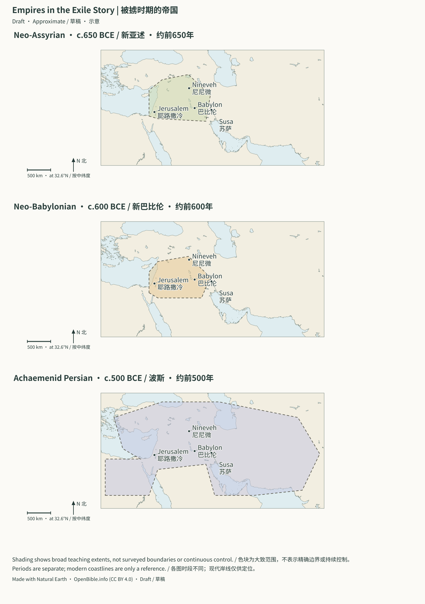
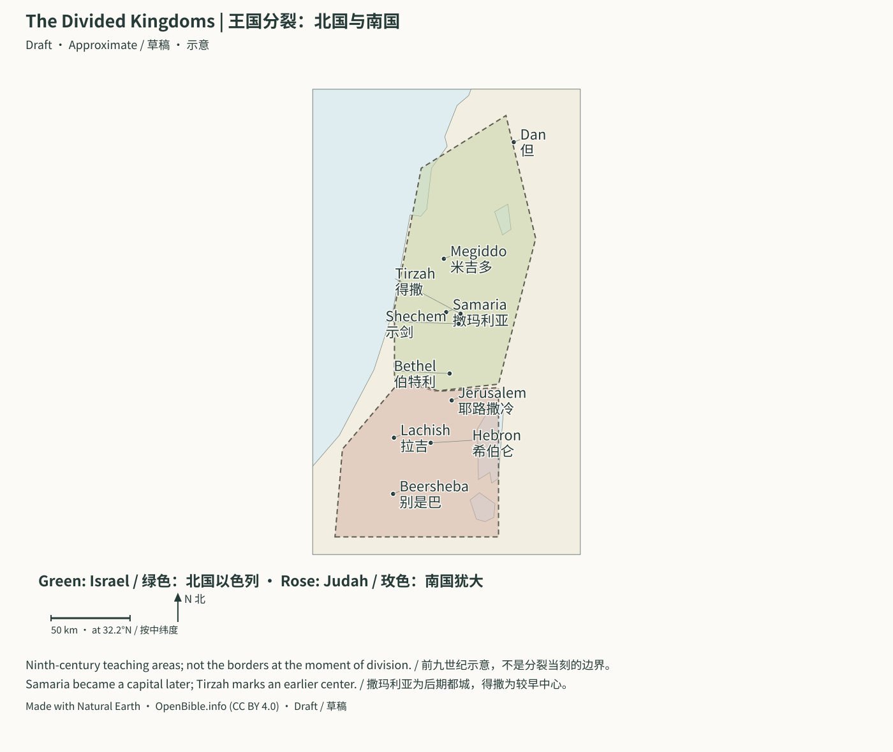

# Divided Kingdom to Return: Imperial Sources and Event Comparison | 分裂王国至归回：帝国史料与逐事件对照

> Status: Draft (AI draft; not human reviewed) | 状态：Draft（AI 草稿，未人工审阅）

## Empires in the Exile Story | 被掳时期的帝国

Three separate panels show broad Neo-Assyrian, Neo-Babylonian and Achaemenid Persian teaching extents around 650, 600 and 500 BCE. They are not simultaneous borders, maximum conquests, or measurements of continuous control. Nineveh, Babylon, Susa and Jerusalem anchor the comparison. The shapes are original regional sketches informed by historical descriptions, not copied historical boundary datasets.
三个分图分别示意约前650、600、500年的新亚述、新巴比伦和阿契美尼德波斯大致范围。它们不是同时存在的国界，不是最大征服范围，也不衡量持续控制。尼尼微、巴比伦、苏萨与耶路撒冷用于定位比较。色块根据历史文字说明自行绘制，未复制历史边界数据库。

**Sources | 来源：** [Met: Assyria / 大都会博物馆亚述资料](https://www.metmuseum.org/exhibitions/listings/2014/assyria-to-iberia) · [Met: Achaemenid Persia / 波斯资料](https://www.metmuseum.org/essays/the-achaemenid-persian-empire-550-330-b-c) · [Credits | 署名](../CREDITS.md#batch2-map-data)

[Open full SVG | 打开完整SVG](../assets/maps/exile-empires.svg)

## The Divided Kingdoms | 王国分裂：北国与南国

The shading is a broad ninth-century teaching envelope, not a precise frontier or the borders at the instant of division. Samaria belongs to the later northern capital phase; Tirzah marks an earlier center. Northern Israel and southern Judah changed in extent over time, and the eastern territories are not reconstructed in detail.
色块是前九世纪的大致教学范围，不是精确边界，也不是王国刚分裂时的疆界。撒玛利亚属于北国后期都城阶段，得撒标记较早中心。北国以色列与南国犹大的范围不断变化，约旦河东的领地未作详细重建。

**Sources | 来源：** [Coordinate sources and limits / 坐标来源与限制](../CREDITS.md#batch2-map-data) · [Credits | 署名](../CREDITS.md#batch2-map-data)

[Open full SVG | 打开完整SVG](../assets/maps/divided-kingdoms.svg)

> Scope: 1 Kings 12 through 2 Kings, 2 Chronicles 10–36, Ezra, Nehemiah, Esther, and related prophets. 
> 覆盖范围：《列王纪上》12 章至《列王纪下》、《历代志下》10–36 章、《以斯拉记》《尼希米记》《以斯帖记》，以及相关先知书。
> Period: kingdom division about 930 BCE to fifth-century returnees and Persian diaspora society. 
> 时间范围：约主前 930 年王国分裂，至主前 5 世纪归回群体与波斯侨民社会。
> Main question: how can the kings, prophets, Aram, Moab, Assyria, Babylon, and Persia share a timeline without overstating external evidence? 
> 核心问题：怎样把两国诸王、先知、亚兰、摩押、亚述、巴比伦和波斯放回同一条时间线，又不把外部证据说得超过它实际能证明的范围？

## 1. Main Conclusions | 一、先给结论

1. From the ninth century BCE, external sources become denser for Israel/Judah. Omri, Ahab, Jehu, Mesha, Menahem, Pekah, Hoshea, Hezekiah, Manasseh, Jehoiachin connect with outside material.
   从主前 9 世纪开始，以色列和犹大进入外部史料较密集的时期；暗利、亚哈、耶户、米沙、米拿现、比加、何细亚、希西家、玛拿西、约雅斤等名字都能与域外材料相连。
2. Kings assesses covenant loyalty; Assyrian/Babylonian inscriptions assess tribute, rebellion, conquest. These are different kinds of historical writing.
   《列王纪》用“是否忠于耶和华之约”评价君王；亚述和巴比伦王室铭文则用“是否进贡、是否反叛、是否被征服”评价同一世界。二者不是同一种历史写作。
3. Ahab is condemned for Baal worship in Scripture but fields many chariots in Assyrian accounts: theological assessment and military strength are different perspectives, not a contradiction.
   亚哈在圣经中因巴力崇拜受责备，在亚述铭文中却是一位能出动大批战车的区域君王；这不是矛盾，而是神学评价与国际军事实力两个不同观察面。
4. Mesha, Tel Dan, Black Obelisk make the ninth century the first densely interconnected biblical/regional-source stage.
   米沙碑、特尔但碑和黑色方尖碑使主前 9 世纪成为经文与周边王国材料可以密集互读的第一个阶段。
5. Tiglath-pileser III directly links Menahem, Pekah, Hoshea, placing northern decline within expansion, vassalage, annexation, deportation.
   提革拉毗列色三世的铭文直接连到米拿现、比加和何细亚；从这时起，北国的衰亡可逐步放进亚述扩张、附庸、割地和迁徙政策中理解。
6. Use 722/720 BCE for Samaria: Shalmaneser V’s three-year siege tradition and successor Sargon II’s conquest/deportation/provincial claims require separate layers.
   撒马利亚的结局宜写成“主前 722/720 年”：撒缦以色五世开始或完成三年围城的传统，与继位者撒珥根二世声称征服、迁走居民及重建行省的铭文，需要分层处理。
7. Sennacherib’s 701 BCE Judah campaign is richly attested by Scripture, prisms, Lachish reliefs/destruction. These confirm war’s core; none says Assyria captured Jerusalem.
   主前 701 年西拿基立进攻犹大，是旧约历史旁证最丰富的事件之一。经文、亚述棱柱、拉吉浮雕和毁坏层共同确认战争核心；各材料都没有说亚述攻陷耶路撒冷。
8. Babylonian chronicle precisely fixes 597 BCE first fall; 587/586 final destruction combines Scripture, calendar calculation, major Jerusalem fire layers.
   主前 597 年首次攻陷耶路撒冷由巴比伦编年史精确固定；主前 587/586 年末次毁城则由经文、年代推算和耶路撒冷大火毁坏层共同重建。
9. Jehoiachin rations, Al-Yahudu, legal records show varied exile lives: palace support, farming, service, families/property, not everyone imprisoned in camps.
   约雅斤配给文书、亚胡杜村文书和巴比伦法律文书显示：被掳者并非全被囚禁在营中，而是在王宫供养、乡村耕作、服役、经营家庭和财产等多种处境中生活。
10. Cyrus Cylinder uses Babylonian policy language of temple restoration, divine-image return, resettlement. No Jews/Jerusalem/Temple named: strong policy background for Ezra, not its specific decree.
    古列圆柱证明古列在巴比伦采用恢复地方神庙、归还神像和安置迁徙人口的政策语言；它没有提犹太人、耶路撒冷或圣殿，因此只能作为《以斯拉记》归回政策的有力背景。
11. Persian YHD/YHWD stamps, coins, sealings attest a smaller Judah province; Elephantine shows diaspora families, communities, religious life continuing rather than universal return.
    波斯时期的 “YHD／YHWD” 印记、钱币和公文封泥确认犹大成为较小的帝国行省；象岛纸草则显示，不是所有犹太人都归回，侨民群体继续在帝国各处建立家庭、社群和宗教生活。
12. Theologically, more than good/bad kings: Deuteronomic judgment unfolds while prophets open remnant, covenant, heart, Exodus, Davidic offspring, renewed presence hopes.
    神学上，这一大段不是简单的“好王坏王名单”，而是申命记之约的审判逐步实现，同时由先知不断打开“余民、新约、新心、新出埃及、大卫后裔和神重新同住”的盼望。

In one sentence: 
一句话概括：

> Imperial records anchor kings, wars, tribute, deportation, administration in history; prophets explain these events and hope beyond judgment. 
> 帝国史料可以把许多君王、战争、贡赋、迁徙和行政制度钉在真实历史中；先知书则解释这些事件为何发生，以及审判之后为何仍有盼望。

---

## 2. Timeline: Division to the Returned Community | 二、总时间轴：从王国分裂到归回群体

> Common reconstructions; coregencies, accession-year rules, scholarly tables can differ by one/several years. 
> 年代采用常见重建；两国君王共治、登基年算法和不同学者年表会造成一至数年的差异。

| Date / 年代 | Biblical storyline / 经文故事线 | Contemporary prophets/books / 同期先知／书卷 | External anchor / 外部锚点 | Evidence boundary / 证据边界 |
| --- | --- | --- | --- | --- |
| About 930 BCE | Rehoboam/Jeroboam;division | 1 Kings 12–14;2 Chronicles 10–12 | No direct contemporary named witness | Later two-state evidence supports broad framework, not speeches |
| 约主前 930 年 | 罗波安与耶罗波安；王国分裂 | 王上 12–14；代下 10–12 | 尚无直接记名两王的同期外证 | 分裂的大框架可由后续两国材料反向确认，具体演说不能由考古检验 |
| About 925 BCE | Shishak attacks Judah | 1 Kings 14:25–28;2 Chronicles 12 | Shoshenq I Karnak list | A for campaign;no undisputed surviving Jerusalem |
| 约主前 925 年 | 示撒攻打犹大 | 王上 14:25–28；代下 12 | 舍顺克一世卡纳克战役地名表 | 埃及战役为 A；耶路撒冷不见于无争议的现存地名 |
| Early ninth BCE | Omri builds Samaria;Ahab/Jezebel/Elijah | 1 Kings 16–22 | Mesha,Kurkh,Samaria buildings | A for dynasty/regional power;no contemporary Elijah witness |
| 主前 9 世纪前半 | 暗利建撒马利亚；亚哈、耶洗别、以利亚 | 王上 16–22 | 米沙碑、库尔赫碑；撒马利亚建筑群 | 暗利王朝与区域强权为 A；以利亚事迹无同期外证 |
| 853 BCE | Late Ahab | 1 Kings 22;Qarqar unrecorded in Scripture | Shalmaneser III Kurkh names Ahab the Israelite | A person/state/coalition;victory as royal propaganda |
| 主前 853 年 | 亚哈晚期 | 王上 22；经文未记夸夸战役 | 撒缦以色三世库尔赫碑称“以色列人亚哈” | A：人物、国名、战役联盟；亚述“大胜”须按王室宣传阅读 |
| About 850–840 BCE | Moab revolt;Jehoram | 2 Kings 3 | Mesha | A Mesha/Omri/conflict;do not force opposing claims into one report |
| 约主前 850–840 年 | 摩押反叛；约兰时代 | 王下 3 | 米沙碑 | A：米沙、暗利、以色列—摩押冲突；双方战果叙述不可硬拼成同一份战报 |
| 841 BCE | Jehu coup;Ahab dynasty ends | 2 Kings 9–10 | Black Obelisk;Tel Dan similar window | A tribute;Tel Dan author/damaged names debated |
| 主前 841 年 | 耶户政变；亚哈家终结 | 王下 9–10 | 黑色方尖碑；特尔但碑约属同一历史窗口 | A：耶户进贡；特尔但碑作者与残缺人物复原仍有争议 |
| About 800–750 BCE | Jeroboam II expansion/inequality | 2 Kings 14 | Amos/Hosea;Jonah narrative setting | Prosperity/administration give background, not revelation proof |
| 约主前 800–750 年 | 耶罗波安二世扩张，社会贫富分化 | 王下 14 | 阿摩司、何西阿；约拿的叙事背景 | 区域繁荣和行政材料可作背景；先知神谕的启示性质不由考古证明 |
| About 738 BCE | Menahem pays Pul | 2 Kings 15:19–20 | Tiglath-pileser III names Menahem of Samaria | A person/tribute |
| 约主前 738 年 | 米拿现向普勒进贡 | 王下 15:19–20 | 提革拉毗列色三世铭文列“撒马利亚的米拿现” | A：人物与贡赋 |
| 734–732 BCE | Syro-Ephraimite crisis;Ahaz seeks Assyria | 2 Kings 15–16;Isaiah 7–8;2 Chronicles 28 | Assyrian Rezin/Pekah/Hoshea/annexation | A people/coup/territory;Isaiah 7 promise requires exegesis |
| 主前 734–732 年 | 亚兰—以法莲危机；亚哈斯求助亚述 | 王下 15–16；赛 7–8；代下 28 | 亚述铭文记利汛、比加、何细亚及北国领土并吞 | A：人物、政变、割地；赛 7 的神学应许需按经文解释 |
| 724–722 BCE | Hoshea revolt/three-year siege | 2 Kings 17–18 | Sargon II claims capture/27,290 deported | A conquest/deportation/province;who completed siege separate |
| 主前 724–722 年 | 何细亚反叛；撒马利亚被围三年 | 王下 17–18 | 撒珥根二世称攻取撒马利亚并迁走 27,290 人 | A：征服、迁徙、行省化；攻城由撒缦以色还是撒珥根完成仍须分层 |
| 720 BCE | Renewed western revolt suppressed | Not itemized in Kings | Other Sargon II chronological records | Distinguish 722/720 layers, not same day |
| 主前 720 年 | 亚述平定西部再次反叛 | 王下没有逐项记录 | 撒珥根二世其他年表材料 | 解释“722/720”两层事件，不能把所有铭文句子压在同一天 |
| 701 BCE | Hezekiah crisis | 2 Kings 18–20;Isaiah 36–39;2 Chronicles 32;Micah 1 | Prisms,Lachish,Siloam | A campaign/person/Lachish/tribute;withdrawal cause undecided |
| 主前 701 年 | 西拿基立攻犹大；希西家危机 | 王下 18–20；赛 36–39；代下 32；弥 1 | 西拿基立棱柱、拉吉浮雕与毁坏层、西罗亚水道 | A：战役、希西家、拉吉、贡物；亚述退兵原因不能由铭文裁定 |
| Mid-seventh BCE | Manasseh | 2 Kings 21;2 Chronicles 33 | Assyrian vassal list | A person/status;no independent captivity/repentance witness |
| 主前 7 世纪中叶 | 玛拿西长期作王 | 王下 21；代下 33 | 亚述王室名单称“犹大王玛拿西”为附庸 | A：人物与附庸地位；被押巴比伦及悔改没有独立外证 |
| About 622 BCE | Josiah reform/book discovery | 2 Kings 22–23;2 Chronicles 34–35 | Late-Judah literacy/administration/religion | No object determines exact discovered book-form |
| 主前 622 年前后 | 约西亚改革与约书发现 | 王下 22–23；代下 34–35 | 犹大末期识字、行政和宗教遗存作背景 | 不能由某件文物证明“所发现的书”究竟是哪一文本形态 |
| 612 BCE | Nineveh falls/Assyria collapses | Nahum;Zephaniah 2 | Chronicle BM 21901 | A fall;theology separate |
| 主前 612 年 | 尼尼微陷落，亚述帝国崩解 | 那鸿；番 2 | 巴比伦编年史 BM 21901 | A：尼尼微陷落；《那鸿书》的神学宣告属另一层 |
| 609 BCE | Necho kills Josiah at Megiddo | 2 Kings 23:29–30;2 Chronicles 35:20–24 | Egypt’s Syrian contest | People/date reconstructable;no direct Egyptian death report |
| 主前 609 年 | 约西亚在米吉多被法老尼哥所杀 | 王下 23:29–30；代下 35:20–24 | 埃及争夺叙利亚的国际背景 | 人物和年代可重建；尚无埃及战报直接叙述约西亚之死 |
| 605 BCE | Carchemish;Babylon replaces Egypt | Jeremiah 25/46;Daniel 1 opening | Chronicle BM 21946 | A battle/power shift;accession calculations differ |
| 主前 605 年 | 迦基米施之战；巴比伦取代埃及控制西方 | 耶 25、46；但 1 的叙事起点 | 巴比伦编年史 BM 21946 | A：战役与权力转移；但 1 与王下／耶利米的登基年算法须分别解释 |
| 597 BCE | First Jerusalem fall;Jehoiachin exiled/Zedekiah installed | 2 Kings 24;2 Chronicles 36;Jeremiah 24/29;Ezekiel 1 | Chronicle BM 21946 | A siege/deposition/replacement/year |
| 主前 597 年 | 耶路撒冷首次陷落；约雅斤被掳；西底家被立 | 王下 24；代下 36；耶 24、29；结 1 | 巴比伦编年史 BM 21946 | A：攻城、废王、另立新王与年份 |
| 589–587/586 BCE | Zedekiah revolt;city/Temple destroyed | 2 Kings 25;2 Chronicles 36;Jeremiah 37–44/52;Lamentations | Jerusalem fire;Lachish letters;official tablet | A/B destruction/administration;calendar conversion explains 587/586 |
| 主前 589–587/586 年 | 西底家反叛；耶路撒冷与圣殿被毁 | 王下 25；代下 36；耶 37–44、52；哀 | 耶路撒冷大火毁坏层、拉吉书信、巴比伦官员泥版 | A/B：毁城与末期行政；“587/586”取决于年历与登基年换算 |
| Sixth BCE | Exile in Babylon | Ezekiel,Daniel,Psalm 137,Isaiah 40–55 | Jehoiachin/Al-Yahudu | A king/community;not personal spiritual experience |
| 主前 6 世纪 | 被掳者在巴比伦生活 | 结、但；诗 137；赛 40–55 | 约雅斤配给文书、亚胡杜档案 | A：犹大王与被掳群体存在；个人属灵经历不能由行政文书验证 |
| 539 BCE | Babylon under Persia | Daniel 5–6;Isaiah 44–45 | Nabonidus/Cyrus Cylinder | A regime change;no direct Daniel/night-detail witness |
| 主前 539 年 | 巴比伦归波斯 | 但 5–6 的叙事过渡；赛 44–45 | 拿波尼度编年史、古列圆柱 | A：政权更替；但以理人物与当夜细节无直接外证 |
| About 538 BCE | Return/Temple rebuilding permitted | Ezra 1–4;2 Chronicles 36:22–23 | Cyrus policy context | B compatibility;no Jerusalem edict on cylinder |
| 主前 538 年前后 | 古列准许归回、重建圣殿 | 拉 1–4；代下 36:22–23 | 古列圆柱提供帝国政策背景 | B：政策相容；圆柱没有耶路撒冷诏书 |
| 520–516/515 BCE | Zerubbabel/Joshua restart;Temple finished | Ezra 5–6;Haggai;Zechariah 1–8 | Behistun on Darius’ early revolts | B imperial setting;no Jerusalem Temple |
| 主前 520–516/515 年 | 所罗巴伯、约书亚重启工程；第二圣殿完工 | 拉 5–6；该；亚 1–8 | 贝希斯敦铭文说明大流士初年帝国叛乱背景 | B：帝国环境；铭文不提耶路撒冷圣殿 |
| Traditional 458 BCE | Ezra arrives/law community | Ezra 7–10 | Province/Aramaic document forms | B institutions;minority chronological alternatives |
| 传统年表主前 458 年 | 以斯拉到耶路撒冷、重整律法群体 | 拉 7–10 | 波斯行省制度、亚兰文公文形式 | B：制度背景；以斯拉绝对年代仍有少数替代方案 |
| 454–404 BCE | Many Judah descendants remain in Babylon | Ezra 7–8 ascent;Ezekiel/Jeremiah 29 diaspora background | Nippur Murashu legal/business archive | A residents/agriculture/administration;not Ezra party/list |
| 主前 454–404 年 | 归回同时，许多犹大后裔仍留在巴比伦 | 拉 7–8 的“从巴比伦上来”；结、耶 29 的侨居后景 | 尼普尔穆拉舒商业／法律档案 | A：留居者、农业与行政经济；不证明以斯拉队伍或名单 |
| From 445/444 BCE | Nehemiah governor/walls/renewal | Nehemiah | Yehud seals/stamps/coins | A province;no generally accepted contemporary Nehemiah witness |
| 主前 445/444 年起 | 尼希米作省长、修城墙、群体更新 | 尼 | Yehud 封泥、印记与钱币 | A：犹大行省存在；尼希米本人尚无公认同期外证 |
| 486–465 BCE narrative setting | Esther at Susa/Purim | Esther | Palace archaeology/Xerxes court setting | B place/king/institutions;no direct Esther/Mordecai witness |
| 主前 486–465 年的叙事背景 | 以斯帖在书珊宫廷；普珥日来源 | 斯 | 书珊王宫考古与薛西斯时代宫廷背景 | B：地点、君王名和制度环境；无直接以斯帖或末底改外证 |

---

## 3. Distinguish Three Kinds of Historical Writing | 三、先把三种“历史书写”分开

## 3.1 Kings: Explaining Exile | 3.1 《列王纪》：解释为何被掳

Kings is more than court annals. It repeatedly asks: 
《列王纪》不是单纯的宫廷年鉴。它反复用几条标准评价君王：

- Exclusive worship of the Lord?
  是否专一敬拜耶和华；
- Tolerance of high places, idols, Baal?
  是否容许邱坛、偶像和巴力崇拜；
- Northern continuation of Jeroboam son of Nebat’s sin?
  北国君王是否延续“尼八的儿子耶罗波安的罪”；
- Judah’s kings following David’s way?
  犹大君王是否行大卫所行的正道；
- Attention to prophets?
  是否听从先知之言；
- National fall fulfilling Deuteronomy’s covenant judgment?
  国家的灭亡是否应验申命记所警告的圣约审判。

Political strength is not spiritual loyalty. Omri/Ahab matter internationally, yet Kings devotes space to Elijah’s covenant struggle. Jeroboam II recovers territory while northern sin persists. 
因此，政治强盛不等于属灵忠诚。暗利和亚哈在国际政治上很重要，《列王纪》却用较多篇幅写以利亚与约中的争战；耶罗波安二世收复失地，经文仍指出北国的罪没有改变。

## 3.2 Chronicles: Retelling Identity for Returnees | 3.2 《历代志》：向归回群体重讲身份

Sharing much material with Kings, Chronicles differs in focus: 
《历代志》与《列王纪》共享大量材料，却有不同焦点：

- Davidic/Judah line rather than full northern history;
  主要跟随大卫王朝和犹大，不展开北国诸王的完整历史；
- Temple, priests, Levites, worship, prayer;
  强调圣殿、祭司、利未人、敬拜和祷告；
- Seeking God, humility, repentance, renewal;
  反复呈现寻求神、谦卑、悔改与复兴；
- Exilic/postexilic readers learn state collapse did not cancel Davidic promise/Temple worship calling.
  让被掳后读者明白：国亡了，神给大卫的应许和对圣殿敬拜的呼召并未作废。

2 Chronicles ends and Ezra begins with near-identical Cyrus wording, an intentional canonical seam: 
《历代志下》最后以古列诏令收尾，《以斯拉记》开头几乎接续同一段话。这是正典叙事刻意留下的接缝：

> Judgment is not the final word; return is not the complete ending. 
> 审判不是故事最后一句；归回也不是完整终局。

### 3.2.1 A Few 4Q118 Lines and Careful Chronicles Comparison | 3.2.1 4Q118：只剩几行，仍足以提醒怎样比较《历代志》

4Q118/4QChr is a Hebrew leather fragment from Cave 4. Its second column parallels 2 Chronicles 28:27–29:3, where Ahaz dies and Hezekiah begins his reign and Temple cleansing. 
4Q118／4QChr 是昆兰第 4 洞的一件希伯来文皮卷残片。第二栏可与代下 28:27–29:3 对读，正处在亚哈斯死后、希西家即位并开始洁净圣殿的转折：

| Establishes / 可确认 | Interpretive value / 解释意义 | Cannot infer / 不可推出 |
| --- | --- | --- |
| Column 2 closely matches Hebrew 2 Chronicles 28–29 | Late Second Temple copying/rewriting of succession–Temple narrative | Independent proof of cleansing event |
| 第二栏保存与代下 28–29 高度相合的希伯来文字 | 到第二圣殿晚期，这段王位—圣殿叙事已在传抄／改写 | 希西家洁殿事件因抄本而获独立外证 |
| Small variants | Not only unchanged-wording versus fiction alternatives | Whole original reconstructed from a few lines |
| 有若干小异文 | 古代《历代志》文本不是只剩“逐字不变／完全虚构”二选一 | 可由几行恢复整卷原文 |
| Column 1 uncertain,possibly parallels 4Q381 31 | Could be rewriting/parallel text;identity question remains | Undisputed complete Chronicles manuscript |
| 第一栏仍无法稳妥认作《历代志》，并可能平行 4Q381 31 | 整件作品或许是改写、平行文本，须保留鉴定问号 | 4Q118 是无争议的完整《历代志》抄本 |

IAA/DJD retain 4Q Chronicles title, justified for column 2; later work cautions about whole composition’s category. Say fragments directly match 2 Chronicles 28–29, rather than let a catalogue name settle author, composition, scroll form, canon. 
以色列文物局和 DJD 沿用“4Q Chronicles”名称，这对第二栏很有根据；但后续研究使整件作品的类别变得更谨慎。最稳妥的写法是：“4Q118 含有与《历代志下》28–29 章直接相合的残文”，而不是用一个目录名解决作者、成书、卷形和正典地位。

Sources: 
来源：

- [Israel Antiquities Authority:4Q118/4Q Chronicles](https://www.deadseascrolls.org.il/explore-the-archive/manuscript/4Q118-1?locale=de_DE)
  [以色列文物局：4Q118／4Q Chronicles](https://www.deadseascrolls.org.il/explore-the-archive/manuscript/4Q118-1?locale=de_DE)
- [James Nati:column 1/4Q381 31 possible parallel](https://doi.org/10.2143/RQ.29.1.3217837)
  [James Nati：第一栏与 4Q381 31 的可能平行](https://doi.org/10.2143/RQ.29.1.3217837)
- [Marek Parchem:identification/Qumran reception](https://doi.org/10.21697/ct.2019.89.4.07)
  [Marek Parchem：4Q118 鉴定与昆兰接收综述](https://doi.org/10.21697/ct.2019.89.4.07)

### 3.2.2 Sinaiticus 1 Chronicles: Direct Witness and Ancient Copying Error | 3.2.2 《西奈抄本》《历代志上》：直接抄本入口与一次古代抄写错误

Mid-fourth-century Sinaiticus gives dedicated 1 Chronicles evidence unavailable in 4Q118. St Catherine’s 1975 New Finds preserve 17:14–18:11 in original quire position. A copied duplicate 9:27–19:17 interrupts 2 Esdras, marked by an ancient corrector’s three crosses. 
《西奈抄本》（约主后四世纪中叶）为《历代志上》提供了 4Q118 不能提供的专属直接见证。1975 年圣凯瑟琳修道院“新发现”残片保存代上 17:14–18:11 的部分文字；项目重建把它放回《历代志上》原来的帖页位置。另有代上 9:27–19:17 被误抄进 2 Esdras 中段的重复区块，古代校订者已经用三个十字记号标出错误。

| Establishes / 可确认 | Interpretive value / 解释意义 | Cannot infer / 不可推出 |
| --- | --- | --- |
| Original fragments/duplicate preserve Greek 1 Chronicles | Book in large Christian codex by fourth century;some passages twice witnessed | David/genealogy/Temple preparations/author proved |
| 原位残片与重复段都保存《历代志上》希腊文 | 到四世纪本卷已进入大型基督教圣经 codex；部分经文可获同一抄本内两次见证 | 大卫事件、家谱、建殿预备或作者因此获证 |
| Duplicate in 2 Esdras with ancient correction | Copying/correction/order reconstruction as text-history evidence | Different canon order or merely modern misplaced binding |
| 重复段插入 2 Esdras，随后有古代校记 | 抄写、校正和卷序重建本身可以成为文本史资料 | 这代表另一种古代正典卷序，或只是现代装订把完整叶放错 |
| Main scope 9:27–19:17;small original fragments | Direct MS access,not complete book | Entire initial Hebrew exemplar recovered |
| 现存范围主要落在代上 9:27–19:17，原位只余小残片 | 《历代志上》现在有直接 MS 入口，但不是完整幸存卷本 | 可由局部希腊文恢复全卷最初希伯来底本 |

Anchor 198 is Greek 1 Chronicles;anchor 167’s 4Q118 column 2 directly matches only 2 Chronicles 28–29. Adjacent books do not create a nonexistent Hebrew 1 Chronicles manuscript. 
这也澄清两件容易混淆的事：锚点 198 的《西奈抄本》是真正的《历代志上》希腊文本；锚点 167 的 4Q118 第二栏仍只直接对应《历代志下》28–29。不能因为两卷相邻，就把后者改造成一份不存在的《历代志上》希伯来抄本。

Sources: 
来源：

- [Codex Sinaiticus Project:original fragments/duplicate reconstruction](https://codexsinaiticus.org/en/project/transcription_reconstructing.aspx)
  [Codex Sinaiticus Project：原位残片与误抄重复段重建](https://codexsinaiticus.org/en/project/transcription_reconstructing.aspx)
- [Codex Sinaiticus Project:misplaced Chronicles manuscript/transcription](https://www.codexsinaiticus.org/en/manuscript.aspx?book=7)
  [Codex Sinaiticus Project：《历代志上》误抄段实物与转写](https://www.codexsinaiticus.org/en/manuscript.aspx?book=7)
- [British Library:Add MS 43725/Chronicles holdings](https://searcharchives.bl.uk/catalog/032-002169711)
  [British Library：Add MS 43725 及《历代志上》分藏范围](https://searcharchives.bl.uk/catalog/032-002169711)
- [Emanuel Tov:surviving Sinaiticus1 Chronicles](https://www.emanueltov.info/docs/varia/272.sinaiticus.pdf?v=1.0)
  [Emanuel Tov：《西奈抄本》现存《历代志上》范围](https://www.emanueltov.info/docs/varia/272.sinaiticus.pdf?v=1.0)

## 3.3 Prophets: Interpreting Events from Within Them | 3.3 先知书：站在事件中解释事件

Prophets do not write religious sayings detached from history. They address: 
先知不是抽离历史的宗教格言作者。他们常直接回应：

- Royal alliances;
  王室联盟；
- War/siege;
  战争与围城；
- Land seizure, corrupt courts, inequality;
  地主侵吞、法庭腐败和贫富悬殊；
- Worship disconnected from life;
  圣殿敬拜与实际生活的断裂；
- Reliance on Egyptian/Assyrian diplomacy;
  依靠埃及或亚述的外交策略；
- Exiles’ identity/land/divine-presence crisis;
  被掳者对身份、土地和神同在的危机；
- Post-return disappointment, indifference, delayed rebuilding.
  归回后失望、冷淡和重建迟延。

A practical method: 
最实用的读法是：

> Read Kings’ event framework, insert contemporary prophets, then Chronicles’ reinterpretation for returnees. 
> 先读《列王纪》的事件骨架，再把同期先知插回去；然后用《历代志》看归回群体怎样重新解释这段历史。

---

## 4. Division: Political and Worship Rupture | 四、王国分裂：政治断裂与敬拜断裂

### 4.1 Rehoboam’s Burdens and Jeroboam’s Altars | 4.1 罗波安的重担与耶罗波安的祭坛

1 Kings 12 presents two concurrent causal levels: 
《列王纪上》12 章把分裂写成两条同时成立的因果线：

1. Human: Rehoboam rejects elders’ counsel and adds heavier labor for northern tribes.
   人的层面：罗波安拒绝老年人的劝告，以更重劳役回应北方支派。
2. Divine: division fulfills Ahijah’s announcement about Solomon’s covenant breach.
   神的层面：分裂应验亚希雅对所罗门背约的宣告。

Jeroboam then establishes calves, festivals, priests at Bethel/Dan. More than changing worship sites, royal security redesigns worship order. 
耶罗波安随后在伯特利和但设立金牛犊、另立节期和祭司。问题不只是“换一个敬拜地点”，而是王权为了政治安全重新设计敬拜秩序。

### 4.2 Tel Dan Sanctuary: Biblical Place and Visible Buildings Differ | 4.2 特尔但祭祀区：经文地点与可见建筑不能直接画等号

Tel Dan’s long-used cult area and Iron Age cult material illuminate a real northern sanctuary. Evidence of worship differs in strength from identifying today’s platform as Jeroboam I’s own altar. 
特尔但确有长期使用的祭祀区，也出土铁器时代祭祀材料，因此它能帮助读者理解北方边境圣所的真实环境。但“遗址有祭祀活动”与“今天可见的某座台基就是耶罗波安一世亲建祭坛”是两个不同等级的结论。

A 2025 ASOR stratigraphic reassessment places many monumental structures formerly assigned to tenth–eighth-century kings more plausibly in Persian, Hellenistic, Roman periods. Three cautions follow: 
2025 年发表在 ASOR 期刊的重新分层研究指出，过去被归给主前 10–8 世纪君王的不少宏大构筑，其建筑关系和物质文化更适合放在波斯、希腊化与罗马时期。这个修订带来三条纪律：

- Matching place names does not assign every building phase to a biblical person;
  不因遗址名称与经文地名相合，就把每层建筑都署名给经文人物；
- Later large platforms cannot prove every 1 Kings 12 construction detail;
  不能用较晚的宏大台基“证明”王上 12 章每个建筑细节；
- Redating does not show no Iron Age worship at Dan or refute the account of official northern worship.
  新分期也没有证明但城在铁器时代不存在祭祀活动，更没有否定经文关于北国官方敬拜的叙述。

Safest assessment: **place/long cult tradition A/B background; identifying a surviving monument as Jeroboam’s altar remains C.** 
所以目前最稳妥的结论是：**地点与长期祭祀传统为 A／B 级背景；把某一现存宏大遗构认作耶罗波安祭坛仍属 C 级。**

Source: [Bulletin of the American Society of Overseas Research,2025: The Sacred Precinct of Tel Dan Revisited](https://www.journals.uchicago.edu/doi/10.1086/734979). 
来源：[Bulletin of the American Society of Overseas Research（2025）：The Sacred Precinct of Tel Dan Revisited](https://www.journals.uchicago.edu/doi/10.1086/734979)。

### 4.3 Shishak / Shoshenq I’s Campaign | 4.3 示撒／舍顺克一世的战役

About 925 BCE, Shoshenq I campaigns in the southern Levant and leaves Karnak place list. Most studies identify him with Shishak. 
约主前 925 年，埃及法老舍顺克一世在南黎凡特发动战役，并在卡纳克留下地名表。多数研究把他与经文“示撒”认同。

Supports: 
材料支持：

- Late-tenth-century Egyptian intervention in Israel/Judah;
  10 世纪末埃及确实重新深入以色列和犹大地区；
- Timing fitting early Rehoboam;
  时间与罗波安初年相合；
- Divided region vulnerable to outside powers.
  这次行动说明分裂后的地区容易受外部强权介入。

Does not establish: 
材料不支持：

- Undisputed Jerusalem in surviving list;
  现存地名表没有无争议的“耶路撒冷”；
- Every named site burned;
  地名被列出不自动表示每处都被焚毁；
- Karnak recounting Rehoboam surrendering Temple gold.
  卡纳克铭文没有讲述罗波安献出圣殿金器。

**Evidence grade: A** for pharaoh/regional campaign; Jerusalem details **B**. 
**证据等级：A**（法老、区域战役）；经文耶路撒冷细节为 **B**。

### 4.4 Three Kings Manuscripts: Physical Texts, Not Royal Archives | 4.4 三份《列王纪》残卷：文本实物不是王室档案

4Q54,5Q2,6Q4 are three distinguishable Qumran Hebrew Kings manuscripts: 
4Q54、5Q2 与 6Q4 是目前可区分的三份昆兰《列王纪》希伯来文卷本：

| Witness / 卷本 | Carrier/date / 载体与年代 | Main contents / 现存重点 | Textual significance / 最重要的文本意义 |
| --- | --- | --- | --- |
| 5Q2/5QKgs | Cave 5 leather;Hasmonean | 1 Kings 1:1,16–17,27–37 | Opening Solomon succession broadly agrees with Masoretic/Old Greek |
| 5Q2／5QKgs | 第 5 洞皮卷；哈斯摩尼时期 | 王上 1:1、16–17、27–37 | 书卷开头的所罗门继位段与马所拉本、古希腊本大体一致 |
| 4Q54/4QKgs | Cave 4 leather;late Hasmonean/early Herodian script | 1 Kings 7–8 | Generally proto-Masoretic;8:16 longer reading parallels 2 Chronicles 6/some Old Greek |
| 4Q54／4QKgs | 第 4 洞皮卷；晚哈斯摩尼／早期希律书体 | 王上 7–8 | 整体接近原马所拉型，却在王上 8:16 保存与代下 6、部分古希腊本相合的长读 |
| 6Q4/6QpapKgs | Cave 6 papyrus;Hasmonean | 1 Kings 3/12/22;2 Kings 5–10 | Earlier portions near Masoretic;some 2 Kings 7–8 shorter readings share ancient translations |
| 6Q4／6QpapKgs | 第 6 洞纸草卷；哈斯摩尼时期 | 王上 3、12、22；王下 5–10 | 前段多近马所拉本；王下 7–8 的部分短读又与其他古译本相合 |

6Q4 connects division in 1 Kings 12, late Ahab in 22, Elisha/Jehu in 2 Kings 5–10. The story now split into two books has direct Second Temple Hebrew evidence, though tiny fragments often cannot be located. 
6Q4 特别适合接回本专题，因为它现存的王上 12 是王国分裂、王上 22 是亚哈末期，王下 5–10 则横跨以利沙故事与耶户政变。它让读者看到：今天分成“列王纪上、下”的故事，在第二圣殿时期已有希伯来文实物见证；但纸草残片极碎，大量碎片无法定位。

The 8:16 longer reading cautions against treating everything extra in Chronicles as later authorial invention. Some wording may derive from other circulated Hebrew texts; one longer reading does not make all Chronicles earlier/more accurate. 
王上 8:16 长读也提醒比较《列王纪》与《历代志》时不要先假定“凡《历代志》多出的词都是后代作者创造”。某些措辞可能来自曾经流传的不同希伯来文本；反过来，一处长读也不能证明《历代志》整体更早或更准确。

These manuscripts lie about 700–800 years after division-era events. They show transmission/long-short readings; Mesha, Assyrian texts, destruction layers address persons, war, setting. Both layers matter without substituting for each other. 
这些残卷与分裂王国事件相隔约七至八百年。它们回答的是文本怎样流传、哪里出现长短读法；米沙碑、亚述铭文和毁坏层才处理人物、战争和政治背景。两层都重要，却不能互相冒充。

Sources: 
来源：

- [Israel Antiquities Authority:4Q54/4QKgs](https://www.deadseascrolls.org.il/explore-the-archive/manuscript/4Q54-1?locale=en_US)
  [以色列文物局：4Q54／4QKgs](https://www.deadseascrolls.org.il/explore-the-archive/manuscript/4Q54-1?locale=en_US)
- [Israel Antiquities Authority:5Q2/5QKgs](https://www.deadseascrolls.org.il/explore-the-archive/manuscript/5Q2-1?locale=en_US)
  [以色列文物局：5Q2／5QKgs](https://www.deadseascrolls.org.il/explore-the-archive/manuscript/5Q2-1?locale=en_US)
- [Israel Antiquities Authority:6Q4/6QpapKgs](https://www.deadseascrolls.org.il/explore-the-archive/manuscript/6Q4-1?locale=en_US)
  [以色列文物局：6Q4／6QpapKgs](https://www.deadseascrolls.org.il/explore-the-archive/manuscript/6Q4-1?locale=en_US)
- [Julio Trebolle:three manuscripts’ scope/relationships and 1 Kings 8:16 longer reading (Brill DOI)](https://doi.org/10.1163/ej.9789004177291.i-712.15)
  [Julio Trebolle：三卷经文范围、版本关系与王上 8:16 长读（Brill DOI）](https://doi.org/10.1163/ej.9789004177291.i-712.15)

---

## 5. Omri’s Dynasty: Biblical Criticism, Lasting External Memory | 五、暗利王朝：圣经严厉批判，外部世界却记得很深

## 5.1 Omri and Samaria | 5.1 暗利与撒马利亚

Omri buys Samaria’s hill for a new northern capital (1 Kings 16:24). Its location offers: 
暗利买下撒马利亚山，建立北国新都（王上 16:24）。地理上，这里：

- Defensibility;
  易于防守；
- Access to agricultural hinterland;
  接近山地农业腹地；
- Links between coast and Jordan trade routes;
  可连接沿海与约旦河谷贸易线；
- A suitable court/administrative center.
  适合作为中央宫廷和行政中心。

Assyria keeps calling the north Bīt-Ḫumrî / House of Omri after Jehu overthrows the dynasty: Omri’s name becomes an international territorial label. 
亚述此后长期把北国称为 “Bīt-Ḫumrî／暗利之家”，即使王朝已经被耶户推翻。这说明暗利之名在国际政治中成为北国的固定标签。

Samaria’s palace, ivories, administration can be studied, but building phases/individual attribution need caution. Kings gives Omri few verses yet judges him worse than predecessors: narrative space does not measure international prestige. 
考古可以讨论撒马利亚宫殿、象牙和行政遗存，但建筑分期与具体君王署名仍需谨慎。经文对暗利只用数节，却说他比以前的王更恶；这再次显示《列王纪》的篇幅不按国际声望分配。

## 5.2 Ahab and Qarqar, 853 BCE | 5.2 亚哈与主前 853 年夸夸之战

Shalmaneser III’s Kurkh inscription lists Ahab the Israelite among the anti-Assyrian coalition in 853 BCE. 
撒缦以色三世的库尔赫碑记述主前 853 年夸夸之战，在反亚述联盟名单中通常读到“以色列人亚哈”。

It confirms: 
它可以确认：

- A real mid-ninth-century regional king;
  亚哈是主前 9 世纪中叶的真实区域君王；
- Northern participation in a major coalition;
  北国有能力参与大规模国际联盟；
- Significant Israelite chariot power;
  以色列拥有重要战车力量；
- Aram–Israel relations included both war and temporary anti-Assyrian alliance, not permanent hostility.
  经文中的亚兰—以色列关系不是简单的永久敌对：两国可以交战，也可能为抵抗亚述暂时联合。

It does not confirm: 
它不能确认：

- Ahab’s precise Carmel, Naboth, or final-battle experiences;
  亚哈在迦密山、拿伯葡萄园或阵亡战役中的具体经历；
- Complete coalition defeat merely from Shalmaneser’s victory claim. Repeated later campaigns require reading royal propaganda critically.
  撒缦以色所宣称的“胜利”是否等于彻底击溃联盟。亚述后来仍需多次西征，说明战果必须按宣传文体折算。

**Evidence grade: A** for person, state, participation. 
**证据等级：A**（人物、国名、战役参与）。

Source: [British Museum Kurkh BM 118884](https://www.britishmuseum.org/collection/object/W_1863-0619-2). 
来源：[大英博物馆库尔赫碑 BM 118884](https://www.britishmuseum.org/collection/object/W_1863-0619-2)。

## 5.3 Mesha and 2 Kings 3 | 5.3 米沙碑与《列王纪下》3 章

Mesha’s inscription presents Moab’s perspective: 
摩押王米沙的碑文从摩押立场回顾：

- Omri oppressed Moab;
  暗利压迫摩押；
- His son continued control;
  暗利之子继续控制；
- Mesha recovered towns/built works and credited Chemosh.
  米沙夺回城镇、修筑工程，并把胜利归给摩押神基抹。

2 Kings 3 narrates revolt from the Israel–Judah coalition’s side. Shared historical core: 
《列王纪下》3 章从以色列—犹大联军一方叙述摩押反叛。两者共有的历史核心是：

- Mesha as real Moabite king;
  米沙是真实的摩押王；
- Omride control;
  暗利王朝曾控制摩押；
- Later revolt;
  摩押后来反叛；
- Royal, territorial, religious dimensions of warfare.
  战争带有王权、领土与宗教宣传多重面向。

Do not mechanically combine endings. Royal monuments select favorable material; Kings places war within theological reflection on Israelite kings and Chemosh sacrifice. 
两份材料的结尾不能机械拼合。古代王室碑文会选择有利于立碑者的部分，《列王纪》则把战事放进对以色列君王和基抹献祭的神学叙事。

**Evidence grade: A** for persons/powers/conflict; damaged-line restoration **C**. 
**证据等级：A**（人物、政权与冲突）；残损行复原为 **C**。

Source: [Louvre Mesha stele](https://collections.louvre.fr/en/ark:/53355/cl010120339). 
来源：[卢浮宫米沙碑](https://collections.louvre.fr/en/ark:/53355/cl010120339)。

## 5.4 Why So Much Elijah and Elisha? | 5.4 以利亚、以利沙为何占这么大篇幅

External monuments favor kings, tribute, campaigns; 1 Kings 17–2 Kings 13 instead centers prophets: 
外部铭文偏爱记录王、贡物和战果，《列王纪上》17 章至《列王纪下》13 章却把叙事重心放到先知：

- Elijah’s drought challenges Baal as storm/fertility god;
  以利亚宣告旱灾，挑战巴力作为风暴与丰饶神的权能；
- Carmel asks who governs rain, fire, life, not which ritual impresses;
  迦密山事件问的不是“哪一种仪式更感人”，而是谁真正掌管雨、火和生命；
- Naboth exposes seizure of ancestral land and judicial murder;
  拿伯葡萄园事件揭露王权侵吞祖业与司法谋杀；
- Elisha crosses court, army, widow, foreign general, famine city.
  以利沙的故事不断跨过宫廷、军队、寡妇、外族将军和饥荒城市。

The main thread: 
这里的主线是：

> Kings control courts but not the Lord’s word, which judges power and preserves life. 
> 王可以控制宫廷，却不能控制耶和华的话；先知之言不断审判王权，也保存生命。

These miracles have no expected archaeological test. Assyrian annals would not normally record an Israelite widow’s oil or Naaman’s healing. 
这些具体神迹没有可期待的考古检验方法。缺少域外记录并不奇怪，因为亚述年表不会记录以色列寡妇的油或乃缦的医治。

---

## 6. 841 BCE: Jehu, Tel Dan, Black Obelisk | 六、主前 841 年：耶户、特尔但碑与黑色方尖碑

### 6.1 Jehu’s Coup | 6.1 耶户政变

2 Kings 9–10 describes Jehu: 
《列王纪下》9–10 章写耶户：

- Anointed by a prophetic disciple;
  被先知门徒膏立；
- Killing Jehoram, Ahab’s house, Jezebel, Baal worshipers;
  杀约兰、亚哈家、耶洗别和巴力崇拜者；
- Continuing Bethel/Dan’s calves.
  却继续伯特利和但的金牛犊敬拜。

Kings’ verdict is mixed: he executes judgment on Ahab’s house without returning to the whole law. 
《列王纪》的评价并不简单：耶户执行对亚哈家的审判，却没有回转遵行全部律法。

### 6.2 Black Obelisk | 6.2 黑色方尖碑

Shalmaneser III’s relief/inscription depicts tribute, naming Jehu of House of Omri, usually dated 841 BCE. 
撒缦以色三世的黑色方尖碑把一位进贡者称作“暗利之家”的耶户，通常定于主前 841 年。图像显示进贡场面。

Supports: 
它支持：

- Historical Jehu;
  耶户是历史人物；
- New dynasty promptly seeking Assyrian relations/acknowledging suzerainty;
  新王朝很快向亚述寻求关系或承认宗主权；
- House of Omri as territorial name, not actual descent.
  亚述仍用“暗利之家”称呼北国，说明这是地缘政治名称，不等于耶户真是暗利后裔。

Does not establish: 
它不能支持：

- Every coup detail;
  耶户政变的全部过程；
- Sincerity of anti-Baal reform;
  亚述材料不会评价他清除巴力崇拜是否真诚；
- A literal on-site photograph: prostration belongs to imperial imagery of submission.
  跪伏图像属于帝国展示附庸臣服的视觉语言，不能简单当成现场照片。

**Evidence grade: A.** 
**证据等级：A**。

Source: [British Museum Black Obelisk BM 118885](https://www.britishmuseum.org/collection/object/W_1848-1104-1). 
来源：[大英博物馆黑色方尖碑 BM 118885](https://www.britishmuseum.org/collection/object/W_1848-1104-1)。

### 6.3 Tel Dan | 6.3 特尔但碑

Ninth-century Aramaic victory text names king of Israel and, in mainstream reading, king of ביתדוד / House of David. 
约主前 9 世纪的亚兰文胜利碑提到“以色列王”，并按主流释读提到“ביתדוד／大卫之家”的王。

Safest conclusions: 
最稳妥的结论：

- Aramean adversary recognizes Judah’s Davidic title;
  亚兰敌国承认犹大王朝以“大卫之家”为称谓；
- Ninth-century inscription relatively near traditional David setting;
  碑文来自主前 9 世纪，距离大卫传统所处时代并不遥远；
- Claimed deaths differ in perspective/credit from Kings’ Jehu killing Jehoram/Ahaziah.
  碑文所述死亡与《列王纪》把约兰、亚哈谢之死归给耶户的叙述存在视角或战功归属问题。

Possible explanations: 
可能解释包括：

- Aramean king credits himself with destabilizing victory;
  亚兰王把促成政局崩溃的战功归给自己；
- Damage leaves names/verbs incompletely reconstructed;
  碑文残损导致人物和动词复原不完整；
- Jehu completes killings amid Aramean military pressure.
  耶户可能在亚兰军事压力造成的局势中完成击杀。

Neither erase differences for harmony nor deny shared dynasty/war context because victory claims differ. 
不能为了“和谐”而假装两份文本没有差别，也不能因战功宣称不同就否认两者共同确认的王朝与战争背景。

**Evidence grade: A−** for Davidic title; exact outcome reconstruction **C**. 
**证据等级：A−**（大卫之家）；具体战果复原为 **C**。

Sources: 
来源：

- [BASOR: The Stela from Dan](https://www.journals.uchicago.edu/doi/10.2307/1357180)
  [BASOR：The Stela from Dan](https://www.journals.uchicago.edu/doi/10.2307/1357180)
- [Jewish/Israel Museum Tel Dan description](https://thejewishmuseum.org/exhibitions/tel-dan-stele/)
  [犹太博物馆／以色列博物馆特尔但碑说明](https://thejewishmuseum.org/exhibitions/tel-dan-stele/)

---

## 7. Jeroboam II: Prophetic Criticism beneath Prosperity | 七、耶罗波安二世时代：繁荣表面下的先知控诉

### 7.1 Political Revival | 7.1 政治复兴

2 Kings 14:23–29 recounts restored boundaries. Temporarily reduced Assyrian pressure gives the north room to develop. 
《列王纪下》14:23–29 说耶罗波安二世恢复以色列边界。亚述在一段时期内对西方压力减弱，北国获得发展空间。

Amos and Hosea reveal another picture: 
但《阿摩司书》和《何西阿书》揭示另一幅图景：

- Wealthy people on ivory beds;
  富人躺在象牙床上；
- Merchants shrinking measures and raising prices;
  商人压缩量器、抬高价格；
- Poor people sold for debt;
  穷人因债务被卖；
- Injustice in courts/city gates;
  法庭和城门失去公义；
- Thriving Bethel religion masking exploitation;
  伯特利宗教活动兴盛，却不能遮盖剥削；
- Diplomacy, military strength, prosperity mistaken for safety.
  国家把外交、军力和繁荣误认成安全。

The reader should remember: 
这提醒读者：

> Large houses, imports, administration attest prosperity; prophets ask who pays its cost. 
> 考古若发现大型住宅、进口品和行政扩张，只能证明繁荣；先知追问繁荣由谁承担代价。

### Samaria Ostraca: Prosperity in Capital Accounts | 撒马利亚陶片：繁荣怎样进入王都账目

Harvard excavators found ancient Hebrew ostraca in Samaria in 1910. Short, repetitive administrative records, not sermons, often include: 
1910 年哈佛考古队在撒马利亚城发现一批古希伯来文陶片。它们不是先知讲章，而是格式简短、重复的行政记录，常包含：

- Regnal years 9,10,15;
  第 9、10 或 15 年等王年；
- Origins, clan places, suppliers;
  货物来源地、宗族地名或交付者；
- Recipients in capital;
  王都的收受者；
- Old wine or washed/refined oil, valuable produce.
  “陈年酒”或“洗净／精制油”等高价值农产品。

Scholars assign all years to Jeroboam II or year 15 to Joash/years 9–10 to coregent Jeroboam. This project uses Joash–Jeroboam II era, not a precisely dated Amos diary. 
把王年全归耶罗波安二世，还是把第 15 年归约阿施、第 9–10 年归共同执政的耶罗波安二世，学界仍有不同方案。因此本项目只写“约阿施—耶罗波安二世时代”，不把陶片伪装成精确到某一年的阿摩司同期日记。

They illuminate Amos 4:1/6:4–7: scribes, local networks, concentrated quality wine/oil. They record no poor people sold, bribed courts, or reduced measures; every jar cannot become exploitation proof. Archaeology attests prosperity/administration; prophets assess distribution and worship’s concealment of injustice. 
这批陶片能把摩 4:1、6:4–7 所面对的社会舞台具体化：北国王都拥有书吏、地方网络和优质酒油的集中流动。它却没有记录穷人被卖、法庭受贿或商人改小量器；把每罐酒都称为剥削证据，同样越过材料。考古在这里确认“繁荣与行政能力”，先知则判断“繁荣怎样分配、敬拜是否遮盖不义”。

### Kuntillet Ajrud: Localized Worship in Inscriptions | 昆提拉·阿杰鲁德：铭文中的地方化耶和华敬拜

A short-lived single-layer site in northeastern Sinai about 800 BCE. Pithos A inscription 3.1 is commonly transcribed: 
西奈东北部的昆提拉·阿杰鲁德是约主前 800 年的一处短期单层遗址。储藏罐 A 的 3.1 号墨书通常转写为：

> `brkt ʾtkm lyhwh šmrn wlʾšrth`
>
> The source’s rendering blesses the recipients by/to the Lord of Samaria and his asherah; the original Chinese rendering is retained below. 
> “我借／向撒马利亚的耶和华和他的 `asherah` 祝福你们。”

Other texts name the Lord of Teman. These place-qualified divine titles and ʾšrth blessing wording form a real period comparison with Hosea’s Baal/local-altar/mixed-worship criticism and Kings’ Samarian asherah. 
其他文字又提“提幔的耶和华”。这些称号直接表明，至少这批书写者会以地点限定耶和华，并把 `ʾšrth` 放入祝福语。它与何西阿对巴力语言、地方祭坛和宗教混合的批评，以及列王纪对撒马利亚 `asherah` 的记述形成真实的时代对话。

Three common online overclaims need restraint: 
但三个常见网络说法都必须拦住：

1. Letters ʾšrth fairly secure;goddess, sacred tree/cult symbol, object, sanctuary interpretation debated;
   `ʾšrth` 的字母读法较稳，究竟是女神、圣树／祭祀象征、器物还是圣所仍有争论；
2. Images/ink not shown to be same person/time: cannot simply label two figures the Lord and wife;
   罐上图像与墨书未证实由同一人同时完成，不能把两个形象直接题名为“耶和华与妻子”；
3. One travel/frontier/religious node cannot represent all northern/southern people or biblical authors’ normative faith.
   一处商旅／边防／宗教节点不能代表全体北国、南国或圣经作者的规范信仰。

Minimum conclusion: Iron Age inscriptions provide comparable localized/mixed worship contexts; archaeology does not decide prophetic theology true/false. 
最小而可靠的结论是：先知谴责的地方化、混合式耶和华敬拜，在铁器时代确有可比较的铭文语境；考古没有因此裁决先知的神学判断为真或假。

### 7.2 Amos and Hosea Together | 7.2 阿摩司与何西阿怎样互补

| Prophet / 先知 | Main audience / 主要对象 | Main accusation / 核心控诉 | Judgment images / 审判图像 | Remaining hope / 余下盼望 |
| --- | --- | --- | --- | --- |
| Amos | North;opens with neighbors | Injustice,false worship,chosen-status confidence | Earthquake,fire,collapse,exile | David’s fallen tent/land restored(Amos 9) |
| 阿摩司 | 北国，以色列周边列国为开场 | 社会不义、虚假敬拜、自恃选民身份 | 地震、火、倾倒、被掳 | 大卫倒塌帐幕重建，土地复兴（摩 9） |
| Hosea | North | Spiritual adultery,Baal,unstable alliances | Broken marriage,mother/children punished,wilderness | Loving attraction/healing apostasy(Hosea 11/14) |
| 何西阿 | 北国 | 属灵淫乱、巴力崇拜、政治反复 | 婚姻破裂、母子受罚、归回旷野 | 神以慈绳爱索重新吸引，医治背道（何 11、14） |

Amos joins worship with justice; Hosea locates judgment within betrayed yet loving covenant relationship. 
阿摩司说明“敬拜与公义不可分”，何西阿说明“审判来自被背叛却仍施爱的圣约关系”。

### 7.3 Jonah’s Place | 7.3 《约拿书》的位置

2 Kings 14:25 places Jonah son of Amittai under Jeroboam II; Jonah sets a same-named prophet’s mission in Nineveh. 
王下 14:25 提到亚米太的儿子先知约拿，处于耶罗波安二世时代。《约拿书》把同名先知放到尼尼微使命中。

Distinguish: 
应区分：

- Kings’ tradition places Jonah in this reign;
  王下 14 确认经文传统中有一位约拿在此王时代活动；
- Jonah’s story carries an Israelite prophet to Assyria’s great city, emphasizing mercy to nations;
  《约拿书》的故事把以色列先知带到亚述大城，突出神对列国的怜悯；
- No Assyrian direct confirmation of Jonah, citywide repentance, particular king;
  尚无亚述文献直接确认约拿、全城悔改或具体君王；
- Composition/finalization date can differ from narrative setting.
  书卷的写作／定稿年代与故事所设年代可以不是同一个问题。

---

## 8. Tiglath-pileser III: Northern Decline Accelerates | 八、提革拉毗列色三世：北国灭亡进入倒计时

## 8.1 Menahem Pays Pul | 8.1 米拿现向“普勒”进贡

2 Kings 15:19–20 describes Menahem’s tribute to secure his throne when Pul attacks. Pul is usually associated with Tiglath-pileser III. 
王下 15:19–20 记亚述王普勒来攻，米拿现向他进贡以巩固王位。“普勒”通常与提革拉毗列色三世相关。

Assyrian records list Menahem of Samaria’s payments, fitting Kings’ political logic: 
亚述铭文列出“撒马利亚的米拿现”所交财物，和王下的政治逻辑相符：

- Imperial backing secures a throne;
  外部帝国提供王位保障；
- Local taxation on wealthy households funds tribute;
  本地君王向富户征税筹贡；
- Survival comes with reduced autonomy.
  国家暂时存续，主权却被削弱。

**Evidence grade: A** for Menahem, Samaria, tribute. 
**证据等级：A**（米拿现、撒马利亚、贡赋）。

Source: [ORACC/RINAP 1: Tiglath-pileser III 32, Menahem’s tribute](https://oracc.museum.upenn.edu/rinap/Q003445). 
来源：[ORACC／RINAP 1：Tiglath-pileser III 32，列米拿现贡物](https://oracc.museum.upenn.edu/rinap/Q003445)。

## 8.2 Syro-Ephraimite Crisis | 8.2 亚兰—以法莲危机

In 734–732 BCE, Rezin of Aram and Pekah of Israel seek to force Judah into their anti-Assyrian coalition, planning a replacement king (Isaiah 7:6). 
主前 734–732 年，亚兰王利汛与北国王比加试图迫使犹大加入反亚述联盟，并计划另立犹大王（赛 7:6）。

Ahaz’s choice: 
亚哈斯的选择：

1. Isaiah urges quiet trust rather than fear of two smoking firebrands;
   先知以赛亚要他安静信靠，不因“两根冒烟的火把”惧怕；
2. Ahaz refuses a sign, using religious language to conceal unbelief;
   亚哈斯拒绝求兆，以属灵措辞掩饰不信；
3. He seeks Assyrian help with Temple/palace silver and gold;
   他向提革拉毗列色求救，送上圣殿与王宫金银；
4. Assyria destroys Damascus and annexes northern territory, also making Judah a vassal.
   亚述消灭大马士革、割走北国领土，却也使犹大成为附庸。

A major theological pattern: 
这是一条重要神学规律：

> Ahaz solves an immediate crisis by inviting a greater imperial power into his own house. 
> 亚哈斯用帝国解决眼前危机，却把更大的帝国请进了家门。

### 8.3 Assyrian Records, Pekah, Hoshea | 8.3 亚述铭文与比加、何细亚

Surviving Tiglath-pileser inscriptions report: 
提革拉毗列色三世的残存铭文说：

- Annexation of Israelite frontier/Gilead;
  并吞以色列边境、基列等地；
- Destroyed cities/deported populations;
  北国城市遭破坏、人口被迁；
- Pekah killed;
  比加被杀；
- Hoshea installed and paying tribute.
  何细亚被立为王并交纳贡物。

This closely resembles 2 Kings 15:29–30’s event framework. The difference: 
这与王下 15:29–30 的事件骨架高度接近。差异在于：

- Kings credits Hoshea with conspiring and killing Pekah;
  王下说何细亚背叛并杀比加；
- Assyria claims credit for installing Hoshea.
  亚述王把立何细亚的功劳归给自己。

These can describe internal/external levels: Hoshea acts within the kingdom, Assyria approves/controls the outcome. Damaged inscriptions should not be over-restored. 
两者可以同时反映政变的内外层面：何细亚实施或领导内部政变，亚述批准并控制结果。亚述铭文的残损处也不宜填得过满。

**Evidence grade: A** for people, regime change, annexation; precise coup mechanism **B/C**. 
**证据等级：A**（人物、政权更替、领土并吞）；政变具体执行方式为 **B/C**。

Sources: 
来源：

- [ORACC/RINAP: Pekah killed, Hoshea installed](https://oracc.museum.upenn.edu/rinap/rinap1/Q003455)
  [ORACC／RINAP：比加被杀、何细亚被立](https://oracc.museum.upenn.edu/rinap/rinap1/Q003455)
- [University of Pennsylvania, Assyrian Empire Builders: Israel, House of Omri](https://oracc.museum.upenn.edu/saao/aebp/essentials/countries/israel/)
  [宾夕法尼亚大学 Assyrian Empire Builders：Israel, the House of Omri](https://oracc.museum.upenn.edu/saao/aebp/essentials/countries/israel/)

---

## 9. Samaria’s Fall: Why 722/720? | 九、撒马利亚陷落：为什么要写“722/720”

## 9.1 Three-Year Biblical Siege | 9.1 经文的三年围城

2 Kings 17:3–6 recounts: 
王下 17:3–6 说：

- Hoshea first submitting;
  何细亚先臣服亚述；
- Then withholding tribute and seeking Egypt;
  后来停止进贡并寻求埃及援助；
- His arrest and three-year siege;
  亚述王拘禁何细亚，围攻撒马利亚三年；
- Capture/deportation in his ninth year.
  何细亚第九年，撒马利亚被取，居民被迁往亚述境内。

2 Kings 18:9–11 places siege/fall in Hezekiah’s fourth/sixth years and explicitly names Shalmaneser’s siege. 
王下 18:9–11 把围城开始放在希西家第四年、陷落放在第六年，并明确提撒缦以色围城。

## 9.2 Sargon II’s Claims | 9.2 撒珥根二世的宣称

The successor claims: 
继位者撒珥根二世的铭文声称：

- Siege/capture;
  围困并攻取撒马利亚；
- About 27,290 deportees;
  迁走约 27,290 名居民；
- Fifty chariots recruited from them;
  从被迁者中编入 50 辆战车；
- Assyrian governor;
  设亚述官员治理；
- Renewed tribute.
  重新征收贡赋。

The [ORACC edition](https://oracc.museum.upenn.edu/rinap/rinap2/Q006488.194.7) also notes: 
[ORACC 的铭文版本](https://oracc.museum.upenn.edu/rinap/rinap2/Q006488.194.7)同时提示：

- Some texts place conquest in accession year 722 BCE;
  有些文本把征服放在撒珥根登基年，即主前 722 年；
- Other action relates to western revolt suppression in 720 BCE;
  另一些行动与他主前 720 年平定西部反叛有关；
- Small numerical differences between witnesses.
  数字在不同抄本中有小差异。

## 9.3 A Usable Reconstruction | 9.3 可采用的重建

Safest formulation: 
最稳妥的写法：

| Layer / 层次 | Possible event / 可能事件 |
| --- | --- |
| 724–722 BCE | Shalmaneser V’s three-year siege;fall near royal transition |
| 主前 724–722 年 | 撒缦以色五世发起三年围城；撒马利亚在王位交替附近陷落 |
| 722 BCE | Sargon succeeds and incorporates conquest in accession achievements |
| 主前 722 年 | 撒珥根继位，并在王室记忆中把征服归入自己登基功业 |
| 720 BCE | Renewed Samarian/western suppression,provincialization,population reorganization |
| 主前 720 年 | 撒珥根再次镇压撒马利亚及西部反叛，完成行省化和人口重组 |

Therefore: 
因此：

- 722 BCE remains reasonable shorthand for northern collapse;
  说“北国亡于主前 722 年”仍是合理速记；
- Detailed study should retain 722/720 rather than flatten inscription phases into one instant;
  专题研究应写“722/720”，避免把不同铭文阶段揉成一次瞬间事件；
- Biblical Shalmaneser siege and Sargon’s completion/administrative consolidation need not exclude each other.
  经文强调撒缦以色发动围城，撒珥根铭文强调继任者完成征服和行政整合，两者不必被迫互相排斥。

## 9.4 Ten Lost Tribes? | 9.4 “十个失落支派”应怎样理解

Deportation did not empty every northern resident: 
亚述的迁徙政策不是把每一名北国居民全部清空：

- Royal, military, craft, administrative elites and part of population removed;
  迁走王室、军人、工匠、行政精英和部分人口；
- Others left producing locally;
  留下部分本地居民继续生产；
- People from conquered regions moved in;
  再迁入其他被征服地区人口；
- Population mixing, provincial reorganization, taxation weaken rebellious identities.
  通过混合人口、重划行省和征税削弱反叛身份。

2 Kings 17 also describes incoming populations and the problem of the land’s god. 
王下 17 也描述亚述从其他地区迁人撒马利亚，同时写到当地仍需处理“那地之神”的问题。

Thus: 
所以：

- The independent northern kingdom ended;
  “北国作为独立王国灭亡”是确定的；
- Every member of ten tribes vanishing is overstatement;
  “十支派每个人从历史上消失”是过度说法；
- People could disperse, remain, move to Judah, assimilate;
  北国人口可能进入亚述各地、留在原地、迁入犹大，或逐渐融合；
- Chronicles/New Testament retain collective twelve-tribe language.
  历代志和新约仍可使用“以色列十二支派”的整体身份语言。

Source: [University of Pennsylvania: Assyrian mass deportation](https://oracc.museum.upenn.edu/saao/aebp/essentials/governors/massdeportation/). 
来源：[宾夕法尼亚大学：亚述大规模迁徙政策](https://oracc.museum.upenn.edu/saao/aebp/essentials/governors/massdeportation/)。

## 9.5 Hosea and 2 Kings 17: Two Interpretive Perspectives | 9.5 《何西阿书》与王下 17 的双重解释

Kings interprets collapse as persistent covenant breach, idolatry, rejected prophetic warnings, not a stronger Assyrian god. 
王下 17 给出长篇神学总结：北国灭亡不是因为亚述神比耶和华强，而是因为以色列长期背约、敬拜偶像、拒绝先知警告。

Hosea depicts marriage/parent-child crisis: 
何西阿以婚姻和父子图像表达同一危机：

- Not my people marks broken relationship;
  “非我民”揭示关系破裂；
- Assyria/Egypt cannot save;
  投靠亚述与埃及不能拯救；
- God remembers teaching Ephraim to walk;
  神却仍记得怎样教以法莲行走；
- Return to the Lord remains the call beyond judgment.
  审判之后仍呼召“归向耶和华”。

Imperial history explains conquest’s process; prophets explain the covenant relationship’s crisis. 
帝国史解释亚述怎样征服；先知解释以色列为何在圣约中走到这一步。

---

## 10. Hezekiah and 701 BCE: Reading Four Evidence Groups Together | 十、希西家与主前 701 年：四组材料怎样互读

## 10.1 More Than One Biblical Account | 10.1 经文叙事不是只有一个版本

Relevant passages: 
相关经文：

- 2 Kings 18–20;
  王下 18–20；
- Isaiah 36–39;
  赛 36–39；
- 2 Chronicles 29–32;
  代下 29–32；
- Micah 1:8–16;
  弥 1:8–16；
- Possible Psalm contexts require individual assessment.
  可能相关的诗篇背景需逐篇谨慎判断。

2 Kings 18:13–16 records Hezekiah admitting fault and paying silver/gold; from 18:17, Assyrian threats at Jerusalem and eventual withdrawal. 
王下 18:13–16 记希西家承认得罪，交纳大量银金；18:17 以后又写亚述军在耶路撒冷前威吓及最终退去。

Do not skip the tribute: Scripture does not conceal his attempt to resolve crisis with wealth. 
不要跳过前一段贡物记录。圣经并未隐藏希西家曾试图用财富解决危机。

## 10.2 Sennacherib’s Prisms | 10.2 西拿基立棱柱

The annals claim: 
西拿基立年表宣称：

- Many fortified Judah cities taken;
  攻取犹大许多设防城；
- People/goods captured;
  掳走人口和财物；
- Hezekiah confined in Jerusalem like a caged bird;
  把希西家困在耶路撒冷如“笼中鸟”；
- Tribute received.
  接收贡物。

They directly support: 
它明确支持：

- Major Assyrian campaign in 701 BCE;
  主前 701 年亚述大举进攻犹大；
- Historical Hezekiah king of Judah;
  希西家是真实的犹大王；
- Severe losses;
  犹大损失惨重；
- Jerusalem blockaded or isolated;
  耶路撒冷被封锁或孤立；
- Tribute paid.
  贡物确实发生。

Particularly significant: 
但最值得注意的是：

- No claim of capturing Jerusalem;
  西拿基立没有宣称攻陷耶路撒冷；
- Usually expansive accounts of capture, slaughter, deposition end here with confinement/tribute;
  亚述王室铭文通常很乐意详述攻城、屠杀和废王；此处却以围困和贡物结束；
- Compatible with Scripture’s core result: Jerusalem not taken.
  这与经文“耶路撒冷没有被攻取”的核心结果相容。

[Israel Museum exhibit](https://imj.org.il/en/exhibitions/special-display-assyrian-campaign-judah-told-sennacherib-prism) stresses devastation/submission boasts without explicit siege/capture claim for Jerusalem. 
[以色列博物馆的棱柱展览说明](https://imj.org.il/en/exhibitions/special-display-assyrian-campaign-judah-told-sennacherib-prism)也特别指出：铭文炫耀蹂躏犹大、制服希西家，却没有明确声称围攻或攻取耶路撒冷。

**Evidence grade: A** for war, king, tribute, Jerusalem not listed as captured. 
**证据等级：A**（战争、王名、贡物、耶路撒冷未被列为攻陷城）。

Sources: 
来源：

- [British Museum Taylor Prism BM 91032](https://www.britishmuseum.org/collection/object/W_1855-1003-1)
  [大英博物馆泰勒棱柱 BM 91032](https://www.britishmuseum.org/collection/object/W_1855-1003-1)
- [ORACC/RINAP: Sennacherib annals](https://oracc.museum.upenn.edu/rinap/rinap3/Q003478/html)
  [ORACC／RINAP：西拿基立年表](https://oracc.museum.upenn.edu/rinap/rinap3/Q003478/html)

## 10.3 Lachish Reliefs and Destruction | 10.3 拉吉浮雕与毁坏层

Instead of a Jerusalem-capture relief, Sennacherib displayed Lachish victory: 
西拿基立没有把“攻陷耶路撒冷”刻在宫墙上，却为拉吉胜利制作大型浮雕：

- Siege ramp;
  攻城坡道；
- Assyrian assault;
  亚述军进攻；
- Captives/spoils;
  俘虏和战利品；
- King watching enthroned;
  西拿基立坐在宝座上观看；
- Caption identifying Lachish.
  题记把场景与拉吉相连。

The site has major destruction/siege works linked to 701 BCE. Assyrian envoys go to Jerusalem while the king attacks Lachish (2 Kings 18:14,17). 
拉吉遗址也有与主前 701 年相连的猛烈毁坏层和攻城工程。经文说亚述王正在攻打拉吉时差使者去耶路撒冷（王下 18:14、17）。

Text, image, strata, biblical geography intersect strongly. 
这是“文字、图像、地层和经文地理”四重相交的强锚点。

**Evidence grade: A.** 
**证据等级：A**。

Source: [British Museum Lachish reliefs](https://www.britishmuseum.org/collection/object/W_1856-0909-14_7). 
来源：[大英博物馆拉吉浮雕](https://www.britishmuseum.org/collection/object/W_1856-0909-14_7)。

## 10.4 Hezekiah’s Waterworks and Siloam Inscription | 10.4 希西家水道与西罗亚铭文

2 Kings 20:20 and 2 Chronicles 32:2–4,30 describe water brought into the city for siege preparations. Siloam connects Gihon to an internal pool; inscription describes teams cutting toward each other. 
王下 20:20、代下 32:2–4、30 提到希西家引水入城，为围城作准备。西罗亚水道连接基训泉与城内水池；隧道内铭文描述两组工人从两端相向凿通。

Establishes: 
可以确认：

- Iron II construction;
  水道属于铁器时代 II 期工程；
- Techniques/scenario compatible with siege defense;
  技术和施工情景与围城防御需求相符；
- Inscribed breakthrough account attests engineering/literacy;
  铭文保存了凿通过程，是犹大工程与识字能力的重要见证；
- Radiocarbon/uranium-thorium support Iron Age dating.
  碳十四和铀钍研究支持铁器时代年代。

Does not establish: 
不能确认：

- Hezekiah’s name in inscription;
  铭文本身没有写“希西家”；
- Every phase’s correspondence with every biblical statement;
  水道的每个施工阶段和经文每句话如何对应仍有研究；
- Theological cause of withdrawal from waterworks alone.
  工程存在不能证明亚述退兵的神学原因。

**Evidence grade: B+**, or **A** for Iron Age engineering/inscription alone. 
**证据等级：B+**；若只论铁器时代工程与铭文则为 **A**。

Source: [Nature: Siloam radiometric dating](https://www.nature.com/articles/nature01875). 
来源：[《Nature》：西罗亚水道放射性年代研究](https://www.nature.com/articles/nature01875)。

## 10.5 Why Did Assyria Withdraw? | 10.5 亚述为何退兵

Sources address different questions: 
不同材料回答不同问题：

| Material / 材料 | Emphasis / 强调什么 |
| --- | --- |
| Sennacherib annals | Judah cities,people,tribute,pressure on king |
| 西拿基立年表 | 犹大城邑、人口、贡物和希西家受压 |
| Lachish reliefs | Displayable Assyrian victory |
| 拉吉浮雕 | 亚述在犹大取得可展示的重大胜利 |
| Kings/Isaiah | Rabshakeh’s blasphemy,prayer,promise,Jerusalem preserved |
| 王下／以赛亚 | 拉伯沙基亵渎、希西家祷告、先知应许、耶路撒冷蒙保守 |
| Chronicles | Reform,water preparation,divine rescue |
| 历代志 | 希西家改革、预备水源和神施行拯救 |
| Later Greek historians | Egyptian story of plague/camp disaster,not automatically same event |
| 后世希腊史家传统 | 另有与鼠疫／军营灾变相关的埃及故事，但不能直接等同经文事件 |

Historical study can say: 
历史研究能说：

- Jerusalem did not fall to Sennacherib;
  耶路撒冷没有落入西拿基立之手；
- Assyria won greatly elsewhere in Judah;
  亚述在犹大其他地方取得巨大胜利；
- Tribute and war severely weakened Judah;
  希西家付出贡物，犹大国力受重创；
- Sennacherib continued reigning after return,killed by sons later.
  西拿基立返回后继续作王，后来才被儿子所杀。

Scripture further declares: 
经文进一步宣告：

- Preservation rests on divine name/Davidic covenant,not adequate walls;
  耶路撒冷得保存不是因城墙够强，而是神为自己的名和大卫之约施行拯救；
- Assyrian inscriptions neither verify nor disprove how a miracle occurred.
  “神迹怎样发生”不能由亚述铭文验证或否证。

---

## 11. Manasseh, Josiah, Judah’s Final Decades | 十一、玛拿西、约西亚与犹大最后几十年

## 11.1 A Condemned King and Assyrian Vassal | 11.1 玛拿西：圣经最坏的王之一，也是亚述记录中的附庸

2 Kings 21 treats Manasseh’s idolatry, innocent blood, Temple corruption as major causes of judgment. 2 Chronicles 33 also recounts: 
王下 21 把玛拿西的偶像崇拜、流无辜人血和败坏圣殿视为犹大最终审判的重要原因。代下 33 另记：

- Assyrian officers taking him in hooks/chains to Babylon;
  他被亚述将领用钩锁带到巴比伦；
- Humble prayer in distress;
  在患难中谦卑祷告；
- Reform after return.
  回耶路撒冷后有所改革。

Ashurbanipal lists Manasseh king of Judah among 22 western vassals bringing gifts/service. 
亚述王亚述巴尼拔的名单把“犹大王玛拿西”列在 22 位西方附庸王中，前来带礼物或服役。

Supports: 
它支持：

- Historical Manasseh;
  玛拿西是历史人物；
- Judah’s vassal status;
  犹大当时处于亚述附庸体系；
- Long peace/building within Assyrian submission context.
  长期和平和建筑发展可放在服从亚述的政治背景中理解。

Does not establish: 
它不能支持：

- This inscription does not record captivity/repentance;
  现有该条铭文没有记代下 33 的被押和悔改；
- Silence neither rules out a possible punishment nor proves Chronicles’ whole experience.
  不能用“亚述名单没写”否定一次可能的惩戒，也不能反过来说名单已经证明整段经历。

**Evidence grade: A** for person/title/vassalage; captivity/repentance remain internal biblical testimony. 
**证据等级：A**（人物、王衔、附庸）；被押与悔改为经文内部证言。

Source: [ORACC/RINAP: Manasseh in Ashurbanipal](https://oracc.museum.upenn.edu/rinap/rinap5/Q003705.538.3). 
来源：[ORACC／RINAP：亚述巴尼拔铭文中的玛拿西](https://oracc.museum.upenn.edu/rinap/rinap5/Q003705.538.3)。

## 11.2 Josiah’s Reform and Law Book | 11.2 约西亚改革与“律法书”

2 Kings 22–23/2 Chronicles 34–35 recount discovery during repairs. Josiah: 
王下 22–23、代下 34–35 记圣殿修缮时发现律法书，约西亚：

- Tears clothes;
  撕裂衣服；
- Consults prophet Huldah;
  求问女先知户勒大；
- Covenants with people;
  与百姓立约；
- Removes idols/unapproved altars;
  清除各地偶像与非正统祭坛；
- Keeps Passover at Jerusalem.
  在耶路撒冷守逾越节。

Often linked with an early/core Deuteronomic form, with other views also argued. 
研究中常把这卷书与《申命记》某种早期或核心形态相连，也有不同观点。

Evidence limits: 
证据边界：

- Royal/priestly/scribal culture could preserve, copy, read texts;
  犹大末期有足够的王室、祭司和书吏行政文化来保存、抄写和宣读文本；
- Arad/Lachish ink shows military/administrative writing;
  亚拉得、拉吉等地的墨书陶片显示文字进入军事和行政网络；
- No excavated book Josiah found;
  但没有出土“约西亚发现的那卷书”；
- No archaeological determination of its exact modern Deuteronomy chapters.
  考古不能判定该卷恰好包含今天《申命记》的哪些章节。

## 11.3 Josiah’s Death,609 BCE | 11.3 约西亚之死与主前 609 年

After 612 BCE Nineveh falls, Assyrian remnants withdraw toward Harran/Euphrates. Necho II moves north to support or contest the region. 
亚述首都尼尼微于主前 612 年陷落，亚述残余势力向哈兰和幼发拉底一带退却。埃及法老尼哥二世北上支援或争夺该地区。

2 Kings 23 recounts Megiddo confrontation/death;2 Chronicles 35 expands battle/final moments. 
王下 23 说约西亚在米吉多迎战，被杀；代下 35 提供更展开的战场与临终叙事。

Confirmable setting: 
可确认的背景：

- Egypt’s northward campaign in 609 BCE;
  主前 609 年埃及军确实北上；
- Megiddo on Syria route;
  米吉多处在埃及通往叙利亚的要道；
- Death followed by rapid Egyptian control of Judah.
  约西亚之死导致犹大迅速落入埃及控制。

Unconfirmed: 
不能确认：

- No Egyptian inscription directly names Josiah;
  现无埃及铭文直接点名约西亚；
- Read Kings/Chronicles’ battle/death-location differences together without erasing them.
  王下与代下对交战和死亡位置的叙事细节需并读，不宜强行抹平。

## 11.4 Nineveh’s Fall and Nahum | 11.4 尼尼微陷落与《那鸿书》

Chronicle BM 21901 covers 616–609 BCE and records Nineveh’s fall, giving Nahum concrete historical context. 
巴比伦编年史 BM 21901 覆盖主前 616–609 年，记述尼尼微陷落。它为《那鸿书》对尼尼微毁灭的宣告提供明确历史背景。

Supports: 
能支持：

- Babylonian–Median capture in 612 BCE;
  亚述首都在主前 612 年被巴比伦—玛代联盟攻陷；
- Assyria not invulnerable;
  亚述并非永不可破；
- Imperial oppression Judah knew reached a historical end.
  犹大所经历的帝国压迫确实迎来历史终结。

Does not establish: 
不能支持：

- Nahum’s revelatory source;
  编年史不能证明那鸿信息的启示来源；
- Poetry, satire, theology reduced to military report.
  《那鸿书》的诗歌、讽刺和神学意象不能缩减成战报。

**Evidence grade: A** for fall. 
**证据等级：A**（尼尼微陷落）。

Source: [British Museum BM 21901](https://www.britishmuseum.org/collection/object/W_1896-0409-6). 
来源：[大英博物馆巴比伦编年史 BM 21901](https://www.britishmuseum.org/collection/object/W_1896-0409-6)。

---

## 12. Everyday Late-Judah Voices: Lachish and Arad | 十二、犹大末期的日常声音：拉吉书信与亚拉得陶片

## 12.1 Lachish Letters | 12.1 拉吉书信

Hebrew ink ostraca usually dated just before Babylonian invasion discuss: 
拉吉发现的一组希伯来文墨书陶片通常放在犹大末期、巴比伦进攻前夕。内容涉及：

- Military messages;
  军事通信；
- Officials/prophets;
  官员和先知；
- Signal fires;
  信号火；
- Intercity contact;
  城邑联络；
- Defense of obedience/loyalty.
  对命令和忠诚的辩护。

Jeremiah 34:7 names Jerusalem, Lachish, Azekah as remaining fortifications. One letter watches Lachish signals but cannot see Azekah’s: highly compatible crisis setting. 
耶 34:7 提到巴比伦军攻击耶路撒冷、拉吉和亚西加，因为犹大坚固城只剩这些。某封拉吉书信提到观察拉吉信号，而看不见亚西加信号；这与经文的危机世界高度相容。

Cautions: 
但必须谨慎：

- No statement that Babylon already captured Azekah;
  陶片没有写“亚西加已经被巴比伦攻陷”；
- Missing signals have several explanations;
  看不见信号可有多种原因；
- Shared names do not identify every letter writer with Jeremiah’s persons.
  不能把书信中的每个人自动等同《耶利米书》同名人物。

**Evidence grade: A** for late-Judah administration/crisis; exact Jeremiah 34 moment **B**. 
**证据等级：A**（末期犹大军事行政与危机）；与耶 34 的具体瞬间对应为 **B**。

Sources: 
来源：

- [British Museum Lachish Letter II](https://www.britishmuseum.org/collection/object/W_1959-0711-2)
  [大英博物馆拉吉书信 II](https://www.britishmuseum.org/collection/object/W_1959-0711-2)
- [British Museum Lachish bibliography](https://www.britishmuseum.org/collection/term/BIB996)
  [大英博物馆拉吉书信专题书目](https://www.britishmuseum.org/collection/term/BIB996)

## 12.2 Arad Ostraca and Literacy Networks | 12.2 亚拉得陶片与识字网络

Many Hebrew ostraca from the fortress around 600 BCE concern: 
亚拉得要塞出土大量主前 600 年前后的希伯来文陶片，内容涉及：

- Grain/wine/oil rations;
  粮食、酒、油等配给；
- Troop movements;
  军队调动；
- Orders between forts;
  不同堡垒之间的命令；
- Names, posts, frontier pressure.
  人名、职务和边境压力。

Multispectral images reveal overlooked text; handwriting studies find multiple writers, suggesting practical administrative/military literacy beyond a few elite capital scribes. 
多光谱成像发现肉眼曾未注意的文字；笔迹研究认为一批样本由多名书写者完成，说明军队和行政体系中的实用识字并不限于首都极少数顶层书吏。

They help explain: 
它可以帮助解释：

- A viable written setting for Jeremiah, letters, Baruch;
  耶利米的书卷、书信与书记巴录为何处在可行的文字社会中；
- Royal, Temple, fortress, local administration through writing;
  王室、圣殿、军事堡垒和地方官员如何借书写运作；
- Coexisting oral society/written administration.
  “口传社会”与“书写行政”可以同时存在。

They cannot determine: 
它不能告诉我们：

- General literacy percentage;
  普通百姓识字率是多少；
- Composition date of any biblical book;
  哪一卷圣经在何时完成；
- Many signatures do not imply many long-form literary authors.
  有多人会签名不等于多人能创作长篇文学。

**Evidence grade: A** for administrative writing; national literacy estimates **C**. 
**证据等级：A**（行政书写）；推算全国识字率为 **C**。

Sources: 
来源：

- [PLOS ONE: at least 12 writers among 18 Arad ostraca](https://journals.plos.org/plosone/article?id=10.1371/journal.pone.0237962)
  [PLOS ONE：亚拉得 18 件陶片至少 12 名书写者研究](https://journals.plos.org/plosone/article?id=10.1371/journal.pone.0237962)
- [PLOS ONE: multispectral discovery on an ostracon’s reverse](https://journals.plos.org/plosone/article?id=10.1371/journal.pone.0178400)
  [PLOS ONE：多光谱发现亚拉得陶片背面文字](https://journals.plos.org/plosone/article?id=10.1371/journal.pone.0178400)

---

## 13. Carchemish to Jerusalem’s Destruction: 605,597,587/586 | 十三、从迦基米施到耶路撒冷毁灭：605、597、587/586

## 13.1 Carchemish,605 BCE | 13.1 主前 605 年：迦基米施之战

Crown prince Nebuchadnezzar defeats Egypt at Carchemish, then becomes king. Jeremiah 46:2 places the Egyptian oracle in Jehoiakim’s fourth year, at this battle. 
巴比伦王太子尼布甲尼撒在迦基米施击败埃及军，随后成为巴比伦王。耶 46:2 明确把对埃及的神谕定位在约雅敬第四年、迦基米施之战。

This explains: 
这一年解释了：

- Egypt’s rapid loss of Syria–Palestine;
  埃及为何很快失去叙利亚—巴勒斯坦控制；
- Judah’s shift from Egyptian to Babylonian influence;
  犹大为何从埃及附庸转入巴比伦势力；
- Jeremiah 25 announcing Babylon’s king;
  耶 25 为何宣告巴比伦王来临；
- Daniel 1 opening with Nebuchadnezzar/Jehoiakim.
  《但以理书》1 章为何以尼布甲尼撒与约雅敬的关系开场。

### Biblical Dating Note | 经文纪年注

Daniel 1:1’s third year versus Jeremiah 25:1/46:2’s fourth can involve: 
《但以理书》1:1 的“约雅敬第三年”与耶 25:1、46:2 的“第四年”常被讨论。可能涉及：

- Babylonian exclusion of accession year from year 1;
  巴比伦“登基年不计第一年”的算法；
- Different Judah/Babylon calendar starts;
  犹大与巴比伦年历起点不同；
- Daniel describing initial siege/control, Jeremiah decisive battle;
  但 1 描述围困或控制过程的开始，耶利米定位决定性战役；
- Coming against a city not necessarily completed capture.
  “来攻”不一定等同城市已经正式陷落。

Modern civil-calendar intuition cannot make these identical ancient calculations. 
不能只用现代公历直觉把两个古代纪年当成同一种计算。

## 13.2 First Fall,597 BCE: Chronicle Anchor | 13.2 主前 597 年：有编年史固定的第一次陷落

BM 21946 records: 
巴比伦编年史 BM 21946 记：

- Nebuchadnezzar’s western march;
  尼布甲尼撒向西方进军；
- Siege of city of Judah;
  围攻“犹大城”；
- Capture;
  夺取城市；
- King seized;
  捕获其王；
- Chosen replacement installed;
  另立自己选择的王；
- Substantial tribute.
  收取大量贡物。

This closely matches 2 Kings 24:10–17: 
这与王下 24:10–17 的骨架高度对应：

- Jehoiachin exiled;
  约雅斤被掳；
- Zedekiah installed;
  西底家被立；
- Royalty, warriors, artisans deported;
  王室、勇士、工匠等被迁；
- Temple/palace treasures taken.
  圣殿和王宫财物被取。

Among the most precise Old Testament chronological anchors. 
它是旧约年代学最精确的锚点之一。

**Evidence grade: A.** 
**证据等级：A**。

Source: [British Museum Chronicle BM 21946](https://www.britishmuseum.org/collection/object/W_1896-0409-51). 
来源：[大英博物馆巴比伦编年史 BM 21946](https://www.britishmuseum.org/collection/object/W_1896-0409-51)。

## 13.3 More Than One Deportation | 13.3 被掳不是一次

Biblical memory includes multiple groups: 
经文记忆中至少有多批迁徙：

| Stage / 阶段 | Passages / 主要经文 | Features / 特征 |
| --- | --- | --- |
| Jehoiakim | Daniel 1/Jeremiah 25 background | Early small deportation’s occurrence/date disputed |
| 约雅敬时期 | 但 1；耶 25 等背景 | 是否及何时有早期小规模迁徙，重建意见不一 |
| 597 BCE | 2 Kings 24;Jeremiah 24/29;Ezekiel 1 | Jehoiachin,royals,officials,warriors,artisans |
| 主前 597 年 | 王下 24；耶 24、29；结 1 | 约雅斤、王室、官员、勇士、工匠被掳 |
| 587/586 BCE | 2 Kings 25;Jeremiah 39/52 | City/Temple destroyed,further deportation |
| 主前 587/586 年 | 王下 25；耶 39、52 | 城与圣殿被毁，更多人口被迁 |
| About 582/581 BCE | Jeremiah 52:30 | Later group,possibly Gedaliah aftermath |
| 主前 582/581 年前后 | 耶 52:30 | 后续一批迁徙，可能与基大利事件余波相关 |

Seventy years is not everyone’s identical imprisonment period. Biblical perspectives can start/end with: 
因此“七十年被掳”不是每个人从同一天起算、同一天结束的监禁期。圣经内部也可从：

- Babylonian dominance;
  巴比伦掌权开始；
- 597 deportation;
  597 年迁徙；
- 587/586 Temple destruction;
  587/586 年圣殿毁灭；
- 538 return decree;
  538 年归回诏令；
- 516/515 Temple completion
  516/515 年圣殿完工

These are different endpoints for seventy-year reflection. 
等不同端点观察“七十年”。

## 13.4 Why 587/586? | 13.4 主前 587/586 年：为什么有两个年份

2 Kings 25/Jeremiah 39/52 use Zedekiah/Nebuchadnezzar regnal years. Modern 587/586 differences involve: 
王下 25 与耶 39、52 用西底家年和尼布甲尼撒年定位毁城。换算成现代纪年时，学者会因以下因素得到主前 587 或 586 年：

- Spring/autumn Judah regnal start;
  犹大采用春季还是秋季为王年起点；
- Accession year counted or excluded;
  是否把登基零年计入；
- Nebuchadnezzar’s eighteenth/nineteenth year viewpoints;
  尼布甲尼撒第十八／十九年的不同叙述角度；
- Ancient months converted to Julian dates.
  古代月份与儒略历日期的换算。

Project convention: 
因此本项目采用：

- Quick timelines use familiar **586 BCE**;
  快速时间线沿用教会常见的 **主前 586 年**；
- Research prose **587/586 BCE**;
  专题正文写 **主前 587/586 年**；
- One destruction, different absolute-date conversion, not two destructions.
  这不是两次毁城，而是同一事件的绝对年代换算差异。

## 13.5 Jerusalem Fire Layers | 13.5 耶路撒冷火毁层

Several sites preserve extensive late-Iron burning/collapse. Microarchaeological fire/archaeomagnetic study of a large elite/public building finds: 
耶路撒冷多处发现铁器时代末的大规模火毁与坍塌。对一座大型精英或公共建筑的微观火灾和古地磁研究显示：

- Violent burning;
  建筑遭到猛烈焚烧；
- Upper floor collapsed/cooled,retaining field direction;
  二层地面坍塌后冷却并保存磁场方向；
- Pottery,seals,rosette handles,building type indicate late Judah;
  陶器、印章、玫瑰印记罐柄和建筑性质共同指向犹大末期；
- Layer linked to Babylonian destruction.
  这一层与巴比伦毁城相连。

Strong urban-disaster background for 2 Kings 25:9’s Temple,palace,large houses burned. 
这有力支持王下 25:9 所述圣殿、王宫和大房屋被焚的城市灾变背景。

Still cannot: 
考古仍不能：

- Identify who verbally ordered burning from soil;
  从烧土辨认命令是谁口头下达；
- Locate every biblical person;
  找出每一位经文人物；
- Prove Lamentations’ theology;
  证明哀歌对灾难的神学解释；
- Date every city location’s fire to one day from one room.
  仅凭某一房间确定整个城市每处在同一天燃烧。

**Evidence grade: A/B+** for fire/date; specific building-to-passage mapping **B**. 
**证据等级：A/B+**（城市火毁与年代）；逐建筑对应经文为 **B**。

Sources: 
来源：

- [Hebrew University/Journal of Archaeological Science:586 BCE fire reconstruction](https://cris.huji.ac.il/en/publications/destruction-by-fire-reconstructing-the-evidence-of-the-586-bce-ba/)
  [希伯来大学／Journal of Archaeological Science：重建主前 586 年火毁](https://cris.huji.ac.il/en/publications/destruction-by-fire-reconstructing-the-evidence-of-the-586-bce-ba/)
- [PLOS ONE: Babylonian Jerusalem destruction archaeomagnetism](https://journals.plos.org/plosone/article?id=10.1371/journal.pone.0237029)
  [PLOS ONE：耶路撒冷巴比伦毁灭层的古地磁研究](https://journals.plos.org/plosone/article?id=10.1371/journal.pone.0237029)

## 13.6 Nebu-sarsekim Tablet | 13.6 尼布撒西金泥版

A Nebuchadnezzar-era British Museum administrative tablet names Nabu-sharrussu-ukin,rab ša-rēši, often compared with Jeremiah 39:3’s official/name-title. 
大英博物馆一块尼布甲尼撒时期行政泥版记有 Nabu-sharrussu-ukin 及其 “rab ša-rēši” 职衔；该名与头衔常与耶 39:3 的尼布撒西金／拉撒力对应。

Supports: 
可以支持：

- Highly specific Babylonian names/titles in Jeremiah;
  《耶利米书》保存了高度具体的巴比伦姓名和官衔；
- This name/title within Nebuchadnezzar’s court administration;
  此名此衔确实属于尼布甲尼撒宫廷行政世界；
- Rare nonroyal external witness if identification holds.
  若身份对应成立，这是少见的非王室人物外证。

Does not establish: 
不能支持：

- Tablet concerns gold delivered to a Babylonian temple,not Jerusalem siege;
  泥版记录的是向巴比伦神庙交付金子的行政事务，不是耶路撒冷围城战报；
- Strong name/title agreement still differs from confirming every Jerusalem action.
  同名和职位高度吻合虽很强，仍要区分“确认一个人”与“确认他在耶路撒冷所做的一切”。

**Evidence grade: A−/B+**,depending on uniqueness. 
**证据等级：A−／B+**（视身份唯一性判断）。

Source: [British Museum BM 114789](https://www.britishmuseum.org/collection/object/W_1920-1213-81). 
来源：[大英博物馆泥版 BM 114789](https://www.britishmuseum.org/collection/object/W_1920-1213-81)。

---

## 14. Jeremiah, Lamentations, Ezekiel, Daniel: Four Exile Perspectives | 十四、耶利米、哀歌、以西结、但以理：四种被掳视角

## 14.1 Jeremiah: Remain or Surrender? | 14.1 耶利米：留下还是投降

Jeremiah challenges automatic Temple protection: 
耶利米的信息不断挑战“圣殿必自动保护城市”的假安全感：

- Oppression,bloodshed,idols prevent using Temple as charm(Jeremiah 7);
  圣殿若与欺压、流血和偶像并存，不能成为护身符（耶 7）；
- Babylon serves judgment;
  巴比伦是神审判的工具；
- Surrender then can be life-preserving obedience;
  向巴比伦投降在当时反而是保全生命的顺服；
- Exiles build,plant,form families,seek their city’s peace(Jeremiah 29);
  被掳者要建房、栽种、成家，并求所在之城的平安（耶 29）；
- Future covenant writes law on hearts(Jeremiah 31).
  将来神要另立新约，把律法写在心上（耶 31）。

Not pro-Babylonian propaganda: Jeremiah also announces judgment on Babylon’s violence. 
耶利米不是亲巴比伦宣传者。他同时宣告巴比伦最终也因暴力受审判。

## 14.2 Lamentations: Do Not Explain Suffering Away | 14.2 《耶利米哀歌》：不急着解释掉痛苦

Destruction appears as: 
《哀歌》把毁城经验写成：

- Widowed city bereaved of children;
  城像失去儿女的寡妇；
- Hunger,shame,bodies,desecration;
  饥饿、羞辱、尸体和圣所受辱；
- Acknowledged sin/judgment;
  罪与审判被承认；
- Remembered divine love;
  神的慈爱仍被记起；
- Unresolved final cry about being forgotten forever.
  结尾仍保留“你为何永远忘记我们”的未解决呼喊。

Sound theology need not stop tears immediately. Repentance,protest,memory,hope can coexist in prayer. 
它教导读者：正确神学并不要求受苦者马上停止哀哭。悔改、抗议、记忆和盼望可以同时出现在祷告中。

### 14.2.1 Four Manuscripts: Destruction and Poetry Transmission Are Different Layers | 14.2.1 四份昆兰残卷：毁城证据与诗歌抄传不是同一层

3Q3,4Q111,5Q6,5Q7 are Hebrew leather Lamentations from Caves 3/4/5,collectively preserving portions of five chapters: 
3Q3、4Q111、5Q6、5Q7 是第 3、4、5 洞出土的四份希伯来文《哀歌》皮质残卷，合计保存五章的部分文字：

| Witness / 残卷 | Main surviving text / 主要现存经文 | Text-history value / 文本史价值 |
| --- | --- | --- |
| 3Q3 | Lamentations 1:10–12/3:53–62 portions | Lonely city/deep-pit prayer in later copying |
| 3Q3 | 哀 1:10–12；3:53–62 部分 | 把孤城与深坑呼求置于同一后期抄本传统 |
| 4Q111 | 1:1–15,17,16,18;2:5 | Pe before ayin in chapter 1,unlike later Masoretic order |
| 4Q111 | 哀 1:1–15、17、16、18；2:5 | 第一章把 pe 诗节置于 ayin 诗节之前，显示不同于后来马所拉本的诗节次序 |
| 5Q6 | 4:5–8,11–16,19–22;5:1–13,16–17 | Famine,fall,captured anointed one,communal prayer |
| 5Q6 | 哀 4:5–8、11–16、19–22；5:1–13、16–17 | 保存饥荒、城陷、受膏者被擒及群体祷告的大段残文 |
| 5Q7 | 4:17–20 | Independent witness overlapping 5Q6 |
| 5Q7 | 哀 4:17–20 | 与 5Q6 部分重叠，可作为另一份独立卷本比较 |

At least four distinguishable copies by late Second Temple period preserve portions of five poems. 4Q111 order/variants reject identical-versus-corrupt oversimplification. 
这四件材料可证明：到第二圣殿晚期，《哀歌》五首诗的部分文字已在至少四份可区分的希伯来抄本中流传。4Q111 的次序和文字异文又提醒读者，古代文本史不是“完全相同／完全失真”的二选一。

Still cannot establish: 
它们仍不能证明：

- Four complete five-chapter scrolls;
  四份都是完整五章卷本；
- Every poem composed on-site by an eyewitness in 587/586 BCE;
  每首诗都是主前 587／586 年目击者当场写下；
- Jeremiah as author of all five;
  耶利米就是五首诗的作者；
- Archaeological verification of lament,guilt,hope as theological facts.
  抄本中的哀哭、罪责和盼望可由考古验证为神学事实。

Week 24 pairs urban fire with later poetry transmission. Fire is not author signature;manuscripts not contemporary destruction diaries. 
所以第 24 周应把两层材料并读：耶路撒冷火毁层处理城市灾变，四份残卷处理《哀歌》怎样被后人传抄。前者不是诗的作者题署，后者不是毁城同期日记。

Sources: 
来源：

- [Israel Antiquities Authority:3Q3/3QLam](https://www.deadseascrolls.org.il/explore-the-archive/manuscript/3Q3-1)
  [以色列文物局：3Q3／3QLam](https://www.deadseascrolls.org.il/explore-the-archive/manuscript/3Q3-1)
- [Israel Antiquities Authority:4Q111/4QLam](https://www.deadseascrolls.org.il/explore-the-archive/manuscript/4Q111-1?locale=en_US)
  [以色列文物局：4Q111／4QLam](https://www.deadseascrolls.org.il/explore-the-archive/manuscript/4Q111-1?locale=en_US)
- [Israel Antiquities Authority:5Q6/5QLamᵃ](https://www.deadseascrolls.org.il/explore-the-archive/manuscript/5Q6-1)
  [以色列文物局：5Q6／5QLamᵃ](https://www.deadseascrolls.org.il/explore-the-archive/manuscript/5Q6-1)
- [Israel Antiquities Authority:5Q7/5QLamᵇ](https://www.deadseascrolls.org.il/explore-the-archive/manuscript/5Q7-1)
  [以色列文物局：5Q7／5QLamᵇ](https://www.deadseascrolls.org.il/explore-the-archive/manuscript/5Q7-1)
- [Gideon R.Kotzé:4Q111 chapter 1 order/variants](https://scriptura.journals.ac.za/pub/article/view/110/118)
  [Gideon R. Kotzé：4Q111 第一章次序与异文](https://scriptura.journals.ac.za/pub/article/view/110/118)

## 14.3 Ezekiel: Glory Departs but Appears Abroad | 14.3 以西结：荣耀离开，也能在异地临到

Ezekiel belongs to 597 BCE exiles,seeing visions near Chebar. His message spans 587/586 destruction: 
以西结属于主前 597 年被掳群体。他在迦巴鲁河区域见异象，信息跨越 587/586 年毁城：

- Chapters 1–24 explain approaching judgment;
  结 1–24：解释审判必临；
- 25–32 address nations;
  结 25–32：向列国发预言；
- 33–48 turn after fall toward renewal,heart,spirit,dry bones,reunification,new Temple.
  结 33–48：城毁消息之后转向复兴、新心、新灵、枯骨复生、两国合一与新圣殿。

Major theological turn: 
最关键的神学转折：

- Glory leaves polluted Temple;
  神的荣耀离开被污秽的圣殿；
- God is not confined to Jerusalem;
  但神并未被锁在耶路撒冷；
- Still appearing by Babylon’s waters;
  在巴比伦河边，神仍向先知显现；
- Final vision ends with the Lord is there.
  最终异象以“耶和华的所在”结束。

### 14.3.1 4Q73–75 and 11Q4: Direct Text History | 14.3.1 4Q73–75 与 11Q4：本卷直接文本史

Four square-Hebrew leather witnesses add a layer distinct from imperial archives: 
四份方体希伯来字皮质残卷给《以西结书》增加了不同于帝国档案的证据层：

| Witness / 残卷 | Catalogue period / 目录时期 | Main surviving text / 主要现存经文 |
| --- | --- | --- |
| 4Q73/4QEzekᵃ | Hasmonean | Portions10–11,23,41 |
| 4Q73／4QEzekᵃ | 哈斯摩尼时期 | 结 10–11、23、41 章部分文字 |
| 4Q74/4QEzekᵇ | Herodian | 1:10–13,16–17,19–24 |
| 4Q74／4QEzekᵇ | 希律时期 | 结 1:10–13、16–17、19–24 |
| 4Q75/4QEzekᶜ | Hasmonean | 24:2–3 |
| 4Q75／4QEzekᶜ | 哈斯摩尼时期 | 结 24:2–3 |
| 11Q4/11QEzek | Herodian | 1:8–10;4:3–6/9–10;5:11–17;7:9/11–12;10:11 |
| 11Q4／11QEzek | 希律时期 | 结 1:8–10；4:3–6、9–10；5:11–17；7:9、11–12；10:11 |

Judgment, siege actions, departing glory, new Temple measurements enter Second Temple Hebrew copying history. Broad Masoretic similarity coexists with variants; spaces in 11Q4 chapter 5/4Q73 chapter 23 inform shorter-reading debates. Greek P967’s shorter text/different order cautions against both uniformly expanded-from-short and word-for-word-identical slogans. 
它们把审判异象、围城象征行动、荣耀离殿和新殿量度都放进第二圣殿时期的希伯来抄传史。总体文字与后来马所拉传统广泛相近，却有真实异文；11Q4 第 5 章与 4Q73 第 23 章的残行空间，还被用于讨论较短读法。希腊 P967 的较短文本与不同次序说明，不能把《以西结书》文本史压成“最初短本后来一路扩充”或“所有见证逐字相同”两种口号。

Multiple Hebrew Ezekiel copies in Hasmonean–Herodian times do not prove: 
因此四份残卷能证明的是“哈斯摩尼至希律时期有多份希伯来文《以西结书》流传”，不能证明：

- Prophet’s person/every internal date;
  以西结本人或每个书内日期；
- Chebar visions/glory’s actual movement;
  迦巴鲁河异象和神荣耀实际移动；
- Dry bones as excavated event;
  枯骨复生为已发生的考古事件；
- Chapters 40–48 as modern construction drawings;
  40–48 章是一座可直接按比例施工的现代建筑图；
- Each section’s initial writing,compilation,authorship.
  全书各段的初写、编集和作者问题。

Week 25 compares 597 chronicle(exile),Jehoiachin/Al-Yahudu/Murashu(society),4Q73–75/11Q4(later copying). Together illuminate context without substituting layers. 
第 25 周可以形成三层互读：597 年巴比伦编年史固定被掳事件；约雅斤、亚胡杜和穆拉舒文书说明人物与侨民社会；4Q73–75、11Q4 则说明本卷文字后来的抄传。三层彼此加强历史处境，却不互相冒充。

Sources: 
来源：

- [Israel Antiquities Authority:4Q73/4QEzekᵃ](https://www.deadseascrolls.org.il/explore-the-archive/manuscript/4Q73-1?locale=en_US)
  [以色列文物局：4Q73／4QEzekᵃ](https://www.deadseascrolls.org.il/explore-the-archive/manuscript/4Q73-1?locale=en_US)
- [Israel Antiquities Authority:4Q74/4QEzekᵇ](https://www.deadseascrolls.org.il/explore-the-archive/manuscript/4Q74-1?locale=he_IL)
  [以色列文物局：4Q74／4QEzekᵇ](https://www.deadseascrolls.org.il/explore-the-archive/manuscript/4Q74-1?locale=he_IL)
- [Israel Antiquities Authority:4Q75/4QEzekᶜ](https://www.deadseascrolls.org.il/explore-the-archive/manuscript/4Q75-1?locale=en_US)
  [以色列文物局：4Q75／4QEzekᶜ](https://www.deadseascrolls.org.il/explore-the-archive/manuscript/4Q75-1?locale=en_US)
- [Israel Antiquities Authority:11Q4/11QEzek](https://www.deadseascrolls.org.il/explore-the-archive/manuscript/11Q4-1?locale=en_US)
  [以色列文物局：11Q4／11QEzek](https://www.deadseascrolls.org.il/explore-the-archive/manuscript/11Q4-1?locale=en_US)
- [Hebrew University:formal 4Q73–75 edition,DJD XV](https://cris.huji.ac.il/en/publications/the-prophets/)
  [希伯来大学：4Q73–75 正式版本所在 DJD XV](https://cris.huji.ac.il/en/publications/the-prophets/)
- [Hector M.Patmore:Qumran,Masada,long-short texts](https://doi.org/10.1177/0309089207085885)
  [Hector M. Patmore：昆兰、马萨达与长短文本关系](https://doi.org/10.1177/0309089207085885)

## 14.4 Daniel: Loyalty and Kingdom in Imperial Courts | 14.4 但以理：帝国宫廷中的忠诚与国度

Chapters 1–6 place exiles in Babylonian/Persian courts: 
《但以理书》1–6 章把犹大被掳者放在巴比伦与波斯宫廷：

- Food/identity;
  饮食与身份；
- Dreams/power;
  解梦与帝国权力；
- Image/refused worship;
  金像与敬拜拒绝；
- Lion pit/conflicting edicts;
  狮子坑与政令冲突；
- Royal pride/divine sovereignty.
  君王自高与神至高主权。

Chapters 7–12 broaden visions across empires/final hope. 
7–12 章以异象扩展到一连串帝国和末后盼望。

Evidence limits: 
证据边界应清楚写：

- Nebuchadnezzar,Belshazzar,Cyrus,Babylon richly attested;
  尼布甲尼撒、伯沙撒、古列和巴比伦帝国均有丰富外证；
- Babylonian context for Belshazzar as Nabonidus’ son/regent;
  伯沙撒作为拿波尼度之子及摄政者有巴比伦材料背景；
- Darius the Mede’s identity disputed;
  “大利乌王／玛代人大利乌”的历史身份仍有争论；
- No generally accepted contemporary Daniel inscription;
  但以理个人尚无公认同期外部铭文；
- Composition debated: traditional sixth-century witness versus mainstream historical-critical final form in second-century Antiochus IV crisis. Present both,not a stance disguised as archaeology.
  学界对书卷形成日期分歧显著：传统理解强调主前 6 世纪人物见证，主流历史批判研究多把最终形态放到主前 2 世纪安条克四世危机；本项目需并列说明，不把立场伪装成考古结论。

---

## 十五、被掳者在巴比伦到底怎样生活

## 15.1 约雅斤配给文书

巴比伦出土的配给清单 VAT 16378 记录给俘虏发放油，其中提到“犹大王”及其随从，通常与约雅斤认同。

它支持：

- 被废的犹大王约雅斤确实在巴比伦王宫体系内；
- 他仍以“犹大王”身份被识别；
- 王室成员和随从接受定量供给；
- 王下 25:27–30 所述他后来在宫廷获优待，有可信制度背景。

它不能支持：

- 该泥版不等于约雅斤获释那一天的记录；
- 不能从一位王的供养状况推断所有被掳者生活同样优裕。

**证据等级：A**（王衔、巴比伦处境）。

来源：[德国数字图书馆／柏林西亚博物馆：VAT 16378](https://www.deutsche-digitale-bibliothek.de/item/ZTR54HLR23HFPLZKCSDKCYF7P5UCBS4K)。

## 15.2 亚胡杜／“犹大城”文书

亚胡杜及相关村镇的楔形文字法律和行政文书，跨主前 6–5 世纪，记录有犹大来源姓名的居民：

- 租种或经营土地；
- 承担“土地换服役”的义务；
- 借贷、买卖和作证；
- 组建家庭；
- 使用巴比伦法务系统；
- 有些姓名保留耶和华缩写的神名成分。

它们让耶 29:4–7 的生活劝勉获得具体社会背景：被掳者确实可以建造长期生活，而不是全部关在监牢。

同时要避免浪漫化：

- “土地换服役”不是现代自由农场；
- 他们处在帝国迁徙与义务体系中；
- 有人逐渐稳定，有人仍承受失土和身份创伤；
- 文书不直接记录诗 137 的哭泣，却与那种“在异地长期生活”的张力相容。

**证据等级：A/B+**（被掳群体社会生活）。

来源：

- [宾夕法尼亚大学：主前 572–474 年犹大被掳者材料概述](https://anch.sas.upenn.edu/news/0419-laurie-pearce-uc-berkeley-evidence-judean-exiles-babylonia-572%E2%80%93474-bce)
- [ORACC：亚胡杜法律文书目录](https://oracc.museum.upenn.edu/ctij/withatf)

## 15.3 被掳并没有掏空整个犹大

王下 25 说巴比伦留下部分穷人修理葡萄园、耕种土地，并立基大利治理。耶 40–44 继续写：

- 米斯巴成为行政中心；
- 基大利被杀；
- 群体惧怕巴比伦报复；
- 一批人逃往埃及，并强迫耶利米同行。

考古显示：

- 耶路撒冷和犹大主要城市经历严重衰退；
- 但便雅悯地区和部分乡村并非全无人烟；
- 被掳者、留地者、逃埃及者构成多个犹大群体；
- 后来的“归回”不是无人土地重新有人，而是不同记忆和权益群体重新相遇。

这为《以斯拉记》《尼希米记》中土地、婚姻、族谱和“谁是真以色列”的紧张提供背景。

## 15.4 穆拉舒档案：归回以后，巴比伦的犹大人并未消失

尼普尔穆拉舒档案的主体约为主前 454–404 年，正跨亚达薛西一世、二世时期。约 730 件泥版主要从一家经营农业、租赁和信贷的巴比伦家族视角，记录：

- 土地换服役体系；
- 租地、用水、牲畜、借贷与收据；
- 税费及王室／高官地产；
- 农民、见证人、基层官员和行政链。

近期人物志研究在 64 件文书中辨认出 61 位犹大人，多数从事农业，少数进入基层行政。他们会使用带耶和华成分的西闪语名字，也会采用巴比伦或伊朗名字。这给“归回”补上一幅经文容易被快速略过的图景：

1. 古列允许归回，不等于所有被掳者都离开；
2. 第二圣殿重建后，巴比伦仍有代际延续的犹大社群；
3. 拉 7–8 的一支队伍“从巴比伦上来”，恰好意味着还有更大的留居世界；
4. 法律经济整合与身份保存可以同时发生；
5. 归回者、留居者、留地者之间的家谱、土地和权威问题会真实存在。

但 61 人不是帝国人口普查：族群识别依名字、亲属和社会网络，单个含神名名字并非永远充分。档案也没有以斯拉、所罗巴伯、归回名单、耶路撒冷婚姻争议或圣殿改革，不能把“时代相同”写成“书中事件的巴比伦档案”。

来源：

- [宾夕法尼亚大学博物馆：穆拉舒泥版 L-29-570](https://collections.penn.museum/collections/object/382694)
- [Tero Alstola：档案出土、年代与其中犹大人](https://doi.org/10.1163/9789004365421_007)
- [Leiden Prosobab：波斯时期巴比伦人物与穆拉舒档案数据库](https://prosobab.leidenuniv.nl/)

---

## 十六、主前 539 年：巴比伦倾倒与古列兴起

## 16.1 拿波尼度编年史

大英博物馆藏拿波尼度编年史记录拿波尼度统治和波斯扩张，并涉及古列攻取巴比伦的过程。

它可以确认：

- 主前 539 年巴比伦由波斯接管；
- 古列军进入巴比伦的时间和基本次序；
- 拿波尼度长期离开巴比伦及宗教节期中断的政治宗教背景。

它不能确认：

- 《但以理书》5 章宴席中手指写字的神迹；
- 编年史的巴比伦祭司立场并非无偏见；
- “和平进入”不表示整个征服过程完全没有军事冲突。

**证据等级：A**（政权更替）。

来源：[大英博物馆拿波尼度编年史 BM 35382](https://www.britishmuseum.org/collection/object/W_Sp-II-964)。

## 16.2 古列圆柱

古列圆柱以巴比伦宗教政治语言描述：

- 巴比伦神马尔杜克拣选古列；
- 拿波尼度被描绘成破坏正常敬拜的坏王；
- 古列恢复神庙和祭祀；
- 归还部分被搬走的神像；
- 安置部分迁徙人口；
- 合法化古列为巴比伦正统君王。

它与《以斯拉记》共同呈现的政策逻辑：

- 新王不必继续巴比伦式集中迁徙；
- 恢复地方宗教中心可加强帝国秩序；
- 被迁群体可在帝国授权下返回或重建。

必须写清的差异：

| 古列圆柱 | 《以斯拉记》1 章 |
| --- | --- |
| 以马尔杜克拣选古列的巴比伦话语合法化统治 | 以耶和华激动古列之心解释同一帝国变化 |
| 提到多个地区的神庙、神像与居民 | 专门聚焦耶路撒冷、圣殿器皿和归回群体 |
| 没有提犹太人、耶路撒冷或犹大 | 保存针对犹大社群的诏令传统 |
| 是王室宣传和奠基铭文 | 是犹大归回历史的神学叙事与公文传统 |

因此正确说法是：

> 古列圆柱使《以斯拉记》的归回政策具有清楚帝国背景，但它不是以斯拉诏书原件。

“世界第一份人权宪章”的流行称号也不宜采用；圆柱的首要文类是古代王权合法化文本，不是现代普遍人权声明。

**证据等级：B**（政策背景）。

来源：

- [大英博物馆古列圆柱 BM 90920](https://www.britishmuseum.org/collection/object/W_1880-0617-1941)
- [大都会艺术博物馆：古列圆柱与犹大侨民](https://www.metmuseum.org/es/perspectives/cyrus-and-the-judean-diaspora)

---

## 十七、归回不是一个瞬间：圣殿、城墙、律法与侨民

## 17.1 三个容易混淆的“归回”

| 阶段 | 领袖 | 主要任务 | 书卷 |
| --- | --- | --- | --- |
| 第一阶段，主前 538 年后 | 设巴萨／所罗巴伯、祭司约书亚 | 筑坛、献祭、奠圣殿根基 | 拉 1–4 |
| 第二阶段，主前 520–516/515 年 | 所罗巴伯、约书亚、哈该、撒迦利亚 | 在大流士时代恢复工程、完成圣殿 | 拉 5–6；该；亚 1–8 |
| 第三阶段，传统年表主前 458 年 | 以斯拉 | 教导律法、处理群体边界与婚姻危机 | 拉 7–10 |
| 第四阶段，主前 445/444 年起 | 尼希米 | 修城墙、治理行省、盟约更新与社会改革 | 尼 |

“归回”不是所有被掳者一次集体徒步回家：

- 有多批人口移动；
- 很多人选择留在巴比伦；
- 圣殿、城市和社会制度重建相隔数十年；
- 《以斯帖记》和象岛纸草表明波斯帝国内侨民生活继续存在。

## 17.2 哈该与撒迦利亚：为什么主前 520 年突然重启

古列死后，波斯帝国经历王位变动；大流士一世于主前 522 年上台，面对广泛叛乱。贝希斯敦铭文由大流士下令刻写，记述主前 521–520 年重建帝国控制。

这为拉 5、该、亚提供背景：

- 地方工程要重新获得帝国确认；
- 总督达乃及其同僚查问档案符合帝国行政逻辑；
- 哈该和撒迦利亚在大流士二年，即主前 520 年，推动停顿多年的圣殿工程；
- 帝国重新稳定，为地方工程完成提供政治窗口。

贝希斯敦铭文能确认大流士、登基危机和帝国重整，不能确认：

- 它没有提所罗巴伯、约书亚、哈该或耶路撒冷；
- 不能作为圣殿重建的直接证明；
- 大流士把对手一律称作说谎者，也要按王室宣传阅读。

**证据等级：B**（拉 5–6 的帝国背景）。

来源：[UNESCO：贝希斯敦铭文](https://whc.unesco.org/en/list/1222/)。

## 17.3 所罗巴伯为何没有恢复王国

所罗巴伯是大卫后裔，却不是独立君王，而是波斯体系下的犹大省长。哈该 2、撒迦利亚 3–6 使用高度盼望性的语言：

- 所罗巴伯如印；
- 大祭司约书亚得洁净；
- “苗裔”将兴起；
- 圣殿重建与列国震动相连。

但历史上：

- 犹大仍是小行省；
- 没有恢复大卫王位；
- 第二圣殿远非先知最终异象的全部实现。

这种“已有、但未完全”把旧约末期指向更远的弥赛亚盼望。

## 17.4 以斯拉和尼希米的年代

传统年表把：

- 以斯拉到达置于亚达薛西一世第七年，主前 458 年；
- 尼希米到达置于亚达薛西一世第二十年，主前 445/444 年。

少数学者把以斯拉的亚达薛西认作二世，从而把他后移到主前 398 年左右。争论涉及：

- “亚达薛西”是哪一位；
- 拉 7–10 与尼 8–10 的先后；
- 祭司谱系与人物重叠；
- 书卷的编辑次序。

本项目采用传统顺序作为阅读主线，但在精细研究中标注替代年表。

## 17.5 Yehud：从犹大王国到波斯行省

波斯时期材料使用 YHD／YHWD 表示犹大行省。相关材料包括：

- 公文封泥；
- 罐柄印记；
- 钱币；
- 省长称号；
- 亚兰文和古希伯来文字并用。

它们支持：

- 犹大在波斯体系中是实际行政单位；
- 本地有官僚、税收、文书和一定货币权；
- 归回群体的政治规模比昔日王国小；
- 犹大身份、耶和华名字和帝国行政可以同时出现在物质文化中。

它们不能支持：

- “YHD” 只证明行省存在，不直接证明以斯拉或尼希米某次改革；
- 来源不明的古董市场封泥必须低于可靠出土品；
- 一枚钱币图像不能单独代表全部群体神学。

**证据等级：A**（行省名称和行政）。

来源：

- [希伯来大学：被掳后犹大档案封泥](https://archaeology.huji.ac.il/publications/qedem-4)
- [希伯来大学：波斯行省 Yehud 的印记与钱币概述](https://archaeology.huji.ac.il/city-david)

## 17.6 尼希米的社会改革不是城墙竣工庆典而已

尼希米记 5 章显示，城墙重建期间内部已有严重债务问题：

- 有人抵押田地和房屋；
- 有人借钱缴王税；
- 子女可能成为债务奴仆；
- 贵胄和官长向同胞取利。

尼希米的“建城”因此包含：

- 防御和政治稳定；
- 恢复公共身份；
- 纠正经济压迫；
- 安排圣殿供给；
- 安息日与盟约群体实践。

若只把尼希米读成项目管理教材，就会遗漏其核心：城墙若包围的仍是一个彼此吞吃的群体，重建尚未真正完成。

## 17.7 象岛 TAD A.4.7–4.9：参巴拉获得外证，到底证明了什么

主前 407 年，象岛犹太祭司为了重建被毁的 YHW 圣殿，向“犹大省长”巴歌希／巴哥亚请愿。TAD A.4.7／4.8 写明，他们也把同样内容送给“撒玛利亚省长参巴拉的儿子底莱雅和示利米雅”，并曾致信耶路撒冷大祭司约哈难。TAD A.4.9 又记录巴歌希与底莱雅同意重建、恢复素祭与香祭的意见。

这组材料比“一般象岛纸草”更直接：

| 可直接读出的事实 | 与《尼希米记》的关系 | 仍不能推出 |
| --- | --- | --- |
| 主前 407 年有“犹大省长”与“撒玛利亚省长”称谓 | 尼希米的省际政治属于真实波斯行政世界 | 尼希米本人或城墙工程 |
| 公文点名参巴拉及两个儿子 | “参巴拉＋撒玛利亚权力中心”有很强域外参照 | 纸草中的参巴拉必与尼 2–6 每处为同一人 |
| 象岛同时诉诸犹大省长、耶路撒冷祭司和参巴拉家族 | 显示跨地区犹太／雅威敬拜网络并非单线 | 耶路撒冷、撒玛利亚、象岛神学实践完全一致 |
| A.4.9 保存巴歌希和底莱雅的简短意见 | 省长家族可参与圣所事务与跨省协调 | 一份来自波斯王、具有普遍效力的完整诏令 |

因此最稳妥的写法是：“象岛文书直接证明主前五世纪末一位名叫参巴拉的撒玛利亚省长及其家族进入帝国通信网络；他很可能与《尼希米记》人物相同或属于同一政治家族，但精确身份和代际仍需论证。”它不能简写成“考古已证明参巴拉阻挠尼希米建墙”。

来源：

- [TAD A.4.7：柏林 P. 13495 请愿抄件](https://elephantine.smb.museum/texts/view.php?t=100282)
- [TAD A.4.8：开罗 JdE 43465、主前 407 年草稿](https://elephantine.smb.museum/objects/object.php?o=308133)
- [TAD A.4.9：柏林 P. 13497 重建备忘录](https://elephantine.smb.museum/objects/object.php?o=100735)

## 17.8 4Q117：能证明《以斯拉记》文本存在，不等于证明波斯诏书原件

4Q117／4QEzra 是第 4 洞一份极小的皮卷残本，保存：

- 拉 4:2–6 的希伯来文：所罗巴伯、耶书亚、拒绝共同建殿和阻挠；
- 拉 4:9–11 的亚兰文：官员来函的开头；
- 拉 5:17–6:5 的亚兰文：请求查档及大流士下令搜查卷库。

它最重要的贡献有三层：

| 层次 | 可以说 | 不可以说 |
| --- | --- | --- |
| 实物文本 | 第二圣殿晚期已有《以斯拉记》4–6 章的希伯来—亚兰传本 | 残片就是以斯拉亲笔或波斯公文原件 |
| 文本比较 | 与马所拉文本高度相近，又有拼写、单复数等小异文 | 每个字从未变化，或异文使整段无法识别 |
| 书卷范围 | 现存内容只属于《以斯拉记》 | 已证明当时与《尼希米记》按后来方式合卷 |

文物局把字形归入哈斯摩尼时期，近期古文字研究则建议改列早期希律时期。因此“约主前 50 年前后”只宜当宽估，不是精确抄写日期。目录号 `4QEzra` 的 `4Q` 指第 4 洞，也绝不能误读为后世启示文学《以斯拉四书／4 Ezra》。

这件残卷直接证明的是文本传播，不是事件史。它没有保存拉 7–10，不能确认以斯拉本人、458／398 年争论、婚姻措施或名单；即使保存拉 6 的查档叙事，也不等于考古学家已在波斯档案中找到该诏令原件。

来源：

- [以色列文物局：4Q117／4Q Ezra](https://www.deadseascrolls.org.il/explore-the-archive/manuscript/4Q117-1)
- [希伯来大学：DJD XVI *Psalms to Chronicles* 正式版本书目](https://cris.huji.ac.il/en/publications/psalms-to-chronicles/)
- [Popović、Tigchelaar：4Q117 古文字断代修订](https://doi.org/10.1163/15685179-bja10048)

## 17.9 《西奈抄本》2 Esdras：四世纪《尼希米记》实物，不是波斯档案

死海古卷中的 4Q117 只保存《以斯拉记》4–6 章，没有现存《尼希米记》文字。要为《尼希米记》补上直接经卷实物，本项目采用四世纪中叶的《西奈抄本》2 Esdras（锚点 197），并明确承认它与故事事件相距约八个世纪。

希腊文 2 Esdras 的编号容易造成误会：

| 2 Esdras 范围 | 对应现代书卷 | 《西奈抄本》现存状况 |
| --- | --- | --- |
| 1–10 章 | 《以斯拉记》 | 现存从 9:9 开始 |
| 11–23 章 | 《尼希米记》 | 保存至 23:31，覆盖尼 1–13 |

因此可说：

- 四世纪基督教希腊文羊皮册本直接保存《尼希米记》全书对应范围；
- 在这件 codex 中，《以斯拉记》与《尼希米记》按 2 Esdras 连续编排；
- 现存文字可用于比较希腊译本、马所拉文本、章节编号和局部异文。

不能说：

- 这是尼希米的回忆录原件、波斯公文或第二圣殿时期希伯来卷；
- 四世纪合卷形态已经证明所有更早犹太抄本都按同样边界流传；
- 一件后期文本实物能验证城墙工程、参巴拉、亚达薛西年号、改革措施、作者或成书日期。

《西奈抄本》的实物价值在“抄本时钟”，象岛参巴拉文书、Yehud 行政材料和耶路撒冷遗址则分别进入人物／制度背景与事件史。把三者分开，反而能更精确地说明每项证据的重量。

来源：

- [Codex Sinaiticus Project：四世纪羊皮 codex 与现存内容](https://www.codexsinaiticus.org/en/codex/content.aspx)
- [Codex Sinaiticus Project：2 Esdras 23:15–31 实物页](https://www.codexsinaiticus.org/en/manuscript.aspx?book=8&chapter=23&verse=21)
- [Codex Sinaiticus Project：原卷序与缺叶重建](https://codexsinaiticus.org/en/project/transcription_reconstructing.aspx)
- [NETS：2 Esdras 1–10＝《以斯拉记》，11–23＝《尼希米记》](https://ccat.sas.upenn.edu/nets/edition/16-2esdras-nets.pdf)
- [Emanuel Tov：《西奈抄本》现存 2 Esdras 9:9–23:31](https://www.emanueltov.info/docs/varia/272.sinaiticus.pdf?v=1.0)
- [Codex Sinaiticus Project：《历代志上》原位残片与误抄重复段重建](https://codexsinaiticus.org/en/project/transcription_reconstructing.aspx)
- [British Library：Add MS 43725 及《历代志上》分藏范围](https://searcharchives.bl.uk/catalog/032-002169711)

---

## 十八、《以斯帖记》与象岛纸草：留下的人同样属于故事

## 18.1 书珊与亚哈随鲁

《以斯帖记》把故事放在书珊宫城和亚哈随鲁王时代。亚哈随鲁的希伯来名通常被认为可与古波斯薛西斯一世之名对应，薛西斯统治约主前 486–465 年。

考古与波斯史可以支持：

- 书珊是阿契美尼德帝国重要首都和王宫所在地；
- 大流士所建王宫由薛西斯继续使用或完成；
- 帝国幅员、驿传、公文、多语言行政和宫廷宴饮的叙事世界具有真实波斯背景；
- 犹太侨民在波斯帝国各地持续存在。

不能支持：

- 尚无同期波斯文献确认以斯帖、末底改、瓦实提或哈曼；
- “玛代和波斯人的例不可更改”不宜扩展成一条已经由域外法典证明、适用于所有波斯诏令的普遍法律；
- 后世“以斯帖与末底改墓”传统不是主前 5 世纪的可靠考古证明；
- 宫廷细节可能经过文学塑造，历史背景相容不等于每段都有独立外证。

**证据等级：B**（地点、帝国与宫廷背景）；人物直接外证缺失。

来源：

- [UNESCO：书珊遗址与阿契美尼德王宫](https://whc.unesco.org/en/list/1455/)
- [Encyclopaedia Iranica：亚哈随鲁与薛西斯之名](https://www.iranicaonline.org/articles/ahasureus/)

## 18.2 象岛犹太社群

埃及南部象岛发现的主前 5 世纪亚兰文纸草，记录一个犹太社群的：

- 婚姻；
- 财产转让；
- 奴隶获释；
- 借贷与收据；
- 家庭成员；
- 在多族群社会中的法律活动。

部分象岛材料还显示该群体有自己的宗教组织和圣所传统，与耶路撒冷中心化敬拜形成复杂关系。

它们的重要性：

- 证明波斯时期犹太身份远不只存在于耶路撒冷；
- 说明亚兰文是帝国和侨民日常公文语言；
- 与《以斯帖记》共同提醒：归回之后，散居生活仍是犹太历史的重要组成；
- 不同犹太群体对律法、敬拜中心和与外族相处的实践并不完全一致。

它们不能支持：

- 象岛家庭不能代表所有波斯犹太人；
- 不能把其宗教混合或地方实践倒推成耶路撒冷群体全部状况；
- 某些纸草来自收藏流通史，个别结论要看具体文书来源。

**证据等级：A/B+**（犹太侨民与日常法律生活）。

来源：

- [布鲁克林博物馆：象岛亚兰文纸草藏品群](https://opencollection.brooklynmuseum.org/geographicallocations/7436305)
- [大都会艺术博物馆：埃及晚期与象岛犹太社群](https://www.metmuseum.org/de/essays/egypt-in-the-late-period-ca-712-332-b-c)

## 18.3 波斯堡泥版：帝国行政是真的，“找到末底改”却说得太快

波斯堡两组行政档案让《以斯帖记》的帝国背景变得具体：

- 城防档案约主前 509–493 年，记录谷物、酒、牲畜和口粮的收支；
- 旅行者携带盖印授权文书，沿路按身份领取供给；
- 档案以埃兰语为主，也包含帝国亚兰文，显示官僚体系本来就跨语言；
- 工人、祭司、官员、旅行者和王室成员都进入同一核算网络；
- 国库档案约主前 492–457 年，跨越薛西斯时期，记录实物与银钱支付。

这些材料使斯 1:22、3:12–15、8:9–14 所说的多语言公文、盖印、驿路和快速传送不再只是抽象背景。不过，城防档案来自大流士时期的波斯堡地区，不能直接充当薛西斯书珊宫廷每项制度的逐条档案。

多件文书出现 `Marduka／Marduku` 姓名形式，常被网络文章写成“泥版发现末底改”。严谨核验却必须再问：

1. 文书可能涉及多位同名者，而非一条连续履历；
2. 同一姓名形式不等于同一族群、同一家庭或同一人物；
3. 城防档案主要早于薛西斯即位，国库档案虽跨薛西斯时期，也未提供与以斯帖、哈曼、书珊及犹太身份相连的唯一组合；
4. “书记／翻译／官员”等职位释读不能在不同泥版之间任意拼接；
5. 档案没有灭族诏令、反诏、普珥日或书卷人物关系。

所以 `Marduka` 能支持的是姓名世界与官僚背景，不能升级成书中末底改的身份证明。

来源：

- [芝加哥 ISAC：波斯堡城防泥版 OIP 92](https://isac.uchicago.edu/research/publications/oip/persepolis-fortification-tablets)
- [芝加哥 ISAC：波斯堡国库泥版 OIP 65](https://isac.uchicago.edu/research/publications/oip/oip-65-persepolis-treasury-tablets)
- [ISAC：城防／国库档案 509–493／492–457 年范围](https://isac.uchicago.edu/research/publications/saoc/saoc-72-ritual-landscape-persepolis)
- [David J. A. Clines：`Marduka` 身份认定问题](https://doi.org/10.1163/156853391X00414)
- [Edwin M. Yamauchi：多件同名泥版与波斯背景](https://doi.org/10.1163/156853392X00125)

## 18.4 P.Oxy. 4443 与 P967：事件史之外，还要追踪《以斯帖记》的文本史

昆兰圣经残卷中没有得到公认的《以斯帖记》抄本，但“不见于昆兰”不等于本卷此前不存在。埃及保存了两组早期希腊文实物见证：

| 纸草 | 年代与形态 | 所见内容 | 能说明什么 |
| --- | --- | --- | --- |
| P.Oxy. LXV 4443／Rahlfs 996 | 主后一世纪末或二世纪初；三栏纸草卷 | 希腊文增补 E 后段至斯 9:3 | 扩展希腊本已在埃及抄传；卷轴形式可能指向犹太使用，但不是定论 |
| P967 | 约主后 200 年；原约 236 页纸草册本 | 《以西结书》—《但以理书》及附篇—《以斯帖记》；已刊科隆部分含斯 1:1a–2:15 | 《以斯帖记》已进入多卷希腊文册本，并可与后期大写本比较 |

这两件抄本把问题从“事件发生了吗”转向“故事怎样被传抄和扩展”：

- 希伯来马所拉文本不明说神名，古希腊本与 Alpha Text 却各有增补和改写；
- P.Oxy. 4443 保存得早，证明增补不是中世纪临时创造，却不能自动证明其原用希伯来文；
- P967 是文本批判的重要早期册本，却晚于叙事背景六百多年；
- 三种主要文本形态的关系属于翻译史、编辑史和接收史，不可由一张纸草裁决；
- 抄本能证明文字流传，不能证明以斯帖、末底改、哈曼或全国诏令。

来源：

- [牛津 Oxyrhynchus Papyri：P.Oxy. 4443](https://oxyrhynchus.web.ox.ac.uk/daily-life)
- [DCLP／papyri.info：P.Oxy. 4443 目录记录](https://papyri.info/dclp/61923)
- [科隆纸草收藏：P967](https://papyri.uni-koeln.de/features/rahlfs)
- [NETS《以斯帖记》导言：古希腊本、Alpha Text 与增补](https://septuaginta.uni-goettingen.de/static/ioscs/pdf/nets/17-esther-nets.pdf)
- [Kristin De Troyer：P967 与希腊以斯帖文本史](https://www.degruyterbrill.com/document/doi/10.1515/9783110781304-011/pdf?licenseType=open-access)

---

## 十九、先知书应该插在时间线的哪里

> 先知的活动年代、书卷编辑年代和书中某段所指年代不必完全相同。本表先给读经定位，再标主要争议。

| 先知书 | 主要历史窗口 | 对应历史书 | 主信息 | 年代提醒 |
| --- | --- | --- | --- | --- |
| 约拿 | 故事人物与耶罗波安二世时代相连 | 王下 14:25 | 神怜悯敌国，先知心胸被揭露 | 书卷成书日期可能晚于人物时代 |
| 阿摩司 | 主前 8 世纪中叶，北国繁荣期 | 王下 14 | 公义、虚假敬拜、被掳、余民 | 开头提乌西雅与耶罗波安二世 |
| 何西阿 | 北国最后数十年 | 王下 15–17 | 婚约、巴力、政治投靠、爱与审判 | 跨多位犹大王，北国王名只列耶罗波安 |
| 以赛亚 | 乌西雅至希西家；书卷后段面向被掳与归回 | 王下 15–20；代下 26–32 | 圣洁之王、信靠、余民、仆人、新出埃及 | 学界普遍讨论多阶段形成；正典整体仍有统一主题 |
| 弥迦 | 约坦、亚哈斯、希西家 | 王下 15–20 | 撒马利亚与耶路撒冷受审、公义怜悯、伯利恒之王 | 弥 1 可与亚述进攻犹大地理互读 |
| 那鸿 | 尼尼微灭亡前 | 王下以后历史背景 | 压迫帝国受审 | 主前 663 年挪亚们陷落之后、612 年尼尼微陷落之前 |
| 西番雅 | 约西亚时代 | 王下 22–23 | 耶和华的日子、列国审判、谦卑余民 | 是否在约西亚改革前活动仍有讨论 |
| 耶利米 | 约西亚十三年至毁城以后 | 王下 22–25；代下 34–36 | 假安全、巴比伦之轭、新约、归回 | 书卷含多阶段材料；希伯来本与七十士译本次序长度有差异 |
| 哈巴谷 | 巴比伦兴起期，常置主前 7 世纪末 | 王下 23–24 | 神为何使用更恶的国家审判；义人因信得生 | 具体定位在 605 年前后属于重建 |
| 俄巴底亚 | 耶路撒冷灾难与以东敌意 | 王下 25；哀 4 | 以东受审，锡安复兴 | 可能对应 587/586 年，也有人主张更早背景 |
| 以西结 | 597 年被掳至毁城后 | 王下 24–25 | 荣耀离开、新心新灵、枯骨、复兴圣殿 | 书中日期体系较丰富，是被掳年表主轴 |
| 但以理 | 故事背景跨巴比伦至波斯 | 王下 24–25；拉 1 背景 | 帝国之上神掌权，圣徒忍耐，末后国度 | 人物时代与书卷最终成书年代争议显著 |
| 哈该 | 主前 520 年 | 拉 5–6 | 先建神殿，不以私宅优先；所罗巴伯如印 | 有精确月日，可与大流士年表对齐 |
| 撒迦利亚 | 1–8 章始于主前 520–518 年；9–14 章年代争议 | 拉 5–6 | 洁净、圣殿、苗裔、王临到、末后更新 | 后半部文体和年代与前半不同 |
| 玛拉基 | 波斯时期、第二圣殿已运行 | 尼的社会宗教背景 | 祭司失职、婚约、十一奉献、主的使者 | 没有君王年号，常置主前 5 世纪 |
| 约珥 | 灾蝗、耶和华的日子、圣灵浇灌 | 难与单一历史事件锁定 | 悔改、复兴、万民得灵 | 早期与被掳后日期均有人主张 |

### 三卷不宜强行锁死日期的书

1. **《约珥书》**：内部没有君王名，语言和主题可被不同年代解释。
2. **《俄巴底亚书》**：以东参与耶路撒冷灾难很像 587/586 年，但也有人联系较早冲突。
3. **《但以理书》**：故事自称处于主前 6 世纪，最终文学形态的学术定年却高度争论。

正确做法不是隐去争议，而是分开：

- 故事发生时间；
- 先知活动时间；
- 神谕最初发表时间；
- 材料收集、扩展和书卷定稿时间。

### 《约珥书》的抄本能定年，不等于先知活动能定年

《约珥书》缺少王名，早期王国、被掳前后和波斯时期方案各自使用语言、圣殿、列国和先知互文作论据。4Q78、4Q82 与 Mur88 能回答的是另一个问题：

| 抄本 | 大致时期 | 对《约珥书》的贡献 | 不能回答 |
| --- | --- | --- | --- |
| 4Q78／4QXIIc | 常定主前一世纪中叶 | 保存约珥 1、2、4 章多段，并与何西阿、阿摩司等同卷 | 约珥本人生活年代 |
| 4Q82／4QXIIg | 以色列文物局归“希律时期” | 另一份约珥 1、2、4 章实物见证，也属《十二先知》合集 | 全书最初定稿年份 |
| Mur88／MurXII | 罗马时期 | 实际保存约珥 2:28–32，即徒 2 所引圣灵应许段落 | 彼得或路加是否使用这件具体卷轴 |

因此可确认：第二圣殿后期已有多份《十二先知》卷包含约珥，罗马时期卷又保存圣灵应许；不可推成“主前一世纪才写成约珥”，也不可用抄本直接证明蝗灾或五旬节。徒 2 主要通过希腊文传统引用并作解释性调整，文本接收、经文解释与事件判断必须继续分开。

### 《玛拉基书》的先知窗口与 4Q76 抄本必须分开

《玛拉基书》内部显示圣殿、祭司、祭物和十分之一制度已经运行，因此常置于波斯时期、主前五世纪的归回后生活；但它没有像《哈该书》《撒迦利亚书》那样给出君王年号。Yehud 印记与钱币能确认行省环境，不能给祭司冷淡、婚约背信或“夺取神之物”开立外部案卷。

4Q76／4QXIIa（锚点 158）回答的是后来的抄传问题：

| 层次 | 可确认 | 不可推出 |
| --- | --- | --- |
| 波斯时期背景 | 第二圣殿与 Yehud 行政是真实制度环境 | 玛拉基本人、讲论年份或具体听众已被外证 |
| 4Q76 实物 | 主前二世纪的希伯来文《十二先知》抄本保存玛 2:10–4:6 | 抄本就是先知原稿，或主前二世纪才写成 |
| 四福音重读 | 玛 3:1、4:5–6 与赛 40 一起进入施洗约翰叙事 | 4Q76 是马可／路加手中底本，或抄本本身证明应验 |

4Q76 的《玛拉基书》范围相当可观，包含“我的使者”、炼净、十分之一、记念摩西和以利亚再来，却仍是残片。它最强的结论是：这些段落至迟在主前二世纪已经随《十二先知》抄传；它不能把文本史、先知历史和基督教应验判断压成同一层。

### 普通《十二先知》卷与 1QpHab：先分清经文抄本和连续注释

把 1QpHab 当作《哈巴谷书》唯一早期实物，会混淆“抄传了什么”和“怎样解释它”。4Q82 曾被目录与转录资料谨慎标作“哈 2:4？”；可辨字母不足，原卷又是整部《十二先知》，因此不能单独承担稳定的《哈巴谷书》直接见证。更可靠的普通经卷是 8ḤevXIIgr 与 Mur88（锚点 196）：

| 实物 | 语言与时期 | 实际保存 | 最多能推出 |
| --- | --- | --- | --- |
| 8ḤevXIIgr／Rahlfs 943 | 希腊文；主前一世纪后半前后 | 哈 1:5–11、1:14–2:8、2:13–20、3:8–15 | 基督教形成前后，三章已进入普通希腊文《十二先知》卷；卷中神名用古希伯来字母 |
| Mur88／MurXII | 希伯来文；罗马时期 | 哈 1–3 章多段 | 三章在犹太旷野希伯来文《十二先知》卷中继续抄传 |
| 1QpHab | 希伯来文；主前一世纪后半 | 逐段引用并解释哈 1–2 | 一个犹太群体怎样把经文现实化、末世化 |

这两件普通卷轴补上第 3 章，并给 1QpHab 的解释活动提供“所解释经书本身”的文本史背景；它们仍不能证明哈巴谷人物、巴比伦入侵细节、诗歌最初编集或新约作者直接使用哪件卷轴。

1QpHab（锚点 162）则不是普通经文副本，而是现存相当完整的连续注释。它逐段引用哈巴谷 1–2 章，再以“其解释是”把经文应用到注释者自己的群体：

| 哈巴谷原段 | 1QpHab 的解释动作 | 阅读边界 |
| --- | --- | --- |
| 1:5“不信” | 指向不接受公义教师讲解的人 | 说明主前一世纪群体怎样重读，不是哈巴谷已知公义教师 |
| 1:6 起的迦勒底人 | 对应注释者时代的“基提人”，常联系罗马势力 | 古代名称被末世化应用，具体历史对应仍需论证 |
| 2:1–3 先知守望、异象尚待 | 公义教师获知先知话语的奥秘 | 反映昆兰启示观，不等于现代历史语法释经 |
| 2:4“义人因信实得生” | 遵行律法者因忠信／信靠公义教师而蒙拯救 | 与保罗、来 10 使用同一经节，但主语、对象和救恩语境不可合并 |

这件卷轴让“旧约—新约连接”多出一个必要的中间层：

1. 哈巴谷在巴比伦威胁下谈暴力、等候与义人忠信；
2. 昆兰注释者把经文应用于自己群体的末世冲突；
3. 保罗在罗 1、加 3 中把哈 2:4 放进基督、称义与信的论证；
4. 《希伯来书》10 章用同段劝受压信徒忍耐等候。

因此，“新约引用旧约”不能被想成一句经文从公元前七世纪跳过所有犹太阅读史直接落到保罗手里；同样，也不能因 1QpHab 更早就断言保罗抄袭昆兰。它们共同证明这节经文具有早期解释生命，分歧则显示每位作者怎样在自己的叙事中重置重点。

### 不只《哈巴谷书》：四卷小先知也留下昆兰具名释义

4Q166／167、1Q14、4Q169、1Q15／4Q170（锚点 200–203）让本段时间线多出一条不能省略的接收链。它们都晚于先知故事数百年，也都不是普通《十二先知》经卷；价值在于让读者直接看见第二圣殿后期犹太群体怎样把古代神谕带进自己的历法、领袖、对手与帝国处境：

| 释义实物 | 保存／引释范围 | 后来怎样重读 | 最重要的停止线 |
| --- | --- | --- | --- |
| 4Q166／4Q167《何西阿书释义》 | 何 2:8–14；5:13–15；6、8 章若干语句 | 把婚约、偶像、外援、节期和审判应用到群体及历法争论 | 昆兰解释不是何西阿婚姻的第二份记录，也不是何 2 原来就在谈 364 日历法 |
| 1Q14《弥迦书释义》 | 弥 1:2–9，尤其 1:5–6 | 把撒马利亚、耶路撒冷与“公义教师”、群体议会及末后得救相连 | 碎片极残；“耶路撒冷”到群体的转换是后期接收，不可反投回主前八世纪 |
| 4Q169《那鸿书释义》 | 鸿 1:3–6；2:12–14；3 章多段 | 明写“希腊王德米特里”，并以“忿怒之狮”“寻求圆滑之事者”等代称处理哈斯摩尼冲突 | 德米特里是明文；亚历山大·詹纳乌斯／法利赛人的具体认定是常见历史重建，不是三个人名都写在卷上 |
| 1Q15／4Q170《西番雅书释义》 | 1Q15：番 1:18–2:2；4Q170：番 1:12–13 | 1Q15 把“其解释是”应用于犹大地居民；4Q170 的解释几乎全失 | 两件不能拼成完整注释，也不能决定西番雅与约西亚改革的先后 |

这四组材料和普通 4Q78／4Q82 等经卷共同形成三层：

1. **先知事件层：** 何西阿、弥迦面对亚述危机，那鸿、西番雅处在亚述终局—巴比伦兴起的窗口；
2. **文本抄传层：** 多份《十二先知》卷显示这些书在第二圣殿后期合卷流传；
3. **解释接收层：** `pesher` 把经文现实化到释经者自己的群体史。

第三层能证明“这些书仍在被认真解释”，不能证明第一层的全部事件；它也不能单独决定第三层就是先知唯一原意。4Q169 尤其提供一项难得练习：同一卷《那鸿书》先指向亚述尼尼微，约五百年后又被拿来解释希腊—哈斯摩尼时代。承认这条接收距离，不会削弱经文，反而避免把“经文具有后续解释生命”误写成“原作者逐名预告了每个后来人物”。

第 71 批的梅利托、俄利根书目（锚点 204–205）再加一层 CAT（明确列名）：梅利托明列《十二先知》一卷却没有《以斯帖记》，俄利根明列《以斯帖记》并把《耶利米书—哀歌—书信》合为一卷，但现传枚举又漏《十二先知》。两份清单可以按明文互补，不能拼成毫无缝隙的现代 39 卷目录；更不能替代亚述、巴比伦、波斯事件材料或昆兰逐句释义。详见[古代旧约书目专题](./古代旧约书目_22卷24卷39卷与52卷路线桥接.md)。

### 4Q80／4Q81 把两处新约重读经文放回前基督教希伯来抄传史

4Q80 与 4Q81（锚点 163）是两份不同的哈斯摩尼时期《十二先知》皮卷：

| 抄本 | 实际保存 | 后来新约连接 | 不能推出 |
| --- | --- | --- | --- |
| 4Q81／4QXIIf | 约拿 1；弥 5:1–2 的伯利恒与治理者 | 太 2:5–6 | 昆兰群体已经把经文解释为耶稣降生 |
| 4Q80／4QXIIe | 该 2；亚 1–6、8、12 多段，包括 3 章苗裔与 12:7–12 哀哭被刺者 | 约 19:37；启 1:7 | 受刺者身份、约翰底本或应验事件已由残片解决 |

这里最容易出现两种相反误读：

- **过度护教式误读**：“抄本早于耶稣，所以已经考古证明预言应验。”抄本只证明这些希伯来句子先于基督教并已被抄传，事件与神学判断仍须另论。
- **过度怀疑式误读**：“福音书为了耶稣才创造伯利恒治理者或被刺者。”4Q81、4Q80 排除了“句子由基督徒临时造出”这一说法，却不自动证明福音书的解释。

4Q80 的撒迦利亚 12:10 有实际缺损和复原，完整希伯来句法本身又有“看我／看向我”与“为他哀哭”的代词张力。严谨比较必须把马所拉文本、七十士译本、其他希腊传统、4Q80 和约 19 分栏，而不能让一个现代译词承担全部结论。

### 六份《耶利米书》残卷让“书卷被烧后重写”成为真实文本史问题

耶 36 本身就叙述约雅敬烧毁书卷，耶利米再由巴录写下并“另外又添了许多相仿的话”。2Q13、4Q70–72b（锚点 180）不能证明这一次重写的原稿，却让读者看到：第二圣殿时期确实有不完全相同的《耶利米书》希伯来文本并行。

| 层次 | 实物观察 | 最多能推出 | 不能推出 |
| --- | --- | --- | --- |
| 偏长文本 | 4Q70、4Q72、4Q72b 与 2Q13 多处接近后来马所拉型正文 | 较长形态并非中世纪才凭空出现 | 所有长读都由耶利米本人一次写成 |
| 偏短文本 | 4Q71 的耶 9–10 与 4Q72a 的耶 43 有多处接近古希腊底本 | 古希腊本的部分短读背后有古代希伯来文字 | 古希腊本全卷每一缺文、次序都已由两片残卷证实 |
| 羊皮 DNA | 4Q71、4Q72a 为羊皮，4Q72b 为牛皮 | 三组材料不是同一卷拆散；不同文本形态平行流传 | 牛皮一定来自某座具名城市，或 DNA 能读出经文 |
| 文学形成 | 长短文本、列国神谕位置及称谓详略不同 | 《耶利米书》可能经历编辑、扩展与不同完成形态 | “较短＝自动原版”或“较长＝自动篡改” |

这里对故事线有两层帮助：

1. 巴比伦编年史、拉吉书信和毁城层回答“犹大末期发生了什么”；
2. 六份残卷回答“关于审判、新约和归回的书卷后来怎样流传”。

二者不能互相替代。耶 31 的“新约”在基督教阅读中接到路 22、林后 3、来 8–10；现存古卷能使我们更早进入《耶利米书》的文本传统，却不能让一张羊皮裁决新约怎样实现。

### 八份《但以理书》残卷与 4Q114 新测年：日期范围不是作者身份证

1Q71–72、4Q112–116、6Q7（锚点 181）把《但以理书》的宫廷故事、异象、祷告和安条克危机段落带进实物文本史。它们现存文字覆盖 1–11 章；4Q174 又另引但 12:10，并称“先知但以理的书”。要把证据放好位置，可分四层：

| 层次 | 可确认 | 必须保留的边界 |
| --- | --- | --- |
| 故事时间 | 卷内把人物置于巴比伦—波斯帝国 | 叙事设定不自动等于抄本或最终成书年代 |
| 文本形态 | 1Q71 保存 2:4 希伯来—亚兰接缝；4Q112／113 保存 7:28–8:1 亚兰—希伯来接缝 | 双语结构很早，不等于一位作者一次写成 |
| 抄本年代 | 按传统古文字断年，八卷由主前二世纪后期延伸至主后一世纪；2025 年 4Q114 羊皮碳十四 2σ 范围为主前 230–160 年 | 碳十四测羊皮，不直接测构思、预言发出或作者生活 |
| 接收与解释 | 多卷抄传及 4Q174 具名引用显示本卷很快具有解释生命 | 抄本数量和引文不能自动等于后来统一正典分类 |

4Q114 尤其需要防止两个方向的网络误传：

- **“主前 230–160 年的中点是主前 195 年，所以但 11 必在安条克事件前写成。”** 碳十四范围是概率分布，不是均匀直尺，也没有指定中点为真实日期；晚端与主前 160 年代重合。
- **“这块羊皮证明整卷只在主前 160 年代才写成。”** 测年对象是现存载体，作品可能早于副本，卷中材料也可能经历不同形成阶段；单件载体同样不能裁决传统作者说。

还要注意目录精度：DJD／以色列文物局把 4Q114 可辨文字列为但 10:5–11:29 的若干片段，2025 年论文则概括为保存“但 8–11”。本项目引用实验范围时保留论文原说法，列经文范围时采用正式残片目录，不把较宽的文学单元误写成实际每章都有字。

---

## 二十、六个外部固定点的逐事件对照

| 固定点 | 经文 | 外部材料 | 两者共有核心 | 不可过度推论 |
| --- | --- | --- | --- | --- |
| 主前 853 年 | 亚哈时代，王上 16–22 | 库尔赫碑 | 亚哈、以色列、强大战车力量与国际战争 | 碑没有以利亚、耶洗别或拿伯 |
| 主前 841 年 | 耶户政变，王下 9–10 | 黑色方尖碑；特尔但碑 | 耶户、暗利之家、亚兰—以色列—犹大剧变 | 战功宣称和政变细节不能简单合并 |
| 主前 722/720 年 | 王下 17 | 撒珥根二世铭文 | 撒马利亚陷落、人口迁徙、亚述统治 | 谁完成最后攻城及两年事件层次有争论 |
| 主前 701 年 | 王下 18–19；赛 36–37；代下 32 | 西拿基立棱柱、拉吉浮雕与地层 | 犹大遭重创、希西家、贡物、耶路撒冷未陷 | 退兵超自然原因不能由亚述铭文检验 |
| 主前 597 年 | 王下 24 | 巴比伦编年史 BM 21946 | 攻陷耶路撒冷、废王、另立王、被掳 | 编年史不覆盖 587/586 年毁城 |
| 主前 587/586 年 | 王下 25；耶 39、52；哀 | 耶路撒冷火毁层、末期陶片 | 城市毁坏、政权终结、人口重组 | 一处烧层不能确认所有经文人物与神学解释 |

后续归回的第七个政策锚点：

| 固定点 | 经文 | 外部材料 | 共有核心 | 不可过度推论 |
| --- | --- | --- | --- | --- |
| 主前 539/538 年 | 拉 1；代下 36；赛 44–45 | 拿波尼度编年史、古列圆柱 | 波斯取代巴比伦；地方宗教恢复与人口安置政策 | 古列圆柱没有提耶路撒冷或犹太人 |

---

## 二十一、证据矩阵：哪些人物和事件有多强

| 对象 | 主要外部材料 | 最多可以说 | 等级 |
| --- | --- | --- | --- |
| 暗利 | 米沙碑；亚述“暗利之家”称谓 | 暗利王朝强大并长期控制摩押，名字成为北国政治标签 | A |
| 亚哈 | 库尔赫碑 | 亚哈是有重要军力的以色列王，参与 853 年联盟 | A |
| 米沙 | 米沙碑 | 摩押王与暗利王朝确有领土战争 | A |
| 耶户 | 黑色方尖碑 | 841 年前后耶户向亚述进贡 | A |
| 大卫王朝 | 特尔但碑 | 主前 9 世纪邻国以“大卫之家”称犹大王朝 | A− |
| 北国行政与优质酒油 | 撒马利亚陶片 | 约阿施／耶罗波安二世时代王都以标准化希伯来文记录地方货物流动 | A；王年归属和制度复原 C |
| 地方化耶和华敬拜 | 昆提拉·阿杰鲁德 3.1 等铭文 | 约主前 800 年有人使用“撒马利亚／提幔的耶和华”和 `ʾšrth` 祝福语 | 文字 A；`ʾšrth` 身份及图文关系 C |
| 米拿现 | 提革拉毗列色三世铭文 | 撒马利亚王米拿现向亚述进贡 | A |
| 比加、何细亚 | 提革拉毗列色三世铭文 | 北国发生受亚述控制的政权更替 | A |
| 撒马利亚陷落 | 撒珥根二世铭文 | 亚述征服、迁徙、战车征编和行省化 | A；完成者细节 B |
| 亚哈斯 | 亚述铭文中的 Jehoahaz／Yauhazi 常被认作亚哈斯 | 犹大王进入亚述贡赋体系 | A−／B+ |
| 希西家 | 西拿基立棱柱 | 701 年战争、贡物、耶路撒冷受困但未称陷落 | A |
| 拉吉 | 浮雕、攻城坡、毁坏层 | 701 年亚述攻陷拉吉 | A |
| 希西家水道 | 水道、铭文、放射性定年 | 铁器时代大型引水工程与凿通施工 | A；归给希西家 B+ |
| 玛拿西 | 亚述附庸名单 | 玛拿西为犹大王并在亚述体系内 | A |
| 约西亚 | 国际年代背景 | 609 年埃及北上背景与经文相容 | B；个人无直接外证 |
| 尼尼微陷落 | 巴比伦编年史 BM 21901 | 612 年尼尼微被攻陷 | A |
| 597 年陷落 | 巴比伦编年史 BM 21946 | 尼布甲尼撒攻城、废王、另立王 | A |
| 尼布撒西金 | 巴比伦行政泥版 | 姓名和高级官衔与耶 39 高度吻合 | A−／B+ |
| 587/586 年毁城 | 耶路撒冷火毁层 | 铁器时代末城市遭大规模焚毁 | A/B+ |
| 约雅斤 | 配给文书 VAT 16378 | 犹大王及随从在巴比伦受配给 | A |
| 犹大被掳者 | 亚胡杜档案 | 犹大人长期住在巴比伦乡村并参与土地、服役和法律经济 | A/B+ |
| 古列取巴比伦 | 拿波尼度编年史、古列圆柱 | 539 年政权更替 | A |
| 犹大归回政策 | 古列圆柱与一般波斯政策 | 恢复地方神庙和安置人口符合帝国政策 | B |
| 大流士初年动荡 | 贝希斯敦铭文 | 521–520 年大流士平定帝国叛乱 | A；与圣殿关系 B |
| Yehud 行省 | 封泥、印记、钱币 | 波斯时期犹大作为行省存在并有本地行政 | A |
| 以斯帖背景 | 书珊王宫与薛西斯时代 | 地点、王名和宫廷行政世界相容 | B；人物无直接外证 |
| 象岛犹太人 | 亚兰文纸草 | 波斯时期埃及有犹太侨民和完整日常法律生活 | A |

---

## 二十二、重点经文注释

## 22.1 王上 12:28：“上耶路撒冷去实在是难”

耶罗波安的逻辑是政治现实主义：

- 若人民持续去南国首都敬拜，忠诚可能回到大卫家；
- 因此北国需要自己的圣所、节期和祭司体系。

经文要揭露的是：以国家安全为理由修改敬拜对象，最终使政治自保成为偶像。

## 22.2 王上 16:25：暗利比以前列王更恶

从外部政治看，暗利可能是北国最有影响力的建国者之一；从《列王纪》看，他延续并加深背约。

这节禁止一种常见错误：

> 不能用国家强盛、工程宏大或邻国尊重，替代圣经对公义和敬拜的判断。

## 22.3 王下 3:27：“以色列遭遇大怒”

米沙献长子后，“有大怒临到以色列”有多种解释：

- 摩押人因献祭激起猛烈反攻；
- 以色列军因恐惧或厌恶撤退；
- 基抹之怒是叙事中参战者的理解；
- 耶和华对联军的怒；
- 原文故意保留不完全解释。

米沙碑证明战争和米沙真实，却不能替这句决定唯一神学释义。

## 22.4 王下 17:7：“这是因以色列人得罪……耶和华”

这不是否认亚述军事实力，而是在亚述宣传之外再问一层：

- 亚述说是亚述神和国王使其得胜；
- 《列王纪》说亚述不过进入耶和华长期警告的审判过程；
- 人的帝国行动与神的圣约治理在经文中可以同时成立。

## 22.5 王下 18:13 与 18:17：是一次还是两次战役

传统上多把两段都放在主前 701 年：

- 13–16 节：希西家交贡；
- 17 节后：亚述使者仍向耶路撒冷施压。

也有学者提出两次战役或材料来源不同，以解释：

- 贡物已经交付，为何仍有大军威吓；
- 希西家第十四年与其他年代问题；
- 王下、以赛亚和亚述记录之间的结构。

本项目采用一次 701 年战役作为主线，同时标注“两次战役”属于学术替代模型，不把它当定论。

## 22.6 赛 7:14：“以马内利”

首先要放回亚兰—以法莲危机：

- 亚哈斯面对利汛与比加；
- 兆头必须对当时“大卫家”有现实意义；
- 孩子长到能分辨善恶前，两敌国会衰败。

基督教正典又在太 1:22–23 中看见更完全的应验：

- 历史近景：神与犹大同在，危机不会消灭大卫家；
- 正典终景：耶稣以独特方式成为“神与我们同在”。

这不是把原处境取消，而是从近处应验推进到最终实现。

## 22.7 王下 19:35：亚述军死亡

可以历史上确认：

- 西拿基立没有攻陷耶路撒冷；
- 他继续统治至主前 681 年；
- 亚述材料不会记录对自身不利的灾难；
- 可能的疾病、营地灾害或战略因素都被提出。

经文明确把拯救归给耶和华的使者。历史机制假说即使成立，也不自动否定神学因果；但没有直接材料时，也不应把某一种疾病假说说成已经证明。

## 22.8 代下 33:11：玛拿西为何被带到“巴比伦”

当时巴比伦可处于亚述帝国控制之下，亚述王也可能驻留或治理巴比伦。因此“亚述将帅把人带到巴比伦”并非地理错误。

不过，现有亚述名单只确认玛拿西是附庸，并未记录这次拘押。应说“历史制度上可行，尚无直接外证”。

## 22.9 耶 29:10：“为巴比伦所定的七十年”

七十年可以表达：

- 一个人一生的完整期限；
- 巴比伦支配列国的大致时期；
- 从 605 至 539/538 年；
- 从圣殿毁灭至第二圣殿完成的约七十年。

经文重点不只在算日期，而是：

- 巴比伦期限由神限定；
- 被掳者不可相信“很快回家”的假预言；
- 他们要忠实生活，同时等待神眷顾。

## 22.10 结 1:1：“第三十年”

这可能指：

- 以西结年龄三十岁；
- 某种禧年或祭司年计算；
- 从约西亚改革或另一事件起算；
- 一个现已不完全清楚的历法。

下一节用“约雅斤王被掳第五年”给出更可靠历史定位，约主前 593 年。

## 22.11 但 5：“伯沙撒王”

巴比伦材料显示伯沙撒是拿波尼度之子，在父亲长期离开巴比伦时承担重要王权职能。

这解释：

- 他虽不是通常王表最后一位正式国王，叙事仍可称他行使王权；
- 他只能赏赐但以理作“国中第三位”，可能反映拿波尼度、伯沙撒、受赏者的层级。

但这一解释仍不能直接证明宴席、墙上文字或伯沙撒死亡细节。

## 22.12 拉 1 与赛 44–45：古列知道多少

《以斯拉记》以古列承认天上之神并授权建殿的公文语言叙述；《以赛亚书》称古列为神的牧人和受膏者。

这不一定表示古列成为只敬拜耶和华的人：

- 古列圆柱用马尔杜克语言；
- 波斯王可按不同地方宗教使用不同合法化表达；
- 圣经重点是耶和华可以使用一位外邦王完成旨意；
- “被神使用”不等于“具有完整以色列信仰告白”。

## 22.13 拉 4 的年代为什么看似跳跃

拉 4:1–5 讲古列至大流士时代的圣殿阻力；4:6–23 插入亚哈随鲁和亚达薛西时代关于耶路撒冷城的后续反对；4:24 再回到大流士二年。

这是主题插叙，不是严格逐年叙述。作者先集中说明“敌对持续很久”，再返回圣殿工程主线。

## 22.14 尼 2 的“王后坐在王旁边”

这句可能只是宫廷场景标记，也可能说明尼希米选择合适时机陈情。不能据此认定王后就是某个已知历史人物，更不能与《以斯帖记》人物强行连接。

---

## 二十三、这段怎样推进整本圣经的主线

## 23.1 王国失败，神的国度没有失败

扫罗、大卫、所罗门和两国诸王证明：

- 即使有律法、土地、王、圣殿和先知，人心仍可背约；
- 好王带来阶段性更新，却不能根治下一代；
- 大卫之约需要一位比所有地上君王更忠实的王。

这把读者推向：

- 赛 9、11 的大卫后裔；
- 弥 5 的伯利恒掌权者；
- 耶 23 的公义苗裔；
- 结 34、37 的一位牧人“大卫”；
- 亚 9 谦和骑驴的王。

## 23.2 被掳是“反创造”与“反出埃及”

出埃及的运动：

- 从奴役之地出来；
- 经过水与旷野；
- 进入应许之地；
- 神住在子民中间。

被掳的运动反向进行：

- 子民离开土地；
- 王与圣殿失去；
- 被带回列国权下；
- 神荣耀离开污秽圣所。

但先知又应许“新出埃及”：

- 旷野开道路（赛 40）；
- 从列国招聚；
- 洁净污秽；
- 赐新心新灵（结 36）；
- 枯骨成为活军队（结 37）。

## 23.3 归回完成了什么，又没有完成什么

已经完成：

- 一批被掳者返回；
- 祭坛和圣殿重建；
- 城墙修复；
- 律法公开宣读；
- 犹大群体在土地上延续；
- 大卫家谱和弥赛亚盼望得保存。

尚未完成：

- 大卫王位没有恢复；
- 仍受外邦帝国统治；
- 神荣耀回殿的规模未完全如以西结异象；
- 群体仍有剥削、混杂敬拜、婚约破裂和安息日问题；
- 先知仍说主将突然临到他的殿。

所以旧约历史不是以“他们终于回家，从此幸福”结束，而是以等待结束。

## 23.4 新约怎样接住这些盼望

| 旧约危机／应许 | 新约承接 |
| --- | --- |
| 大卫王朝似乎只剩树墩 | 耶稣被宣告为大卫之子 |
| 以马内利 | 耶稣是神与人同在 |
| 新约、律法写心 | 最后晚餐与圣灵工作 |
| 新心、新灵 | 重生与圣灵内住 |
| 枯骨复生 | 复活与新创造 |
| 一位牧人“大卫” | 耶稣是好牧人 |
| 新出埃及 | 耶稣的受死、复活与救赎 |
| 圣殿重建仍不完全 | 基督的身体、教会为灵宫、最终神住在人间 |
| 被掳归回但仍受帝国 | 神国临到并等待完全显现 |

---

## 二十四、建议阅读顺序

### 第一遍：只抓事件骨架

1. 王上 12、16–22
2. 王下 3、9–10、14–20
3. 王下 21–25
4. 拉 1、3、5–7
5. 尼 1–6、8–10、13
6. 斯 1–10

### 第二遍：把先知插回历史

1. 王下 14 + 摩、何、拿
2. 王下 15–17 + 赛 1–12、弥
3. 王下 18–20 + 赛 36–39、弥 1
4. 王下 21–23 + 番、鸿
5. 王下 24–25 + 耶、哈、哀
6. 被掳阶段 + 结、但、赛 40–55
7. 拉 5–6 + 该、亚 1–8
8. 尼与归回后生活 + 玛

### 第三遍：每个固定点同时读三类材料

以主前 701 年为例：

1. **经文叙事**：王下 18–19；赛 36–37；代下 32；
2. **外部材料**：西拿基立棱柱与拉吉浮雕；
3. **先知解释**：以赛亚对信靠、锡安和亚述骄傲的宣告。

每次问：

- 共有的历史核心是什么？
- 各材料选择了什么、略去了什么？
- 外部材料能确认到哪一步？
- 经文作了什么神学解释？

---

## 二十五、来源导航

### 亚兰、摩押与主前 9 世纪

- [卢浮宫：米沙碑](https://collections.louvre.fr/en/ark:/53355/cl010120339)
- [大英博物馆：库尔赫碑](https://www.britishmuseum.org/collection/object/W_1863-0619-2)
- [大英博物馆：黑色方尖碑](https://www.britishmuseum.org/collection/object/W_1848-1104-1)
- [BASOR：特尔但碑正式讨论](https://www.journals.uchicago.edu/doi/10.2307/1357180)

### 《列王纪》抄本

- [以色列文物局：4Q54、5Q2、6Q4 数字档案入口](https://www.deadseascrolls.org.il/explore-the-archive/manuscript/6Q4-1?locale=en_US)
- [希伯来大学：4Q54 正式版本所在 DJD XIV](https://cris.huji.ac.il/en/publications/deuteronomy-joshua-judges-kings/)
- [Julio Trebolle：三份卷本与古代《列王纪》文本形态（Brill DOI）](https://doi.org/10.1163/ej.9789004177291.i-712.15)

### 亚述时期

- [ORACC／RINAP：米拿现贡物](https://oracc.museum.upenn.edu/rinap/Q003445)
- [ORACC／RINAP：比加与何细亚](https://oracc.museum.upenn.edu/rinap/rinap1/Q003455)
- [ORACC／RINAP：撒珥根征服撒马利亚](https://oracc.museum.upenn.edu/rinap/rinap2/Q006488.194.7)
- [ORACC：北国以色列／暗利之家历史页](https://oracc.museum.upenn.edu/saao/aebp/essentials/countries/israel/)
- [大英博物馆：西拿基立棱柱](https://www.britishmuseum.org/collection/object/W_1855-1003-1)
- [大英博物馆：拉吉浮雕](https://www.britishmuseum.org/collection/object/W_1856-0909-14_7)
- [以色列博物馆：西拿基立进攻犹大专题](https://imj.org.il/en/exhibitions/special-display-assyrian-campaign-judah-told-sennacherib-prism)
- [Nature：西罗亚水道年代](https://www.nature.com/articles/nature01875)
- [ORACC／RINAP：玛拿西为犹大王](https://oracc.museum.upenn.edu/rinap/rinap5/Q003705.538.3)

### 北国社会、宗教与《十二先知》抄传

- [哈佛撒马利亚发掘原始出版书目](https://cdli.earth/publications/1786045)
- [Rainey：撒马利亚陶片王年归属方案](https://doi.org/10.2307/1356786)
- [Suriano：“陈年酒／洗净油”与行政文体](https://doi.org/10.1179/003103207x162997)
- [昆提拉·阿杰鲁德最终发掘报告说明](https://whitelevy.fas.harvard.edu/publications/kuntillet-ajrud-horvat-teman-iron-age-ii-religious-site-judah-sinai-border)
- [昆提拉·阿杰鲁德放射性碳测年](https://www.cambridge.org/core/journals/radiocarbon/article/14c-dating-of-an-israelite-biblical-site-at-kuntillet-ajrud-horvat-teman/67D6C439F8EA388F26851D02C7C84E51)
- [以色列文物局：4Q78、4Q82 与 Mur88《十二先知》卷](https://www.deadseascrolls.org.il/explore-the-archive/search?locale=en_US)
- [以色列文物局：4Q76／4QXIIa《十二先知》卷](https://www.deadseascrolls.org.il/explore-the-archive/manuscript/4Q76-1?locale=en_US)
- [以色列文物局：4Q76 玛拉基 4:1–5 残片红外图像](https://www.deadseascrolls.org.il/explore-the-archive/image/B-368348)
- [Armin Lange：4Q82 的“哈 2:4？”辨认及其《十二先知》卷性质](https://bibleproject.huji.ac.il/sites/default/files/he_bible_project/files/a._lange.pdf)
- [以色列文物局精选古卷：8ḤevXIIgr 的出土地、年代、语言与卷属](https://www.deadseascrolls.org.il/featured-scrolls)
- [哥廷根七十士译本目录：Rahlfs 943 的《哈巴谷书》保存范围](https://septuaginta.uni-goettingen.de/catalogue/Ra_943/)
- [Gunnar M. Eidsvåg：8ḤevXIIgr 的书手、年代、神名与哈巴谷读法](https://septuaginta.uni-goettingen.de/static/ioscs/pdf/volumes/jscs46.pdf)
- [以色列文物局：Mur88／MurXII](https://www.deadseascrolls.org.il/explore-the-archive/manuscript/MUR88-1?locale=en_US)
- [以色列博物馆：1QpHab《哈巴谷书注释》高清卷轴与说明](https://dss.collections.imj.org.il/habakkuk)
- [Qumran-Digital：1QpHab 逐栏转录](https://lexicon.qumran-digital.org/transcriptions/1QpHab/2023-05-17/index.html)
- [以色列文物局：4Q166／4Q167《何西阿书释义》](https://www.deadseascrolls.org.il/explore-the-archive/manuscript/4Q166-1?locale=en_US)
- [Qumran-Digital：4Q166](https://lexicon.qumran-digital.org/transcriptions/4Q166/2025-03-11/index.html)、[4Q167](https://lexicon.qumran-digital.org/transcriptions/4Q167/2025-11-11/index.html)
- [以色列文物局：1Q14《弥迦书释义》](https://www.deadseascrolls.org.il/explore-the-archive/manuscript/1Q14-1?locale=en_US)、[Qumran-Digital 转写](https://lexicon.qumran-digital.org/transcriptions/1Q14/2025-03-11/index.html)
- [以色列文物局：4Q169《那鸿书释义》](https://www.deadseascrolls.org.il/explore-the-archive/manuscript/4Q169-1?locale=en_US)、[Qumran-Digital 转写](https://lexicon.qumran-digital.org/transcriptions/4Q169/2023-12-08/index.html)
- [以色列文物局：1Q15／4Q170《西番雅书释义》](https://www.deadseascrolls.org.il/explore-the-archive/manuscript/1Q15-1?locale=en_US)、[Qumran-Digital：1Q15](https://lexicon.qumran-digital.org/transcriptions/1Q15/2025-08-25/index.html)、[4Q170](https://lexicon.qumran-digital.org/transcriptions/4Q170/2026-02-11/index.html)
- [以色列文物局：4Q80／4QXIIe《十二先知》卷](https://www.deadseascrolls.org.il/explore-the-archive/manuscript/4Q80-1)
- [Qumran-Digital：4Q80 逐片转录](https://lexicon.qumran-digital.org/transcriptions/4Q80/2025-11-11/index.html)
- [以色列文物局：4Q81／4QXIIf《十二先知》卷](https://www.deadseascrolls.org.il/explore-the-archive/manuscript/4Q81-1?locale=en_US)
- [Qumran-Digital：4Q81 逐片转录](https://lexicon.qumran-digital.org/transcriptions/4Q81/2024-07-30/index.html)

### 犹大末期、巴比伦与被掳

- [大英博物馆：尼尼微陷落编年史 BM 21901](https://www.britishmuseum.org/collection/object/W_1896-0409-6)
- [大英博物馆：耶路撒冷 597 年编年史 BM 21946](https://www.britishmuseum.org/collection/object/W_1896-0409-51)
- [大英博物馆：拉吉书信 II](https://www.britishmuseum.org/collection/object/W_1959-0711-2)
- [PLOS ONE：亚拉得书写者研究](https://journals.plos.org/plosone/article?id=10.1371/journal.pone.0237962)
- [希伯来大学：耶路撒冷巴比伦火毁研究](https://cris.huji.ac.il/en/publications/destruction-by-fire-reconstructing-the-evidence-of-the-586-bce-ba/)
- [大英博物馆：尼布撒西金泥版](https://www.britishmuseum.org/collection/object/W_1920-1213-81)
- [柏林西亚博物馆：约雅斤配给文书 VAT 16378](https://www.deutsche-digitale-bibliothek.de/item/ZTR54HLR23HFPLZKCSDKCYF7P5UCBS4K)
- [宾夕法尼亚大学：亚胡杜与犹大被掳者](https://anch.sas.upenn.edu/news/0419-laurie-pearce-uc-berkeley-evidence-judean-exiles-babylonia-572%E2%80%93474-bce)
- [宾夕法尼亚大学博物馆：尼普尔穆拉舒泥版](https://collections.penn.museum/collections/object/382694)
- [Tero Alstola：穆拉舒档案中的犹大人](https://doi.org/10.1163/9789004365421_007)
- [以色列文物局：4Q70／4QJerᵃ](https://www.deadseascrolls.org.il/explore-the-archive/manuscript/4Q70-1?locale=en_US)
- [以色列文物局：4Q71／4QJerᵇ](https://www.deadseascrolls.org.il/explore-the-archive/manuscript/4Q71-1?locale=en_US)
- [Emanuel Tov：4QJerᵇ／ᵈ 与长短《耶利米书》](https://www.degruyterbrill.com/document/doi/10.2478/opth-2014-0007/pdf)
- [Cell：羊皮 DNA 与不同《耶利米书》卷本](https://doi.org/10.1016/j.cell.2020.04.046)

### 《但以理书》抄本与 4Q114 测年

- [以色列文物局：4Q112／4QDanᵃ](https://www.deadseascrolls.org.il/explore-the-archive/manuscript/4Q112-1?locale=en_US)
- [以色列文物局：4Q114／4QDanᶜ](https://www.deadseascrolls.org.il/explore-the-archive/manuscript/4Q114-1?locale=en_US)
- [Eugene Ulrich：八份《但以理书》残卷](https://www.journals.uchicago.edu/doi/10.2307/1356992)
- [希伯来大学：DJD XVI *Psalms to Chronicles*](https://cris.huji.ac.il/en/publications/psalms-to-chronicles/)
- [PLOS ONE：4Q114 主前 230–160 年碳十四范围](https://journals.plos.org/plosone/article?id=10.1371/journal.pone.0323185)

### 波斯与归回

- [大英博物馆：拿波尼度编年史](https://www.britishmuseum.org/collection/object/W_Sp-II-964)
- [大英博物馆：古列圆柱](https://www.britishmuseum.org/collection/object/W_1880-0617-1941)
- [UNESCO：贝希斯敦铭文](https://whc.unesco.org/en/list/1222/)
- [希伯来大学：Yehud 档案封泥](https://archaeology.huji.ac.il/publications/qedem-4)
- [UNESCO：书珊遗址](https://whc.unesco.org/en/list/1455/)
- [布鲁克林博物馆：象岛亚兰文纸草](https://opencollection.brooklynmuseum.org/geographicallocations/7436305)
- [象岛 TAD A.4.7–4.9：参巴拉家族与圣殿重建请愿](https://elephantine.smb.museum/texts/view.php?t=100282)
- [以色列文物局：4Q117《以斯拉记》](https://www.deadseascrolls.org.il/explore-the-archive/manuscript/4Q117-1)
- [Codex Sinaiticus Project：2 Esdras 及四世纪《尼希米记》范围](https://www.codexsinaiticus.org/en/codex/content.aspx)
- [NETS：2 Esdras 章节与《以斯拉记—尼希米记》对应](https://ccat.sas.upenn.edu/nets/edition/16-2esdras-nets.pdf)
- [Emanuel Tov：《西奈抄本》现存 2 Esdras 9:9–23:31](https://www.emanueltov.info/docs/varia/272.sinaiticus.pdf?v=1.0)
- [芝加哥 ISAC：波斯堡城防／国库行政档案](https://isac.uchicago.edu/research/publications/oip/persepolis-fortification-tablets)
- [牛津：P.Oxy. 4443 希腊文《以斯帖记》纸草卷](https://oxyrhynchus.web.ox.ac.uk/daily-life)
- [科隆：P967 多卷纸草册本](https://papyri.uni-koeln.de/features/rahlfs)

### 《历代志》文本史

- [以色列文物局：4Q118／4Q Chronicles](https://www.deadseascrolls.org.il/explore-the-archive/manuscript/4Q118-1?locale=de_DE)
- [James Nati：4Q118 第一栏与 4Q381 的平行](https://doi.org/10.2143/RQ.29.1.3217837)

## 二十六、本专题的证据纪律

1. 王室铭文有明确宣传目的；“王说自己全胜”不等于中立战损报告。
2. 名字相同还需比较年代、职衔、地点和该职位是否唯一。
3. 毁坏层可确认灾变，通常不能仅凭烧土确认毁城者；需与陶器、铭文和历史年表合并。
4. 文物确认一个人，不等于确认该人全部经文事迹。
5. 制度和政策相容属于背景旁证，不可升级成诏书逐字证明。
6. 神迹的神学因果不是考古学可直接重复实验的对象。
7. 没有外证不自动表示人物不存在；但也不能把“将来或许发现”当现有证据。
8. 遇到 722/720、587/586、458/398 等年代问题，要展示算法或模型，不隐藏差异。
9. 书卷故事年代、先知活动年代与书卷最终形成年代应分别记录。
10. 每次写“证明”前，先改问：“这件材料具体确认了哪一个最小命题？”

---

## 二十七、把这一大段压缩成一条故事线

> 所罗门之后，王国因背约与政治愚昧分裂。北国以新的敬拜体系巩固政权，暗利王朝一度强盛，却在巴力崇拜和社会不义中受先知审判。亚述逐步从远方盟主变成宗主、占领者和迁徙者，最终在主前 722/720 年吞并撒马利亚。犹大因大卫之约多存留一个多世纪，主前 701 年耶路撒冷在亚述危机中蒙保守，却没有因此永久悔改。约西亚改革不能逆转玛拿西时代累积的败坏；巴比伦在 605 年取代埃及，597 年掳走约雅斤，587/586 年焚城毁殿。被掳使土地、王权和圣殿全部失去，却促使先知宣告新约、新心、新灵、新出埃及和大卫牧人的盼望。古列在 539 年取得巴比伦后，归回和重建成为可能；第二圣殿与城墙终于完成，但犹大仍是波斯小行省，许多犹太人仍散居帝国各处，罪与压迫也仍在群体内部。4Q54、5Q2、6Q4 证明这段王国—先知故事后来以多份希伯来卷本流传；8ḤevXIIgr／Mur88、《西奈抄本》《历代志上》与同抄本 2 Esdras 又分别补上《哈巴谷书》三章、《历代志上》和《尼希米记》的后期文本实物。它们可以保存真实异文、抄写错误和接收形态，却不替代帝国铭文的事件层，也不把神学评价变成考古结论。旧约历史因此停在等待中：等候真正忠信的大卫之子、彻底的心之更新，以及神永久住在子民中间。
