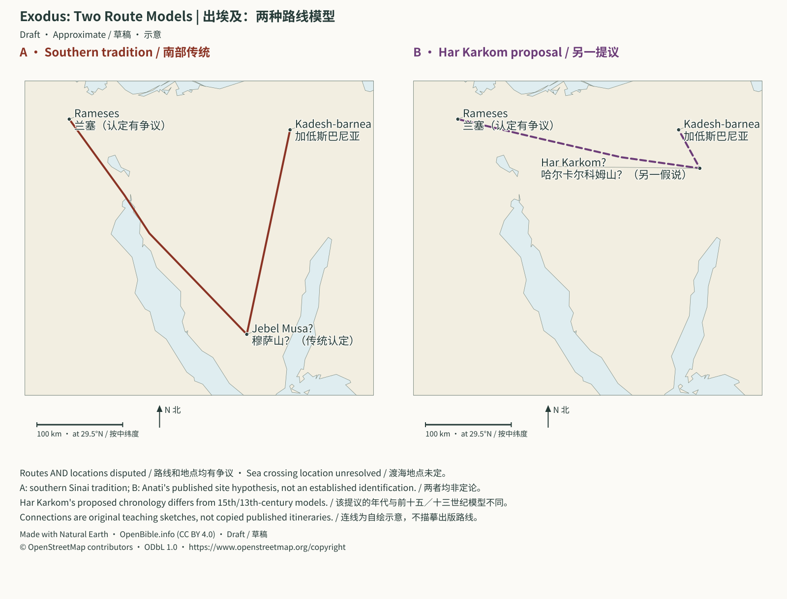
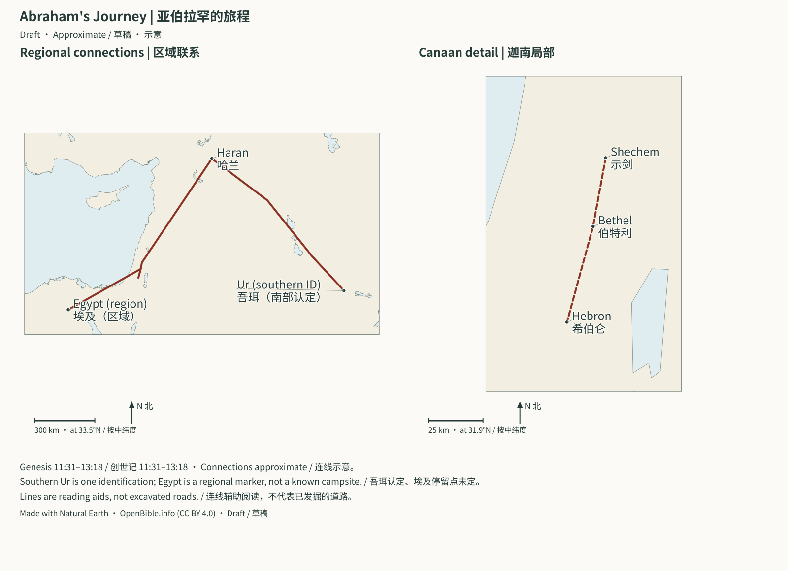

# Pentateuch: Historical Background and Evidence Boundaries | 摩西五经：历史背景、考古旁证与证据边界

> Status: Draft (AI draft; not human reviewed) | 状态：Draft（AI 草稿，未人工审阅）

> **In Three Sentences | 三句话读懂本篇**
>
> This study reads Genesis through Deuteronomy alongside ancient texts and archaeology. It separates background parallels, direct evidence, transmission, and theological interpretation. Routes, dates, and individual identifications remain qualified where the sources do not settle them. 
> 本篇把创世记至申命记与古代文献及考古材料一起读。背景相似、直接证据、文本流传和神学解释会分开处理。来源不能确定的路线、年代和人物对应，仍保留限制。

> **Language status | 语言状态：** Paired English/Chinese research draft; translation is not a new source-verification result. / 中英逐段对照研究草稿；补译不等于重新核实了来源。

## Exodus: Two Route Models | 出埃及：两种路线模型

Routes AND locations are disputed. A illustrates a southern-Sinai route family associated with the Jebel Musa tradition; B connects locations around Anati’s published Har Karkom hypothesis. The lines are editorial sketches, not a tracing of either author’s maps or a claim to reproduce a published itinerary. Har Karkom’s proposed chronology is different from the fifteenth/thirteenth-century models; this diagram does not resolve that disagreement or the sea crossing.
路线和地点均有争议。A示意与穆萨山传统相连的南部西奈路线族，B围绕Anati发表的Har Karkom假说连接地点。连线为自行绘制的教学草图，没有描摹学者地图，也不声称精确复现其出版行程。Har Karkom提议的年代不同于前十五／十三世纪模型；本图不解决年代或渡海地点争议。

**Sources | 来源：** [Hoffmeier, Ancient Israel in Sinai (2005), chapters 4–7 / 相关研究](https://academic.oup.com/book/36060) · [Anati’s research account / Anati研究说明](https://www.harkarkom.com/SinaiDiscoveries.php?more=all) · [Credits | 署名](../CREDITS.md#batch2-map-data)

[Open full SVG | 打开完整SVG](../assets/maps/exodus-models.svg)

## Abraham’s Journey | 亚伯拉罕的旅程

Genesis 11:31–13:18 supplies the named sequence. Southern Ur is one identification; the northern alternatives are not plotted here. Egypt is a regional marker because the narrative does not name a campsite there. Lines are original connections, not established roads, and the patriarchal date range is disputed.
创世记11:31–13:18提供所列地点顺序。图中采用南部吾珥这一认定，未画北部候选点。叙事没有指明埃及的停留地，所以只标区域。连线是原创示意，不是已确认古道；族长年代区间仍有争议。

**Sources | 来源：** [Coordinate sources and limits / 坐标来源与限制](../CREDITS.md#batch2-map-data) · [Credits | 署名](../CREDITS.md#batch2-map-data)

[Open full SVG | 打开完整SVG](../assets/maps/abraham-journey.svg)

> Scope: Genesis, Exodus, Leviticus, Numbers, and Deuteronomy. 
> 范围：创世记、出埃及记、利未记、民数记、申命记。 
> Purpose: connect the five books’ storyline while distinguishing ancient setting, indirect support, direct evidence, scholarly disputes, and theological interpretation. 
> 目的：说明这些书卷怎样形成一条故事线，并区分古代背景、间接旁证、直接证据、学术争议与神学解读。

## Start with the Conclusions | 一、先给结论

1. **Genesis 1–11 genuinely engages ancient Near Eastern traditions of creation, flood, and cities.** The parallels show that these themes circulated in antiquity, but do not by themselves prove or disprove the events in Genesis.
   **创世记 1–11 与古代近东创世、洪水和城市传统有真实的文化对话关系。**这些平行材料证明相关主题在古代世界早已流传，却不能单独证明或否定创世记所述事件。
2. **West Asian people did enter, live, and serve in Bronze Age Egypt; forced labor and brickmaking are also depicted.** This makes the patriarchal and Exodus settings historically intelligible, but no existing item directly identifies Abraham, Joseph, Moses, or the Israelites’ exodus.
   **青铜时代确有西亚人口进入埃及、在埃及生活或服役，也有强迫劳动和制砖图像。**这使列祖下埃及和出埃及记的社会背景具有历史可理解性，但没有一件现有材料可以直接认定为亚伯拉罕、约瑟、摩西或以色列人出埃及的记录。
3. **There is no scholarly consensus on the Exodus’s date, route, numbers, or historical scale.** Fifteenth- and thirteenth-century BCE models each have arguments and problems. Many scholars use a composite account centered on local Canaanites, possibly incorporating memories from a smaller group with an Egyptian past.
   **出埃及的具体年代、路线、人数和历史规模没有学术共识。**主前 15 世纪和 13 世纪方案各有依据与难题；许多研究者采用“以迦南本地人口为主、可能另有来自埃及的小群体记忆”的综合模型。
4. **By about 1208 BCE, an Egyptian inscription explicitly recognizes a population called Israel in Canaan.** This is the firmest current chronological limit: any reconstruction must allow Israel to exist there by this time.
   **到主前 1208 年左右，埃及铭文已经明确知道迦南有一个称作“以色列”的人口群体。**这是现阶段最坚实的时间下限：不论怎样重建早期历史，以色列在这时已经存在于迦南。
5. **Mosaic law belongs within ancient Near Eastern legal and covenantal culture while having its own theological focus.** Hammurabi’s judgments, treaties, and ritual practices illuminate its form. Similarity alone proves neither direct copying nor a book’s date.
   **摩西律法属于古代近东法律与盟约世界，却又有自己的神学重心。**汉谟拉比法律集、古代条约和祭祀制度可以帮助理解文体；相似不等于直接抄袭，也不能仅凭文体确定整卷书的年代。
6. **The Pentateuch’s main sequence is creation, loss, promise, redemption, covenant, presence, holiness, wilderness testing, and covenant renewal.** Historical discussion should not replace this textual storyline.
   **摩西五经最重要的串联逻辑是“创造—失落—应许—救赎—立约—同在—圣洁—旷野考验—更新圣约”。**历史讨论不应取代这条文本本身清楚推进的主线。

---

## Do Not Confuse Evidence Types | 二、证据类型不能混用

| Type / 类型 | Example / 例子 | Question it can answer / 可以回答 | What it cannot directly answer / 不能直接回答 |
| --- | --- | --- | --- |
| Contemporary or near-contemporary inscription | Merneptah stele | Whether a name, population, ruler, or war was attested | A miracle’s cause or every narrative detail |
| 同期或近同期铭文 | 梅尔内普塔碑 | 某名称、群体、君王或战争是否已出现 | 神迹的原因、经文全部细节 |
| Archaeological site and layers | Pi-Ramesse; highland villages | Urban dates, population change, ways of life | Identifying residents with a particular biblical person |
| 考古遗址与地层 | 皮兰塞、迦南高地聚落 | 城市年代、人口变化、生活方式 | 出土居民必然属于哪个经文人物 |
| Social-background material | West Asians in Egypt; brickmaking scenes | Whether a setting fits the ancient world | Identifying depicted workers as Hebrews |
| 社会背景类材料 | 西亚人在埃及、制砖图像 | 某种生活场景是否符合当时世界 | “画中人就是希伯来人” |
| Literary parallels | Atrahasis; Gilgamesh | Ancient discourse about creation, flood, and death | Direct copying of one surviving text by Genesis |
| 文学平行文本 | 《阿特拉哈西斯》《吉尔伽美什史诗》 | 古代人怎样谈创造、洪水、死亡 | 创世记是否直接复制某一个现存版本 |
| Later textual witness | Ketef Hinnom silver amulets | By when a passage or tradition circulated | Its precise initial composition date |
| 后期文本见证 | 基特夫欣嫩银卷 | 某段经文在何时已经流传 | 该段最初写成的确切日期 |
| Theological interpretation | Passover; covenant; tabernacle | The text’s understanding of God, humanity, sin, and redemption | A substitute for artifact dating or a stratigraphic report |
| 神学解释 | 逾越节、圣约、会幕 | 经文怎样理解神、人、罪与救赎 | 不能当作器物测年或地层报告 |

---

## Genesis 1–11: Ancient Near Eastern Background Is Not Simply Copying | 三、创世记 1–11：古代近东背景不等于简单“抄袭”

### 3.1 Creation and Enuma Elish | 3.1 创造叙事与《埃努玛·埃利什》

The Babylonian Enuma Elish also moves from primordial waters toward cosmic order, using themes of heavenly bodies, sea, and divine rest. Surviving tablets attest this creation tradition in Mesopotamia; the British Museum holds several fragments. 
巴比伦《埃努玛·埃利什》也从原初水域谈到宇宙秩序，并使用天体、海水和神圣安息等主题。现存泥版证明这种创世传统确实存在于美索不达米亚；大英博物馆藏有多块该作品残片。

Points of comparison: 
可以比较的地方：

- Both move from disorder or an unformed state toward an ordered world.
  都从无秩序或未成形的状态走向有秩序的世界；
- Both address water, heavenly bodies, land, and humanity’s place in the cosmos.
  都处理水域、天体、土地和人类在宇宙中的位置；
- Both connect creation with an order of worship.
  都把创造与敬拜秩序联系起来。

Differences that must remain visible: 
不可忽略的差异：

- Enuma Elish includes divine genealogies and conflict among gods. Genesis has no birth of God or Creator who must defeat an equal rival.
  《埃努玛·埃利什》包含众神谱系、神与神之间的战争；创世记没有神的出生，也没有创造主需要击败同等对手。
- In the Babylonian tradition, humans commonly perform work the gods do not want. Genesis calls people God’s image and gives them representative responsibility and rule.
  巴比伦传统中，人常被造来承担众神不愿承担的劳作；创世记把人称为神的形象，赋予治理和代表的使命。
- Genesis repeatedly calls creation good; sun and moon are created lights rather than gods to worship.
  创世记反复宣告受造界“好”，日月只是受造的光体，不是需要敬拜的神。

**Assessment: B, literary and cultural background.** 
**证据判断：B（文学与文化背景）。** 
The material places Genesis within shared ancient Near Eastern questions. Similarity alone cannot establish who copied whom or test the confession that God creates. 
它证明创世记进入了古代近东共同讨论的问题，却不能仅凭相似性判断“谁抄谁”，也不能检验神创造的信仰宣告。

Sources: 
参考：

- British Museum: Enuma Elish, Tablet I fragment, BM 47292.
  [大英博物馆：《埃努玛·埃利什》第一块泥版（Tablet I）残片，BM 47292](https://www.britishmuseum.org/collection/object/W_1881-0830-814)
- British Museum: Enuma Elish, Tablet III fragment, BM 93017.
  [大英博物馆：《埃努玛·埃利什》第三块泥版（Tablet III）残片，BM 93017](https://www.britishmuseum.org/collection/object/W_1888-0419-13)

### 3.2 Flood Traditions: Atrahasis and Gilgamesh | 3.2 洪水传统：《阿特拉哈西斯》与《吉尔伽美什史诗》

The British Museum’s Atrahasis flood tablet dates to about 1635 BCE. The famous flood tablet of Gilgamesh XI is a seventh-century BCE copy of an older narrative tradition. 
大英博物馆所藏《阿特拉哈西斯》洪水泥版约制于主前 1635 年；《吉尔伽美什史诗》第十一版的著名“洪水泥版”是主前 7 世纪抄本，但其故事传统更早。

Shared elements include: 
共同元素包括：

- A divine decision to send a flood.
  神明决定降下洪水；
- One person receives advance warning.
  一人预先得到警告；
- A vessel preserves family and living creatures.
  建造船只，保全家人及生命；
- Birds are released after the flood.
  洪水结束后放出鸟类；
- Sacrifice follows disembarkation.
  下船后献祭。

Important differences include: 
关键差异包括：

- In Atrahasis, human destruction concerns population, noise, and conflict among gods. Genesis connects judgment with human violence and moral corruption.
  《阿特拉哈西斯》中毁灭人类与人口、噪音及众神内部冲突有关；创世记把审判与人类暴力和道德败坏相连。
- Mesopotamian gods experience hunger, panic, and quarrels. Genesis presents God’s consistent sovereignty over judgment, preservation, and covenant.
  美索不达米亚诸神会饥饿、恐慌并彼此争执；创世记中的神对审判、保全与立约承担一致主权。
- Genesis ends with Noah’s covenant and God’s commitment to creation, rather than a hero gaining exceptional immortality.
  创世记以挪亚之约和神对受造界的承诺收尾，重点不是英雄获得特殊不死地位。

**What can these materials establish?** 
**这组材料能证明什么？**

- Structurally similar flood traditions circulated early in the ancient Near East.
  古代近东很早就有结构相近的大洪水记忆；
- The world of Genesis’s first audiences could understand the narrative elements of ark, judgment, remnant, and sacrifice.
  创世记的第一批听众所处世界能够理解方舟、审判、余民和献祭等叙事元素。

**What can they not establish?** 
**不能证明什么？**

- Literary parallels alone cannot determine the flood’s geographic extent.
  不能仅凭文学相似性确定洪水覆盖的地理范围；
- They cannot directly calculate a flood date.
  不能直接计算洪水日期；
- They do not prove that Genesis copied the surviving Gilgamesh tablet; those texts also underwent long transmission and revision.
  不能证明创世记直接复制现存的《吉尔伽美什》泥版，因为现存文本本身也经历长期传承和改写。

**Assessment: A for the existence of ancient flood texts; B for literary background relevant to Genesis. No direct grade is assigned to the flood event’s extent or date.** 
**证据判断：A（古代洪水文本真实存在）；B（与创世记存在文学背景关系）；对洪水事件范围和年代不提供直接等级。**

Sources: 
参考：

- British Museum: Atrahasis flood tablet, BM 78943, about 1635 BCE.
  [大英博物馆：《阿特拉哈西斯》洪水泥版，BM 78943，约主前 1635 年](https://www.britishmuseum.org/collection/object/W_1889-0426-236)
- British Museum: Gilgamesh flood tablet, K.3375.
  [大英博物馆：《吉尔伽美什史诗》洪水泥版，K.3375](https://www.britishmuseum.org/collection/object/W_K-3375)

### 3.3 Babel and Mesopotamian Ziggurats | 3.3 巴别塔与美索不达米亚神塔

Genesis 11’s bricks, bitumen, city, and sky-reaching tower fit building materials and stepped temple-tower settings in the Mesopotamian plain. Babylon and other cities had large ziggurats; Nebuchadnezzar II’s inscriptions describe restoring towers at Babylon and Borsippa. 
创世记 11 章所说的砖、沥青、城市和“塔顶通天”，与美索不达米亚平原的建城材料及阶梯神塔背景相符。巴比伦等城市确有大型神塔，尼布甲尼撒二世铭文也记载修复巴比伦和波尔西帕的神塔。

Conclusions requiring restraint: 
需要克制的结论：

- Ziggurat background illuminates the tower’s political, religious, and imperial significance.
  神塔背景帮助我们理解“塔”的政治、宗教和帝国意义；
- Existing ruins cannot simply be identified as the particular tower of Genesis 11.
  现有遗址不能被简单贴上“这就是创世记 11 章那座塔”的标签；
- The text criticizes seeking security through concentrated power, self-exaltation, and refusal to disperse, rather than merely the height of a building.
  经文批判的中心是人类以集中权力、自我扬名和拒绝分散来建立安全，而不只是建筑高度。

**Assessment: B for urban and ziggurat culture; C or weaker for identifying a particular ruin as Babel’s tower.** 
**证据判断：B（城市与神塔文化背景）；具体认定某遗址为巴别塔属于 C 或更弱。**

Source: British Museum, Nebuchadnezzar II’s cylinder concerning the Babylon and Borsippa ziggurats, BM 91142. 
参考：[大英博物馆：尼布甲尼撒二世修复巴比伦和波尔西帕神塔的圆柱铭文，BM 91142](https://www.britishmuseum.org/collection/object/W_1885-0430-1)。

### Reading Note: Genesis 1–11 | 注释：怎样读创世记 1–11

> These chapters concern all humanity and set up the question answered by Abraham’s covenant. Babel’s concentration and self-exaltation resist creation’s commission to fill the earth. The subsequent dispersion of nations is followed by Abraham’s calling to bring blessing to them. 
> 这些章节既谈全人类，也为亚伯拉罕之约设定问题。创造中的“遍满全地”在巴别被人类的集中与自我扬名抵抗；巴别后的万族分散，紧接着由亚伯拉罕“使万族得福”的使命回应。

---

## The Patriarchs: Reconstructable Background without Direct Identification | 四、列祖时期：背景可以重建，个人还不能被外证点名

### 4.1 West Asian Movement into Egypt Was Historically Common | 4.1 西亚人口进入埃及是常见历史现象

The tomb painting of Khnumhotep II at Beni Hasan shows West Asian people entering Egypt. The original belongs to the Twelfth Dynasty reign of Senwosret II, about 1887–1878 BCE. It may involve trade, migration, and Egyptian symbolic portrayals of outsiders, so it cannot simply be called a picture of Abraham entering Egypt. 
贝尼哈桑赫努姆霍特普二世墓壁画描绘一批来自西亚的人进入埃及，原作属于第十二王朝森沃斯雷特二世时期，约主前 1887–1878 年。画面可能包含贸易、移民和埃及人对外来者的象征表达，因此不能简单称为“亚伯拉罕下埃及图”。

Metropolitan Museum object 33.8.17 is Norman de Garis Davies’s full-scale copy made in the tomb in 1931, not a removed ancient painting. The linked collection page and study explain that the scene may concern trade, contemporary West Asian migration, or the symbolism of Egyptian order overcoming disorder. 
大都会艺术博物馆编号 33.8.17 是 Norman de Garis Davies 于 1931 年在墓室制作的等比例临摹，不是被移走的古代原画。[大都会的藏品页](https://www.metmuseum.org/art/collection/search/544548)和[专题说明](https://www.metmuseum.org/es/-/media/files/about-the-met/curatorial-departments/egyptian/facsimiles/2016-19_walklikeanegyptian_web.pdf)指出，这组人可能反映贸易场景或当时进入埃及的西亚移民潮，也可能带有埃及秩序战胜混乱的象征层。

**What it can support:** 
**它能支持：**

- The Canaan-to-Egypt movements described in Genesis are not unusual within Bronze Age conditions.
  创世记所描写的迦南—埃及人口流动在青铜时代并不离奇；
- Famine, trade, herding, and political opportunities could bring people into the Nile valley.
  饥荒、贸易、牧养与政治机会可以促成人群进入尼罗河谷。

**What it cannot support:** 
**它不能支持：**

- The people depicted have not been identified as Abraham, Jacob, or Joseph’s family.
  画中人不是经确认的亚伯拉罕、雅各或约瑟家族；
- Clothing or headcounts cannot establish one-to-one identifications.
  不能用服装或人数进行一一对应。

**Assessment: B for population-movement background.** 
**证据判断：B（人口流动背景）。**

### 4.2 Brooklyn Papyrus: West Asians in Egyptian Household Service | 4.2 布鲁克林纸草：西亚人在埃及家庭中服役

Brooklyn Museum Papyrus 35.1446 dates to about 1809–1743 BCE. One section concerns 95 household servants belonging to a Theban noblewoman; 45 are identified as West Asian Asiatics. 
布鲁克林博物馆藏纸草 35.1446 约写于主前 1809–1743 年，其中一段涉及一位底比斯贵族妇女拥有的 95 名家庭仆役；45 人被认定为来自西亚的“亚细亚人”。

It includes a West Asian woman’s name comparable to Shiphrah, but the museum cautions that **she cannot be identified as the midwife of Exodus 1**. 
纸草中出现一个可与“施弗拉”相比的西亚女性名字，但博物馆特别提醒：**无法确认她就是出埃及记 1 章的收生婆。**

**What it can support:** 
**它能支持：**

- People from Canaan and West Asia could serve in Egyptian households in the early second millennium BCE.
  第二千纪前期，来自迦南和西亚的人可以在埃及家庭中作仆役；
- Northwest Semitic names occur in Egyptian administrative documents.
  西北闪语名字确实能出现在埃及行政文书中。

**What it cannot support:** 
**它不能支持：**

- The people cannot automatically be called Israelites.
  这些人不能自动称为“以色列人”；
- A shared name does not prove a shared identity.
  相同名字不能证明是同一个人；
- The document predates most proposed Exodus chronologies and names neither Joseph nor Moses.
  文书早于多数出埃及年代方案，也没有约瑟或摩西。

**Assessment: A for West Asian servants and names; D for identifying them as Israelites, an inference not adopted here.** 
**证据判断：A（西亚仆役和名字）；对以色列人身份为 D，不采用。**

Source: Brooklyn Museum, Papyrus 35.1446. 
参考：[布鲁克林博物馆：Papyrus 35.1446](https://www.brooklynmuseum.org/objects/3369)。

### 4.3 Hammurabi’s Judgments and Patriarchal Society | 4.3 汉谟拉比法律集与列祖社会

The Hammurabi stele, about 1750 BCE, contains judgments about family, property, business, labor, and injury compensation. The Louvre notes that it is an organized collection of cases rather than a comprehensive modern legal code. It shares a broad legal world with marriage, inheritance, servants, and property in Genesis. 
约主前 1750 年的汉谟拉比碑包含家庭、财产、商业、劳务和伤害赔偿等案例判决。卢浮宫提醒，它不是现代意义上覆盖全部法律的“法典”，而是一批组织起来的判例。它与创世记列祖故事中的婚姻、继承、奴仆和财产问题共享广阔的古代法律世界。

Use with care: 
谨慎使用：

- Shared customs span centuries and large regions; one custom cannot precisely date the patriarchs.
  共同习俗往往跨越数百年和广大地区，不能凭某一习俗精确给列祖定年；
- Similar practices in Nuzi, Mari, or Babylonian documents do not prove that a Genesis figure came from that city or directly followed its law.
  努济、马里或巴比伦文书中的“相似做法”不自动说明创世记人物来自该城或直接依照该法；
- The safest use is to show that ancient households were not modern nuclear families: inheritance, kinship, marriage arrangements, and service had legal and economic functions.
  最稳妥的用法是说明古代家庭不是现代核心家庭，继承、宗族、婚约与仆役皆带法律和经济功能。

**Assessment: B for legal culture; C for precisely dating patriarchs from individual customs.** 
**证据判断：B（法律文化背景）；以个别习俗给列祖精确定年属于 C。**

Sources: Louvre, the Code of Hammurabi and collection record SB 8. 
参考：[卢浮宫：汉谟拉比法律集](https://www.louvre.fr/en/the-code-of-hammurabi)；[卢浮宫藏品页：SB 8](https://collections.louvre.fr/en/ark%3A/53355/cl010174436)。

### 4.4 What Can Be Said Responsibly about Patriarchal History? | 4.4 列祖史可以诚实说到哪一步

| Question / 问题 | Current careful conclusion / 目前较稳妥的结论 |
| --- | --- |
| Do contemporary external inscriptions name Abraham, Isaac, Jacob, or Joseph? | No generally accepted direct inscription currently does. |
| 亚伯拉罕、以撒、雅各、约瑟有无同期外部铭文？ | 尚无获得主流确认的直接铭文 |
| Does Genesis’s migration-to-Egypt setting fit antiquity? | Yes, within long-running second-millennium West Asian–Egyptian movement. |
| 创世记所写迁徙和下埃及是否符合古代背景？ | 符合第二千纪西亚—埃及长期人口流动的大背景 |
| Do similar names or customs prove personal identity? | No; they improve cultural intelligibility only. |
| 相似的名字或习俗能否证明人物？ | 不能；只能提高文化可理解性 |
| Can Nuzi or Mari customs fix a precise patriarchal date? | Not safely; many customs endured for long periods. |
| 能否用努济／马里习俗精确锁定年代？ | 不宜；许多习俗时间跨度很长 |
| Does absence of direct attestation prove the patriarchs never existed? | No. Lack of direct evidence proves neither existence nor nonexistence. |
| 这是否表示列祖一定不存在？ | 也不能这样推断；缺少直接外证既不是存在证明，也不是不存在证明 |

### Reading Note: The Joseph Story’s Handoff | 注释：约瑟故事的神学接力

> Genesis ends with a coffin and waiting, rather than fulfillment of every promise. Joseph saves the family but brings it into Egypt. Exodus asks whether God still remembers the covenant with Abraham, Isaac, and Jacob when residence becomes slavery. 
> 创世记不是以“应许全部实现”结束，而是以棺木和等待结束。约瑟拯救了家族，却把家族带进埃及；出埃及记将回答：当寄居变成奴役，神还记不记得对亚伯拉罕、以撒、雅各的约？

---

## Egypt and Exodus: Real Background without Direct Event Records | 五、埃及与出埃及：真实背景、缺少直接记录

### 5.1 Egyptian Background That Can Be Established | 5.1 可以确认的埃及背景

#### Rameses Was a Real Royal City | “兰塞”是一座真实的王城

Exodus 1:11 mentions Rameses. The Ramesside dynasty located its capital at Pi-Ramesse in the eastern Delta, near modern Qantir. Archaeology has found bronze and glass production, palace or temple structures, and large stables, indicating a major royal and industrial center in the thirteenth century BCE. 
出埃及记 1:11 提到“兰塞”。拉美西斯王朝把王都设在尼罗河三角洲东部的皮兰塞（今坎提尔一带）；考古项目发现青铜铸造、玻璃生产、宫殿／神庙建筑和大型马厩等设施，显示主前 13 世纪这里是大型王城和工业中心。

- International Association of Egyptologists: Qantir–Pi-Ramesse Project.
  [国际埃及学家协会：Qantir–Pi-Ramesse Project](https://www.iae-egyptology.org/archives/696)
- University College London: glass production at Qantir–Piramesses.
  [伦敦大学学院：Qantir–Piramesses 玻璃工业](https://www.ucl.ac.uk/news/2005/jun/mystery-egyptian-glass-making-becomes-clear)
- UCL research on Pi-Ramesse’s remains and bronze workshops.
  [伦敦大学学院研究：皮兰塞的考古遗存与青铜作坊](https://discovery.ucl.ac.uk/1544889/1/Rehren_Rademakers_etal_PiRamesse_LIA%20EP%20submitted%20revised.pdf)

**Significance:** this provides important place-name context for a thirteenth-century late-Exodus model. 
**意义：**这为主前 13 世纪的“晚期出埃及方案”提供重要地名背景。 
**Limit:** later copying or geographic updating may introduce a newer place-name into an earlier tradition, as people use modern names for ancient places. One place-name cannot exclude every earlier model. 
**边界：**地名也可能由后来的抄写或地理更新加入较早传统，正如现代人会用现名说明古地；因此不能只靠一个地名排除所有较早方案。

#### Egypt Had Large-Scale Brickmaking and State Projects | 埃及确有成规模制砖与国家工程

The original painting in Rekhmire’s Theban tomb TT 100, about 1479–1425 BCE, depicts obtaining mud, moving materials, molding bricks, and supervision. These processes fit the labor described in Exodus 5. 
底比斯大臣雷克米拉墓 TT 100 中约主前 1479–1425 年的原画，显示取泥、运料、塑砖和监督等劳动流程。它与出埃及记 5 章的劳动类型相符。

Source: Metropolitan Museum of Art, Brickmakers, Tomb of Rekhmire. 
参考：[大都会艺术博物馆：Brickmakers, Tomb of Rekhmire](https://www.metmuseum.org/art/collection/search/544649)。

**Object identification:** Met 30.4.77 is Nina de Garis Davies’s full-scale paper facsimile, acquired in 1930, not an ancient wall painting removed from the tomb. 
**原件说明：**大都会艺术博物馆 30.4.77 是 Nina de Garis Davies 制作、1930 年入藏的 1:1 纸本摹本，不是从墓中取下的古代墙画。

**Limit:** the workers cannot be identified as Hebrews. The scene attests labor systems and techniques, not the Exodus itself, and a fifteenth-century scene alone cannot confirm an early Exodus. 
**边界：**墓画中的工人不能被确定为希伯来人；它证明的是劳动制度和技术背景，不是出埃及事件本身，也不能单凭十五世纪画面确认“早期出埃及方案”。

#### West Asian Residents, Captives, and Laborers Were Common in Egypt | 来自西亚的居民、战俘与劳工在埃及并不少见

Beni Hasan, the Brooklyn papyrus, and New Kingdom war records together show people from Canaan and Syria entering Egypt through migration, trade, captivity, and labor. 
贝尼哈桑壁画、布鲁克林纸草以及新王国战争记录共同显示，迦南和叙利亚人口可以通过移民、贸易、战争俘虏和劳务进入埃及。

**Conclusion:** a Semitic-speaking West Asian group living and serving in the Delta is historically intelligible; identifying it with the Israelites of Exodus still lacks direct evidence. 
**结论：**“一群讲闪语的西亚人在尼罗河三角洲生活并服役”在历史上完全可理解；“这一群就是出埃及记中的以色列”仍缺直接材料。

### 5.2 Evidence Currently Lacking | 5.2 目前没有的证据

- No generally accepted Egyptian document names Moses, Aaron, or the ten plagues.
  没有获得主流确认的埃及文献点名摩西、亚伦或十灾；
- No Egyptian document explicitly records a large body of Israelite slaves escaping together under a particular pharaoh.
  没有埃及文献明确记录大批以色列奴隶在某法老任内集体逃离；
- Sinai surveys have not identified remains securely attributable to the Exodus group’s forty-year itinerary.
  西奈调查尚未发现可以确认为出埃及群体四十年行程的遗迹；
- Goshen, Pithom, the crossing, Sinai, and many wilderness stops lack agreed identifications.
  歌珊、比东、过海地点、西奈山和许多旷野站点无法被一致定位；
- Exodus does not name its pharaoh, making reconstruction more difficult.
  法老名字在出埃及记中没有给出，使年代重建更困难。

How to interpret these absences: 
这组“没有”应怎样理解：

- Egyptian royal inscriptions do not fairly record every defeat, and nomadic groups leave few readily identifiable archaeological layers.
  埃及王室铭文不会公平记录每次失败，游牧群体也很少留下易识别的考古层；
- Yet a straightforward reading involving millions migrating for many years faces a serious historical problem from the lack of material traces.
  但若按最直观方式理解为数百万人的长期迁徙，缺乏物质遗迹就成为很强的历史难题；
- Absence of records means neither that an event was impossible nor that it must therefore have happened.
  所以“没有记录”不能简单等于“绝不可能发生”，也不能被反过来说成“因此必然发生过”。

Carol Meyers’s introduction to Exodus, published by Cambridge University Press, gives a balanced account: specific people, numbers, and sequences cannot be confirmed historically, while Egyptian history supplies many parallels for West Asians entering, living in, and leaving Egypt. 
剑桥大学出版社 Carol Meyers 的《Exodus》导论把现状总结得很平衡：具体人物、人数和事件序列无法由历史研究确认，但西亚人进入埃及、在埃及生活并离开的广阔背景在埃及史中有大量类比材料。

Source: the linked Cambridge University Press sample chapter from Carol Meyers, Exodus. 
参考：[Carol Meyers, *Exodus*, Cambridge University Press 试读章节](https://assets.cambridge.org/97805210/02912/excerpt/9780521002912_excerpt.pdf)。

### 5.3 Three Major Historical Reconstructions | 5.3 三种主要历史重建

| Model / 模型 | Approximate date or process / 大致年代／过程 | Main support / 主要依据 | Main difficulties / 主要难题 | Treatment here / 本项目处理 |
| --- | --- | --- | --- | --- |
| Early Exodus | Mid-fifteenth century BCE, often calculated as about 1446 | 1 Kings 6:1’s 480 years; Judges chronology; proposed Eighteenth Dynasty links | Later Rameses name; difficult conquest-site alignment; no agreed pharaoh | Retained as a serious but disputed proposal |
| 早期出埃及 | 约主前 15 世纪中叶，常见推算约 1446 年 | 王上 6:1 的“480 年”；士师时期长度；部分人尝试与埃及十八王朝对应 | 兰塞城名较晚；迦南部分遗址与直线征服不吻合；法老身份没有共识 | 作为严肃但有争议的方案保留 |
| Late Exodus | Thirteenth century BCE, often Ramesses II or shortly after | Rameses and eastern-Delta setting; Israel in Canaan by about 1208 | 480 years interpreted symbolically or generationally; Jericho and Ai remain difficult | Easiest connection with place-name context, not established fact |
| 晚期出埃及 | 约主前 13 世纪，常放在拉美西斯二世时代或稍后 | 兰塞城；拉美西斯时期东三角洲背景；主前 1208 年前以色列已在迦南 | “480 年”需视为象征或世代数；耶利哥、艾等遗址仍难与逐城征服对应 | 目前最容易与地名背景连接，但不是已证实 |
| Local formation or composite model | Thirteenth–twelfth-century highland formation, possibly absorbing a smaller group with Egyptian experience | New early-Iron-Age villages, Canaanite cultural continuity, no mass-migration traces | May understate shared Exodus memory’s historical core; not every tradition explained | Used by many scholars, with substantial differences among versions |
| 本地形成／综合模型 | 主前 13–12 世纪，迦南高地群体逐步形成；可能吸收一个有埃及经历的小群体 | 铁器时代早期高地新村落；物质文化与迦南连续；无大规模迁徙遗迹 | 容易低估以色列共同出埃及记忆的历史核心；不能解释每项传统 | 许多研究者采用的工作模型，但内部版本差异很大 |

### 5.4 The Chronological Limit Supplied by Merneptah’s Stele | 5.4 梅尔内普塔碑提供的“最迟日期”

Pharaoh Merneptah’s victory stele mentions Israel in Canaan around 1208 BCE. Its determinative is usually understood to mark Israel as a population rather than a walled city-state. 
埃及法老梅尔内普塔的胜利碑约在主前 1208 年提到迦南的“以色列”。其限定符通常把以色列表示为人口群体，而非有城墙的城市国家。

Implications: 
它意味着：

- Any historical Exodus model must allow a group called Israel to be present in Canaan by 1208 BCE.
  任何把出埃及置于历史中的模型，都必须让一个被称为“以色列”的群体在主前 1208 年前出现在迦南；
- The stele does not explain how the group arrived or formed.
  它不能说明这个群体怎样来到或形成；
- It names neither Moses nor Joshua.
  它既没有提摩西，也没有提约书亚。

**Assessment: A for an Israelite population in late-thirteenth-century BCE Canaan.** 
**证据判断：A（主前 13 世纪末迦南有以色列群体）。**

Source: the Metropolitan Museum publication’s discussion of the Merneptah stele. 
参考：[大都会艺术博物馆出版物对梅尔内普塔碑的说明](https://resources.metmuseum.org/resources/metpublications/pdf/Assyria_to_Iberia_Art_and_Culture_in_the_Iron_Age.pdf)。

### 5.5 Highland Settlement and Israel’s Formation | 5.5 高地聚落与以色列形成

Numerous small villages appeared in Canaan’s central highlands in the twelfth and eleventh centuries BCE. Many scholars relate them to early Israel, but identifying ethnicity from pottery, houses, and food remains has methodological limits. 
主前 12–11 世纪，迦南中央高地出现大量小型村落。许多研究者把这些村落与早期以色列联系；但仅凭陶器、房屋和食物遗存辨认族群有方法论限制。

The University of Chicago Oriental Institute’s Ancient Israel catalogue notes: 
芝加哥大学东方研究所的《Ancient Israel》展览图录指出：

- Many new villages appeared.
  新村落大量出现；
- Their material culture shows continuity with local Canaanite culture.
  居民物质文化与本地迦南文化存在连续性；
- Israel’s formation likely combined urban populations, marginal herders, and other groups.
  以色列的形成很可能包含城市居民、边缘牧民和其他群体的混合；
- Exodus tradition may also preserve memories of an external origin for at least part of Israel’s population.
  出埃及传统也可能保存以色列人口中至少一部分人的外来起源记忆。

Source: the University of Chicago Oriental Institute, Ancient Israel, especially pages 65–68. 
参考：[芝加哥大学东方研究所，*Ancient Israel*，尤其第 65–68 页](https://oi.uchicago.edu/sites/default/files/uploads/shared/docs/oimp31.pdf)。

**Assessment: A for settlement change; B/C for identifying every village as Israelite and explaining its origins.** 
**证据判断：A（高地聚落变化）；B/C（把所有村落统一认定为以色列及解释其来源）。**

### 5.6 Population, Route, and Sea Crossing | 5.6 人数、路线与过海

#### Population | 人数

If Exodus 12:37 and Numbers 1 are read as modern statistics counting 600,000 men on foot, the total population could exceed two million. This creates major difficulties for supplies, column length, camps, and archaeological visibility. 
出埃及记 12:37 和民数记 1 章若把“六十万步行男人”按现代统计方式理解，总人口可能超过二百万人。这会带来补给、行军长度、营地和考古能见度的巨大困难。

Main interpretations include: 
主要解释包括：

- A literal, exceptionally large group sustained miraculously.
  按字面理解为非常大的神迹性群体；
- Understanding Hebrew `ʾeleph` as a thousand in some contexts and a clan, contingent, or unit in others.
  把希伯来词 `ʾeleph` 在部分上下文理解为“千”，在另一些上下文理解为“宗族、队伍或单位”；
- Numbers shaped by literary, military, or later representations of the whole people.
  认为数字经过文学化、军事化或后期民族总数表达；
- A smaller group’s historical memory becoming the shared identity story of all Israel.
  认为较小的历史群体记忆后来成为全以色列的共同身份故事。

**This library presents none of these as a settled conclusion.** State the interpretive model whenever citing population figures. 
**本项目不把任何一种解释伪装成定论。**每次引用人数时都应注明解释模型。

#### Route | 路线

Hebrew `yam suph`, conventionally rendered Red Sea, is more literally Sea of Reeds. Its water body remains disputed; northern lakes, the Gulf of Suez, and other locations have been proposed. 
“红海”所译希伯来语 `yam suph` 更直译为“芦苇海”；其具体水域没有共识。北部湖区、苏伊士湾及其他方案均有人提出。

**The theological focus does not require a fully settled map:** the text depicts the crossing as God overcoming enslaving power and bringing the people from death into new life. 
**神学重点不依赖地图完全确定：**经文把过海描写为神战胜奴役权势、使百姓从死亡进入新生命的拯救事件。

---

## Sinai, Law, Priesthood, and Covenant | 六、西奈、律法、祭司与盟约

### 6.1 Ancient Legal Traditions and Mosaic Law | 6.1 古代法律传统与摩西律法

Hammurabi’s collection predates most proposed dates for Moses and attests developed case-law traditions in the second millennium BCE. Exodus 21–23 and other ancient laws address injuries, animals, property, servants, and compensation. 
汉谟拉比法律集早于多数摩西年代方案，说明第二千纪古代近东已有成熟的案例法传统。出埃及记 21–23 章与其他古代法律都处理伤害、牲畜、财产、奴仆和赔偿。

Reading principles: 
读法要点：

- Similar laws may answer shared social problems without every case involving direct borrowing.
  相似法律可来自共同社会问题，不必每条都解释为直接借用；
- Compare not only wording but legal subjects, penalties, status, and theological frameworks.
  比较时不能只列相似句式，也要看法律对象、处罚、社会地位和神学框架的差异；
- Biblical law sits within a rescue-before-covenant narrative: Exodus 20 recalls deliverance from Egypt before giving the Ten Commandments.
  圣经律法被放在“神先救赎、然后立约”的叙事中：出埃及记 20 章先说“我把你从埃及领出来”，再颁十诫。

**Reading note:** obedience is not the price of being rescued from Egypt, but the redeemed community’s response. 
**注释：**这正是摩西五经的重要逻辑——顺服不是换取出埃及的条件，而是蒙救赎群体的回应。

### 6.2 Deuteronomy and Ancient Treaties | 6.2 申命记与古代条约

Deuteronomy shares structural features with ancient Near Eastern suzerain–vassal treaties: 
申命记与古代近东宗主—附庸条约共享一些结构元素：

- The covenant maker’s identity or preamble.
  立约者身份或序言；
- A historical prologue recalling previous favors.
  回顾过去恩惠的历史序言；
- General and specific stipulations.
  总体和具体条款；
- Blessings and curses.
  祝福与咒诅；
- Preservation, public reading, and renewal of the treaty.
  保存、公开宣读和更新条约。

Scholarly disagreements: 
学术争议：

- Some scholars emphasize similarities with second-millennium Hittite treaties, supporting older traditions.
  有人认为申命记特别接近第二千纪赫人条约，因此支持较早传统；
- Others emphasize parallels with first-millennium Neo-Assyrian treaties.
  有人强调它也与第一千纪新亚述条约相似；
- Still others note the flexibility of ancient treaties: a structural outline alone cannot date Deuteronomy.
  另一些研究指出，古代条约形式本来就有弹性，不能只靠一个结构表决定申命记的成书年代。

**Careful conclusion:** treaty comparison offers valuable covenant background, not a code that independently settles date and authorship. 
**稳妥结论：**条约比较是理解“圣约”最有帮助的背景之一，却不是一个能够单独解决日期和作者问题的密码。

One specific first-millennium object is the **672 BCE Esarhaddon succession treaty from Tell Tayinat**. Found in Temple XVI, this cuneiform tablet records provincial officials’ loyalty oaths to crown prince Ashurbanipal and lengthy curses for breach. It attests written loyalty obligations, temple storage, and sanctions; formal resemblance still does not prove that Deuteronomy copied this tablet. 
一件可具体查验的第一千纪材料，是主前 672 年的**特尔泰纳特以撒哈顿继承条约**。这块出土于 Temple XVI 的楔形文字泥版，记录地方省长和官员宣誓效忠王储亚述巴尼拔，并列出长篇违约咒诅。它说明忠诚誓约可写成文本、存放在神庙并以制裁维系；但“形式相似”仍不等于申命记直接抄自这块泥版。

Sources: 
参考：

- University of Toronto Tayinat Archaeological Project: Esarhaddon succession treaty.
  [多伦多大学 Tayinat Archaeological Project：以撒哈顿继承条约](https://tayinat.artsci.utoronto.ca/the-toronto-expedition/the-esarhaddon-succession-treaty/)
- CDLI: Lauinger’s 2012 publication and P500551.
  [CDLI：Lauinger 2012 正式出版与 P500551](https://cdli.earth/publications/1769646)
- William S. Morrow’s Journal of Hebrew Scriptures review of ancient treaty traditions and biblical covenants.
  [William S. Morrow, “Ancient Near Eastern Treaty Traditions and Biblical Covenants,” *Journal of Hebrew Scriptures* 21](https://jhsonline.org/index.php/jhs/article/view/29595)
- Nicholas O. Polk, Deuteronomy and Treaty Texts, University of Chicago.
  [Nicholas O. Polk, *Deuteronomy and Treaty Texts*, University of Chicago](https://knowledge.uchicago.edu/records/n6s0b-vah18)

### 6.3 Ketef Hinnom Silver Amulets and the Priestly Blessing | 6.3 基特夫欣嫩银卷与祭司祝福

The two inscribed silver amulets KH 1 and KH 2 from Ketef Hinnom tombs in Jerusalem, IAA 1980-1495 and 1980-1496, are commonly dated to the late seventh or early sixth century BCE. They contain wording parallel to Numbers 6:24–26 and are often regarded as the earliest biblical text fragments. A minority proposes a later, early-return-period date. 
耶路撒冷基特夫欣嫩墓葬发现的两件刻文银护身片 KH 1／KH 2（IAA 1980-1495／1980-1496），通行分期约属主前 7 世纪末至 6 世纪初，包含与民数记 6:24–26 祭司祝福对应的文字。它们常被视为目前最早的圣经文本片段；也有少数研究者提出归回初期的较晚年代。

**What it can support:** 
**它能支持：**

- Under the usual dating, the priestly blessing circulated by the end of the First Temple period. Even a later dating places it in protective or blessing use by the early return period.
  按通行分期，民数记祭司祝福在第一圣殿末期已经流传；即使采用较晚异议，也能说明它至归回初期已经用于护身／祝福语境；
- The blessing tradition invoking the LORD’s favor, protection, countenance, and peace is ancient.
  “耶和华赐福、保护、仰脸、赐平安”的传统相当古老。

**What it cannot support:** 
**它不能支持：**

- The amulets are not Moses’ autograph.
  银卷不是摩西亲笔原稿；
- They establish that a blessing tradition existed by their date, not independently when the whole of Numbers was completed.
  它只能给现有祝福传统提供“最迟在此时已存在”的下限，不能单独确定民数记全书完成时间。

**Assessment: A for artifacts, inscriptions, and blessing parallels; A−/B for precise dating because disagreement remains.** 
**证据判断：A（器物、刻文与祝福平行）；A−／B（精确年代，因仍有异议）。**

Sources: Israel Museum; the 2004 BASOR rereading; USC West Semitic Research Project’s KH 1/KH 2 identifiers; and Nadav Na’aman’s argument for later dating, linked below. 
参考：[以色列博物馆：基特夫欣嫩银片与祭司祝福](https://www.imj.org.il/en/exhibitions/i-will-lift-mine-eyes)；[BASOR：2004 年新版释读与评估](https://www.journals.uchicago.edu/doi/10.2307/4150106)；[USC West Semitic Research Project：KH 1／KH 2 编号](https://dornsife.usc.edu/wsrp-temp/wp-content/uploads/sites/155/2023/05/Northwest-Semitic-Amulets-and-Incantations.pdf)；[Nadav Na’aman：较晚年代的异议](https://www.jstor.org/stable/23214240)。

### 6.4 Deir ʿAlla and Balaam Son of Beor | 6.4 德尔阿拉铭文与“比珥之子巴兰”

Red- and black-ink plaster fragments found at Tell Deir ʿAlla in the Jordan valley in 1967 are usually dated around 800 BCE, within the late ninth to eighth centuries. The opening is commonly read as naming Balaam son of Beor, a seer of the gods. The name matches Numbers 22–24, but content, divine world, and date are not the same as that narrative. 
1967 年在约旦河谷 Tell Deir ʿAlla 发现的红、黑墨石灰墙残片，通常定在主前 9 世纪末至 8 世纪、约主前 800 年附近。残片开头通常读到一位“众神的先见”——“比珥之子巴兰”。名字与民数记 22–24 章相同，但文本内容、神明世界和年代均不等同于民数记叙事。

**What it can support:** 
**它能支持：**

- A tradition about a notable seer called Balaam son of Beor existed in the Iron Age east of the Jordan.
  铁器时代约旦河东地区存在一位名叫“比珥之子巴兰”的著名先见传统；
- The name used in Numbers is not confined to biblical literature.
  民数记使用的名字并非只能存在于圣经内部。

**What it cannot support:** 
**它不能支持：**

- The inscription is centuries later than the proposed Mosaic period.
  铭文晚于摩西时代数百年；
- It cannot identify every inscribed story with the particular event in Numbers.
  不能证明铭文中的每个故事就是民数记那一次事件；
- Fragment arrangement, damaged readings, dialect classification, and precise date remain disputed.
  残片组合、受损字句、方言分类和精确日期仍有争议。

**Assessment: A− for the name and seer tradition; B/C for the Numbers event.** 
**证据判断：A−（名字与先见身份的传统）；对民数记事件为 B/C。**

Sources: the ASOR/Biblical Archaeologist study of Balaam traditions; Brill’s re-evaluation; and the Tell Deir ʿAlla cult-space study, linked below. 
参考：[ASOR／*The Biblical Archaeologist*：巴兰传统研究](https://www.journals.uchicago.edu/doi/10.2307/3210015)；[Brill：*The Balaam Text from Deir ʿAlla Re-Evaluated*](https://brill.com/edcollchap/book/9789004666351/B9789004666351_s006.xml)；[Tell Deir ʿAlla 祭祀空间研究](https://www.mdpi.com/2077-1444/10/3/145)。

### 6.5 Soleb’s Shasu and yhw Inscription | 6.5 索莱布“Shasu 的 yhw”铭文

Egyptian monumental place or people lists at Soleb under Amenhotep III, about 1390–1352 BCE, and Amara West under Ramesses II, about 1279–1213 BCE, include a name commonly transcribed `yhwꜣ`, associated with Shasu-land. 
阿蒙霍特普三世时期索莱布神庙（约主前 1390–1352 年）以及拉美西斯二世时期阿玛拉西神庙（约主前 1279–1213 年）的埃及纪念性地名／族群表，包含通常转写作 `yhwꜣ` 的名称，并与 Shasu-land 相联。

Two cautious readings: 
两种谨慎读法：

- There may be a historical relationship to the later Israelite divine name YHWH, even if it was not yet explicitly used as a divine name.
  这可能与后来以色列神名 YHWH 有历史联系，即使当时还未明确作为神名使用；
- The lists first describe Egyptian understandings of territories and populations. `yhwꜣ` may originally be a place, region, or name of uncertain origin; it cannot simply be translated as Israelites worshiping the LORD.
  地名表首先在描绘埃及所理解的地域与群体，`yhwꜣ` 也可能首先是地名、地区或来源未明的名称，不能直接翻译成“敬拜耶和华的以色列人”。

**Assessment: A for the Egyptian occurrence of `yhwꜣ`; C for its precise relationship to Israel’s divine name and Mosaic traditions.** 
**证据判断：A（埃及铭文中确有 yhwꜣ 名称）；C（它与以色列神名及摩西传统的具体关系）。**

Source: Daniel E. Fleming, Yahweh before Israel, Cambridge University Press. 
参考：[Daniel E. Fleming, *Yahweh before Israel*, Cambridge University Press](https://www.cambridge.org/core/books/abs/yahweh-before-israel/yhw-of-shasuland/119116DC7806AE299828B5D58EA06539)。

### 6.6 Ugarit and Emar Ritual Texts: Shared Ritual Culture Is Not Identical Theology | 6.6 乌加列与埃马祭祀文本：共同礼仪世界不等于同一神学

Ugaritic KTU 1.41, Louvre AO 11996, RS 1.003 + RS 2.[005], is a Late Bronze Age sacrificial list. Emar VI 373 describes the Zukru festival for Dagan. Both preserve arrangements for offerings, calendars, processions, or public participation, inviting comparison with Leviticus 1–7 and 23. 
乌加列 KTU 1.41（卢浮宫 AO 11996，RS 1.003 + RS 2.[005]）是晚青铜时代的祭祀清单；埃马 Emar VI 373 则描述献给 Dagan 的 Zukru 节期。两者都保存供物、历法、巡行或公共参与的具体安排，可与利未记 1–7、23 章比较。

Keep these distinctions in view: 
比较时应同时看到：

- Agricultural societies naturally share offerings such as animals, grain, oil, and wine.
  牲畜、谷物、油和酒等祭物在农业社会中本来就容易重复出现；
- Sacrifice involves priests, calendars, communities, and public order, not only personal feeling.
  献祭不只是个人感受，也牵涉祭司、历法、共同体和公共秩序；
- Ugarit and Emar had their own gods, kingship, and civic institutions; formal resemblance does not establish direct Israelite copying.
  乌加列、埃马各有自己的神明世界、王权与城市制度，不能把形式相似写成以色列直接抄写；
- Whether Emar VI 373’s seventh year implies a six- or seven-year cycle remains disputed. It cannot simply be equated with a sabbatical or jubilee year.
  Emar VI 373 的“第七年”究竟构成六年还是七年循环仍有解释争议，不能直接等同安息年或禧年。

**Assessment: A for texts, identifiers, and ritual content; B for Leviticus’s ancient ritual setting; C for direct dependence, equated festivals, or composition dates.** 
**证据判断：A（文本、编号与礼仪内容）；B（利未记的古代祭祀背景）；C（直接依赖、节期等同或成书定年）。**

Sources: Louvre KTU 1.41/AO 11996; Masamichi Yamada’s ORIENT article on Zukru; and the linked study of Emar VI 373’s cycle. 
参考：[卢浮宫：KTU 1.41／AO 11996](https://collections.louvre.fr/en/ark%3A/53355/cl010136717)；[Masamichi Yamada, “The zukru Festival in Emar,” *ORIENT* 45](https://www.jstage.jst.go.jp/article/orient/45/0/45_111/_article)；[Emar VI 373 周期解释](https://cir.nii.ac.jp/crid/1390282680479629056?lang=en)。

### 6.7 Arad and Tel Moẓa: Actual Worship Is Not Necessarily Legal Norm | 6.7 亚拉得祭坛与特尔摩撒：实际宗教生活不等于律法规范

Two eighth-century BCE altars from the Judahite shrine at Tel Arad preserve analyzable residues: frankincense markers on the larger, and cannabis components including THC, CBD, and CBN on the smaller. Tel Moẓa has a monumental temple founded in the late tenth or early ninth century BCE and used through several Iron Age phases, with altar, offering table, ash, animal bones, ritual vessels, and figurines. 
特尔亚拉得犹大圣所的两座主前 8 世纪祭坛保存可分析残留物：较大者有乳香标志物，较小者有 THC、CBD、CBN 等大麻成分。特尔摩撒则发现主前 10 世纪末至 9 世纪初建立、铁器时代多期延续的纪念性神庙，包含祭坛、供桌、灰、动物骨骼、祭祀器物和小像。

Two important reminders: 
它们带来两层重要提醒：

1. Leviticus’s altar, incense, sacrifice, and sanctuary language belongs within investigable ancient practice.
   利未记中的祭坛、香料、祭物与圣所语言落在真实可考察的古代实践中；
2. Archaeology finds what people actually did, which need not match what law prescribed. Local temples and figurines especially show religious diversity in Judah and possible departures from norms.
   考古发现的是人实际怎样敬拜，不必等于律法规定他们应该怎样敬拜。地方神庙和小像尤其说明，犹大宗教生活具有多样性，也存在偏离规范的可能。

Neither Arad nor Moẓa can simply be called the tabernacle, nor can later sanctuaries independently establish Mosaic ritual origins. Cannabis at Arad proves neither its use in Jerusalem’s temple nor that biblical `qaneh-bosem` must mean cannabis. 
因此不能把亚拉得或摩撒直接称为会幕，也不能由晚期圣所反推摩西礼仪的起源。亚拉得检出大麻，更不能证明耶路撒冷圣殿使用同物，或把圣经香料词 `qaneh-bosem` 锁定为 cannabis。

**Assessment: A for residues, temple architecture, and ritual assemblages; B for Iron Age Judahite worship; C/D for tabernacle identification, generalized recipes, or dating Leviticus.** 
**证据判断：A（祭坛残留物、神庙建筑与祭祀组合）；B（铁器时代犹大敬拜背景）；C／D（等同会幕、推广配方或决定利未记年代）。**

Sources: University of Haifa/Tel Aviv on Arad residues; Israel Antiquities Authority’s Tel Moẓa report; and Shua Kisilevitz’s Iron IIA temple study, linked below. 
参考：[海法大学／*Tel Aviv*：亚拉得祭坛的大麻与乳香](https://cris.haifa.ac.il/en/publications/cannabis-and-frankincense-at-the-judahite-shrine-of-arad/)；[以色列文物局：特尔摩撒发掘报告](https://hadashot.iaa.org.il/Report_Detail_Eng.aspx?id=25702)；[Shua Kisilevitz：铁器时代 IIA 特尔摩撒神庙](https://www.tandfonline.com/doi/abs/10.1179/0334435515Z.00000000052)。

### 6.8 11Q1 and the En-Gedi Scroll: Leviticus in Transmission | 6.8 11Q1 与隐基底焦卷：《利未记》的流传史

Qumran Cave 11’s 11Q1 is a Herodian-period Leviticus parchment manuscript in paleo-Hebrew script. Micro-CT and virtual unwrapping of the charred scroll from the En-Gedi synagogue’s ark revealed Leviticus 1:1–9 and 2:1–11. 
昆兰 11 号洞的 11Q1 是希律时期、用古希伯来字体抄写的《利未记》羊皮纸残卷；隐基底会堂约柜遗存中的炭化卷轴，则借微型 CT 和虚拟展开读出利未记 1:1–9、2:1–11。

What the two witnesses show: 
二者能说明：

- Leviticus continued to be copied, read, and preserved during and after the Second Temple period.
  第二圣殿时期及其后，《利未记》持续被抄写、诵读和保存；
- Paleo-Hebrew script may be a later scribe’s deliberate traditional choice, not automatic evidence of an early date.
  古希伯来字体可以是较晚抄写者有意识的传统选择，不是自动的早期年代证明；
- The two recovered En-Gedi passages agree exactly in consonants with the medieval Masoretic Text, a strong example of local textual stability.
  隐基底已读出的两段与中世纪马所拉文本辅音完全一致，是局部文本稳定的强实例。

What they do not show: 
二者不能说明：

- Neither manuscript is Moses’ autograph or determines the book’s original composition date.
  抄本不是摩西原稿，也不能给全书最初成书时间定案；
- Two short recovered passages cannot establish word-for-word identity throughout the entire Bible’s history.
  隐基底只读出两个短段，不能外推为整本圣经历来逐字无异；
- Manuscript transmission evidence does not replace historical study of sacrificial events, the tabernacle, or priestly origins.
  抄本传承证据不能代替对献祭事件、会幕或祭司制度起源的历史研究。

Radiocarbon dating mainly places the En-Gedi scroll in the third to fourth centuries CE; paleography favors the late first to early second centuries. This library preserves the discrepancy rather than masking different methods with one year. 
隐基底卷轴的碳十四测年主要指向主后 3–4 世纪，古文字学则偏向主后 1 世纪末至 2 世纪初；项目保留这一差距，不用单一年份掩盖方法差异。

**Assessment: A for manuscript, text, and imaging; A−/B for En-Gedi’s precise date; C/D for inferring composition or events from archaic script or later copies.** 
**证据判断：A（抄本、文字与成像结果）；A−／B（隐基底精确年代）；C／D（由古体字或后期抄本反推成书与事件）。**

Sources: the IAA Dead Sea Scrolls digital archive for 11Q1; Textus 26 on the En-Gedi Leviticus scroll; and Science Advances on virtual unwrapping, linked below. 
参考：[以色列文物局死海古卷数字图书馆：11Q1](https://www.deadseascrolls.org.il/explore-the-archive/manuscript/11Q1-1?locale=en_US)；[《Textus》26：隐基底《利未记》卷轴](https://openscholar.huji.ac.il/sites/default/files/he_bible_project/files/m._segal1.1.pdf)；[Science Advances：虚拟展开](https://doi.org/10.1126/sciadv.1601247)。

---

## How the Five Books Hand the Story On | 七、五卷书怎样一卷接一卷

| Book / 书卷 | Question inherited / 开头承接的问题 | Response within this book / 本卷回答 | Question left at the end / 结尾留下的问题 |
| --- | --- | --- | --- |
| Genesis | Origins of world, humanity, sin, and death | God creates; humanity falls; Abraham’s family begins the promise of blessing nations | The promised family remains landless in Egypt |
| 创世记 | 世界、人类、罪和死亡从何而来？ | 神创造；人堕落；神借亚伯拉罕一家启动祝福万国的应许 | 应许家族在埃及，还没有得地 |
| Exodus | Does God remember the enslaved family? | Rescue, covenant, law, and tabernacle presence | How can sinful people approach a present, holy God? |
| 出埃及记 | 神是否记念在埃及受奴役的应许家族？ | 神救赎、立约、赐律法并住在会幕中 | 圣洁的神已临在，有罪的人怎样亲近祂？ |
| Leviticus | How can people live with a holy God? | Sacrifice, priests, cleansing, festivals, and holy life sustain covenant relationship | Will the cleansed community trust God toward the land? |
| 利未记 | 百姓怎样与圣洁的神同住？ | 借献祭、祭司、洁净、节期和圣洁生活维持约中关系 | 洁净的群体能否信靠神走向应许之地？ |
| Numbers | Will a rescued people proceed faithfully? | The first generation rebels and is judged; God preserves promise and prepares another | How can the next generation avoid repetition? |
| 民数记 | 蒙救赎的百姓会不会忠心前行？ | 第一代反叛受审判，神仍保全应许并预备新一代 | 新一代怎样避免重复上一代？ |
| Deuteronomy | What must the new generation remember before entry? | Rescue history, covenant commands, blessings and curses, and love of God restated | Moses dies; will the people keep covenant in the land? |
| 申命记 | 进地前的新一代需要记住什么？ | 重申救赎历史、圣约诫命、祝福咒诅与爱神要求 | 摩西去世；百姓能否在地上守约？ |

### The Connection in One Sentence | 一句话串联

> Genesis introduces sin and promise; Exodus brings rescue and covenant; Leviticus addresses presence and holiness; Numbers exposes unbelief; Deuteronomy brings the new generation before the covenant’s call to choose life. 
> 创世记提出罪与应许，出埃及记施行救赎并建立圣约，利未记解决同住与圣洁，民数记显出人心的不信，申命记把新一代再次带到“选择生命”的约前。

---

## Notes on Key Passages | 八、重点经文注释

### Genesis 1:26–28: God’s Image | 创世记 1:26–28：神的形象

Ancient kingship often portrays a king as a deity’s earthly representative. Genesis extends this dignity to women and men. The focus is representation, rule, relationship, and responsibility, rather than physical resemblance. 
古代王权常把君王视为神明在人间的代表；创世记却把这一尊贵身份扩展给男人和女人。重点不在人的外貌像神，而在代表、治理、关系和责任。

### Genesis 3:15: A Seed of Hope | 创世记 3:15：盼望的种子

Christian tradition often calls this the first gospel. Within Genesis it first announces continuing conflict between the serpent and the woman’s offspring, leaving hope of the serpent’s ultimate defeat. The New Testament focuses that hope on Christ’s victory. 
基督教传统常称其为“第一福音”。就创世记叙事本身，它首先宣告蛇与女人后裔之间持续争战，并留下蛇最终被击败的盼望；新约再把这条盼望集中到基督得胜。

### Genesis 12:1–3: From One Person to All Nations | 创世记 12:1–3：从一人到万国

Babel’s people seek their own name, whereas God promises to make Abraham’s name great. The aim is not a closed privileged family, but blessing reaching every family of the earth. 
巴别的人要“为自己立名”，神却应许使亚伯拉罕的名为大；目的不是建立一个封闭特权家族，而是“地上万族都要因你得福”。

### Exodus 3:14–15: Divine Name and Presence | 出埃及记 3:14–15：神名与同在

The Chinese rendering retained below conveys divine self-existence; the Hebrew may also carry a dynamic sense of continuing presence. The passage’s emphasis is not an abstract philosophical definition, but assurance that the God calling Moses will be with him and remember the patriarchal covenant. 
“我是自有永有的”也可在语义上听见“我将是我将是”的动态同在。经文重点不是提供抽象哲学定义，而是保证：呼召摩西的神会与他同在，并记念列祖之约。

### Exodus 12: Passover | 出埃及记 12：逾越节

Passover brings together judgment, substitution, a household sign, and a departure meal. When the New Testament identifies Christ with Passover’s lamb, it locates Jesus’ death within this story of release from slavery. 
逾越节同时是审判、代替、家庭记号与出发之餐。新约称基督为“逾越节的羔羊”时，是把耶稣的死放进这套从奴役得释放的故事语法。

Elephantine Pap. Berlin P. 13464, 419–418 BCE, anchor 187, attests an Aramaic letter coordinating Nisan, seven days of unleavened bread, work cessation, and removing leaven for a Jewish military community in southern Egypt. It gives a Persian-period object for studying Exodus memory in diaspora, but does not narrate Moses, plagues, lamb’s blood, or sea crossing and is not an Exodus manuscript. The conventional Passover-letter title, restored words and dates, and whether the imperial order concerns Passover, Unleavened Bread, calendar adjustment, or military religious leave remain disputed. 
主前 419–418 年象岛 Pap. Berlin P. 13464（锚点 187）证明，埃及南境的犹太驻军群体曾以亚兰文书信协调尼散月、七日无酵、停工和除酵等节期实践。它使“出埃及记忆怎样进入散居生活”拥有一件波斯时期实物，却没有叙述摩西、十灾、羔羊血或过海，也不是《出埃及记》抄本。传统“逾越节书信”题名、关键字和日数复原、帝国命令究竟针对逾越节、无酵节、日历调整还是军人宗教休假，仍须保留争议。

### Exodus 19:4–6: Rescue before Mission | 出埃及记 19:4–6：先救赎，后使命

The people do not earn escape from Egypt by obeying law. God first recalls carrying them to himself, then calls them to be a priestly kingdom and holy people. The original Chinese quotation is retained below. 
百姓不是靠守律法换取从埃及获救。神先说“我将你们背在鹰的翅膀上，带来归我”，再呼召他们作祭司的国度和圣洁国民。

### Leviticus 16: The Day of Atonement | 利未记 16：赎罪日

One goat is sacrificed and another bears sin outside the camp; the high priest enters the inner sanctuary yearly. Hebrews uses this to explain Christ’s once-for-all entry and more complete cleansing. 
一只羊被献上，一只羊担当罪被送到营外；大祭司一年一次进入至圣所。希伯来书借此说明基督一次进入并成就更完全的洁净。

### Numbers 14: Wilderness Failure | 民数记 14：旷野失败

The spies see the same land but interpret it through differing trust. Judgment concerns not the embarrassment of fear, but construing God as intending harm after experiencing his rescue. 
探子看见同一片土地，却以不同信靠解释事实。审判的核心不是“害怕很丢脸”，而是在已经经历救赎后仍把神解释成要害他们的神。

### Deuteronomy 6:4–9: The Shema | 申命记 6:4–9：示玛

The LORD’s uniqueness is both confession and a demand for allegiance. Love of God means the whole orientation of heart, life, strength, household teaching, and daily conduct, not merely feeling. 
“耶和华是独一的”既是信仰宣认，也是忠诚要求。爱神不是纯感受，而是心、生命、力量、家庭教导和每日行为的整体归属。

### Deuteronomy 30:11–20: Choosing Life | 申命记 30:11–20：选择生命

The law is not an inaccessible mystery; Moses sets a choice before the people. Later Old Testament history exposes the heart’s problem despite external commands and shows why the prophets’ new heart and new covenant become necessary. 
律法不是遥不可及的奥秘；摩西把选择放到百姓面前。旧约后续历史会显示外在命令仍暴露人心问题，并让先知所说“新心、新约”变得必要。

### Physical Pentateuch Witnesses: Copying Dates before Events or Composition | 五经文本实物：先回答“何时已经在抄”，再问事件与成书

Ancient Near Eastern parallels, event evidence, and biblical manuscripts answer different questions. Batch 67 added three direct textual anchors so Genesis, Exodus, and Numbers no longer depended only on cultural background or later reception: 
古代近东平行材料、事件旁证与经卷抄本回答的不是同一个问题。第 67 批补入三件直接文本锚点，使《创世记》《出埃及记》《民数记》不再只有文化背景或后期接收材料：

| Textual object / 经卷实物 | Approximate date and scope / 大致年代与范围 | Careful conclusion / 最稳妥的结论 | What cannot be inferred / 不能倒推出 |
| --- | --- | --- | --- |
| 4Q1/4Q7, anchor 193 | Hasmonean; portions of Genesis 1–2 and 8 | Late-Second-Temple Hebrew Genesis parchment; 4Q1 catalogued as a Genesis–Exodus scroll | Creation or flood events, Mosaic authorship, initial or final composition dates |
| 4Q1／4Q7（锚点 193） | 哈斯摩尼时期；创 1–2、8 章若干文字 | 第二圣殿后期已有希伯来文《创世记》皮卷；4Q1 还被编为同一件《创世记—出埃及记》卷 | 创造、洪水事件；摩西作者；初写或定稿年代 |
| 4Q22/4QpaleoExodᵐ, anchor 194 | Hasmonean; radiocarbon about 100–25 BCE; substantial Exodus 6–37 | Broad copying of narrative, law, and tabernacle material; comparison with Masoretic, Samaritan, and ancient versions | Pharaoh, plagues, crossing, Sinai, or paleo-Hebrew equaling Moses’ own hand |
| 4Q22／4QpaleoExodᵐ（锚点 194） | 哈斯摩尼时期，碳十四给出约主前 100–25 年；出 6–37 章大量段落 | 《出埃及记》的叙事、律法和会幕材料已经大范围抄传；卷中文字可与马所拉本、撒玛利亚五经及古译本比较 | 法老、十灾、过海、西奈显现；“古希伯来字母＝摩西亲笔” |
| 4Q27/4QNumb, anchor 195 | Herodian; substantial Numbers 11–36 | A sizable Hebrew Numbers witness for spelling, variants, and scribal study | Wilderness population, route, Balaam event, original composition, author, or divine origin |
| 4Q27／4QNumb（锚点 195） | 希律时期；民 11–36 章大量段落 | 第二圣殿后期已有范围可观的希伯来文《民数记》经卷，可研究拼写、异文和书写习惯 | 旷野人口、路线、巴兰事件；整卷初写、作者或神授 |

4Q22 shows how a book can remain highly recognizable while containing expansions, harmonizations, and supplementary parallel material. Scholars use pre-Samaritan or more neutral expanded/harmonizing terminology; labels and models remain debated. Variants do not imply unrestricted textual drift, and an ancient copy does not independently attest its narrated events. 
4Q22 尤其提醒读者：同一部经卷既可高度可辨，又可出现扩展、协调和平行段落补写。研究者常用“前撒玛利亚型”或较中性的“扩展型／协调型”描述这种文本现象；名称和形成模型仍在讨论。异文的存在不等于文本任意漂移，抄本的古老也不等于事件本身已被外证。

Batch 70 added 4Q252, Commentary on Genesis A, anchor 199, in a separate category. It is Herodian-period selective interpretation, not an ordinary Genesis manuscript. It recalculates the flood chronology of Genesis 6–9, summarizes patriarchal passages, and relates Judah’s blessing in Genesis 49:10 to Davidic kingship and a righteous anointed figure or Davidic branch. Its evidence concerns the **reception clock**: how some late-Second-Temple readers interpreted Genesis. It cannot fill missing manuscript pages or prove flood events, patriarchs, or New Testament fulfillment. 
第 70 批再补入 4Q252／《创世记释义 A》（锚点 199），但必须放在另一栏。它不是普通《创世记》经卷，而是希律时期的选择性释经：创 6–9 的洪水日程被重新计算，列祖若干段落被摘要，创 49:10 的犹大祝福又被连接到大卫王位和“公义的受膏者／大卫的苗裔”。它建立的是 **接收时钟**——说明第二圣殿末期有人怎样阅读《创世记》；不能拿来替普通抄本补缺页，也不能倒作洪水、列祖或新约应验的事件证明。

Keep four distinct clocks: 
因此这里固定保留四个不同的“时钟”：

1. **Story clock:** when the narrated events are situated.
   **故事时钟**：经文叙述事件发生在何时；
2. **Composition clock:** when material formed, was edited, or reached its final shape.
   **成书时钟**：材料何时形成、编辑或定稿；
3. **Manuscript clock:** when the surviving parchment was copied.
   **抄本时钟**：现存这张皮卷何时被抄写；
4. **Reception clock:** how later Jewish or Christian groups interpreted, translated, and used it.
   **接收时钟**：后来的犹太或基督教群体怎样解释、翻译和使用它。

The latter three provide textual-history limits and comparison witnesses, but cannot replace historical arguments concerning the first. 
后三者可以提供文本史的上限、下限与比较样本，却不能替代第一时钟的历史论证。

Batch 71 added Melito’s and Origen’s Old Testament catalogues, anchors 204–205. Both clearly begin with the five Mosaic books, supplying CAT named-catalogue reception evidence. Second- or third-century listing is neither a Pentateuch autograph nor a contemporary record of creation, patriarchs, Exodus, or Sinai. The linked ancient-catalogue study explains counts of 22, 24, and 39 and why these differ from this library’s 52-book teaching route. 
第 71 批又补入梅利托、俄利根旧约书目（锚点 204–205）。两份清单都把摩西五卷作为一个清楚的开端，因此提供 CAT（书目列名）型接收；但第二／三世纪的列名既不是五经原稿，也不是创造、列祖、出埃及或西奈事件的同时代记录。22、24、39 卷怎样合并计数，以及它们为什么不同于本项目 52 卷教学路线，见[古代旧约书目专题](./古代旧约书目_22卷24卷39卷与52卷路线桥接.md)。

---

## Evidence Matrix | 九、证据矩阵

| Material / 材料 | Date / 年代 | Biblical scope / 对应范围 | What it attests / 可确认 | Grade / 等级 | Typical overclaim / 最容易出现的夸大 |
| --- | --- | --- | --- | --- | --- |
| Enuma Elish, BM 47292 | Late Babylonian copy | Genesis 1–2 | Physical tablet witness to Babylonian creation tradition | A/B | Shared themes prove direct copying of this tablet |
| 《埃努玛·埃利什》BM 47292 | 晚期巴比伦抄本 | 创 1–2 | 巴比伦创造传统有实际泥版见证 | A/B | “共同主题证明创世记直接抄写这块泥版” |
| Atrahasis flood tablet | About 1635 BCE | Genesis 6–9 | Early Mesopotamian flood tradition | A/B | Direct proof or disproof of Noah’s flood |
| 《阿特拉哈西斯》洪水泥版 | 约主前 1635 | 创 6–9 | 很早的美索不达米亚洪水传统 | A/B | “它直接证明／推翻挪亚洪水” |
| Gilgamesh flood tablet | Seventh-century BCE copy of older tradition | Genesis 6–9 | Circulation of structurally similar flood stories | A/B | Genesis copied this surviving tablet |
| 《吉尔伽美什》洪水泥版 | 现存抄本主前 7 世纪，传统更早 | 创 6–9 | 结构相近的洪水故事广泛流传 | A/B | “创世记就是照这块现存泥版抄的” |
| Mesopotamian ziggurats | Second–first millennia BCE | Genesis 11 | Brick-built cities and temple-tower culture | B | A particular ruin is conclusively Babel’s tower |
| 美索不达米亚神塔 | 第二千纪至第一千纪 | 创 11 | 砖造城市和神塔文化真实存在 | B | “某座遗址就是巴别塔，已经证实” |
| 4Q1/4Q7 Genesis | Hasmonean | Genesis 1–2, 8; textual history | Late-Second-Temple Hebrew creation and post-flood sacrifice text | A/B | Manuscripts prove narrated events, Mosaic authorship, or composition date |
| 4Q1／4Q7《创世记》 | 哈斯摩尼时期 | 创 1–2、8；《创世记》文本史 | 第二圣殿后期已有希伯来文创造与洪水后献祭文字 | A/B | “抄本证明创造／洪水事件、摩西作者或成书年代” |
| 4Q252, Commentary on Genesis A | Herodian | Selective Genesis 6–49 interpretation; reception | An identifiable late-Second-Temple interpretive object on flood chronology, patriarchs, and Judah’s kingship | A/B/C | A complete biblical scroll or commentary, or proof of events, authorial meaning, or christological fulfillment |
| 4Q252《创世记释义 A》 | 希律时期 | 创 6–49 选择性引释；接收史 | 第二圣殿末期已有洪水历法、列祖与犹大王权的具名释经实物 | A/B/C | “这是完整经卷／完整注释，或证明洪水、列祖、作者原意与基督论应验” |
| Beni Hasan West Asian scene | Original about 1887–1878 BCE; Met facsimile 1931 | Genesis 12, 37–50 | West Asian people in Egyptian art and movement context | A/B | The Met holds the ancient original depicting Jacob’s family |
| 贝尼哈桑西亚人图 | 原画约主前 1887–1878；大都会临摹为 1931 年 | 创 12、37–50 | 埃及艺术中的西亚群体及人口流动背景 | A/B | “大都会藏的是古代原画，画中就是雅各一家” |
| Brooklyn Papyrus 35.1446 | Nineteenth–eighteenth centuries BCE | Patriarchal/Egyptian setting | Numerous West Asian household servants | A/B | Its Shiphrah is Exodus’s midwife |
| 布鲁克林纸草 35.1446 | 主前 19–18 世纪 | 列祖／埃及背景 | 埃及家庭有大量西亚仆役 | A/B | “其中施弗拉就是出埃及记人物” |
| Hammurabi collection | About 1750 BCE | Genesis, Exodus, Deuteronomy | Developed ancient legal culture | A/B | Similar laws prove borrowing or a precise date |
| 汉谟拉比法律集 | 约主前 1750 | 创、出、申 | 成熟古代法律文化 | A/B | “相似法条自动证明直接借用或精确日期” |
| Pi-Ramesse | Mainly thirteenth century BCE | Exodus 1:11 | Royal Rameses and industrial center | A/B | Ramesses II must therefore be the Exodus pharaoh |
| 皮兰塞遗址 | 主前 13 世纪为核心 | 出 1:11 | 兰塞王城与工业中心真实存在 | A/B | “因此拉美西斯二世必是出埃及法老” |
| Rekhmire brickmaking scene | 1479–1425 BCE | Exodus 5 | Mudbrick state labor; Met object is a paper facsimile acquired in 1930 | A/B | Museum copy is ancient or workers are Hebrew slaves |
| 雷克米拉墓制砖图 | 主前 1479–1425 年 | 出 5 | 国家工程中的泥砖劳动；大都会藏品是 1930 年纸本摹本 | A/B | “博物馆摹本是古代原画／工人就是希伯来奴隶” |
| 4Q22/4QpaleoExodᵐ | Hasmonean; radiocarbon about 100–25 BCE | Exodus 6–37; textual history | Extensive paleo-Hebrew manuscript with expanded or harmonizing readings | A/B/C | Archaic script proves Mosaic autograph or the Exodus event |
| 4Q22／4QpaleoExodᵐ | 哈斯摩尼时期；碳十四约主前 100–25 年 | 出 6–37；《出埃及记》文本史 | 大范围古希伯来字母经卷及扩展／协调型读法 | A/B/C | “古字体就是摩西亲笔／抄本证明出埃及事件” |
| Tell Tayinat Esarhaddon succession treaty | 672 BCE | Exodus 19–24; Deuteronomy 27–30 | Loyalty oaths, temple storage, breach curses | A/B | Deuteronomy copied this tablet or form alone fixes its date |
| 特尔泰纳特以撒哈顿继承条约 | 主前 672 年 | 出 19–24；申 27–30 | 忠诚誓约、神庙存放、违约咒诅 | A/B | “申命记直接抄自此泥版／形式可单独定年” |
| Soleb yhwꜣ | Fourteenth century BCE | Exodus 3; southern wilderness traditions | Egyptian record of a Shasu-related yhwꜣ name | A/C | Direct proof of Moses or Israelite YHWH worship |
| 索莱布 yhwꜣ | 主前 14 世纪 | 出 3；南方旷野传统 | 埃及人记录一个 Shasu 相关 yhwꜣ 名称 | A/C | “已直接证明摩西和耶和华崇拜” |
| Ugarit KTU 1.41 | 1400–1200 BCE | Leviticus 1–7, 23 | Late Bronze sacrificial lists and offering terms | A/B | Shared offerings prove direct copying from Ugarit |
| 乌加列 KTU 1.41 | 主前 1400–1200 年 | 利 1–7、23 | 晚青铜时代祭祀清单与祭物术语 | A/B | “共同祭物证明利未记直接抄自乌加列” |
| Emar VI 373 | Thirteenth century BCE | Leviticus 23, 25 | Recurring multiday festival, offerings, public participation | A/B/C | Zukru equals an Israelite sabbatical, jubilee, or festival |
| 埃马 Emar VI 373 | 主前 13 世纪 | 利 23、25 | 周期性多日节期、供物与公共参与 | A/B/C | “Zukru 就是安息年、禧年或某一以色列节期” |
| Elephantine Pap. Berlin P. 13464/TAD A4.1 | 419–418 BCE | Exodus 12, 23; Leviticus 23; Deuteronomy 16 | Diaspora military instructions on Nisan, unleavened bread, work cessation, and leaven | A/B/C | Proof of Exodus, universal practice of the complete Pentateuch, or Gospel Last Supper dating |
| 象岛 Pap. Berlin P. 13464／TAD A4.1 | 主前 419–418 年 | 出 12、23；利 23；申 16 | 波斯时期散居犹太驻军的尼散月、七日无酵、停工与除酵指令 | A/B/C | “它直接证明出埃及事件、完整五经已经普遍实行，或福音书最后晚餐日期” |
| Two Arad altars | Eighth century BCE | Leviticus 2, 16, 24 | Material frankincense and cannabis residues in a Judahite shrine | A/B | Cannabis identified with biblical incense or generalized to Jerusalem and tabernacle |
| 亚拉得两座祭坛 | 主前 8 世纪 | 利 2、16、24 | 犹大圣所使用乳香和大麻的物质残留 | A/B | “大麻就是圣经香料／耶路撒冷和会幕也这样使用” |
| Tel Moẓa temple | Founded late tenth–early ninth century BCE | Leviticus 1–7, 17; Deuteronomy 12 | Local Judahite shrine, altar, bones, ash, and ritual vessels | A/B/C | The tabernacle or a copy of Solomon’s temple |
| 特尔摩撒神庙 | 主前 10 世纪末至 9 世纪初起 | 利 1–7、17；申 12 | 犹大地方圣所、祭坛、骨骼、灰与祭祀器物 | A/B/C | “它就是会幕或所罗门圣殿复制品” |
| Paleo-Hebrew Leviticus, 11Q1 | Herodian | Leviticus textual history | Second-Temple copying in archaic script | A/C | Script proves Mosaic or First Temple autograph |
| 11Q1 古希伯来文《利未记》 | 希律时期 | 利未记文本史 | 第二圣殿时期《利未记》的古体字抄本 | A/C | “古字体证明它是摩西或第一圣殿时期原稿” |
| En-Gedi charred scroll | Radiocarbon mainly third–fourth centuries CE; paleography earlier | Leviticus 1:1–9; 2:1–11 | Two consonantal passages identical to medieval Masoretic Text | A; date A−/B | Two passages prove universal word-for-word stability or ritual events |
| 隐基底焦卷 | 碳十四主要指向主后 3–4 世纪；古文字学较早 | 利 1:1–9；2:1–11 | 两段辅音文本与中世纪马所拉文本完全一致 | A；年代 A−/B | “两段一致证明整本圣经历来逐字无异／礼仪事件已证实” |
| Merneptah stele | About 1208 BCE | After the Exodus setting | An Israel population in Canaan | A | Records the Exodus or Joshua’s conquest |
| 梅尔内普塔碑 | 约主前 1208 | 出埃及以后 | 迦南已有以色列人口群体 | A | “它记载了出埃及或约书亚征服” |
| Highland settlements | Twelfth–eleventh centuries BCE | Joshua, Judges, Israel’s formation | Major population and settlement change | A/B/C | Every village can be assigned to a tribe |
| 高地聚落 | 主前 12–11 世纪 | 书、士及以色列形成 | 人口与定居模式显著变化 | A/B/C | “所有村落都能按支派点名” |
| 4Q27/4QNumb | Herodian | Numbers 11–36; textual history | Extensive Hebrew witness with comparable scribal and variant data | A/B | Proof of population, route, Balaam, or authorship |
| 4Q27／4QNumb | 希律时期 | 民 11–36；《民数记》文本史 | 大范围希伯来文经卷与可比较的抄写／异文资料 | A/B | “抄本证明旷野人口、路线、巴兰或作者” |
| Deir ʿAlla Balaam inscription | About 800 BCE | Numbers 22–24 | Seer tradition about Balaam son of Beor | A−/C | Balaam’s own Mosaic-period record |
| 德尔阿拉巴兰铭文 | 约主前 800 年 | 民 22–24 | “比珥之子巴兰”先见传统 | A−/C | “它是摩西时代的巴兰亲笔记录” |
| Ketef Hinnom silver amulets | Usually late seventh–early sixth century BCE; later proposals exist | Numbers 6:24–26 | Circulation of the priestly blessing | A; date A−/B | A Torah scroll or proof of when all Numbers was completed |
| 基特夫欣嫩银护身片 | 通行主前 7 世纪末至 6 世纪初；有较晚异议 | 民 6:24–26 | 祭司祝福当时已流传 | A；年代 A−/B | “它是 Torah 卷轴／证明民数记全书在此时才／已写成” |

---

## The Most Responsible Current Synthesis | 十、目前最诚实的综合解读

### Historical Level | 历史层面

The Pentateuch’s world has many points of contact with the ancient Near East, Egypt, and Canaan. Population movements, West Asians serving in Egypt, royal Rameses, brickmaking labor, ancient law, covenant forms, and Israel around 1208 BCE are not invented modern settings. 
摩西五经保存的世界与古代近东、埃及和迦南的真实环境有大量接触点。人口迁徙、西亚人在埃及服役、王城兰塞、制砖劳役、古代法律、盟约形式和主前 1208 年的以色列群体都不是虚构出来的现代背景。

Real background does not automatically mean every narrative detail is archaeologically confirmed. Direct external evidence is thinner for individual patriarchs, Joseph, Moses, and wilderness routes; inscriptions and archaeological anchors become much denser in the kingdom period. 
但背景真实不能自动推出每一叙事细节都已被考古确认。越靠近亚伯拉罕、约瑟、摩西个人和旷野路线，直接外部证据越少；越进入王国时期，铭文与考古锚点才明显增多。

### Literary Level | 文学层面

The Pentateuch is not five unrelated collections: 
摩西五经不是五本互不相干的资料：

- Genesis ends with Joseph’s coffin and expectation of God’s future care.
  创世记以约瑟棺木和“将来神必眷顾你们”结束；
- Exodus answers with God’s care and presence in the tabernacle.
  出埃及记以神眷顾并住在会幕中回应；
- Leviticus explains holiness and atonement within that presence.
  利未记说明同住需要圣洁和赎罪；
- Numbers shows that institutions do not automatically change an unbelieving heart.
  民数记说明制度存在仍不能自动改变不信的心；
- Deuteronomy confronts the next generation with memory, love, and choice.
  申命记把记忆、爱与选择摆在下一代面前。

### Theological Level | 神学层面

Archaeology helps locate the text in a real ancient world but cannot replace its interpretation of events. Exodus ultimately asks more than how many people left by which route: 
考古能帮助我们看见经文落在真实古代世界中，却不能替代经文对事件意义的解释。出埃及记关心的最终问题不只是“多少人从哪条路线离开”，而是：

- Who is the true king, Pharaoh or the LORD?
  谁是真正的王：法老还是耶和华？
- To whom do people belong after rescue from slavery?
  人从奴役被救出来以后属于谁？
- How can a holy God dwell among sinful people?
  圣洁的神怎样住在有罪的人中间？
- Can a freed people’s hearts still desire Egypt?
  外在得自由以后，人心是否仍想回埃及？
- How does God’s promise continue through a weak people toward all nations?
  神的应许怎样借一个软弱民族继续走向万国？

These five questions propel the story through Joshua, Judges, kings, prophets, Jesus, and new creation. 
这五个问题将继续推动约书亚记、士师记、王国、先知、耶稣和新创造的全部故事。

---

## Sources and Review Record | 十一、来源与复核记录

This study was first created on 2026-07-26. 
本专题初建：2026-07-26。

Priority sources: 
优先来源：

- British Museum collection records for Atrahasis, Gilgamesh, Enuma Elish, and Babylonian inscriptions.
  大英博物馆：《阿特拉哈西斯》《吉尔伽美什史诗》《埃努玛·埃利什》及巴比伦铭文藏品页；
- Louvre: Hammurabi’s judgments.
  卢浮宫：汉谟拉比法律集；
- Brooklyn Museum: Papyrus 35.1446.
  布鲁克林博物馆：Papyrus 35.1446；
- Metropolitan Museum: Beni Hasan and Rekhmire facsimile explanations.
  大都会艺术博物馆：贝尼哈桑与雷克米拉墓画摹本说明；
- International Association of Egyptologists and UCL: Pi-Ramesse archaeology, industry, and Ramesside context.
  国际埃及学家协会、伦敦大学学院：皮兰塞考古、工业设施与拉美西斯时期资料；
- University of Chicago Oriental Institute: Ancient Israel.
  芝加哥大学东方研究所：*Ancient Israel*；
- Cambridge University Press: Carol Meyers, Exodus, and Daniel E. Fleming, Yahweh before Israel.
  Cambridge University Press：Carol Meyers, *Exodus*；Daniel E. Fleming, *Yahweh before Israel*；
- Journal of Hebrew Scriptures: ancient treaties and biblical covenants.
  *Journal of Hebrew Scriptures*：古代条约与圣经圣约研究综述；
- University of Toronto Tayinat Archaeological Project and CDLI: Esarhaddon succession treaty.
  多伦多大学 Tayinat Archaeological Project、CDLI：以撒哈顿继承条约；
- Israel Museum, BASOR, and USC WSRP: Ketef Hinnom silver amulets.
  以色列博物馆、BASOR、USC WSRP：基特夫欣嫩银护身片；
- ASOR and Brill: Deir ʿAlla’s Balaam inscription.
  ASOR、Brill：德尔阿拉巴兰铭文研究；
- Cambridge University Press: Soleb and Amara West `yhwꜣ`.
  Cambridge University Press：索莱布与阿玛拉西 `yhwꜣ` 研究；
- IAA digital records for 4Q1/4QGen-Exodᵃ, 4Q7/4QGenᵍ, 4Q22/4QpaleoExodᵐ, 4Q27/4QNumb, and 4Q252/Commentary on Genesis A, linked below.
  [以色列文物局：4Q1／4QGen-Exodᵃ](https://www.deadseascrolls.org.il/explore-the-archive/manuscript/4Q1-1?locale=en_US)、[4Q7／4QGenᵍ](https://www.deadseascrolls.org.il/explore-the-archive/manuscript/4Q7-1?locale=en_US)、[4Q22／4QpaleoExodᵐ](https://www.deadseascrolls.org.il/explore-the-archive/manuscript/4Q22-1?locale=en_US)、[4Q27／4QNumb](https://www.deadseascrolls.org.il/explore-the-archive/manuscript/4Q27-1?locale=en_US)、[4Q252／Commentary on Genesis A](https://www.deadseascrolls.org.il/explore-the-archive/manuscript/4Q252-1?locale=en_US)；
- Qumran-Digital: 4Q252 transcription, flood chronology, and Genesis 49 interpretation.
  [Qumran-Digital：4Q252 转写及洪水—创 49 释义](https://lexicon.qumran-digital.org/transcriptions/4Q252/2022-10-14/index.html)；
- Bonani and colleagues: 4Q22 radiocarbon range.
  [Bonani 等：4Q22 碳十四范围](https://citeseerx.ist.psu.edu/document?doi=e37e8081602a084267006e2f81e743cedd95d700&repid=rep1&type=pdf)；
- Emanuel Tov and Hila Dayfani on 4Q22’s scope and expanded or pre-Samaritan textual terminology.
  [Emanuel Tov：4Q22 的范围及扩展／“前撒玛利亚型”文本](https://www.emanueltov.info/docs/books/biqoret-hanusah.2hebrew-book2.pdf)、[Hila Dayfani：扩展型文本与“前撒玛利亚型”术语复核](https://academic.oup.com/edited-volume/61539/chapter/537125938)。

Priorities for the next source review: 
下次复核重点：

1. Add an item-by-item original-text comparison of Atrahasis and the Genesis flood narrative.
   补入《阿特拉哈西斯》与创世记洪水叙事的逐项原文比较；
2. Add a representative peer-reviewed study for each early and late Exodus model.
   为早期和晚期出埃及方案各补一篇代表性同行评议论文；
3. Study Jericho, Ai, and Hazor separately without deciding the conquest model in advance here.
   单独研究耶利哥、艾、夏琐，不提前在本专题中裁定约书亚征服模型；
4. Expand background on tabernacle, priests, and ancient mobile sanctuaries without turning formal resemblance into direct dependence.
   补充会幕、祭司与古代移动圣所背景，但避免把形式相似当作直接来源；
5. Continue checking fragment placement, verse coverage, and textual-family terms for 4Q1/7/22/27; do not present editorial reconstruction or old classifications as uncontested.
   继续核对 4Q1／7／22／27 的残片归位、逐节范围和文本家族术语，避免把编辑复原或旧分类写成无争议事实；
6. Review 4Q252’s column order, the Genesis 18 legal combination, and Genesis 49 kingship interpretation; distinguish visible text, restored letters, genre judgments, and subsequent Christian reading.
   复核 4Q252 的栏序、创 18 法律组合和创 49 王权释义；始终把可见文字、编辑补字、文类判断及基督教后续解释分开。
