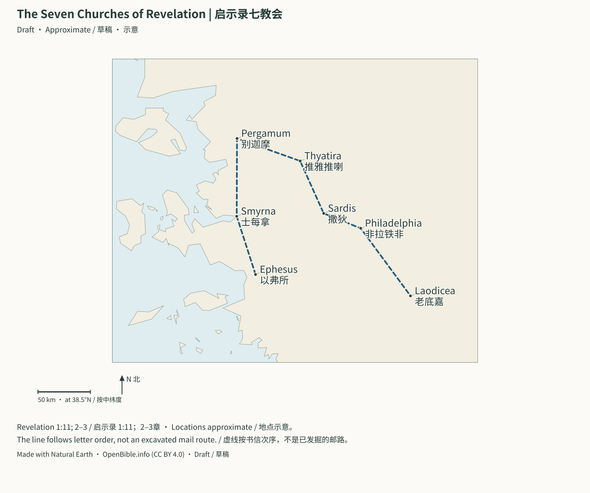

# Maps | 地图

> Status: Draft (AI draft; not human reviewed) | 状态：Draft（AI 草稿，未人工审阅）

## Map Index | 地图索引

These locally generated maps support reading the Bible’s story, the Gospels, Acts, and Revelation. They work without internet access, map tiles, scripts, or downloaded fonts. On a narrow screen, scroll inside the map or open its SVG link at full size. / 本地生成的地图辅助圣经故事线、福音书、使徒行传与启示录阅读，不需要网络、地图瓦片、脚本或下载字体。窄屏可在图内横向滚动，或打开完整 SVG。

| Map / 地图 | Read alongside / 配套阅读 |
| --- | --- |
| [Palestine in the Time of Jesus / 耶稣时代的巴勒斯坦](../assets/maps/palestine-jesus.svg) | [New Testament Timeline / 新约时间线](../Bible_Timeline/New_Testament_Timeline_Bilingual.md#gospel-map) |
| [Paul's Missionary Journeys / 保罗的宣教旅程](../assets/maps/paul-journeys.svg) | [Acts and Paul / 使徒行传与保罗书信](../Bible_Timeline/使徒行传与保罗书信_旅程年代与城市史料对照.md#journey-map) |
| [Jerusalem in the Time of Jesus / 耶稣时代的耶路撒冷](#map-jerusalem-jesus) | [Related study / 配套研究](../Bible_Timeline/两约之间至四福音_第二圣殿与罗马背景.md#map-jerusalem-jesus) |
| [Abraham’s Journey / 亚伯拉罕的旅程](#map-abraham-journey) | [Related study / 配套研究](../Bible_Timeline/摩西五经_历史背景与证据边界.md#map-abraham-journey) |
| [Exodus: Two Route Models / 出埃及：两种路线模型](#map-exodus-models) | [Related study / 配套研究](../Bible_Timeline/摩西五经_历史背景与证据边界.md#map-exodus-models) |
| [The Divided Kingdoms / 王国分裂：北国与南国](#map-divided-kingdoms) | [Related study / 配套研究](../Bible_Timeline/分裂王国至归回_帝国史料与逐事件对照.md#map-divided-kingdoms) |
| [Empires in the Exile Story / 被掳时期的帝国](#map-exile-empires) | [Related study / 配套研究](../Bible_Timeline/分裂王国至归回_帝国史料与逐事件对照.md#map-exile-empires) |
| [The Seven Churches of Revelation / 启示录七教会](#map-seven-churches) | [Related study / 配套研究](../Bible_Timeline/希伯来书至启示录_晚期新约与七教会背景.md#map-seven-churches) |

## Gospel Geography | 福音书地理

Galilee / 加利利; Samaria / 撒玛利亚; Judaea / 犹太; Perea / 比利亚; Decapolis area / 低加波利区域. Selected places include Nazareth / 拿撒勒, Bethlehem / 伯利恒, Capernaum / 迦百农, Jerusalem / 耶路撒冷, and Jericho / 耶利哥.

**Approximate / 示意:** Colored envelopes are teaching sketches, not surveyed administrative borders. The Decapolis was a network of cities, including Scythopolis west of the Jordan, rather than one continuous province. Cana has competing identifications; the plotted point follows the selected legacy dataset and is not a verdict on that debate. Modern lake and coastal outlines do not reconstruct first-century shorelines. / 色块是教学示意范围，不是测绘的行政边界。低加波利是包括约旦河西斯基泰城在内的城邦网络，并非连续行省。迦拿有不同候选位置，图中采用所选旧数据的代表点，不裁定争议。现代湖岸及海岸轮廓不重建一世纪岸线。

## Paul's Journeys | 保罗的旅程

| Route / 路线 | Line style / 线型 | Text / 经文 |
| --- | --- | --- |
| First journey / 第一次 | Solid / 实线 | Acts 13–14 / 使徒行传 13–14 |
| Second journey / 第二次 | Dashed / 虚线 | Acts 15:36–18:22 / 徒 15:36–18:22 |
| Third journey / 第三次 | Dotted / 点线 | Acts 18:23–21:16 / 徒 18:23–21:16 |
| Voyage to Rome / 前往罗马 | Dash-dot / 点划线 | Acts 27–28 / 使徒行传 27–28 |

**Approximate / 示意:** Lines connect selected named places rather than reconstructing ancient roads or exact sea tracks. The route through Phrygia and Galatia and the identification of Derbe remain debated; omitted intermediate stops are not claims that Paul bypassed them. The Malta point represents the island, not an identified shipwreck site; its landing bay and the exact storm-driven track are uncertain. / 连线连接选定地点，不重建古道或精确航迹。弗吕家与加拉太的经过路线、特庇的遗址认定仍有争议；省略中途地点不代表保罗未曾经过。马耳他点只代表岛屿，不是已确认的沉船点；登陆湾及风暴中的精确航迹仍不确定。

## Jerusalem in the Time of Jesus | 耶稣时代的耶路撒冷

The Temple Mount outline and Kidron course are teaching sketches. A marks the Holy Sepulchre tradition; B the Skull Hill/Garden Tomb vicinity; C the Taylor proposal recorded by OpenBible. These proposals do not have equal evidential support, and a point does not identify a particular tomb.
圣殿山范围与汲沦溪谷走向是教学示意。A为圣墓教堂传统地点，B为髑髅山／花园墓附近，C为OpenBible收录的Taylor提议。各提议的证据支持并不相等，坐标也不能识别某一座墓穴。

**Sources | 来源：** [Holy Sepulchre custodians / 圣墓教堂管理方](https://www.custodia.org/en/sanctuaries/basilica-of-the-holy-sepulchre/) · [Garden Tomb association / 花园墓管理方](https://gardentomb.com/about/) · [Credits | 署名](../CREDITS.md#batch2-map-data)

[Open full SVG | 打开完整SVG](../assets/maps/jerusalem-jesus.svg)

## Abraham’s Journey | 亚伯拉罕的旅程

Genesis 11:31–13:18 supplies the named sequence. Southern Ur is one identification; the northern alternatives are not plotted here. Egypt is a regional marker because the narrative does not name a campsite there. Lines are original connections, not established roads, and the patriarchal date range is disputed.
创世记11:31–13:18提供所列地点顺序。图中采用南部吾珥这一认定，未画北部候选点。叙事没有指明埃及的停留地，所以只标区域。连线是原创示意，不是已确认古道；族长年代区间仍有争议。

**Sources | 来源：** [Coordinate sources and limits / 坐标来源与限制](../CREDITS.md#batch2-map-data) · [Credits | 署名](../CREDITS.md#batch2-map-data)

[Open full SVG | 打开完整SVG](../assets/maps/abraham-journey.svg)

## Exodus: Two Route Models | 出埃及：两种路线模型

Routes AND locations are disputed. A illustrates a southern-Sinai route family associated with the Jebel Musa tradition; B connects locations around Anati’s published Har Karkom hypothesis. The lines are editorial sketches, not a tracing of either author’s maps or a claim to reproduce a published itinerary. Har Karkom’s proposed chronology is different from the fifteenth/thirteenth-century models; this diagram does not resolve that disagreement or the sea crossing.
路线和地点均有争议。A示意与穆萨山传统相连的南部西奈路线族，B围绕Anati发表的Har Karkom假说连接地点。连线为自行绘制的教学草图，没有描摹学者地图，也不声称精确复现其出版行程。Har Karkom提议的年代不同于前十五／十三世纪模型；本图不解决年代或渡海地点争议。

**Sources | 来源：** [Hoffmeier, Ancient Israel in Sinai (2005), chapters 4–7 / 相关研究](https://academic.oup.com/book/36060) · [Anati’s research account / Anati研究说明](https://www.harkarkom.com/SinaiDiscoveries.php?more=all) · [Credits | 署名](../CREDITS.md#batch2-map-data)

[Open full SVG | 打开完整SVG](../assets/maps/exodus-models.svg)

## The Divided Kingdoms | 王国分裂：北国与南国

The shading is a broad ninth-century teaching envelope, not a precise frontier or the borders at the instant of division. Samaria belongs to the later northern capital phase; Tirzah marks an earlier center. Northern Israel and southern Judah changed in extent over time, and the eastern territories are not reconstructed in detail.
色块是前九世纪的大致教学范围，不是精确边界，也不是王国刚分裂时的疆界。撒玛利亚属于北国后期都城阶段，得撒标记较早中心。北国以色列与南国犹大的范围不断变化，约旦河东的领地未作详细重建。

**Sources | 来源：** [Coordinate sources and limits / 坐标来源与限制](../CREDITS.md#batch2-map-data) · [Credits | 署名](../CREDITS.md#batch2-map-data)

[Open full SVG | 打开完整SVG](../assets/maps/divided-kingdoms.svg)

## Empires in the Exile Story | 被掳时期的帝国

Three separate panels show broad Neo-Assyrian, Neo-Babylonian and Achaemenid Persian teaching extents around 650, 600 and 500 BCE. They are not simultaneous borders, maximum conquests, or measurements of continuous control. Nineveh, Babylon, Susa and Jerusalem anchor the comparison. The shapes are original regional sketches informed by historical descriptions, not copied historical boundary datasets.
三个分图分别示意约前650、600、500年的新亚述、新巴比伦和阿契美尼德波斯大致范围。它们不是同时存在的国界，不是最大征服范围，也不衡量持续控制。尼尼微、巴比伦、苏萨与耶路撒冷用于定位比较。色块根据历史文字说明自行绘制，未复制历史边界数据库。

**Sources | 来源：** [Met: Assyria / 大都会博物馆亚述资料](https://www.metmuseum.org/exhibitions/listings/2014/assyria-to-iberia) · [Met: Achaemenid Persia / 波斯资料](https://www.metmuseum.org/essays/the-achaemenid-persian-empire-550-330-b-c) · [Credits | 署名](../CREDITS.md#batch2-map-data)

[Open full SVG | 打开完整SVG](../assets/maps/exile-empires.svg)

## The Seven Churches of Revelation | 启示录七教会

Revelation 1:11 and chapters 2–3 provide the seven names and order. The dashed line is a reading-order connection, not an excavated mail route. Modern archaeological sites help locate ancient cities but do not establish interpretations of Revelation’s visions.
启示录1:11及二至三章提供七个名称与次序。虚线按阅读次序连接，不是已经发掘的邮路。现代遗址帮助定位古城，但不能证明对启示录异象的某种解释。

**Sources | 来源：** [Coordinate sources and limits / 坐标来源与限制](../CREDITS.md#batch2-map-data) · [Credits | 署名](../CREDITS.md#batch2-map-data)

[Open full SVG | 打开完整SVG](../assets/maps/seven-churches.svg)

## One-Page Storyline | 一页故事线

[Read First Steps | 阅读第一步](../Bible_Timeline/First_Steps_Bilingual.md) · [Open full SVG | 打开完整SVG](../assets/maps/bible-storyline.svg)

## Sources and Reproduction | 来源与重现

Made with Natural Earth (public domain) and selected OpenBible.info coordinates (CC BY 4.0); the seven modern OSM-derived points also retain ODbL 1.0 attribution and database terms. Labels, teaching envelopes, routes, and layout were assembled for this library without copying or tracing a published map. See [Credits and Licenses](../CREDITS.md#map-data) for source links, changes, and attribution. / 底图为公有领域 Natural Earth，选用 OpenBible.info 的 CC BY 4.0 坐标；七个源自 OSM 的现代点另保留 ODbL 1.0 署名与数据库条款。双语标注、教学范围、路线与版面为本资料库自行组合，没有复制或描摹出版地图；来源、修改及署名见[资料与授权](../CREDITS.md#map-data)。

Regenerate with the standard-library command `python3 scripts/generate_maps.py`; verify with `python3 scripts/generate_maps.py --check`. The committed geographic subsets make this repeatable offline. / 用上述标准库命令重新生成或检查；已提交的地理子集让重现过程可以完全离线。

[Back to Project Covenant | 返回首页](../README.md)
